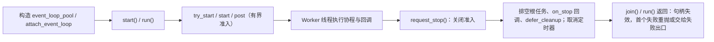
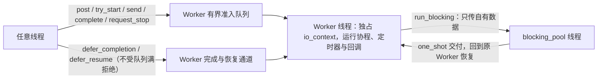

# `ruvia::core` 运行时 API 手册

`ruvia-core`（CMake target `ruvia::core`）是 Ruvia 的独立运行时底座：惰性协程任务、Worker 事件循环、有界投递、停止令牌、超时与定时器、跨线程通道、单次交付、槽位租约、阻塞卸载池与失败上报。它不含 HTTP、TLS、Web 或数据后端语义，可脱离 `ruvia::http` 与 `ruvia::web` 单独使用。

本手册以 `ruvia-core/CMakeLists.txt` 中 `ruvia_install_public_headers(core ...)` 的安装集合为唯一范围，逐头列出全部非 `detail` 公开 API。所有符号位于 `namespace ruvia`；`ruvia::detail` 中的符号不是公开契约，即使出现在安装头中。

## 目录

- [1. 定位与接入](#1-定位与接入)
  - [1.1 职责边界](#11-职责边界)
  - [1.2 CMake 接入、依赖与公开编译定义](#12-cmake-接入依赖与公开编译定义)
  - [1.3 最短接入](#13-最短接入)
  - [1.4 公开头总览](#14-公开头总览)
- [2. 运行模型与通用契约](#2-运行模型与通用契约)
  - [2.1 Worker 亲和与跨线程边界](#21-worker-亲和与跨线程边界)
  - [2.2 惰性任务与冷操作](#22-惰性任务与冷操作)
  - [2.3 同线程延迟唤醒](#23-同线程延迟唤醒)
  - [2.4 输入拥有化与借用](#24-输入拥有化与借用)
  - [2.5 错误模型](#25-错误模型)
  - [2.6 成功、错误、取消与回收](#26-成功错误取消与回收)
  - [2.7 超时与取消输入](#27-超时与取消输入)
  - [2.8 内存与分配器](#28-内存与分配器)
- [3. 协程与任务](#3-协程与任务)：`task.h`、`task_scope.h`、`asio_bridge.h`、`operation_scope.h`
- [4. 事件循环与 Worker](#4-事件循环与-worker)：`event_loop.h`、`worker_ref.h`、`worker_runtime.h`、`failure_report.h`
- [5. 投递结果与可调用包装](#5-投递结果与可调用包装)：`delivery_result.h`、`move_only_function.h`
- [6. 取消、时长与定时](#6-取消时长与定时)：`stop_token.h`、`timeout_duration.h`、`operation_options.h`、`worker_timer.h`、`worker_cancellation.h`
- [7. Worker 等待原语](#7-worker-等待原语)：`wait_result.h`、`channel.h`、`one_shot.h`、`worker_signal.h`、`pool_lease.h`、`worker_wait.h`、`suspend_race.h`、`waiter_list.h`
- [8. 阻塞卸载](#8-阻塞卸载)：`blocking_pool.h`
- [9. 字节视图](#9-字节视图)：`byte_view.h`
- [10. 示例索引](#10-示例索引)

---

## 1. 定位与接入

### 1.1 职责边界

- **负责**：协程 `task<T>` 与结构化任务域、单线程 Worker 与 standalone Asio 事件循环、有界准入投递、停止令牌与截止期、单 Worker 定时器、跨线程通道与单次交付、槽位租约、阻塞卸载池、mimalloc 线程堆收集与无主失败上报。
- **不负责**：HTTP 协议与编解码（见 [ruvia-http.md](ruvia-http.md)）；服务器、路由、出站客户端、数据库、Redis 与生产应用的 Share-Nothing Worker 拓扑（见 [ruvia-web.md](ruvia-web.md)）。
- **依赖方向**：`ruvia::web` 复用本库的事件循环、协程与租约；`ruvia::http` 不依赖本库。
- **头文件**：公开头平铺安装在 `${CMAKE_INSTALL_INCLUDEDIR}` 下，以 `#include "task.h"` 形式包含。

### 1.2 CMake 接入、依赖与公开编译定义

```cmake
find_package(ruvia REQUIRED COMPONENTS core)
target_link_libraries(my_tool PRIVATE ruvia::core)
```

构建开关、vcpkg 工具链与安装流程见 [README.md](README.md)。`ruvia::core` 对使用方传播以下契约：

| 项目 | 值 | 契约 |
| --- | --- | --- |
| 语言标准 | `cxx_std_20` | PUBLIC 编译特性 |
| 公开依赖 | `asio::asio`（standalone Asio）、`Threads::Threads` | 使用方无需另行链接 |
| 编译定义 `ASIO_STANDALONE` | PUBLIC | 使用 standalone Asio |
| 编译定义 `ASIO_NO_DEPRECATED` | PUBLIC | 禁用 Asio 弃用接口 |
| 编译定义 `ASIO_DISABLE_SMALL_BLOCK_RECYCLING` | PUBLIC | 关闭 Asio 处理器小块缓存，分配复用只归 mimalloc |
| 编译定义 `ASIO_DISABLE_AWAITABLE_FRAME_RECYCLING` | PUBLIC | 关闭 Asio awaitable 帧缓存 |
| Windows 链接 | PUBLIC `ws2_32`、`mswsock` | 静态 CRT（`MultiThreaded$<$<CONFIG:Debug>:Debug>`）与普通 mimalloc 依赖 |
| 非 Windows 分配器 | 必须存在 `STATIC_LIBRARY` 类型的 `mimalloc-static` | 以 `WHOLE_ARCHIVE` 链接并启用 mimalloc `override`；缺失时配置失败 |

- **编译定义一致**：凡包含 Asio 的翻译单元都必须看到上述四个定义，不得在使用方取消或改写。
- **Sanitizer 构建**：检测到 `-fsanitize=address|thread|memory|hwaddress` 时 mimalloc 以普通归档链接，由 sanitizer 接管分配。
- **公开宏**：本 target 的公开头不定义任何项目宏；唯一的条件编译是 `_WIN32` 下的 [`worker_runtime::prepare_thread_join`](#api-worker-runtime-h)。

### 1.3 最短接入

**自管线程池**：`event_loop_pool` 拥有 Worker 线程，`root_task` 在其他线程等待结果。

```cpp
#include "event_loop.h"
#include "worker_timer.h"

ruvia::event_loop_pool pool({.loop_count_ = 2, .queue_capacity_ = 1024});
pool.start();

ruvia::event_loop loop = pool.next_loop();
auto root = loop.start([](ruvia::worker_ref worker) -> ruvia::task<int> {
    (void)co_await ruvia::sleep_for(worker, std::chrono::milliseconds(10));
    co_return 42;
}(loop.worker()));

int answer = std::move(root).get();
pool.join();
```

**挂载外部 `io_context`**：调用方拥有 context 与线程，根任务结束时请求退役，`run()` 在退役与调用方自身工作完成后返回。

```cpp
#include "event_loop.h"

ruvia::task<void> run(ruvia::event_loop_attachment& attachment) {
    // ... 业务协程 ...
    attachment.request_stop();
    co_return;
}

asio::io_context context(asio::config_from_concurrency_hint(ASIO_CONCURRENCY_HINT_UNSAFE_IO));
auto attachment = ruvia::attach_event_loop(context);
auto root = attachment.loop().start(run(attachment));
attachment.run();
std::move(root).get();
```

生命周期主链：



### 1.4 公开头总览

| 公开头 | 领域 | 公开符号 | 章节 |
| --- | --- | --- | --- |
| `task.h` | 协程 | `task`、`task_awaiter` | [3.1](#api-task-h) |
| `task_scope.h` | 结构化并发 | `task_scope`、`task_scope::join_operation` | [3.2](#api-task-scope-h) |
| `asio_bridge.h` | Asio 互操作 | `task_completion_result`、`async_start`、`as_awaitable` | [3.3](#api-asio-bridge-h) |
| `operation_scope.h` | 宿主操作域 | 仅 `detail` | [3.4](#api-operation-scope-h) |
| `event_loop.h` | 事件循环 | `root_task`、`event_loop_start_rejected`、`event_loop_start_result`、`event_loop_stop_registration`、`event_loop`、`event_loop_attachment_options`、`event_loop_attachment`、`attach_event_loop`、`event_loop_pool_options`、`event_loop_pool` | [4.1](#api-event-loop-h) |
| `worker_ref.h` | 派发端点 | `worker_id_type`、`worker_selection_hash`、`worker_ref` | [4.2](#api-worker-ref-h) |
| `worker_runtime.h` | 底层 Worker 生命周期 | `worker_runtime_state`、`worker_io_policy`、`worker_runtime_options`、`worker_runtime_hooks`、`worker_runtime`、`worker_group`、`collect_thread_heap` | [4.3](#api-worker-runtime-h) |
| `failure_report.h` | 失败文本与上报 | `error_code_text`、`system_error_text`、`report_unhandled_failure`、`equivalent_failures` | [4.4](#api-failure-report-h) |
| `delivery_result.h` | 投递结果 | `delivery_result`、`post_status`、`post_outcome` | [5.1](#api-delivery-result-h) |
| `move_only_function.h` | 可调用包装 | `move_only_function` | [5.2](#api-move-only-function-h) |
| `stop_token.h` | 取消 | `stop_registration`、`stop_token`、`stop_source`、`stop_group` | [6.1](#api-stop-token-h) |
| `timeout_duration.h` | 时长 | `saturating_duration_cast`、`timeout_duration`、`deadline_after`、`ceil_milliseconds` | [6.2](#api-timeout-duration-h) |
| `operation_options.h` | 操作上限 | `operation_timeout`、`operation_options`、`override_operation_options`、`linked_operation_options`、`operation_deadline`、`deadline_lifecycle` | [6.3](#api-operation-options-h) |
| `worker_timer.h` | 定时器与睡眠 | `worker_timer_cancellation`、`worker_timer_outcome`、`worker_timer_registration`、`wait_bounds`、`timer_sleep_result`、`sleep_for`、`sleep_until`、`sleep_operation` | [6.4](#api-worker-timer-h) |
| `worker_cancellation.h` | 跨线程取消投递 | `worker_cancellation_target`、`make_worker_cancellation_target`、`worker_cancellation_dispatch`、`worker_cancellation_post`、`worker_cancellation_post_is_inline`、`worker_cancellation_registration` | [6.5](#api-worker-cancellation-h) |
| `wait_result.h` | 等待结果 | `wait_status`、`wait_result` | [7.1](#api-wait-result-h) |
| `channel.h` | 有界 MPSC 通道 | `channel_send_status`、`channel_options`、`channel_send_result`、`channel_send_operation`、`channel_sender`、`channel_receiver`、`make_channel` | [7.2](#api-channel-h) |
| `one_shot.h` | 单次交付 | `one_shot_complete_status`、`one_shot_complete_result`、`one_shot_completion`、`one_shot_receiver`、`make_one_shot` | [7.3](#api-one-shot-h) |
| `worker_signal.h` | 同 Worker 通知 | `worker_signal`、`worker_signal::wait_operation` | [7.4](#api-worker-signal-h) |
| `pool_lease.h` | 槽位租约 | `pool_lease_scheduler`、`pool_lease_acquire` | [7.5](#api-pool-lease-h) |
| `worker_wait.h` | 等待原语构件 | `worker_wait_slot`、`worker_single_wait_awaiter`、`worker_shutdown_registered`、`worker_wait_state`、`make_worker_wait_state` | [7.6](#api-worker-wait-h) |
| `suspend_race.h` | 挂起竞争裁决 | 仅 `detail` | [7.7](#api-suspend-race-h) |
| `waiter_list.h` | 侵入式等待队列 | 仅 `detail` | [7.8](#api-waiter-list-h) |
| `blocking_pool.h` | 阻塞卸载 | `blocking_pool_options`、`blocking_pool_stats`、`blocking_pool`、`blocking_status`、`describe_blocking_status`、`blocking_operation_rejected`、`blocking_result`、`run_blocking` | [8.1](#api-blocking-pool-h) |
| `byte_view.h` | 字节视图 | `as_bytes`、`as_chars` | [9.1](#api-byte-view-h) |

---

## 2. 运行模型与通用契约

本章是各头文件小节共享的唯一规则来源；第 3–9 章只记录各 API 的特有契约。

### 2.1 Worker 亲和与跨线程边界



- **Worker**：一个线程驱动一个 `asio::io_context`；`worker_ref` 是指向它的可复制稳定派发端点，不拥有 context。
- **单线程单 Worker**：一个线程不能同时运行两个 Ruvia Worker，否则抛 `std::logic_error`。
- **Worker 亲和操作**：`task_scope`、`worker_signal`、`sleep_for` / `sleep_until`、`channel_receiver::receive`、`one_shot_receiver::wait`、`pool_lease_scheduler`、`run_blocking`、`worker_timer_registration::schedule` 必须在绑定 Worker 线程上创建或启动；违反时抛 `std::logic_error`（各节注明的终止情形除外）。
- **跨线程安全入口**：`worker_ref` 的投递与延迟方法、`event_loop` 的启动/上报/清理/停机注册、`channel_sender::send` / `close`、`one_shot_completion::complete`、`stop_source::request_stop`、`blocking_pool::post`、`event_loop_pool::request_stop`、`event_loop_attachment::request_stop`，以及非本循环线程上的 `root_task::wait` / `get`。
- **跨线程数据**：只传独立所有权数据或不可变快照；不得把 Worker 局部状态的引用交给其他线程。
- **停止回调线程**：停止回调在请求停止的线程执行；影响 Worker 状态时只投递操作 id / 代际，由 Worker 自行校验（见 [`worker_cancellation.h`](#api-worker-cancellation-h)）。
- **阻塞卸载**：阻塞或 CPU 密集型调用必须经 [`run_blocking`](#api-blocking-pool-h) 卸载；闭包按值或移动拥有全部输入，严禁访问 Worker 局部状态。Web 请求上下文的封装入口见 [ruvia-web.md](ruvia-web.md#api-context-h)。
- **锁外执行**：用户回调、负载移动与析构均在内部互斥锁外执行；[`worker_wait_slot`](#api-worker-wait-h) 的组合协议是唯一要求调用方持锁的公开构件。

### 2.2 惰性任务与冷操作

**任务状态**：

| 状态 | 进入方式 | 可直接析构 | 说明 |
| --- | --- | --- | --- |
| 空 | 被移动后的源 | 是 | `co_await` 抛 `std::logic_error` |
| 冷（cold） | 调用协程函数 | 是 | 已分配帧，函数体未执行；析构销毁帧与已移入的参数 |
| 已启动（started） | `co_await std::move(t)`、`event_loop::try_start` / `start`、`task_scope::spawn`、`async_start` / `as_awaitable` | 否：析构触发 `std::terminate()` | 必须运行到完成 |
| 已完成 | 协程到达 `final_suspend` | 是 | 结果被提取后帧随宿主回收 |

- **协作式取消**：取消只能经停止令牌、`task_scope::request_stop()` 或 `operation_options::stop_token_` 请求；请求后仍必须 `co_await` 或 `join` 等待任务退出。
- **放弃根任务**：析构未 `get()` 的 `root_task` 不销毁挂起帧，事件循环继续拥有任务直到完成，未观察的失败交给循环失败出口。
- **宿主绑定任务**：Web 请求、客户端等宿主返回的冷任务可能绑定其操作域，宿主结束后的规则见 [`operation_scope.h`](#api-operation-scope-h)。
- **冷操作等待物**：`task_scope::join_operation`、`sleep_operation`、`channel_receiver::receive_operation`、`channel_send_operation`、`one_shot_receiver::wait_operation`、`worker_signal::wait_operation`、`pool_lease_acquire` 遵循同一规则：
  - **单次**：只能 `co_await` 一次，第二次抛 `std::logic_error`。
  - **移动**：仅启动前可移动；移动已启动的等待物触发 `std::terminate()`。
  - **取址**：一元 `operator&` 已删除，防止保存已发布的等待物地址。
  - **丢弃**：未启动即析构不消费数据、不进入等待队列；`worker_signal` 的冷等待在析构前占用信号，见 [7.4](#api-worker-signal-h)。
  - **启动**：`co_await` 时才检查亲和、读取状态并开始计时；可具名保存后再 `co_await op;`。

### 2.3 同线程延迟唤醒

同一 Worker 上的挂起等待通常经完成通道投递到**后续事件循环轮次**；触发方的调用栈先返回，连续释放、关闭或通知不会形成递归链。

| 事件源 | 唤醒方式 |
| --- | --- |
| `channel_sender::send` / `close`、接收方释放槽位、Worker 停机 | 接收方或等待发送方经各自 Worker 的 `defer_resume` 恢复 |
| `one_shot_completion::complete`、`one_shot_receiver::close` | 等待方经绑定 Worker 的 `defer_resume` 恢复 |
| `pool_lease_scheduler::release` / `close` | 在调用返回前提交槽位或 `closed`，协程在后续轮次恢复 |
| `worker_signal::notify` | 摘下全部等待者，逐个在后续轮次恢复 |
| `task_scope` 子任务完成 | 在后续轮次结算失败、回收帧；最后一个子任务结算后，另行投递已挂起的 `join`。若外部循环已解除挂载，则在当前的子任务结算轮次完成 `join` |
| 停止令牌触发（等待已挂起） | 在请求线程持锁提交 `cancelled`，恢复经绑定 Worker 延迟执行 |
| 通道收发、`one_shot` 接收、连接池租约获取超时 | 先摘除等待者并提交 `timed_out`，再在绑定 Worker 的后续轮次恢复 |
| `worker_timer_registration::cancel_and_notify` | 在 Worker 自身线程调用时投递完成回调，不重入 |
| `worker_ref::defer_completion` | 后续轮次执行，不内联 |

- **直接恢复例外**：`co_await task` 以对称转移启动子任务，子任务完成后直接恢复等待方。
- **无需挂起**：`await_ready` 已能裁决的结果（数据就绪、已关闭、已取消、已过期）直接完成，不挂起也不跳转轮次。
- **顺序**：同一线程发出的 `defer_resume` 按请求顺序执行；不同线程之间无顺序。
- **运行义务**：事件循环在执行前被销毁时，已投递的恢复被丢弃、协程永不恢复；Worker 必须运行到其准入的全部操作完成。

### 2.4 输入拥有化与借用

- **协程参数**：`task` 协程的按值参数在调用时移入协程帧，冷任务也拥有它们；引用参数与协程 lambda 的捕获只被借用，必须存活到任务完成。协程 lambda 不应带捕获，输入改用按值参数传入（见 [1.3](#13-最短接入)）。
- **入口拥有化**：跨越挂起点的公开异步入口在返回冷操作前拥有其输入：`run_blocking` 按值持有 `worker_ref`、`fn` 与 `operation_options`；`channel_sender::send_wait` 持有待发送值；`pool_lease_scheduler::acquire` 复制 `operation_options`。
- **转发边界**：无额外语义的任务转发直接返回底层 `task`；跨挂起保活、取消绑定、RAII、异常收敛与结果转换仍保留必要的协程帧。
- **借用宿主**：以下 API 只借用调用方提供的宿主，宿主必须地址稳定并覆盖借用期；临时量入口一律 `= delete`。

| API | 借用对象 | 已删除的入口 |
| --- | --- | --- |
| `task_scope(const worker_ref&)` | `worker_ref`，覆盖作用域寿命 | `task_scope(worker_ref&&)`、`task_scope(const worker_ref&&)` |
| `worker_signal(const worker_ref&)` | `worker_ref`，覆盖信号寿命 | `worker_signal(worker_ref&&)`、`worker_signal(const worker_ref&&)` |
| `sleep_for` / `sleep_until` | `worker_ref`，覆盖返回的 `sleep_operation` | 两个函数各自的 `worker_ref&&` 与 `const worker_ref&&` 重载 |
| `worker_timer_registration::schedule` | `worker_ref`，覆盖注册寿命 | `worker_ref&&` 与 `const worker_ref&&` 重载 |
| `wait_bounds::start` | `worker_ref`，直到 `wait_bounds` 析构 | — |
| `pool_lease_acquire` | 其 `pool_lease_scheduler` | `acquire(...) &&` |
| `channel_receiver::receive`、`one_shot_receiver::wait` | 接收端（接收端销毁即关闭等待） | `receive(...) const&&`、`wait(...) const&&` |
| `channel_sender::send_wait` | — | `send_wait(...) const&&` |
| `event_loop::worker() const&` | 返回循环内部端点的引用 | 右值 `worker() const&&` 改为返回副本 |
| `linked_operation_options::options()` | 返回内部选项的引用 | `options() const&&` |
| `worker_cancellation_registration` | `shared_ptr` 所指目标 | 以 `shared_ptr&&` / `const shared_ptr&&` 构造 |
| `as_bytes` / `as_chars` | 底层字符或字节存储 | 临时拥有型字符串 / 连续字节容器 |

- **左值限定宿主**：`task_scope`、`worker_runtime`、`delivery_result`、`wait_result`、`blocking_result`、`root_task` 等以 `&` / `const&` 暴露借用访问，并删除右值重载；右值只经 `take_*()` / `get() &&` 提取。各节“已删除重载”列出完整清单。

### 2.5 错误模型

| 类别 | 形状 | 示例 |
| --- | --- | --- |
| 正常推进、背压与终止状态 | 状态枚举 / 结果类型，拒绝时退回未消费负载 | `post_status::queue_full`、`channel_send_status::full`、`one_shot_complete_status::in_progress`、`wait_status::closed`、`blocking_status::timed_out`、`timer_sleep_result::stop_requested` |
| 本地参数或配置错误 | `std::invalid_argument`、`std::length_error`、`std::out_of_range` | 零容量通道、零队列容量、空可调用对象、非正 `operation_timeout`、无效 `worker_ref`、越界 `event_loop_pool::loop(index)` |
| 时序或亲和误用 | `std::logic_error` | 不在绑定 Worker 上启动、重复 `co_await`、在自身 Worker 上 `join()`、启动空 `task` |
| 停机期间注册新状态 | `std::runtime_error` | 在已停止接收的 Worker 上 `make_channel` / `make_one_shot` / `on_stop` |
| 严格入口的拒绝 | 专用异常 | `event_loop_start_rejected`、`blocking_operation_rejected` |
| 任务或回调自身的异常 | 原样保存并在消费点重抛 | `co_await`、`root_task::get`、`task_scope::join`、`blocking_result::value` |
| 分配失败 | `std::bad_alloc` | 协程帧、状态块、超出内联存储的可调用对象 |
| 生命周期违约 | `std::terminate()` | 销毁已启动未完成的 `task`、移动已启动的等待物、销毁仍有活动子任务的 `task_scope`、调用空 `move_only_function`、停止回调抛出异常 |
| 无主失败 | [`report_unhandled_failure`](#api-failure-report-h) | 被放弃根任务在无失败出口时、`task_scope` 未 join 的子任务失败、未 join 池的析构 |

- **投递回调失败**：经 `post` / `defer_completion` 投递到 Worker 的回调若抛出异常，即为该 Worker 的运行时失败；失败交给其失败出口（池、挂载或 `worker_runtime` 钩子），Worker 停止接收，队列中尚未执行的回调被销毁而不调用。

### 2.6 成功、错误、取消与回收

| 原语 | 成功 | 错误 | 取消 / 超时 / 停机 | 回收 |
| --- | --- | --- | --- | --- |
| `co_await task<T>` | 返回 `T` | 重抛协程异常 | 仅协作式 | 结果移出后，`co_await` 表达式结束时回收帧 |
| `async_start` | 处理器收到值 | 处理器收到 `std::exception_ptr` | 仅协作式 | 帧与操作状态先回收，再调用处理器 |
| `root_task<T>` | `get() &&` 返回 `T` | 重抛；已准入但因停机未运行时为 `event_loop_start_rejected(stopping)` | 放弃后循环继续运行 | 共享状态由句柄与循环共同持有，`get()` 提取后释放值 |
| `task_scope` | `join` 正常返回 | 重抛首个子任务失败，其余不等价失败上报 | 首个失败自动 `request_stop()` | 子任务帧在结算轮次回收，先于 `join` 恢复 |
| `channel` 接收 | `wait_result` 持值 | 负载移动异常从 `co_await` 抛出，槽位归还 | `closed` / `worker_stopping` / `timed_out` / `cancelled` | 值移出后槽位立即归还；`close()` 在调用线程销毁缓冲值 |
| `channel` 发送 | `sent` | 负载移动异常抛出，预留槽位归还 | `full` / `closed` / `worker_stopping` / `timed_out` / `cancelled`，均退回值 | 未交付值经结果退回调用方 |
| `one_shot` | `completed`；等待方取得值 | 构造值失败抛出且可重试；接收端移动失败时异常交给接收端，值视为已消费 | `already_completed` / `in_progress` / `receiver_closed` / `worker_stopping`；等待 `closed` / `worker_stopping` / `timed_out` / `cancelled` | 接收端关闭时销毁未消费值 |
| `sleep_operation` | `elapsed` | 误用抛 `std::logic_error` | `stop_requested` | 定时器注册随操作析构 |
| `pool_lease_acquire` | 槽位下标 | 误用抛 `std::logic_error` | `closed` / `cancelled` / `worker_stopping` / `timed_out` | 槽位由调用方 `release()` 归还 |
| `run_blocking` | `blocking_result` 持值 | 结果 `failed()`，`value()` 重抛 | `queue_full` / `pool_stopped` / `worker_stopping` / `cancelled` / `timed_out` / `unavailable` | 迟到结果在池线程上丢弃 |
| `worker_signal` 等待 | 返回 | 误用抛 `std::logic_error` | 无取消；必须由 `notify()` 完成 | 信号析构前所有等待必须完成 |

### 2.7 超时与取消输入

- **唯一入参**：有上限的操作以末位 `operation_options options = {}` 作控制参数，没有截止期平行重载；参数顺序为 `(worker, 对象…, 控制)`。适用：`channel_receiver::receive`、`channel_sender::send_wait`、`one_shot_receiver::wait`、`pool_lease_scheduler::acquire`、`run_blocking`、`worker_single_wait_awaiter`。
- **上限与目标**：上限（bound）一律是 [`operation_timeout`](#api-operation-options-h)，非正相对值在构造时即抛 `std::invalid_argument`；睡眠时长是目标（target）而非上限，`sleep_for` / `sleep_until` 末位为 `stop_token = {}`，非正时长立即 `elapsed`。
- **计时起点**：相对上限自 `co_await` 启动计时；绝对截止期原样使用，可与调用方其他阶段共享。
- **已取消 / 已过期**：已过期的绝对截止期不是错误。接收与等待已有可交付结果时仍优先交付，无结果才以 `cancelled` / `timed_out` 结束；准入型操作 `channel_sender::send_wait` 与 `run_blocking` 则在预留槽位或投递工作前检查启动时已请求的取消与已过期的截止期，拒绝新工作。
- **嵌套预算**：已启动操作把剩余预算交给嵌套操作时传 `{.timeout_ = deadline.timeout()}`（同一绝对截止期），不重新折算为相对时长。
- **合并**：`override_operation_options` 只收紧上限并以显式 token 替换原 token；合并时仅复制实际继承的 token，覆盖值直接移入。累计取消只经 `linked_operation_options`。出站客户端的 `with_options` 沿用同一规则，见 [ruvia-web.md](ruvia-web.md#api-http-client-h)。
- **配置时长**：配置输入（超时、心跳、探活）使用 [`timeout_duration`](#api-timeout-duration-h)；未配置用 `std::nullopt` 表示，零或负值不能代替未配置。缓存 TTL、会话有效期与限流窗口不属于该契约。
- **显式解包**：`timeout_duration` 读取计数用 `.value().count()`；与经过时长比较前必须 `.value()`，混合类型比较不可编译。

### 2.8 内存与分配器

- **原生分配**：全库使用标准容器，不设 `std::pmr` 包装层、`mi_heap_t`、Worker 级池、尺寸类、空闲块或协程帧缓存；分配直接落在调用线程的 mimalloc 线程堆，可在任意线程释放。
- **协程帧**：调用协程函数时分配帧，失败在返回 `task` 前抛 `std::bad_alloc`；支持过对齐结果类型。
- **停止状态**：`stop_state` 来自进程生命周期的 mimalloc 资源，最后一个持有者可在任意线程（含分配线程退出后）释放。
- **小对象内联**：`move_only_function` 内联不超过 `3 * sizeof(void*)` 的目标；内部取消、定时与唤醒回调均落在内联存储内，注册不分配。
- **非 Windows 接管**：mimalloc 普通 `override` 接管 `malloc` / `free` 与全局 `new` / `delete`，不得叠加另一套全局分配器替换；Windows 保持静态 CRT 与普通 mimalloc 依赖。
- **Linux triplet**：`x64-linux` 与 `x64-linux-musl` 为 mimalloc 设置 `-DMI_NO_THP=ON`；`x64-linux-musl` 另设 `-DMI_LIBC_MUSL=ON`。
- **手动收集**：mimalloc 回收参数保持默认；空闲 Worker 可在自身线程调用 [`collect_thread_heap()`](#api-worker-runtime-h)。

---

## 3. 协程与任务

<a id="api-task-h"></a>
### 3.1 `task.h`

源码：[../ruvia-core/include/task.h](../ruvia-core/include/task.h)。结构化惰性协程所有者及其等待物；状态与取消规则见 [2.2](#22-惰性任务与冷操作)。

**`template <typename T> class [[nodiscard]] task final`**

| 声明 | 契约 |
| --- | --- |
| `using value_type = T;` | 结果类型；`T` 可为 `void`，不得为引用（`static_assert` 拒绝） |
| `using promise_type = detail::task_promise<T>;` | 协程协议所需；promise 为实现细节，不直接使用 |
| `using coroutine_type = std::coroutine_handle<promise_type>;` | 协程句柄类型 |
| `task() = delete;` | 只能由协程调用产生 |
| `task(const task&) = delete;`、`task& operator=(const task&) = delete;` | 唯一所有者 |
| `task(task&& other) noexcept;` | 转移帧所有权，源变为空任务 |
| `task& operator=(task&&) = delete;` | 禁止覆盖赋值，避免隐式销毁已启动帧 |
| `~task();` | 空、冷或已完成时回收帧；已启动未完成时 `std::terminate()` |
| `[[nodiscard]] task_awaiter<T> operator co_await() &&;` | 启动任务；空任务抛 `std::logic_error("cannot start an empty ruvia::task")` |
| `[[nodiscard]] task_awaiter<T> operator co_await() & = delete;` | 拒绝等待左值任务 |
| `[[nodiscard]] task_awaiter<T> operator co_await() const& = delete;` | 拒绝等待常量左值任务 |
| `[[nodiscard]] task_awaiter<T> operator co_await() const&& = delete;` | 拒绝等待常量右值任务；只允许 `co_await std::move(t)` |

- **协程体**：`task<T>` 协程以 `co_return expr;` 完成，`expr` 须可构造 `T`；`task<void>` 以 `co_return;` 或流出函数体完成；未捕获异常保存为结果。
- **结果构造**：`co_return expr` 直接在 promise 内构造 `T`，不经中间结果移动；构造异常保存为任务失败，提取结果时的移动异常向等待方传播。
- **初始挂起**：协程总在首条语句前挂起，函数体直到启动才执行。
- **过对齐**：支持过对齐结果类型；GCC 13/14 可能错位协程帧内的过对齐局部变量，此类局部量应放在独立分配的拥有型存储中。

**`template <typename T> class task_awaiter final`**：`co_await std::move(t)` 的等待物，在一个 await 表达式内拥有已启动的任务，只能由 `task` 构造。

| 声明 | 契约 |
| --- | --- |
| `task_awaiter(const task_awaiter&) = delete;`、`task_awaiter& operator=(const task_awaiter&) = delete;` | 不可复制 |
| `task_awaiter(task_awaiter&&) = delete;`、`task_awaiter& operator=(task_awaiter&&) = delete;` | 不可移动 |
| `void operator&() const = delete;` | 不可取址 |
| `[[nodiscard]] bool await_ready() const noexcept;` | 任务已完成时为真 |
| `[[nodiscard]] std::coroutine_handle<> await_suspend(std::coroutine_handle<> continuation) noexcept;` | 记录续体、标记已启动，并对称转移进入子任务 |
| `T await_resume();` | 返回结果或重抛子任务异常；随后回收帧 |

<a id="api-task-scope-h"></a>
### 3.2 `task_scope.h`

源码：[../ruvia-core/include/task_scope.h](../ruvia-core/include/task_scope.h)。单 Worker 亲和的结构化并发任务域。

**`class task_scope final`**

| 声明 | 契约 |
| --- | --- |
| `explicit task_scope(const worker_ref& worker_value);` | 借用 Worker；无效 `worker_ref` 抛 `std::invalid_argument`；构造即建立停止状态 |
| `task_scope(worker_ref&&) = delete;`、`task_scope(const worker_ref&&) = delete;` | 拒绝临时 `worker_ref` |
| `~task_scope();` | 有活动子任务或 `join` 已启动未完成时 `std::terminate()`；全部子任务已完成但未 join 时，首个失败以上下文 `"task scope child"` 交给 `report_unhandled_failure` |
| `task_scope(const task_scope&) = delete;`、`task_scope& operator=(const task_scope&) = delete;` | 子任务节点与 join 借用作用域地址 |
| `task_scope(task_scope&&) = delete;`、`task_scope& operator=(task_scope&&) = delete;` | 同上 |
| `void spawn(task<void> task) &;` | 须在绑定 Worker 调用；在调用栈内立即启动子任务直到其首次挂起；`join` 已启动、任务为空或已失效、不在 Worker 上均抛 `std::logic_error`；分配失败时冷子任务被销毁并重抛 |
| `void spawn(task<void>) && = delete;` | 拒绝临时作用域 |
| `void request_stop() & noexcept;` | 请求作用域停止令牌 |
| `[[nodiscard]] stop_token token() const&;` | 只读观察作用域令牌，不分配、不请求停止 |
| `[[nodiscard]] bool stop_requested() const& noexcept;` | 令牌是否已请求停止 |
| `[[nodiscard]] std::size_t size() const& noexcept;` | 活动子任务数，含正在准入的 `spawn` |
| `[[nodiscard]] bool empty() const& noexcept;` | `size() == 0` |
| `void request_stop() && = delete;` | 拒绝临时作用域 |
| `stop_token token() const&& = delete;` | 同上 |
| `bool stop_requested() const&& = delete;` | 同上 |
| `std::size_t size() const&& = delete;` | 同上 |
| `bool empty() const&& = delete;` | 同上 |
| `[[nodiscard]] join_operation join() &;` | 须在绑定 Worker 创建，否则抛 `std::logic_error` |
| `join_operation join() && = delete;` | 拒绝临时作用域 |

**`class task_scope::join_operation final`**：冷操作规则见 [2.2](#22-惰性任务与冷操作)。

| 声明 | 契约 |
| --- | --- |
| `join_operation(const join_operation&) = delete;` | 不可复制 |
| `join_operation& operator=(const join_operation&) = delete;`、`join_operation& operator=(join_operation&&) = delete;` | 不可赋值 |
| `join_operation(join_operation&& other) noexcept;` | 仅启动前可移动 |
| `void operator&() const = delete;` | 不可取址 |
| `[[nodiscard]] bool await_ready();` | 须在绑定 Worker；作用域已被 join 时抛 `std::logic_error("task scope can only be joined once")`；无活动子任务时直接完成 |
| `void await_suspend(std::coroutine_handle<> continuation) noexcept;` | 独占作用域并关闭 `spawn` |
| `void await_resume();` | 重抛首个子任务失败 |

- **冷 join**：未启动的 `join_operation` 不关闭 `spawn`；启动后作用域只能 join 一次。
- **失败策略**：首个子任务失败使作用域自动 `request_stop()`；之后与其不等价（见 [`equivalent_failures`](#api-failure-report-h)）的失败以 `"additional task scope child"` 上报，等价失败被合并。
- **令牌传递**：作用域不会把令牌自动注入子任务；子任务需显式接收 `token()` 并协作退出。
- **寿命**：作用域与 Worker 必须存活到 join 完成和全部子任务完成。

<a id="api-asio-bridge-h"></a>
### 3.3 `asio_bridge.h`

源码：[../ruvia-core/include/asio_bridge.h](../ruvia-core/include/asio_bridge.h)。把 `task<T>` 作为 Asio 异步操作启动或适配为 `asio::awaitable<T>`。反向把 Asio 回调式操作适配为 Ruvia 等待物的胶水是构建内部头，不安装、不属于公开 API。

| 声明 | 契约 |
| --- | --- |
| `template <typename T> using task_completion_result = std::conditional_t<std::is_void_v<T>, std::exception_ptr, std::variant<T, std::exception_ptr>>;` | 值在前、失败在后；`void` 任务直接以 `std::exception_ptr` 满足 Asio disposition |
| `template <typename T, typename completion_token_type> auto async_start(task<T>&& task_value, completion_token_type&& token);` | 完成签名：`void` 为 `void(std::exception_ptr)`，否则为 `void(task_completion_result<T>&&)` |
| `template <typename T> [[nodiscard]] asio::awaitable<T> as_awaitable(task<T> task_value);` | 供 `co_spawn` 等 Asio 协程所有者使用；失败时从 awaitable 重抛；`void` 任务不增加包装帧 |

- **类型约束**：三者都要求 `T` 为 `void` 或可 `noexcept` 移动构造。
- **启动线程**：`async_start` 在实际发起的线程内联启动任务；`deferred` 等延迟令牌构造时不启动。发起空任务或作用域已失效的任务时抛 `std::logic_error`，不调用完成处理器。
- **交付**：完成总是经处理器关联执行器 `asio::post` 交付，即使任务同步完成；操作状态使用处理器关联分配器。
- **回收顺序**：交付前先提取结果并回收协程帧与操作状态，再调用处理器；拥有型处理器可在析构中安全发布外部就绪。
- **令牌**：回调、`use_awaitable`、`use_future`、`deferred` 与自定义令牌均可用；`event_loop::try_start` 基于 `async_start`。

<a id="api-operation-scope-h"></a>
### 3.4 `operation_scope.h`

源码：[../ruvia-core/include/operation_scope.h](../ruvia-core/include/operation_scope.h)。本头只声明 `ruvia::detail` 符号（`operation_scope`、`capability_link`、`capability_owner`、`capability_registration`），无非 `detail` 公开 API。它是 `ruvia::web` 请求、客户端与会话等宿主回收冷协程帧、在宿主结束时使借用能力失效的机制。

宿主返回的 `task<T>` 对使用方的可观察契约：

- **冷任务丢弃**：宿主关闭时其未启动任务被丢弃；之后 `co_await` 该任务抛 `std::logic_error("capability operation scope has expired")`。
- **单次启动**：宿主绑定任务只能启动一次。
- **线程绑定**：宿主绑定 Worker 时，在其他线程启动、完成或丢弃该任务触发 `std::terminate()`。
- **结构化子任务**：宿主任务可直接交给 [`task_scope::spawn`](#api-task-scope-h)；运行中的子任务仍归 `task_scope` 管理。

---

## 4. 事件循环与 Worker

<a id="api-event-loop-h"></a>
### 4.1 `event_loop.h`

源码：[../ruvia-core/include/event_loop.h](../ruvia-core/include/event_loop.h)。事件循环句柄、根任务、外部 context 挂载与自管线程池。

**`template <typename T> class [[nodiscard]] root_task final`**：`event_loop::try_start` / `start` 返回的跨线程等待句柄。

| 声明 | 契约 |
| --- | --- |
| `root_task(const root_task&) = delete;`、`root_task& operator=(const root_task&) = delete;` | 唯一句柄 |
| `root_task(root_task&& other) noexcept;` | 转移状态 |
| `root_task& operator=(root_task&& other) noexcept;` | 先接管源状态，再退役旧状态；旧结果析构时改写源句柄或释放宿主不会丢失已接管任务 |
| `~root_task();` | 放弃句柄：任务继续运行；已完成或之后完成的未观察失败交给循环失败出口 |
| `[[nodiscard]] bool valid() const noexcept;` | 有状态且结果未被消费 |
| `[[nodiscard]] bool ready() const noexcept;` | 已完成且结果未被消费 |
| `void wait() const;` | 阻塞到完成；空句柄或在所属循环线程调用抛 `std::logic_error` |
| `[[nodiscard]] bool wait_for(operation_timeout timeout) const;` | 有界等待，返回是否完成；相对上限自调用时计时，已过的绝对截止期只报告当前状态 |
| `decltype(auto) get() &&;` | 等待并消费结果：返回 `T` 或重抛失败；空句柄、已消费、在所属循环线程调用抛 `std::logic_error` |
| `void get() & = delete;` | 只允许 `std::move(root).get()` |

- **`get()` 重入**：用户结果移动在状态锁外执行，可重入本句柄；调用期间句柄对象必须存活，移动期间替换其状态受支持。

**`class event_loop_start_rejected final : public std::runtime_error`**

| 声明 | 契约 |
| --- | --- |
| `[[nodiscard]] post_status status() const noexcept;` | `queue_full`（`what()` 为 `"event loop root task queue is full"`）或 `stopping`（`"event loop is stopping"`） |

- **构造**：只由 `event_loop` 产生；`start()` 拒绝时抛出，已准入但因停机未运行的根任务也以它（`stopping`）完成。

**`template <typename T> using event_loop_start_result = delivery_result<task<T>, post_status, post_status::accepted, root_task<T>>;`**：接受时以 `value()` / `take_value()` 取得 `root_task`，拒绝时以 `rejected()` / `take_rejected()` 退回冷任务（见 [5.1](#api-delivery-result-h)）。

**`class event_loop_stop_registration final`**：`on_stop` 的注册句柄。

| 声明 | 契约 |
| --- | --- |
| `event_loop_stop_registration() noexcept = default;` | 空注册 |
| `~event_loop_stop_registration();` | 等同 `reset()` |
| `event_loop_stop_registration(const event_loop_stop_registration&) = delete;`、`event_loop_stop_registration& operator=(const event_loop_stop_registration&) = delete;` | 唯一句柄 |
| `event_loop_stop_registration(event_loop_stop_registration&&) noexcept = default;` | 转移 |
| `event_loop_stop_registration& operator=(event_loop_stop_registration&& other) noexcept;` | 先接管新注册再退役旧回调；旧捕获析构中重入写入的注册最终生效 |
| `[[nodiscard]] bool valid() const noexcept;` | 持有注册 |
| `void reset() noexcept;` | 取消尚未启动的回调；已启动回调的捕获保留到异步清理完成 |

**`class event_loop final`**：指向一个 Ruvia 运行时及其 Asio context 的轻量句柄，不拥有线程。

| 声明 | 契约 |
| --- | --- |
| `event_loop() noexcept = default;` | 无效句柄 |
| `[[nodiscard]] bool valid() const noexcept;` | Worker 执行上下文仍附着 |
| `[[nodiscard]] asio::io_context& io_context() const&;` | 默认构造或已退役时抛 `std::logic_error` |
| `asio::io_context& io_context() const&& = delete;` | 拒绝从临时句柄取 context 引用 |
| `[[nodiscard]] asio::io_context::executor_type executor() const;` | 唯一公开的原生执行器入口，可直接创建 socket、定时器与接入其他 Asio 库；不是有界业务准入；规则同 `io_context()` |
| `[[nodiscard]] const worker_ref& worker() const& noexcept;` | 循环的 Worker 端点（准入、身份、投递、定时器与完成通道）；默认构造时返回空端点；引用不得比循环宿主活得久 |
| `[[nodiscard]] worker_ref worker() const&& noexcept;` | 右值循环返回副本 |
| `void report_failure(std::exception_ptr failure) const noexcept;` | 上报终止性运行时失败，不在调用线程抛出；空指针忽略；无效句柄转 `report_unhandled_failure` |
| `template <typename fn_type> [[nodiscard]] bool defer_cleanup(fn_type&& fn) const;` | 循环级冷路径资源清理，`fn` 须为 `void()` 可调用 |
| `template <typename T> [[nodiscard]] event_loop_start_result<T> try_start(task<T> task_value) const;` | 有界启动；`T` 为 `void` 或可 `noexcept` 移动构造 |
| `template <typename T> [[nodiscard]] root_task<T> start(task<T> task_value) const;` | 严格启动 |
| `template <typename fn_type> [[nodiscard]] event_loop_stop_registration on_stop(fn_type&& fn) const;` | `fn&` 可调用且返回 `task<void>`，`std::decay_t<fn_type>` 可移动构造 |

- **启动准入**：`try_start` 先取有界槽位，再分配完成状态并移动任务；`queue_full` 或 `stopping`（含无效循环）时不分配，原样退回冷任务。
- **启动执行**：准入后根任务在循环线程的后续轮次经 `async_start` 启动；循环拥有已启动协程直到完成。
- **严格启动**：`start` 拒绝时销毁冷任务并抛 `event_loop_start_rejected`。
- **执行器寿命**：执行器借用物理 context，不延长其寿命；停机排空期间仍可供在途操作完成，调用方须在运行时退役前结束原生操作。
- **清理通道**：`defer_cleanup` 绕过有界准入但取退役保护；回调及其输入在循环释放执行上下文前退役；退役开始后返回 `false`；空 `fn` 抛 `std::invalid_argument`。与 [`worker_ref::defer_completion`](#api-worker-ref-h) 的区别是后者服务已准入操作且不取退役保护。
- **停机回调**：`on_stop` 在循环线程的后续轮次调用 `fn` 并运行返回的任务，不在请求停机的调用栈内执行；退役等待其完成。无效循环抛 `std::logic_error`，空 `fn` 抛 `std::invalid_argument`，循环已停止接收抛 `std::runtime_error`。
- **回调异常**：`fn` 抛出、返回的任务无法启动或任务执行失败时，异常交给循环失败出口，不跳过其他停机回调。取消未启动回调时在监听锁外移动并销毁目标，这些操作可请求循环停止。
- **失败出口**：`report_failure`、被放弃根任务的失败与失败的停机回调都进入同一循环失败出口：池中循环使整个池停止并由 `join()` 重抛；挂载循环请求退役并调用 `failure_`；`worker_runtime::loop()` 使该运行时失败。

**`struct event_loop_attachment_options final`**

| 字段 | 默认值 | 契约 |
| --- | --- | --- |
| `std::size_t queue_capacity_` | `1024` | 有界准入队列容量；`0` 或超过 `SIZE_MAX / 2` 抛 `std::invalid_argument` |
| `std::variant<blocking_pool_options, blocking_pool*> blocking_pool_` | `blocking_pool_options{.thread_count_ = 1}` | 选项：挂载自行拥有一个池；指针：借用调用方的池，须比挂载存活更久；`nullptr`：循环没有池 |
| `move_only_function<void(std::exception_ptr)> failure_` | 空 | 失败接收器；空时使用 `report_unhandled_failure` |

- **失败交付**：先请求挂载停止，再在报告线程上于运行时锁外同步调用；通常是 context 线程，但 `report_failure()` 或放弃已完成根任务可在其他线程报告；调用可能并发或重入，接收器负责自身同步。
- **失败接收器寿命**：接收器可销毁挂载或循环句柄；目标在调用期间存活，并保留到最后一个循环状态持有者释放；借用捕获须覆盖该寿命，禁止捕获拥有型循环形成环；全部持有者消失后的迟到失败回落默认诊断。
- **接收器异常**：转交 `report_unhandled_failure`，不逃出 `run()`、不打断退役，也不递归调用接收器。
- **具名选项**：带 `failure_` 的具名选项须 `std::move` 交给 `attach_event_loop`。

**`class event_loop_attachment final`**：把 Ruvia Worker 挂载到调用方拥有的 `asio::io_context`。

| 声明 | 契约 |
| --- | --- |
| `~event_loop_attachment();` | 等同 `request_stop()` |
| `event_loop_attachment(const event_loop_attachment&) = delete;`、`event_loop_attachment& operator=(const event_loop_attachment&) = delete;` | 唯一所有者 |
| `event_loop_attachment(event_loop_attachment&& other) noexcept;` | 转移挂载，不触碰 context |
| `event_loop_attachment& operator=(event_loop_attachment&& other) = delete;` | 移动赋值会隐式停止目标挂载，故删除 |
| `[[nodiscard]] bool valid() const noexcept;` | 退役完成后为 `false` |
| `[[nodiscard]] event_loop loop() const noexcept;` | 挂载的循环句柄 |
| `void run();` | 在当前线程运行 context 并安装 Worker 身份；无效或已分离时抛 `std::logic_error`；回调可在 `run()` 期间销毁挂载，context 须存活到返回 |
| `void request_stop() noexcept;` | 任意线程立即关闭准入，并开始退役 |

**`[[nodiscard]] event_loop_attachment attach_event_loop(asio::io_context& io_context, event_loop_attachment_options options = {});`**

- **唯一挂载**：一个 `io_context` 只能有一个 Ruvia 挂载，重复挂载抛 `std::invalid_argument`。
- **驱动线程**：调用方必须在恰好一个线程上驱动 context，直接 `io_context::run()` 或 `event_loop_attachment::run()`（后者另安装 Worker 身份）。
- **不越权**：挂载从不调用 `io_context::stop()`，也不重启或 join 它不拥有的 context；`request_stop()` 只退役 Ruvia 管理的工作，不取消无关操作。
- **退役序列**：与池循环相同：关闭准入 → 排空停机回调、根任务与延迟清理 → 取消定时器 → Worker 在 context 线程退役；期间挂载在 context 上保持工作，普通 `run()` 在退役与调用方自身工作都完成后返回。
- **提前销毁 context**：仅在没有未完成根任务、停机回调或延迟清理时合法，此时 context 关闭同步退役 Worker；否则把 `std::logic_error` 报告给无主诊断并 `std::terminate()`。
- **退役后**：循环句柄失效，`io_context()` 与 `executor()` 抛 `std::logic_error`；外部 context 仍归调用方。

**`struct event_loop_pool_options final`**

| 字段 | 默认值 | 契约 |
| --- | --- | --- |
| `std::size_t loop_count_` | `0` | `0` 选择 `std::thread::hardware_concurrency()`（至少 1） |
| `std::size_t queue_capacity_` | `1024` | 每个循环的准入队列容量；`0` 抛 `std::invalid_argument` |
| `std::variant<blocking_pool_options, blocking_pool*> blocking_pool_` | `blocking_pool_options{.thread_count_ = 1}` | 选项：池拥有一个由全部循环共享的阻塞池；指针：借用，须比本池存活更久；`nullptr`：循环没有阻塞池 |

**`class event_loop_pool final`**：管理固定数量独立事件循环线程。

| 声明 | 契约 |
| --- | --- |
| `explicit event_loop_pool(event_loop_pool_options options = {});` | 创建全部循环，尚不启动线程 |
| `~event_loop_pool();` | 在自身 Worker 线程析构时 `std::terminate()`；否则 `request_stop()` + join，未被 `join()` 观察的首个失败以 `"event loop pool"` 上报 |
| `event_loop_pool(const event_loop_pool&) = delete;`、`event_loop_pool& operator=(const event_loop_pool&) = delete;` | 固定地址 |
| `event_loop_pool(event_loop_pool&&) = delete;`、`event_loop_pool& operator=(event_loop_pool&&) = delete;` | 同上 |
| `void start();` | 启动全部线程，不等待就绪；重复启动抛 `std::logic_error`；线程创建失败时停止并 join 后重抛 |
| `void request_stop() noexcept;` | 任意线程关闭全部循环准入，不等待 |
| `void join();` | 停止并等待每个 Worker 完成托管清理，重抛首个失败；从池内 Worker 调用在停止前抛 `std::logic_error`；`start()` 前调用时创建短生命期线程排空已准入工作并运行停机回调；join 后循环句柄失效，重复 join 不再重抛 |
| `[[nodiscard]] std::size_t loop_count() const noexcept;` | 循环数 |
| `[[nodiscard]] event_loop loop(std::size_t index) const;` | 越界抛 `std::out_of_range` |
| `[[nodiscard]] event_loop next_loop() noexcept;` | 原子轮转选择 |
| `[[nodiscard]] event_loop loop_for(std::uint64_t key) const noexcept;` | `key % loop_count()` |
| `[[nodiscard]] event_loop loop_for(std::string_view key) const noexcept;` | `loop_for(worker_selection_hash(key))` |

- **启动前准入**：`start()` 前 `try_start` 可被准入，线程启动后执行。
- **失败策略**：任一循环失败使整个池停止；首个失败由 `join()` 重抛，其后不等价的失败以 `"additional event loop failure"` 上报；`join()` 之后经保留句柄上报的失败以 `"event loop failure after pool retirement"` 上报。

<a id="api-worker-ref-h"></a>
### 4.2 `worker_ref.h`

源码：[../ruvia-core/include/worker_ref.h](../ruvia-core/include/worker_ref.h)。跨线程安全的稳定派发端点。

| 声明 | 契约 |
| --- | --- |
| `using worker_id_type = std::uint64_t;` | Worker 身份类型 |
| `[[nodiscard]] std::uint64_t worker_selection_hash(std::string_view key) noexcept;` | 64 位 FNV-1a，跨平台结果一致；供 `event_loop_pool::loop_for` 与 Web `worker_for`（见 [ruvia-web.md](ruvia-web.md#api-app-h)）共用 |

**`class worker_ref final`**：可复制；只持有派发端点，不拥有 Worker 的 `io_context`。

| 声明 | 契约 |
| --- | --- |
| `worker_ref() noexcept = default;` | 空端点 |
| `[[nodiscard]] bool valid() const noexcept;` | 执行上下文仍附着 |
| `[[nodiscard]] bool accepting() const noexcept;` | 仍接受新工作 |
| `[[nodiscard]] bool is_current() const noexcept;` | 调用线程正在运行该 Worker |
| `[[nodiscard]] worker_id_type id() const noexcept;` | 进程内唯一、从 1 开始；空端点为 `0` |
| `[[nodiscard]] ruvia::blocking_pool* blocking_pool() const noexcept;` | 该 Worker 事件循环使用的阻塞池，无池或空端点为 `nullptr`；池所有者保证其至少与 Worker 同寿 |
| `[[nodiscard]] post_status post_factory(move_only_function<move_only_function<void()>()> factory) const;` | 通用有界投递 |
| `template <typename payload_type, typename wrap_type> [[nodiscard]] delivery_result<payload_type, post_status, post_status::accepted> post_payload(payload_type payload, wrap_type wrap) const;` | 类型化负载投递；`wrap&` 以 `payload_type&&` 可调用且结果可转换为 `move_only_function<void()>` |
| `template <typename fn_type> [[nodiscard]] post_outcome<> post(fn_type&& fn) const;` | 已构建可调用对象的投递；`fn` 须为 `void()` 可调用 |
| `void defer_resume(std::coroutine_handle<> continuation) const noexcept;` | 恢复通道 |
| `[[nodiscard]] bool defer_completion(move_only_function<void()> completion) const;` | 完成通道 |

- **`post_factory` 准入**：先预留准入槽位，再在调用线程同步调用 `factory`；拒绝（`queue_full`，或 `stopping`，空端点也是 `stopping`）时不调用工厂，调用方输入原样保留。
- **`post_factory` 失败**：空工厂在准入前抛 `std::invalid_argument`；准入后工厂抛出或产出空可调用对象（`std::invalid_argument`）都会释放预留。
- **端点保活**：投递期间固定所选端点，工厂代码重入退役运行时并清空调用方 `worker_ref` 也安全。
- **执行保证**：`accepted` 不保证执行；运行时分离时放弃已准入回调并释放其拥有的输入。回调在 Worker 后续轮次执行，抛出异常的后果见 [2.5](#25-错误模型)。
- **`post_payload`**：只有准入后才以 `wrap` 把负载转为回调；拒绝时经结果退回原负载。
- **`post`**：拒绝时经 `post_outcome<>` 原样退回可调用对象，不在调用方线程销毁；空可调用对象在准入前抛 `std::invalid_argument`。
- **`defer_resume`**：在后续轮次恢复已准入操作中挂起的协程，从不内联；不受队列满拒绝；在自身线程直接进入事件循环，不建类型擦除回调；执行上下文已分离后跨线程请求或空端点触发 `std::terminate()`；顺序规则见 [2.3](#23-同线程延迟唤醒)。
- **`defer_completion`**：已准入操作的取消、清理或结果交付通道；不受队列满拒绝，自身线程调用也在后续轮次执行；不另取退役保护；执行上下文已分离或空端点时返回 `false` 并在调用线程销毁 `completion`；空可调用对象抛 `std::invalid_argument`。

<a id="api-worker-runtime-h"></a>
### 4.3 `worker_runtime.h`

源码：[../ruvia-core/include/worker_runtime.h](../ruvia-core/include/worker_runtime.h)。底层单 Worker 线程、两阶段启动、停机与 join 生命周期；`event_loop_pool` 与 `ruvia::web` 应用都由它组合。

**枚举**

| 声明 | 成员 |
| --- | --- |
| `enum class worker_runtime_state : std::uint8_t` | `ready`（已构造未启动）、`running`、`stopping`、`stopped` |
| `enum class worker_io_policy : std::uint8_t` | `synchronized`（`ASIO_CONCURRENCY_HINT_DEFAULT`）、`single_owner`（`ASIO_CONCURRENCY_HINT_UNSAFE_IO`：I/O 对象只由拥有线程访问） |

**`struct worker_runtime_options final`**

| 字段 | 默认值 | 契约 |
| --- | --- | --- |
| `std::size_t queue_capacity_` | `4096` | 有界准入队列；`0` 或超过 `SIZE_MAX / 2` 抛 `std::invalid_argument` |
| `worker_io_policy io_policy_` | `worker_io_policy::synchronized` | context 并发提示 |
| `blocking_pool* blocking_pool_` | `nullptr` | 只借用，须比运行时存活更久；空表示无阻塞池 |

**`struct worker_runtime_hooks final`**：全部字段类型为 `move_only_function`，默认值均为 `{}`（空，不调用）；除 `startup_` 与 `serve_` 外的钩子不得抛出。

| 字段 | 调用时机与契约 |
| --- | --- |
| `move_only_function<void()> startup_` | 拥有线程启动时调用一次；开始启动工作，完成后由拥有者调用 `mark_ready()` 发布就绪 |
| `move_only_function<void()> serve_` | 就绪后 `request_serve()` 时在拥有线程调用一次；返回即发布服务态，抛出使运行时失败 |
| `move_only_function<void()> stop_admission_` | 派发准入与停机通知关闭后在拥有线程运行；自定义策略须在外部生产者静默后调用 `finalize()`；为空时停止即 finalize |
| `move_only_function<void()> finalize_` | finalize 释放工作守卫时在拥有线程调用一次，退役领域资源；之后在途 I/O 与续体仍会排空；目标移动与析构可重入 `finalize()` |
| `move_only_function<void(std::exception_ptr)> failure_` | 只为首个失败调用一次，在报告线程上（逃逸失败为拥有线程，`fail()` 为调用方线程） |
| `move_only_function<void()> shutdown_` | I/O 与完成处理器排空后的终止清理，在拥有线程调用 |

**`class worker_runtime final`**：Worker 线程、`io_context`、派发器与生命周期的唯一所有者；必须存活到 `join()`。

| 声明 | 契约 |
| --- | --- |
| `explicit worker_runtime(worker_runtime_options options = {});` | 状态 `ready` |
| `~worker_runtime();` | 未被 `take_failure()` 接管的首个失败在析构时上报 |
| `worker_runtime(const worker_runtime&) = delete;`、`worker_runtime& operator=(const worker_runtime&) = delete;` | 固定地址 |
| `worker_runtime(worker_runtime&&) = delete;`、`worker_runtime& operator=(worker_runtime&&) = delete;` | 同上 |
| `void configure(worker_runtime_hooks hooks);` | 发布或启停前只配置一次，重复或启动后抛 `std::logic_error`；钩子目标移动可调用 `take_failure()` |
| `[[nodiscard]] bool start();` | 启动拥有线程；启动前已被停止时返回 `false`；重复调用抛 `std::logic_error` |
| `void mark_ready() noexcept;` | 拥有者发布就绪 |
| `[[nodiscard]] bool wait_until_ready();` | 等待就绪；就绪前已停止返回 `false`；重抛首个失败；未启动时抛 `std::logic_error` |
| `void request_serve();` | 须已就绪，否则抛 `std::logic_error`；在拥有线程运行 `serve_` |
| `[[nodiscard]] bool wait_until_serving();` | 规则同 `wait_until_ready()` |
| `void request_stop() noexcept;` | 每次调用在返回前关闭派发准入；重复或重入请求不等待胜出的停止派发结束 |
| `bool fail(std::exception_ptr failure) noexcept;` | 记录首个失败、唤醒阶段等待者并请求停止；只有胜出失败到达 `failure_`，此时返回 `true` |
| `[[nodiscard]] bool post_control(move_only_function<void()> control) noexcept;` | 冷路径生命周期控制，与 finalize 串行；停止开始后返回 `false` |
| `void finalize() noexcept;` | 可靠的拥有线程二阶段控制，首次调用生效；不停止 `io_context` |
| `void join();` | 建立线程屏障：启动前即被停止时，先等待外部停止派发，再完成拥有者亲和的排空；并发 join 等待同一屏障；不重抛运行失败，所有者全部 join 后再检查或重抛；从拥有线程或正在派发其停止钩子的线程调用抛 `std::logic_error` |
| `[[nodiscard]] std::exception_ptr take_failure() noexcept;` | 接管首个失败的上报责任，析构不再上报；重复调用返回同一失败 |
| `[[nodiscard]] worker_runtime_state state() const noexcept;` | 当前状态 |
| `[[nodiscard]] asio::io_context& io_context() & noexcept;` | 拥有的 context |
| `[[nodiscard]] const worker_ref& worker() const& noexcept;` | Worker 端点 |
| `[[nodiscard]] event_loop loop() &;` | 首次调用时创建循环，用于 `try_start` / `start`、`on_stop`、`defer_cleanup` 与 `report_failure`（使本运行时失败）；循环存在后，停止准入先等待其根任务、停机回调与清理排空，再运行 `stop_admission_` 或默认 finalize；循环借用运行时，任何副本不得比运行时活得久 |
| `asio::io_context& io_context() && = delete;` | 只经具名运行时访问 |
| `const worker_ref& worker() const&& = delete;` | 同上 |
| `event_loop loop() && = delete;` | 同上 |

**Windows 专用**（`#if defined(_WIN32)`）：

| 声明 | 契约 |
| --- | --- |
| `class worker_runtime::thread_join_operation final` | 未声明移动，只能就地 `co_await prepare_thread_join(...)` 的返回值 |
| `thread_join_operation(const thread_join_operation&) = delete;`、`thread_join_operation& operator=(const thread_join_operation&) = delete;` | 不可复制或赋值 |
| `void operator&() const = delete;` | 不可取址 |
| `~thread_join_operation();` | 销毁操作 |
| `[[nodiscard]] bool await_ready();`、`[[nodiscard]] bool await_suspend(std::coroutine_handle<> continuation);` | 在调用方 Worker 上请求停止并等待外部停止派发退出，不阻塞其事件循环；必要时启动冷拥有者的排空线程 |
| `[[nodiscard]] std::uintptr_t await_resume();` | 调用方拥有的 `SYNCHRONIZE` 线程 `HANDLE`（以 `uintptr_t` 交付）；`0` 表示已 join |
| `[[nodiscard]] thread_join_operation prepare_thread_join(worker_ref caller) &;` | 须在 `caller` Worker 上 `co_await`，在被 join 运行时自身或其停止派发期间调用抛 `std::logic_error` |
| `thread_join_operation prepare_thread_join(worker_ref) && = delete;` | 拒绝临时运行时 |

- **Windows 退出完成**：异步等待句柄触发后关闭句柄，再调用 `join()` 回收线程，不占阻塞池；运行时须存活至操作完成，不得并发执行其他 join。

**`class worker_group final`**：按一个生命周期编排一组借用的 `worker_runtime`。

| 声明 | 契约 |
| --- | --- |
| `worker_group();`、`~worker_group();` | 析构移除并同步成员观察；仍需显式 `join()` 退役成员 |
| `worker_group(const worker_group&) = delete;`、`worker_group& operator=(const worker_group&) = delete;` | 不可复制；未声明移动 |
| `void add(worker_runtime& member);` | 启动或停止前的冷配置；每个成员只属于一个组且只加入一次，否则抛 `std::logic_error` |
| `void launch();` | 启动全部成员但不等待就绪；与 `start()` 互斥且只能一次；线程创建失败时停止并 join 组后重抛 |
| `[[nodiscard]] bool start();` | 阶段一：启动并等待全部就绪；组先被停止时返回 `false`；重抛首个成员失败；成员在就绪前自行停止抛 `std::runtime_error` |
| `[[nodiscard]] bool serve();` | 阶段二，须在 `start()` 成功后；结果规则同 `start()`；只能一次 |
| `void request_stop() noexcept;` | 同时关闭全部成员准入 |
| `[[nodiscard]] bool stop_requested() const noexcept;` | 组是否已请求停止 |
| `[[nodiscard]] std::exception_ptr join(std::exception_ptr primary = nullptr) noexcept;` | 在组内 Worker 上、派发任一成员的停机通知时，或在当前 join 线程重入，均返回 `std::logic_error`，不请求停止；否则停止并 join 全部成员，返回 `primary`（若给定）或注册顺序中首个成员失败 |

- **失败传播**：成员失败关闭整个组的准入并唤醒阶段等待，保留原始异常；独立停止的成员中止组，组自身停止则使阶段调用返回 `false`。
- **上报**：`join` 返回的失败不在此上报；其余成员失败以 `"additional worker"` 上报，等价失败合并为一行并附计数；重复 join 返回首次结果，不重复退役与诊断。
- **线程**：除 `request_stop()` 与 `stop_requested()` 外，所有调用属于同一个生命周期线程。

**`void collect_thread_heap() noexcept;`**：收集调用线程的 mimalloc 线程堆并强制共享 arena 清理待回收范围，不影响存活分配；完全空闲的线程不会自行运行 mimalloc 的延迟收集，静默的 Worker 应在自身线程调用一次。Web 的空闲扫描调用时机见 [ruvia-web.md](ruvia-web.md)。

<a id="api-failure-report-h"></a>
### 4.4 `failure_report.h`

源码：[../ruvia-core/include/failure_report.h](../ruvia-core/include/failure_report.h)。UTF-8 错误文本与无主失败的最后诊断出口。

| 声明 | 契约 |
| --- | --- |
| `[[nodiscard]] std::string error_code_text(const std::error_code& error);` | UTF-8 描述；Windows 上 `std::system_category()` 与 `asio::system_category()` 经 `FormatMessageW` 转 UTF-8，无系统消息时为 `<category>:<value>`（`value` 为带符号十进制）；其他类别与 POSIX 使用 `message()` |
| `[[nodiscard]] std::string system_error_text(const std::system_error& error);` | `what()` 以 `<what_arg>: <code().message()>` 结尾时替换为 `error_code_text(code())` 的文本；否则只返回 `error_code_text(code())` |
| `void report_unhandled_failure(std::string_view context_value, std::exception_ptr exception, std::size_t occurrences = 1) noexcept;` | 向 stderr 写一行 `ruvia: <context> failed: <what>`；上下文与异常文本中的 ASCII 控制字节转义为 `\xhh` |
| `[[nodiscard]] bool equivalent_failures(const std::exception_ptr& left, const std::exception_ptr& right) noexcept;` | 同一异常对象，或两个动态类型相同且 `what()` 相同的 `std::exception` 为真；空指针仅与空指针等价 |

- **上报用途**：分离任务或回调抛出、没有应用失败出口、也无调用方会重抛时使用；既不丢弃也不终止进程。
- **上报格式**：`occurrences > 1` 时追加 ` (x<occurrences>)`；被限流丢弃的行数随下一条输出追加 ` (+<n> suppressed)`；`std::system_error` 经 `system_error_text` 保持 UTF-8；非 `std::exception` 写作 `unknown exception`；空 `exception` 不输出。
- **限流**：每 1 秒窗口最多输出 20 行；需要每条失败的应用应安装所在层的失败出口。
- **尽力而为**：stderr 关闭、写满或重定向时写入可能失败，不再有其他出口。
- **重抛责任**：重抛多个失败之一的生命周期所有者只上报未重抛的部分，被重抛的由调用方负责。

---

## 5. 投递结果与可调用包装

<a id="api-delivery-result-h"></a>
### 5.1 `delivery_result.h`

源码：[../ruvia-core/include/delivery_result.h](../ruvia-core/include/delivery_result.h)。post、send、complete、start 的统一有界投递结果。

**`template <typename T, typename status_type, status_type accepted_status, typename accepted_type = void> class delivery_result final`**：类别在构造时固定；只由投递原语产生，外部不可构造。

| 声明 | 契约 |
| --- | --- |
| `delivery_result(const delivery_result&) = delete;`、`delivery_result& operator=(const delivery_result&) = delete;` | 不可复制 |
| `delivery_result(delivery_result&&) noexcept(std::is_nothrow_move_constructible_v<T> && std::is_nothrow_move_constructible_v<accepted_storage_type>) = default;` | `accepted_storage_type` 为 `accepted_type`（`void` 时为 `std::monostate`）；两者均可 `noexcept` 移动时为 `noexcept` |
| `delivery_result& operator=(delivery_result&&) = delete;` | 不可重新赋值；替换时用新局部变量或 `std::optional::emplace()` |
| `[[nodiscard]] status_type status() const noexcept;` | 投递状态 |
| `[[nodiscard]] bool accepted() const noexcept;` | `status() == accepted_status` |
| `template <typename self_type = accepted_type> requires(!std::is_void_v<self_type>) [[nodiscard]] self_type& value() &;` | 借出接受值；未接受或已提取抛 `std::logic_error` |
| `template <typename self_type = accepted_type> requires(!std::is_void_v<self_type>) [[nodiscard]] const self_type& value() const&;` | 同上 |
| `template <typename self_type = accepted_type> requires(!std::is_void_v<self_type>) self_type& value() && = delete;` | 右值只能提取 |
| `template <typename self_type = accepted_type> requires(!std::is_void_v<self_type>) const self_type& value() const&& = delete;` | 同上 |
| `template <typename self_type = accepted_type> requires(!std::is_void_v<self_type>) [[nodiscard]] self_type take_value() &&;` | 提取接受值并清空；未接受或已提取抛 `std::logic_error` |
| `[[nodiscard]] T* rejected() & noexcept;`、`[[nodiscard]] const T* rejected() const& noexcept;` | 被拒负载指针；无负载时为 `nullptr` |
| `T* rejected() && = delete;`、`const T* rejected() const&& = delete;` | 右值只能提取 |
| `[[nodiscard]] T take_rejected() &&;` | 提取被拒负载；已接受或无负载抛 `std::logic_error` |
| `friend bool operator==(const delivery_result& outcome, status_type status) noexcept;`、`friend bool operator==(status_type status, const delivery_result& outcome) noexcept;` | 与状态值直接比较（ADL） |

- **提取语义**：`take_rejected()` 与 `take_value()` 成功后清空负载；`take_rejected()` 的负载移动抛出时不额外销毁负载，内容遵循负载自身移动语义，可检查后重试；两种情况下 `status()` 不变。

| 声明 | 契约 |
| --- | --- |
| `enum class post_status : std::uint8_t { accepted, queue_full, stopping };` | Worker 队列或阻塞池的准入；`stopping` 表示 Worker 或池不再接收 |
| `template <typename signature_type = void()> using post_outcome = delivery_result<move_only_function<signature_type>, post_status, post_status::accepted>;` | `worker_ref::post` 与 `blocking_pool::post` 的结果，拒绝时退回可调用对象 |

<a id="api-move-only-function-h"></a>
### 5.2 `move_only_function.h`

源码：[../ruvia-core/include/move_only_function.h](../ruvia-core/include/move_only_function.h)。带小对象内联的仅移动可调用包装。

**`template <typename signature_type, typename plain_signature = typename detail::function_signature<signature_type>::plain_type> class move_only_function;`**：使用方只写第一个参数，支持 `R(Args...)` 与 `R(Args...) noexcept`；第二个参数由实现推导，不得显式指定。全部成员由偏特化 `template <typename signature_type, typename result_type, typename... args_type> class move_only_function<signature_type, result_type(args_type...)> final` 提供，下表以 `R` / `Args...` 表示 `result_type` / `args_type...`。

| 声明 | 契约 |
| --- | --- |
| `move_only_function() noexcept = default;`、`move_only_function(std::nullptr_t) noexcept;` | 空包装 |
| `template <typename fn_type> requires(!std::same_as<std::remove_cvref_t<fn_type>, move_only_function>) && detail::move_only_function_target<R, fn_type, Args...> && (!is_noexcept \|\| std::is_nothrow_invocable_r_v<R, std::decay_t<fn_type>&, Args...>) move_only_function(fn_type&& fn);` | 接受目标：非本类型；`std::decay_t<fn_type>&` 以 `Args...` 可调用且结果可转换为 `R`（`void` 签名要求目标返回 `void`，引用签名规则见下）；`noexcept` 签名要求目标 `noexcept` 可调用；空函数指针或空成员指针得到空包装 |
| `~move_only_function();` | 销毁目标 |
| `move_only_function(const move_only_function&) = delete;`、`move_only_function& operator=(const move_only_function&) = delete;` | 仅移动 |
| `move_only_function(move_only_function&& other) noexcept;` | 源变空 |
| `move_only_function& operator=(move_only_function&& other) noexcept;` | 先提取源并提交，再在独立存储销毁旧目标；旧目标可拥有源包装，旧目标析构中的重入赋值最终生效 |
| `move_only_function& operator=(std::nullptr_t) noexcept;` | 与移动赋值共用退役路径 |
| `[[nodiscard]] explicit operator bool() const noexcept;` | 是否持有目标 |
| `[[nodiscard]] friend constexpr bool operator==(const move_only_function& fn, std::nullptr_t) noexcept;` | 判空；C++20 改写同时提供 `nullptr == fn` 与 `!=` |
| `R operator()(Args... args) const noexcept(is_noexcept);` | `is_noexcept` 为签名是否带 `noexcept`；调用空包装 `std::terminate()` |

- **内联存储**：目标 `sizeof <= 3 * sizeof(void*)`、对齐不超过 `alignof(std::max_align_t)` 且可 `noexcept` 移动构造时内联存放，否则在堆上分配。
- **`const` 调用**：`const` 包装仍可调用可变目标；并发调用须由目标自行同步。
- **引用结果**：引用签名只接受直接返回兼容引用的目标（允许增加 cv 限定与派生到基类转换），不从返回值或转换临时量生成引用；各工具链约束一致。需要自定义引用转换（含按值返回 `std::reference_wrapper`）时，用显式 `-> T&` / `-> const T&` 的适配 lambda 返回实际存活对象；包装不延长其寿命。值签名仍允许正常隐式结果转换。

---

## 6. 取消、时长与定时

<a id="api-stop-token-h"></a>
### 6.1 `stop_token.h`

源码：[../ruvia-core/include/stop_token.h](../ruvia-core/include/stop_token.h)。可跨线程的取消状态、观察令牌、回调注册与多源组合。

**`class stop_registration final`**：一个回调注册，内嵌一个侵入式节点，注册不额外分配。

| 声明 | 契约 |
| --- | --- |
| `stop_registration() noexcept = default;` | 空注册 |
| `~stop_registration();` | 等同 `reset()` |
| `stop_registration(const stop_registration&) = delete;`、`stop_registration& operator=(const stop_registration&) = delete;` | 节点地址固定 |
| `stop_registration(stop_registration&&) = delete;`、`stop_registration& operator=(stop_registration&&) = delete;` | 同上 |
| `void reset() noexcept;` | 注销；回调正在其他线程运行时等待其返回，回调注销自身时不等待；与进行中的注册竞争时标记撤销 |
| `[[nodiscard]] bool registered() const noexcept;` | 已链入且尚未触发或注销 |

**`class stop_token final`**：可复制的单一取消状态引用。

| 声明 | 契约 |
| --- | --- |
| `stop_token() noexcept = default;` | 未指定令牌：无状态、不可取消 |
| `[[nodiscard]] bool stop_requested() const noexcept;` | 已请求停止 |
| `[[nodiscard]] bool stoppable() const noexcept;` | 源仍存活或已请求停止 |
| `[[nodiscard]] bool has_state() const noexcept;` | 区分未指定令牌与源已退役的令牌 |
| `[[nodiscard]] friend bool operator==(const stop_token&, const stop_token&) noexcept = default;` | 引用同一状态时相等 |
| `[[nodiscard]] stop_registration register_callback(move_only_function<void()> callback_value) const;` | 返回自有注册 |
| `void register_callback(stop_registration& registration, move_only_function<void()> callback_value) const;` | 先 `reset()` 调用方注册，再注册新回调；供需在 `await_suspend` 发布 id / 代际后才能形成回调的等待物复用存储 |

- **注册结果**：空回调、无状态或不可取消的令牌不注册也不调用回调；源在回调构造期间未请求停止即退役时，注册返回前释放回调；已请求停止时回调在注册返回前同步执行；回调至多执行一次。
- **重入边界**：两种入口都先固定取消状态再移交回调或退役旧注册，之后不再读取令牌宿主；旧载荷析构可清空或销毁该令牌。
- **回调异常**：停止回调抛出异常触发 `std::terminate()`。
- **回调线程**：回调在 `request_stop()` 的线程执行，跨线程影响 Worker 状态的规则见 [2.1](#21-worker-亲和与跨线程边界)。

**`class stop_source final`**：拥有一个停止状态并请求停止。

| 声明 | 契约 |
| --- | --- |
| `stop_source();` | 分配状态 |
| `~stop_source();` | 退役源：已有令牌不悬空，未请求时 `stoppable()` 变为 `false` |
| `stop_source(const stop_source&) = delete;`、`stop_source& operator=(const stop_source&) = delete;` | 固定所有者 |
| `stop_source(stop_source&&) = delete;`、`stop_source& operator=(stop_source&&) = delete;` | 同上 |
| `void request_stop() noexcept;` | 任意线程；幂等；回调在本线程于返回前执行；回调可销毁本源 |
| `[[nodiscard]] bool stop_requested() const noexcept;` | 已请求停止 |
| `[[nodiscard]] stop_token token() const noexcept;` | 观察令牌 |

**`class stop_group final`**：地址稳定的父注册与下游取消状态所有者。

| 声明 | 契约 |
| --- | --- |
| `explicit stop_group(std::span<const stop_token> parents);` | 组合任意数量父令牌（可含另一个组的 `token()`） |
| `stop_group(std::initializer_list<stop_token> parents);` | 同上，支持 `stop_group group{a.token(), b.token()}` |
| `~stop_group() = default;` | 先注销父注册（等待其他线程上的回调），再退役自身取消源 |
| `stop_group(const stop_group&) = delete;`、`stop_group& operator=(const stop_group&) = delete;` | 必须存活到使用其 `token()` 的全部操作完成或 join |
| `stop_group(stop_group&&) = delete;`、`stop_group& operator=(stop_group&&) = delete;` | 同上 |
| `[[nodiscard]] stop_token token() const noexcept;` | 组合令牌 |

- **透传**：0 或 1 个不同的可取消父源直接透传，不创建新状态。
- **组合**：多个父源共享一个下游状态，重复源与嵌套源只触发每个下游回调一次；前两个父注册内嵌，更多父注册按实际数量分配。
- **寿命**：令牌副本不延长组的父注册寿命；回调可注销自身，也可销毁正在转发的组。

<a id="api-timeout-duration-h"></a>
### 6.2 `timeout_duration.h`

源码：[../ruvia-core/include/timeout_duration.h](../ruvia-core/include/timeout_duration.h)。饱和时长换算与受检配置时长。

| 声明 | 契约 |
| --- | --- |
| `template <typename target_type = std::chrono::steady_clock::duration, typename rep_type, typename period_type> [[nodiscard]] constexpr target_type saturating_duration_cast(std::chrono::duration<rep_type, period_type> value) noexcept;` | 直接从原始计数域换算到目标 tick；目标 `rep` 须为有符号整数 |
| `template <typename rep_type, typename period_type> [[nodiscard]] inline std::chrono::steady_clock::time_point deadline_after(std::chrono::steady_clock::time_point now, std::chrono::duration<rep_type, period_type> delay) noexcept;` | 非正延迟返回 `now`；正延迟向上取整到时钟 tick，仅在相加结果超出时钟上界时饱和 |
| `template <typename rep_type, typename period_type> [[nodiscard]] inline std::chrono::steady_clock::time_point deadline_after(std::chrono::duration<rep_type, period_type> delay) noexcept;` | 以 `steady_clock::now()` 为起点 |
| `template <typename rep_type, typename period_type> [[nodiscard]] constexpr std::chrono::milliseconds ceil_milliseconds(std::chrono::duration<rep_type, period_type> value) noexcept;` | 非正为零；正值向上取整到整毫秒并饱和 |

- **整数换算**：不宽于 `uintmax_t` 的整数计数按有理周期精确换算，正小数 tick 向上取整，负数向零截断，越界饱和。
- **浮点换算**：经 `long double`；NaN 为零，无穷饱和；正值换算下溢时保留一个目标 tick。

**`class timeout_duration final`**：配置输入（超时、心跳间隔、流等待）的整数毫秒时长；可为零或负，由消费者决定策略。

| 声明 | 契约 |
| --- | --- |
| `constexpr timeout_duration() noexcept = default;` | 零毫秒 |
| `template <std::integral rep_type, typename period_type> constexpr timeout_duration(std::chrono::duration<rep_type, period_type> value) noexcept;` | 隐式；只接受整数 chrono 时长，按 `saturating_duration_cast<std::chrono::milliseconds>` 换算，不先窄化源计数 |
| `template <std::integral count_type> explicit constexpr timeout_duration(count_type milliseconds) noexcept;` | 显式整数按毫秒计 |
| `[[nodiscard]] constexpr std::chrono::milliseconds value() const noexcept;` | 显式解包 |
| `friend constexpr auto operator<=>(left_type&& left, right_type&& right) noexcept;`、`friend constexpr bool operator==(left_type&& left, right_type&& right) noexcept;` | 仅当两侧去除 cv 引用后均为 `timeout_duration` 时参与重载；与 chrono 时长的混合比较不可编译 |

<a id="api-operation-options-h"></a>
### 6.3 `operation_options.h`

源码：[../ruvia-core/include/operation_options.h](../ruvia-core/include/operation_options.h)。单次操作上限、操作入参、上限合并、链接取消与已解析截止期；使用规则见 [2.7](#27-超时与取消输入)。

**`class operation_timeout final`**：正的相对上限或绝对 `steady_clock` 截止期，构造即合法；无默认构造。

| 声明 | 契约 |
| --- | --- |
| `using clock_type = std::chrono::steady_clock;` | 时钟 |
| `template <std::integral rep_type, typename period_type> operation_timeout(std::chrono::duration<rep_type, period_type> value);` | 隐式，支持 `{.timeout_ = 5s}`；向上取整到整毫秒并饱和；`count() <= 0` 抛 `std::invalid_argument` |
| `operation_timeout(timeout_duration value);` | 隐式；非正抛 `std::invalid_argument` |
| `explicit operation_timeout(clock_type::time_point deadline) noexcept;` | 绝对截止期，可已过去 |
| `template <std::integral rep_type, typename period_type> [[nodiscard]] static std::optional<operation_timeout> try_from_value(std::chrono::duration<rep_type, period_type> value) noexcept;` | 容错入口：非正返回 `std::nullopt` |
| `[[nodiscard]] static std::optional<operation_timeout> try_from_value(timeout_duration value) noexcept;` | 同上 |
| `[[nodiscard]] std::optional<std::chrono::milliseconds> duration() const noexcept;` | 相对形态有值 |
| `[[nodiscard]] std::optional<clock_type::time_point> deadline() const noexcept;` | 绝对形态有值 |
| `[[nodiscard]] clock_type::time_point deadline_from(clock_type::time_point start) const noexcept;` | 以 `start` 解析截止期（相对值饱和相加） |
| `friend bool operator==(const operation_timeout&, const operation_timeout&) noexcept = default;` | 形态与值均相同时相等 |

**`struct operation_options final`**：所有冷等待与出站操作的唯一单次入参。

| 字段 | 默认值 | 契约 |
| --- | --- | --- |
| `std::optional<operation_timeout> timeout_` | `std::nullopt` | 端到端上限；相对值自操作启动计时 |
| `stop_token stop_token_` | 空令牌 | 操作取消 |

**`[[nodiscard]] inline operation_options override_operation_options(const operation_options& base, operation_options overrides);`**

- **令牌**：`overrides.stop_token_.has_state()` 时替换，否则继承。
- **上限**：只收紧不放宽：同为相对取较短；任一为绝对时把双方按合并时刻解析为绝对截止期，取较早者。

**`class linked_operation_options final`**：拥有一次操作的链接取消（`base.stop_token_` 加每个额外父令牌，同 .NET `CreateLinkedTokenSource`）。

| 声明 | 契约 |
| --- | --- |
| `template <typename... extra_type> explicit linked_operation_options(const operation_options& base, const extra_type&... extra);` | 至少一个额外参数且类型均为 `stop_token`；`timeout_` 原样复制 |
| `linked_operation_options(const linked_operation_options&) = delete;`、`linked_operation_options& operator=(const linked_operation_options&) = delete;` | 地址稳定，须存活到以 `options()` 启动的全部操作完成或 join |
| `linked_operation_options(linked_operation_options&&) = delete;`、`linked_operation_options& operator=(linked_operation_options&&) = delete;` | 同上 |
| `[[nodiscard]] const operation_options& options() const& noexcept;` | 链接后的选项 |
| `const operation_options& options() const&& = delete;` | 拒绝从临时对象借出 |

- **分配**：0 或 1 个可取消父源时直接透传、不分配，其余规则同 [`stop_group`](#api-stop-token-h)。

**`class operation_deadline final`**：已启动操作解析后的截止期，在异步阶段间共享。

| 声明 | 契约 |
| --- | --- |
| `using clock_type = std::chrono::steady_clock;` | 时钟 |
| `operation_deadline() noexcept = default;` | 无上限 |
| `explicit operation_deadline(const std::optional<operation_timeout>& timeout) noexcept;` | 按当前时刻解析；空保持无上限 |
| `explicit operation_deadline(clock_type::time_point deadline) noexcept;` | 指定截止期 |
| `[[nodiscard]] std::optional<clock_type::time_point> deadline() const noexcept;` | 截止期 |
| `[[nodiscard]] std::optional<std::chrono::milliseconds> remaining() const noexcept;` | 过期为零；正余量向上取整到整毫秒，超出范围时饱和；无上限为 `std::nullopt` |
| `[[nodiscard]] bool expired() const noexcept;` | `now >= deadline` |
| `[[nodiscard]] operation_deadline constrained_by(const std::optional<operation_timeout>& timeout) const noexcept;` | 本截止期与 `timeout`（按当前时刻解析）中较早者 |
| `[[nodiscard]] std::optional<operation_timeout> timeout() const noexcept;` | 同一截止期的绝对 `operation_timeout`，交给嵌套操作；无上限为空 |

**`template <typename kind_type = std::monostate> class deadline_lifecycle final`**：分配无关的截止期状态，`kind_type` 须为枚举或 `std::monostate`；默认构造为未激活。它不读取时钟、不布置定时器，由调用方提供时刻。

| 声明 | 契约 |
| --- | --- |
| `using clock_type = std::chrono::steady_clock;` | 时钟 |
| `void arm(clock_type::time_point deadline_value, kind_type kind) noexcept;` | 进入激活态并记录类别 |
| `void arm(clock_type::time_point deadline_value) noexcept requires std::is_same_v<kind_type, std::monostate>;` | 仅 `std::monostate` 时可用 |
| `void reset() noexcept;` | 回到未激活 |
| `[[nodiscard]] bool expired() const noexcept;` | 处于过期态 |
| `[[nodiscard]] const kind_type* kind() const& noexcept;` | 激活或过期时为类别指针，未激活为 `nullptr` |
| `const kind_type* kind() const&& = delete;` | 拒绝从临时对象借出 |
| `[[nodiscard]] std::optional<kind_type> expire(clock_type::time_point now) noexcept;` | 激活且截止期 `<= now` 时转为过期并返回类别；否则 `std::nullopt` |
| `[[nodiscard]] bool clear() noexcept;` | 回到未激活，返回此前是否过期 |

<a id="api-worker-timer-h"></a>
### 6.4 `worker_timer.h`

源码：[../ruvia-core/include/worker_timer.h](../ruvia-core/include/worker_timer.h)。单 Worker 侵入式定时器、等待截止期构件与协程睡眠。

**`class worker_timer_cancellation final`**：可跨线程取消一个已布置定时器的轻量句柄。

| 声明 | 契约 |
| --- | --- |
| `worker_timer_cancellation() noexcept = default;` | 无效句柄 |
| `void cancel() const noexcept;` | 任意线程取消对应代际的定时器；完成回调收到 `cancelled`；定时器已结束时无效果 |
| `[[nodiscard]] bool valid() const noexcept;` | 指向一个代际 |

- **借用**：句柄借用 Worker 派发器，由注册所用的稳定 `worker_ref` 保活；在停止回调中使用时，回调注销与之同步。

**`enum class worker_timer_outcome : std::uint8_t`**：`expired`；`cancelled`（`cancel_and_notify()`、`worker_timer_cancellation` 或 Worker 停机停止定时器队列）。

**`class worker_timer_registration final`**：借用式定时器令牌，最近一次 `schedule()` 绑定其 Worker 直到到期、取消或释放。

| 声明 | 契约 |
| --- | --- |
| `worker_timer_registration() noexcept = default;` | 未绑定 |
| `~worker_timer_registration();` | 注销，不产生迟到回调 |
| `worker_timer_registration(const worker_timer_registration&) = delete;`、`worker_timer_registration& operator=(const worker_timer_registration&) = delete;` | 地址固定 |
| `worker_timer_registration(worker_timer_registration&&) = delete;`、`worker_timer_registration& operator=(worker_timer_registration&&) = delete;` | 同上 |
| `bool schedule(const worker_ref& worker, std::chrono::steady_clock::time_point deadline, move_only_function<void(worker_timer_outcome)> completion);` | 在 `worker` 上登记，须在该 Worker 线程调用（否则 `std::logic_error`）；定时器队列已停止（含移入 completion 期间停止）时返回 `false`，不存储、不调用、保持未绑定；空 `worker_ref` 抛 `std::runtime_error`；仍挂起时重新登记抛 `std::logic_error` |
| `bool schedule(worker_ref&&, std::chrono::steady_clock::time_point, move_only_function<void(worker_timer_outcome)>) = delete;` | `worker` 被借用，须比注册存活更久 |
| `bool schedule(const worker_ref&&, std::chrono::steady_clock::time_point, move_only_function<void(worker_timer_outcome)>) = delete;` | 同上 |
| `void cancel() noexcept;` | 移除且不交付完成（所有者已不再观察：完成、重布置、建立回滚）；析构同此 |
| `void cancel_and_notify() noexcept;` | 移除并交付 `cancelled`，供必须运行以恢复或释放等待者的完成；在 Worker 自身线程上投递而不重入 |
| `[[nodiscard]] worker_timer_cancellation cancellation() const&;` | 跨线程取消句柄；未激活时抛 `std::logic_error` |
| `worker_timer_cancellation cancellation() const&& = delete;` | 拒绝从临时注册取句柄 |
| `[[nodiscard]] bool registered() const noexcept;` | 绑定到某个 Worker；到期不经借用注册写回，由其稳定所有者之后释放或复用 |

- **完成线程**：完成回调在绑定 Worker 线程调用。
- **重入取消**：先从到期队列注销，再移出完成对象；对象的移动或析构可取消同一 Worker 上的其他定时器。
- **跨 Worker 复用**：到期或取消后可登记到另一个 Worker；该 Worker 以 acquire/release 次序观察释放，经完成得知到期的调用方即可复用。

**`class wait_bounds final`**：一次 Worker 绑定等待的截止期部分（启动时的 `operation_options`、启动时解析的截止期与结束它的定时器）。停止投递留给所有者：持锁内联或按 id 跳回 Worker。

| 声明 | 契约 |
| --- | --- |
| `explicit wait_bounds(operation_options options) noexcept;` | 冷状态 |
| `wait_bounds(wait_bounds&& other) noexcept;` | 仅冷状态可移动，已启动时 `std::terminate()` |
| `wait_bounds(const wait_bounds&) = delete;`、`wait_bounds& operator=(const wait_bounds&) = delete;`、`wait_bounds& operator=(wait_bounds&&) = delete;` | 已启动后被定时器引用 |
| `void start(const worker_ref& worker, const char* affinity_message);` | 所有者 `await_ready` 第一步；借用 `worker` 至析构；不在该 Worker 抛 `std::logic_error(affinity_message)`，重复启动抛 `std::logic_error`；相对上限从此刻计时 |
| `start(worker_ref&&, ...)`、`start(const worker_ref&&, ...)` | 编译期拒绝临时 Worker 句柄 |
| `[[nodiscard]] const stop_token& token() const& noexcept;` | 从左值借用操作令牌；右值重载已删除 |
| `[[nodiscard]] bool stop_requested() const noexcept;` | 令牌已请求停止 |
| `[[nodiscard]] bool deadline_passed() const noexcept;` | 截止期已过 |
| `[[nodiscard]] std::optional<wait_status> ended() const noexcept;` | 依次报告 `cancelled`、`timed_out`；均未结束时为空 |
| `template <typename owner_type, void (owner_type::*end)(wait_status) noexcept> [[nodiscard]] bool arm_deadline(owner_type& owner, bool watch_worker = false);` | 布置定时器：到期以 `timed_out`、定时器队列先停止以 `worker_stopping` 在 Worker 上调用 `(owner.*end)`；无截止期时不布置，除非 `watch_worker`（在 `time_point::max()` 等待以观察队列停止）；队列已停止返回 `false` 且不调用 `end`；分配可抛出，由所有者回滚 |
| `void cancel_deadline() noexcept;` | 静默取消定时器 |
| `[[nodiscard]] worker_timer_cancellation deadline_cancellation() const&;` | 跨线程取消已布置定时器，`end` 随后以 `worker_stopping` 运行；未布置时抛 `std::logic_error` |
| `worker_timer_cancellation deadline_cancellation() const&& = delete;` | 拒绝从临时对象取句柄 |

- **成员次序**：`wait_bounds` 须声明在所有者末位的 `stop_registration` 之前；持有停止回调也会获取的锁的完成路径只调用 `cancel_deadline()`，不得重置停止注册（会 join 回调而死锁）。

**`enum class timer_sleep_result : std::uint8_t`**：`elapsed`；`stop_requested`（Worker 停机，或传入的 `stop_token` 被请求停止）。

| 声明 | 契约 |
| --- | --- |
| `[[nodiscard]] sleep_operation sleep_for(const worker_ref& worker_value, timeout_duration duration, stop_token stop_token_value = {});` | 睡眠 `duration`，等价于启动时刻的 `sleep_until(now + duration)` |
| `sleep_operation sleep_for(worker_ref&&, timeout_duration, stop_token = {}) = delete;`、`sleep_operation sleep_for(const worker_ref&&, timeout_duration, stop_token = {}) = delete;` | `worker` 被借用到操作完成或冷丢弃 |
| `[[nodiscard]] sleep_operation sleep_until(const worker_ref& worker_value, std::chrono::steady_clock::time_point deadline, stop_token stop_token_value = {});` | 睡眠到 `deadline` |
| `sleep_operation sleep_until(worker_ref&&, std::chrono::steady_clock::time_point, stop_token = {}) = delete;`、`sleep_operation sleep_until(const worker_ref&&, std::chrono::steady_clock::time_point, stop_token = {}) = delete;` | 同上 |

- **目标语义**：非正时长与已过截止期不挂起，直接 `elapsed`；时长饱和，`hours::max()` 等效于等待停止。
- **停止**：Worker 停止定时器时挂起中或之后启动的睡眠返回 `stop_requested`，不抛异常；启动时令牌已停止也直接返回 `stop_requested`。
- **跨线程取消**：停止回调可能运行在其他线程，取消经 Worker 校验后执行；睡眠已结束后的迟到停止无效果。

**`class sleep_operation final`**：冷操作规则见 [2.2](#22-惰性任务与冷操作)。

| 声明 | 契约 |
| --- | --- |
| `sleep_operation(const sleep_operation&) = delete;`、`sleep_operation& operator=(const sleep_operation&) = delete;`、`sleep_operation& operator=(sleep_operation&&) = delete;` | 不可复制或赋值 |
| `sleep_operation(sleep_operation&& other) noexcept;` | 仅启动前可移动 |
| `void operator&() const = delete;` | 不可取址 |
| `[[nodiscard]] bool await_ready();` | 须在绑定 Worker（否则 `std::logic_error`）；已停止或已到期时不挂起 |
| `[[nodiscard]] bool await_suspend(std::coroutine_handle<> continuation);` | 布置定时器；队列已停止时不挂起 |
| `[[nodiscard]] timer_sleep_result await_resume() const noexcept;` | 返回完成时确定的结果：正常到期且令牌未停止为 `elapsed`，否则为 `stop_requested`。已挂起的睡眠在后续 Worker 轮次恢复 |

<a id="api-worker-cancellation-h"></a>
### 6.5 `worker_cancellation.h`

源码：[../ruvia-core/include/worker_cancellation.h](../ruvia-core/include/worker_cancellation.h)。把任意线程上的停止请求按操作 id 投递回 Worker 校验的构件；`pool_lease_scheduler` 即由其组合。

所有者要求：`owner_type` 提供 `cancel_operation_by_id(std::uint64_t)`，在 Worker 上以 `noexcept` 上下文调用（抛出即终止）；所有者析构时调用 `target->detach(*this)`。

**`template <typename owner_type> class worker_cancellation_target final : public std::enable_shared_from_this<...>`**：只持有可分离的所有者指针与稳定 `worker_ref`；排队的投递保留目标，释放不依赖所有者寿命。

| 声明 | 契约 |
| --- | --- |
| `worker_cancellation_target(constructor_token, owner_type& owner_value, const worker_ref& worker_value) noexcept;` | 构造令牌为私有，只能经 `make_worker_cancellation_target` 创建 |
| `worker_cancellation_target(const worker_cancellation_target&) = delete;`、`worker_cancellation_target& operator=(const worker_cancellation_target&) = delete;` | 由 `shared_ptr` 持有 |
| `worker_cancellation_target(worker_cancellation_target&&) = delete;`、`worker_cancellation_target& operator=(worker_cancellation_target&&) = delete;` | 同上 |
| `[[nodiscard]] const worker_ref& worker() const noexcept;` | 绑定 Worker |
| `[[nodiscard]] std::uint64_t next_operation_id() noexcept;` | 分配非零操作 id（回绕时跳过 0）；不在 Worker 线程 `std::terminate()` |
| `[[nodiscard]] std::shared_ptr<worker_cancellation_target> retain() noexcept;` | 取得共享所有权；对象不由 `shared_ptr` 持有时 `std::terminate()` |
| `void dispatch(std::uint64_t operation_id) noexcept;` | 所有者仍附着时调用其 `cancel_operation_by_id` |
| `void detach(owner_type& owner_value) noexcept;` | 分离所有者；已附着其他所有者时 `std::terminate()` |

| 声明 | 契约 |
| --- | --- |
| `template <typename owner_type> [[nodiscard]] inline std::shared_ptr<worker_cancellation_target<owner_type>> make_worker_cancellation_target(owner_type& owner_value, const worker_ref& worker_value);` | 创建目标 |
| `template <typename target_type> class worker_cancellation_dispatch final` | `worker_cancellation_dispatch(std::shared_ptr<target_type> target, std::uint64_t operation_id) noexcept;` 保留目标；`void operator()() noexcept;` 调用 `target->dispatch(id)` |
| `template <typename target_type> class worker_cancellation_post final` | `worker_cancellation_post(target_type* target, std::uint64_t operation_id) noexcept;`（空目标 `std::terminate()`）；`void operator()() noexcept;` 在 Worker 线程上直接 `dispatch`，否则 `retain()` 后经 `defer_completion` 投递 `worker_cancellation_dispatch`，执行上下文已分离时忽略 |
| `template <typename target_type> inline constexpr bool worker_cancellation_post_is_inline` | 投递与分派可调用对象都能放入 `move_only_function` 内联存储时为真 |

**`template <typename target_type> class worker_cancellation_registration final`**：要求 `worker_cancellation_post_is_inline<target_type>`（`static_assert`）。Worker 亲和，拥有所给身份直到 `reset()`。

| 声明 | 契约 |
| --- | --- |
| `worker_cancellation_registration(const std::shared_ptr<target_type>& target, std::uint64_t& identity);` | 借用目标（不保留共享引用），分配新 id 并写入 `identity`；空目标或不在其 Worker 上 `std::terminate()` |
| `worker_cancellation_registration(std::shared_ptr<target_type>&&, std::uint64_t&) = delete;`、`worker_cancellation_registration(const std::shared_ptr<target_type>&&, std::uint64_t&) = delete;` | 目标须由调用方持续持有直到 `reset()` join 回调 |
| `worker_cancellation_registration(const worker_cancellation_registration&) = delete;`、`worker_cancellation_registration& operator=(const worker_cancellation_registration&) = delete;` | 固定地址 |
| `worker_cancellation_registration(worker_cancellation_registration&&) = delete;`、`worker_cancellation_registration& operator=(worker_cancellation_registration&&) = delete;` | 同上 |
| `~worker_cancellation_registration();` | 等同 `reset()` |
| `[[nodiscard]] std::uint64_t id() const noexcept;` | 本次操作 id |
| `void arm(const stop_token& token);` | 仅一次（重复或 `reset()` 后 `std::terminate()`）；可取消时注册 `worker_cancellation_post`；已请求的停止内联交付，因此须先绑定所有者状态再 `arm` |
| `void reset() noexcept;` | join 回调后清除身份（`identity` 仍为本 id 时置 0）；迟到的投递不会命中复用的槽位 |

---

## 7. Worker 等待原语

<a id="api-wait-result-h"></a>
### 7.1 `wait_result.h`

源码：[../ruvia-core/include/wait_result.h](../ruvia-core/include/wait_result.h)。Worker 绑定等待的五态结果。

**`enum class wait_status : std::uint8_t`**

| 成员 | 含义 |
| --- | --- |
| `value` | 持有值 |
| `closed` | 对端或接收端已关闭 |
| `worker_stopping` | 绑定 Worker 停机：停机通知到达，或有时限等待发现（或挂起时遇到）定时器队列停止 |
| `timed_out` | `operation_options::timeout_` 到期 |
| `cancelled` | `operation_options::stop_token_` 触发 |

**`template <typename T> class wait_result final`**：类别在构造后固定。

| 声明 | 契约 |
| --- | --- |
| `wait_result(const wait_result&) = default;`、`wait_result(wait_result&&) = default;` | 跟随负载的复制/移动语义 |
| `wait_result& operator=(const wait_result&) = delete;`、`wait_result& operator=(wait_result&&) = delete;` | 不可重新赋值；替换时用新局部变量或 `std::optional::emplace()` |
| `[[nodiscard]] wait_status status() const noexcept;` | 总是可用于穷举处理 |
| `[[nodiscard]] bool has_value() const noexcept;` | `status() == wait_status::value` |
| `[[nodiscard]] const T& value() const&;`、`[[nodiscard]] T& value() &;` | 无值抛 `std::logic_error`；可修改负载 |
| `const T& value() const&& = delete;`、`T& value() && = delete;` | 右值只能提取 |
| `[[nodiscard]] T take_value() &&;` | 提取负载；无值抛 `std::logic_error`；不改变源的类别 |
| `template <typename u_type> requires std::constructible_from<T, u_type&&> [[nodiscard]] static wait_result with_value(u_type&& value) noexcept(std::is_nothrow_constructible_v<T, u_type&&>);` | 供组合等待产生同类结果 |
| `[[nodiscard]] static wait_result with_status(wait_status status);` | `status == wait_status::value` 抛 `std::invalid_argument` |

- **异常安全**：负载构造或提取抛出不会使已有结果失去类别；通道与单次交付支持可抛异常的负载，不要求其移动为 `noexcept`。

<a id="api-channel-h"></a>
### 7.2 `channel.h`

源码：[../ruvia-core/include/channel.h](../ruvia-core/include/channel.h)。有界 MPSC 通道：多生产者跨线程发送，单接收方绑定一个 Worker。

**`enum class channel_send_status : std::uint8_t`**

| 成员 | 含义 |
| --- | --- |
| `sent` | 已交付或入队 |
| `full` | 仅 `send()`：全部槽位暂被占用 |
| `closed` | 通道已关闭（或空发送端） |
| `worker_stopping` | 通道 Worker 停机；`send_wait` 还包括等待方 Worker 停机 |
| `timed_out` | 仅 `send_wait()`：上限到期 |
| `cancelled` | 仅 `send_wait()`：令牌触发 |

| 声明 | 契约 |
| --- | --- |
| `struct channel_options final { std::size_t capacity_{0}; };` | 限制缓冲值与正在构造的发送预留；`0` 抛 `std::invalid_argument`，`SIZE_MAX` 抛 `std::length_error`；另预分配一个交付槽，供已分配给接收方的值在缓冲重新填满时使用 |
| `template <typename T> using channel_send_result = delivery_result<T, channel_send_status, channel_send_status::sent>;` | 未交付时退回值 |
| `template <typename T> [[nodiscard]] auto make_channel(worker_ref worker_value, channel_options options);` | 返回 `std::pair<channel_sender<T>, channel_receiver<T>>`；无效 Worker 抛 `std::invalid_argument`，Worker 已停止接收抛 `std::runtime_error` |

- **容量与 `full`**：所有槽位暂被接收或销毁操作占用时，`send()` 可在缓冲未满时也返回 `full`。

**`template <typename T> class channel_sender final`**：可复制，多生产者共享。

| 声明 | 契约 |
| --- | --- |
| `channel_sender() noexcept = default;` | 空发送端，`send()` 返回 `closed` |
| `[[nodiscard]] bool valid() const noexcept;` | 关联通道 |
| `[[nodiscard]] channel_send_result<T> send(T value) const;` | 任意线程；有空槽立即投递，否则 `full`；关闭或停机退回值；从不返回 `timed_out` / `cancelled` |
| `[[nodiscard]] channel_send_operation<T> send_wait(T value, operation_options options = {}) const&;` | 等待式发送的冷操作；启动时先检查取消 / 截止期，再预留空槽；拒绝时退回负载 |
| `channel_send_operation<T> send_wait(T, operation_options = {}) const&& = delete;` | 拒绝临时发送端 |
| `void close() const;` | 停止发送，接收方仍可取完缓冲值 |

- **调用期保活**：`send()` 调用期间（含负载移动与析构）调用者对象须存活；负载代码同步改绑该句柄不改变本次目标。
- **顺序**：并发发送按发布顺序交付；负载移动期间通道关闭时退回该值；负载移动抛出时归还预留并重抛。

**`template <typename T> class channel_send_operation final`**：一次 `send_wait()`；冷操作规则见 [2.2](#22-惰性任务与冷操作)。公开继承 `detail::waiter_link`，该基类不属于公开 API。

| 声明 | 契约 |
| --- | --- |
| `channel_send_operation(const channel_send_operation&) = delete;`、`channel_send_operation& operator=(const channel_send_operation&) = delete;`、`channel_send_operation& operator=(channel_send_operation&&) = delete;` | 不可复制或赋值 |
| `channel_send_operation(channel_send_operation&& other) noexcept(std::is_nothrow_move_constructible_v<T>);` | 仅启动前可移动，已启动时 `std::terminate()`；负载移动抛出时，源操作保留通道和等待选项，负载状态由其移动构造决定 |
| `void operator&() const = delete;` | 不可取址 |
| `~channel_send_operation();` | 挂起帧被销毁时摘下等待节点 |
| `[[nodiscard]] bool await_ready();` | 非空发送端须在某个 Worker 线程启动（否则 `std::logic_error`），不必是通道 Worker；重复启动或在成功移出的源操作上启动，抛 `std::logic_error`；空发送端直接 `closed`；其余先检查通道关闭 / 停机，再检查已取消 / 已过期，最后才尝试预留空槽，无空槽则排入等待队列 |
| `[[nodiscard]] bool await_suspend(std::coroutine_handle<> continuation);` | 为已排队的 FIFO 等待者布置定时器并发布挂起状态（无截止期时也观察等待方 Worker 的定时器队列停止）；实际挂起时注册停止回调 |
| `[[nodiscard]] channel_send_result<T> await_resume();` | `sent` 时在等待方 Worker 上填入预留槽并发布；其余状态退回值 |

- **FIFO 预留**：接收方释放的空位按 FIFO 预留给队首等待者，等待者在自己的 Worker 上恢复后填入，不内联。
- **取消准入与退回**：启动时已停止的 `stop_token_` 或已过期的绝对截止期，即使存在空槽也分别报告 `cancelled` / `timed_out`，不预留槽位、不发布消息，完整退回待发送负载；与 [`run_blocking`](#api-blocking-pool-h) 的投递前检查一致。相对上限仍从 `co_await` 启动计时。准入后取消仍是协作式，不承诺撤回已预留或已投递的消息；`receive()` 的已有结果优先规则不变，仍可交付、排空已有值。
- **无上限等待**：没有上限与令牌时，等待持续到出现空位、通道关闭或任一 Worker 停机。

**`template <typename T> class channel_receiver final`**：唯一接收端，绑定通道 Worker。

| 声明 | 契约 |
| --- | --- |
| `channel_receiver() = delete;` | 只能由 `make_channel` 产生 |
| `channel_receiver(const channel_receiver&) = delete;`、`channel_receiver& operator=(const channel_receiver&) = delete;`、`channel_receiver& operator=(channel_receiver&&) = delete;` | 唯一所有者 |
| `channel_receiver(channel_receiver&&) noexcept = default;` | 转移，源无状态 |
| `~channel_receiver();` | 等同 `close()` |
| `[[nodiscard]] bool valid() const noexcept;` | 持有状态 |
| `[[nodiscard]] receive_operation receive(operation_options options = {}) const&;` | 冷接收；已过的截止期在无缓冲值时报告 `timed_out` |
| `receive_operation receive(operation_options = {}) const&& = delete;` | 要求具名接收端，避免临时接收端析构把操作变成已关闭 |
| `[[nodiscard]] const worker_ref& worker() const& noexcept;` | 每次接收必须运行的 Worker；被移动的接收端调用时 `std::terminate()` |
| `const worker_ref& worker() const&& = delete;` | 拒绝从临时接收端借出 |
| `void close() const;` | 退役接收侧：首次退役的调用线程销毁缓冲值，重入不会重复排空。之后接收报告 `closed`；Worker 停机保持 `worker_stopping` |

**`class channel_receiver<T>::receive_operation final`**：冷操作规则见 [2.2](#22-惰性任务与冷操作)；冷丢弃不影响通道。

| 声明 | 契约 |
| --- | --- |
| `receive_operation(receive_operation&&) noexcept = default;` | 仅启动前可移动 |
| `receive_operation(const receive_operation&) = delete;`、`receive_operation& operator=(const receive_operation&) = delete;`、`receive_operation& operator=(receive_operation&&) = delete;` | 不可复制或赋值 |
| `void operator&() const = delete;` | 不可取址 |
| `[[nodiscard]] bool await_ready();` | 须在通道 Worker（否则 `std::logic_error`）；有缓冲值、已停机、已关闭、已取消或已过期时直接完成；已有挂起接收者抛 `std::logic_error("channel supports one pending receiver")` |
| `bool await_suspend(std::coroutine_handle<> continuation);` | 成为唯一挂起接收者 |
| `[[nodiscard]] wait_result<T> await_resume();` | 取出值并归还槽位，或返回终止状态 |

- **交付状态保活**：`send()` 在移动负载前固定状态所有权；缓冲负载析构可关闭通道或销毁端点，接收端退役时以自身持有的状态完成排空。

<a id="api-one-shot-h"></a>
### 7.3 `one_shot.h`

源码：[../ruvia-core/include/one_shot.h](../ruvia-core/include/one_shot.h)。跨线程单次值交付。

**`enum class one_shot_complete_status : std::uint8_t`**

| 成员 | 含义 |
| --- | --- |
| `completed` | 值已交付或就绪 |
| `already_completed` | 已有值就绪或已被消费 |
| `in_progress` | 另一交付正在构造值 |
| `receiver_closed` | 接收端已关闭（或空 completion） |
| `worker_stopping` | 绑定 Worker 停机 |

| 声明 | 契约 |
| --- | --- |
| `template <typename T> using one_shot_complete_result = delivery_result<T, one_shot_complete_status, one_shot_complete_status::completed>;` | 被拒时退回值 |
| `template <typename T> [[nodiscard]] auto make_one_shot(worker_ref worker_value);` | 返回 `std::pair<one_shot_completion<T>, one_shot_receiver<T>>`；无效 Worker 抛 `std::invalid_argument`，Worker 已停止接收抛 `std::runtime_error` |

**`template <typename T> class one_shot_completion final`**

| 声明 | 契约 |
| --- | --- |
| `one_shot_completion() noexcept = default;` | 空句柄，`complete()` 返回 `receiver_closed` |
| `[[nodiscard]] bool valid() const noexcept;` | 关联交付 |
| `[[nodiscard]] one_shot_complete_result<T> complete(T value) const;` | 任意线程；规则见下 |

- **构造竞争**：另一交付正在构造值时返回 `in_progress` 并退回值；值构造抛出时恢复为未完成并重抛，可重试。
- **构造期间终止**：构造期间接收端关闭或 Worker 停机时拒绝交付并退回值；直接从交付槽构造退回结果，不经中间负载。
- **调用期保活**：调用期间（含值的移动与析构）completion 须存活；负载代码同步改绑句柄不改变本次目标。

**`template <typename T> class one_shot_receiver final`**

| 声明 | 契约 |
| --- | --- |
| `one_shot_receiver() = delete;` | 只能由 `make_one_shot` 产生 |
| `one_shot_receiver(const one_shot_receiver&) = delete;`、`one_shot_receiver& operator=(const one_shot_receiver&) = delete;`、`one_shot_receiver& operator=(one_shot_receiver&&) = delete;` | 唯一所有者 |
| `one_shot_receiver(one_shot_receiver&&) noexcept = default;` | 转移 |
| `~one_shot_receiver();` | 等同 `close()` |
| `[[nodiscard]] bool valid() const noexcept;` | 持有状态 |
| `[[nodiscard]] wait_operation wait(operation_options options = {}) const&;` | 冷等待；已过的截止期在无就绪值时报告 `timed_out` |
| `wait_operation wait(operation_options = {}) const&& = delete;` | 要求具名接收端 |
| `[[nodiscard]] const worker_ref& worker() const& noexcept;` | 等待必须运行的 Worker；被移动的接收端调用时 `std::terminate()` |
| `const worker_ref& worker() const&& = delete;` | 拒绝从临时接收端借出 |
| `void close() const;` | 返回前丢弃未消费值，并关闭当前与之后的等待；丢弃值的析构可重入本接收端或其 completion |

**`class one_shot_receiver<T>::wait_operation final`**：冷操作规则见 [2.2](#22-惰性任务与冷操作)；冷丢弃不影响交付。

| 声明 | 契约 |
| --- | --- |
| `wait_operation(wait_operation&&) noexcept = default;` | 仅启动前可移动 |
| `wait_operation(const wait_operation&) = delete;`、`wait_operation& operator=(const wait_operation&) = delete;`、`wait_operation& operator=(wait_operation&&) = delete;` | 不可复制或赋值 |
| `void operator&() const = delete;` | 不可取址 |
| `[[nodiscard]] bool await_ready();` | 须在绑定 Worker（否则 `std::logic_error`）；值就绪、停机、已关闭或已消费（`closed`）、已取消或已过期时直接完成；已有挂起等待者抛 `std::logic_error("one-shot supports one pending receiver")` |
| `bool await_suspend(std::coroutine_handle<> continuation);` | 挂起为唯一等待者 |
| `[[nodiscard]] wait_result<T> await_resume();` | 在锁外直接从交付槽构造最终结果；移动抛出时异常从 `co_await` 传出且值视为已消费，交付槽在成功或异常出口均清空 |

<a id="api-worker-signal-h"></a>
### 7.4 `worker_signal.h`

源码：[../ruvia-core/include/worker_signal.h](../ruvia-core/include/worker_signal.h)。同一 Worker 内的侵入式、无分配闩锁通知；等待者直接挂入调用方协程帧。

**`class worker_signal final`**

| 声明 | 契约 |
| --- | --- |
| `explicit worker_signal(const worker_ref& worker_value);` | 借用 Worker；无效时抛 `std::invalid_argument` |
| `worker_signal(worker_ref&&) = delete;`、`worker_signal(const worker_ref&&) = delete;` | 拒绝临时 `worker_ref` |
| `~worker_signal();` | 仍有挂起、已调度或已创建未结束的等待时 `std::terminate()` |
| `worker_signal(const worker_signal&) = delete;`、`worker_signal& operator=(const worker_signal&) = delete;` | 地址固定；未声明移动 |
| `[[nodiscard]] wait_operation wait() &;` | 须在绑定 Worker（否则 `std::logic_error`）；冷等待从创建起占用信号直到完成或析构 |
| `wait_operation wait() && = delete;` | 拒绝临时信号 |
| `[[nodiscard]] const worker_ref& worker() const& noexcept;` | 绑定 Worker |
| `const worker_ref& worker() const&& = delete;` | 拒绝从临时信号借出 |
| `void notify();` | 须在绑定 Worker（否则 `std::logic_error`）；唤醒全部等待者，无人等待时留下一次待消费唤醒；摘下等待者后恢复投递失败时 `std::terminate()` |

- **合并**：多次无人等待的 `notify()` 只保留一次唤醒，下一个 `wait()` 消费它并不挂起。

**`class worker_signal::wait_operation final`**：不是 `task<void>`；冷操作规则见 [2.2](#22-惰性任务与冷操作)。

| 声明 | 契约 |
| --- | --- |
| `wait_operation(const wait_operation&) = delete;`、`wait_operation& operator=(const wait_operation&) = delete;`、`wait_operation& operator=(wait_operation&&) = delete;` | 不可复制或赋值 |
| `wait_operation(wait_operation&& other) noexcept;` | 仅启动前可移动，已启动时 `std::terminate()` |
| `void operator&() const = delete;` | 不可取址 |
| `~wait_operation();` | 已挂起或已调度未恢复时 `std::terminate()`；否则释放对信号的占用 |
| `[[nodiscard]] bool await_ready();` | 须在绑定 Worker（否则 `std::logic_error`）；有待消费唤醒时消费并不挂起；被移动或重复时抛 `std::logic_error` |
| `bool await_suspend(std::coroutine_handle<> value) noexcept;` | 链入等待者 |
| `void await_resume() noexcept;` | 释放占用 |

- **完成义务**：已启动的等待只能由 `notify()` 完成，没有取消或超时；所有者须保证在销毁信号前通知并等待全部等待者恢复。

<a id="api-pool-lease-h"></a>
### 7.5 `pool_lease.h`

源码：[../ruvia-core/include/pool_lease.h](../ruvia-core/include/pool_lease.h)。单 Worker 连接 / 槽位池的租约调度器。

**`class pool_lease_scheduler final`**

| 声明 | 契约 |
| --- | --- |
| `pool_lease_scheduler(std::size_t pool_size, const worker_ref& worker_value);` | 槽位下标为 `0..pool_size-1`；复制并保留 Worker 端点；无效 Worker 抛 `std::invalid_argument` |
| `pool_lease_scheduler(const pool_lease_scheduler&) = delete;`、`pool_lease_scheduler& operator=(const pool_lease_scheduler&) = delete;` | 租约操作借用调度器 |
| `pool_lease_scheduler(pool_lease_scheduler&&) = delete;`、`pool_lease_scheduler& operator=(pool_lease_scheduler&&) = delete;` | 同上 |
| `~pool_lease_scheduler();` | 仍有存活的 `pool_lease_acquire`（冷或已启动）时 `std::terminate()` |
| `[[nodiscard]] pool_lease_acquire acquire(operation_options options = {}) &;` | 冷获取，复制入参 |
| `pool_lease_acquire acquire(operation_options = {}) && = delete;` | 拒绝临时调度器 |
| `void release(std::size_t slot) noexcept;` | 在绑定 Worker 归还调用方拥有的槽位；归还未租出或越界槽位 `std::terminate()` |
| `[[nodiscard]] bool close() noexcept;` | 拒绝新获取并以 `closed` 完成全部排队者；已在关闭时返回 `false` |
| `[[nodiscard]] bool closing() const noexcept;` | 是否已关闭 |

- **交接**：`release()` 有排队者时在返回前把槽位所有权提交给队首，协程在后续轮次恢复；之后的取消或 `close()` 不撤销已提交的获取。
- **关闭**：`close()` 先提交全部 `closed` 结果，再在后续轮次恢复等待者，调用方的关闭序列先于任何等待者观察到关闭。
- **销毁前**：不得把 `release()` 或 `close()` 的返回视为排队协程已完成；销毁调度器前须等待已启动的获取完成。

**`class pool_lease_acquire final`**：冷操作规则见 [2.2](#22-惰性任务与冷操作)。公开继承 `detail::waiter_link`，该基类不属于公开 API。

| 声明 | 契约 |
| --- | --- |
| `pool_lease_acquire(pool_lease_acquire&& other) noexcept;` | 仅启动前可移动，已启动时 `std::terminate()` |
| `pool_lease_acquire(const pool_lease_acquire&) = delete;`、`pool_lease_acquire& operator=(const pool_lease_acquire&) = delete;`、`pool_lease_acquire& operator=(pool_lease_acquire&&) = delete;` | 不可复制或赋值 |
| `void operator&() const = delete;` | 不可取址 |
| `~pool_lease_acquire();` | 释放对调度器的占用，排队中时撤销等待 |
| `[[nodiscard]] bool await_ready();` | 须在调度器 Worker（否则 `std::logic_error`）；依次检查 `closed`、`cancelled`、空闲槽位（同步租出）、`worker_stopping`、`timed_out` |
| `[[nodiscard]] bool await_suspend(std::coroutine_handle<> continuation);` | 池饱和时排队并布置截止期与取消 |
| `[[nodiscard]] wait_result<std::size_t> await_resume();` | 槽位下标，或 `closed` / `worker_stopping` / `timed_out` / `cancelled` |

- **停机**：Worker 停机通知到达或定时器队列停止后，排队中与新到的饱和获取以 `worker_stopping` 完成；空闲槽位仍同步租出；不为此抛异常。
- **超时**：超时的等待者不影响其他排队者；已过的截止期使饱和获取立即超时。
- **取消**：停止请求按等待者 id 经 [`worker_cancellation_post`](#api-worker-cancellation-h) 送达 Worker；在该 Worker 上请求时在 `request_stop()` 返回前提交 `cancelled`，跨线程请求在后续轮次提交；恢复总在后续轮次。

<a id="api-worker-wait-h"></a>
### 7.6 `worker_wait.h`

源码：[../ruvia-core/include/worker_wait.h](../ruvia-core/include/worker_wait.h)。单挂起等待者的 Worker 绑定等待构件；`channel` 接收与 `one_shot` 等待即由其组合，外部原语可按同一契约组合超时、取消与 `worker_stopping`。

**组合协议**：领域状态持有一个 `worker_wait_slot`，每个冷等待操作按值持有一个 `worker_single_wait_awaiter`：

| 等待步骤 | 调用 |
| --- | --- |
| `await_ready` | `start()`；再在 `lock_state()` 下以 `complete_ready()` 交付已有结果，或以 `complete_or_publish()` 成为挂起等待者 |
| `await_suspend` | `suspend()` |
| `await_resume` | `take_result()` |
| 领域事件 | 持同一锁调用 `wait_slot().complete(...)` |

| 声明 | 契约 |
| --- | --- |
| `template <typename state_type> concept worker_shutdown_registered` | 满足 `detail::worker_shutdown_observer`（提供 `noexcept` 的 `worker_stopping()` 和/或 `worker_stopping_complete()`），且有类型为 `detail::worker_shutdown_registration`、名为 `shutdown_registration_` 的数据成员 |
| `template <typename state_type, typename T> concept worker_wait_state` | `T` 可平凡移动构造；满足 `worker_shutdown_registered`；`const_state.worker()` 返回 `const worker_ref&`；`state.lock_state()` 可调用；`state.wait_slot()` 返回 `worker_wait_slot<T, state_type>&` |
| `template <typename state_type, typename... arg_types> [[nodiscard]] std::shared_ptr<state_type> make_worker_wait_state(arg_types&&... args);` | 以 `args` 构造状态（其构造须绑定 `worker()` 返回的 Worker），并把 `shutdown_registration_` 链入 Worker 停机登记；Worker 已停止接收抛 `std::runtime_error` |

- **停机路由**：状态的 `worker_stopping()` 应持锁以 `wait_slot().complete(wait_status::worker_stopping)` 结束挂起等待；`shutdown_registration_` 应为状态首个数据成员，使其在其他成员析构后才摘链。

**`template <typename T, typename state_type> class worker_wait_slot final`**：要求 `T` 可平凡移动构造；所有成员都在状态锁内调用。

| 声明 | 契约 |
| --- | --- |
| `using awaiter_type = worker_single_wait_awaiter<T, state_type>;` | 对应等待物 |
| `worker_wait_slot() noexcept = default;` | 空槽 |
| `worker_wait_slot(const worker_wait_slot&) = delete;`、`worker_wait_slot& operator=(const worker_wait_slot&) = delete;` | 地址固定 |
| `[[nodiscard]] bool occupied() const noexcept;` | 有挂起等待者 |
| `void complete(wait_result<T>&& result_value);` | 把结果转给等待者并在释放锁前唤醒；无等待者抛 `std::logic_error`；负载移动抛出时等待者保持挂起 |
| `void complete(wait_status status) noexcept;` | 以终止状态完成等待者；无等待者时无效果 |

**`template <typename T, typename state_type> class worker_single_wait_awaiter final`**：要求 `T` 可平凡移动构造，`state_type` 满足 `worker_wait_state<state_type, T>`（构造时 `static_assert`）。

| 声明 | 契约 |
| --- | --- |
| `worker_single_wait_awaiter(std::shared_ptr<state_type> state_value, operation_options options) noexcept;` | 冷等待 |
| `worker_single_wait_awaiter(const worker_single_wait_awaiter&) = delete;`、`worker_single_wait_awaiter& operator=(const worker_single_wait_awaiter&) = delete;`、`worker_single_wait_awaiter& operator=(worker_single_wait_awaiter&&) = delete;` | 不可复制或赋值 |
| `worker_single_wait_awaiter(worker_single_wait_awaiter&& other) noexcept;` | 仅 `start()` 前可移动 |
| `void start(const char* affinity_message);` | 每个领域 `await_ready` 的第一步；被移动后抛 `std::logic_error`；其余同 `wait_bounds::start` |
| `[[nodiscard]] state_type& state() const& noexcept;` | 从左值等待物借用领域状态；右值重载已删除 |
| `void complete_ready(wait_result<T>&& result_value);`、`void complete_ready(wait_status status);` | 在挂起前以领域已有结果完成 |
| `[[nodiscard]] bool complete_or_publish(const char* occupied_message);` | 持锁调用：已取消或已过期时完成并返回 `true`；槽位已占用抛 `std::logic_error(occupied_message)`；否则发布为挂起等待者并返回 `false` |
| `[[nodiscard]] bool suspend(std::coroutine_handle<> continuation);` | 先布置截止期再发布续体；定时器队列已停止时以 `worker_stopping` 完成；确实挂起后才注册停止回调 |
| `[[nodiscard]] wait_result<T> take_result();` | 取得结果 |

- **唤醒**：结果经状态 Worker 的 `defer_resume` 恢复（见 [2.3](#23-同线程延迟唤醒)），截止期与 Worker 停止由定时器回调直接恢复。
- **取消顺序**：自 `await_ready` 以来已请求的停止在注册时内联运行，持锁提交 `cancelled`；因此同一调用栈随后发送的值会入队，而不会交给已取消的接收者。
- **锁约束**：停止回调自行获取状态锁；在该锁内（如负载移动或析构中）请求停止会自死锁。

<a id="api-suspend-race-h"></a>
### 7.7 `suspend_race.h`

源码：[../ruvia-core/include/suspend_race.h](../ruvia-core/include/suspend_race.h)。本头只声明 `ruvia::detail::suspend_race_state`，无非 `detail` 公开 API。它以 `await_suspend` 的返回值作为“先完成后挂起 / 先挂起后完成”竞争的唯一裁决，被 `channel`、`pool_lease`、`worker_wait` 的等待物组合。

<a id="api-waiter-list-h"></a>
### 7.8 `waiter_list.h`

源码：[../ruvia-core/include/waiter_list.h](../ruvia-core/include/waiter_list.h)。本头只声明 `ruvia::detail::waiter_link` 与 `ruvia::detail::waiter_list`，无非 `detail` 公开 API。它是 `pool_lease_acquire` 与 `channel_send_operation` 共用的侵入式 FIFO，排队不分配；两者的公开基类即 `waiter_link`。

---

## 8. 阻塞卸载

<a id="api-blocking-pool-h"></a>
### 8.1 `blocking_pool.h`

源码：[../ruvia-core/include/blocking_pool.h](../ruvia-core/include/blocking_pool.h)。固定线程、有界队列的阻塞卸载池与 Worker 协程入口；跨线程边界见 [2.1](#21-worker-亲和与跨线程边界)。

- **用途**：哈希密码、同步第三方 SDK、模板渲染、慢文件访问等会冻结 Worker 上所有连接的调用。
- **闭包所有权**：闭包在外部线程运行，必须按值或移动拥有一切输入；Worker 停止时不等待运行中的闭包，借用请求或 Worker 状态的引用会悬垂。
- **禁止自等**：池任务不得等待同一池的其他任务，否则固定线程可能全部阻塞而死锁；只提交不等待是允许的。

**`struct blocking_pool_options final`**

| 字段 | 默认值 | 契约 |
| --- | --- | --- |
| `std::size_t thread_count_` | `0` | `0` 选择 `std::thread::hardware_concurrency()` 的一半并钳制到 `2..8` |
| `std::size_t queue_capacity_` | `0` | 等待空闲线程的队列容量；`0` 选择 `thread_count * 64`；容量越界抛 `std::invalid_argument` |

**`struct blocking_pool_stats final`**

| 字段 | 默认值 | 含义 |
| --- | --- | --- |
| `std::size_t queued_` | `0` | 等待空闲线程的任务数 |
| `std::size_t running_` | `0` | 正在运行的任务数 |
| `std::uint64_t completed_` | `0` | 运行完成的任务数（含可调用对象抛出） |
| `std::uint64_t rejected_` | `0` | 因无空闲线程与队列槽位被拒的任务数；持续增长说明容量不足 |
| `std::uint64_t discarded_` | `0` | 因池停止而未运行的任务数（`request_stop()` 丢弃或其后投递），与过载分开计数 |

**`class blocking_pool final`**

| 声明 | 契约 |
| --- | --- |
| `explicit blocking_pool(blocking_pool_options options = {});` | 构造即启动线程 |
| `~blocking_pool();` | 停止接收、丢弃排队任务、join 空闲线程并分离正在运行的线程；这些可调用对象可在池对象销毁后完成；需要等待全部线程时显式 `join()` |
| `blocking_pool(const blocking_pool&) = delete;`、`blocking_pool& operator=(const blocking_pool&) = delete;` | 投递方持有引用 |
| `blocking_pool(blocking_pool&&) = delete;`、`blocking_pool& operator=(blocking_pool&&) = delete;` | 同上 |
| `[[nodiscard]] std::size_t thread_count() const noexcept;` | 解析后的线程数 |
| `[[nodiscard]] std::size_t queue_capacity() const noexcept;` | 解析后的队列容量 |
| `[[nodiscard]] blocking_pool_stats stats() const noexcept;` | 统计快照 |
| `[[nodiscard]] post_outcome<> post(move_only_function<void()> task);` | 任意线程；空可调用对象抛 `std::invalid_argument` |
| `void request_stop() noexcept;` | 幂等、任意线程：停止接收，在锁外销毁未启动任务，唤醒线程；不中断运行中的调用 |
| `void join();` | 停止并等待线程离开循环、在途投递与队列任务析构完成；从池线程或持有该池投递槽位的线程调用，在改变池状态前抛 `std::logic_error`；非池排空线程重入时不等待自身析构 |

- **投递准入**：先取槽位再把可调用对象移入队列；`queue_full` 或 `stopping`（含移动期间停止）时经 `rejected()` / `take_rejected()` 原样退回，由调用方决定在何处销毁；准入计数包含移动尚未完成的投递。
- **重入**：可调用对象的移动与析构可调用 `stats()`、`post()` 或 `request_stop()`。

**`enum class blocking_status : std::uint8_t`** 与 **`[[nodiscard]] std::string_view describe_blocking_status(blocking_status status) noexcept;`**

| 成员 | 含义 | `describe_blocking_status` |
| --- | --- | --- |
| `completed` | 执行和结果交付成功 | `"completed"` |
| `failed` | 执行或结果交付抛出异常 | `"blocking operation failed"` |
| `queue_full` | 池队列已满，未运行 | `"blocking pool queue is full"` |
| `pool_stopped` | 线程取到任务前池已停止，未运行 | `"blocking pool is stopped"` |
| `worker_stopping` | 任务在途时 Worker 停止，无人接收结果；可调用对象可能已运行，结果在池线程丢弃 | `"worker is stopping"` |
| `cancelled` | 调用方令牌先触发；可调用对象可能仍在运行，结果被丢弃 | `"blocking operation was cancelled"` |
| `timed_out` | 调用方先停止等待；可调用对象继续运行，结果被丢弃；释放的是调用方而非池线程 | `"blocking operation timed out"` |
| `unavailable` | Worker 的事件循环没有阻塞池，未运行 | `"worker has no blocking pool"` |

**`class blocking_operation_rejected final : public std::runtime_error`**：阻塞操作没有产生自身结果（被池拒绝或 Worker 离开）时由 `blocking_result::value()` / `take_value()` 抛出；可调用对象自身的异常原样重抛，不包装。

| 声明 | 契约 |
| --- | --- |
| `[[nodiscard]] blocking_status status() const noexcept;` | 拒绝状态；`what()` 为 `describe_blocking_status(status())` |

**`template <typename T> class blocking_result final`**：阻塞操作的值、异常或执行前拒绝；类别在构造后固定。

| 声明 | 契约 |
| --- | --- |
| `blocking_result(const blocking_result&) = delete;`、`blocking_result& operator=(const blocking_result&) = delete;`、`blocking_result& operator=(blocking_result&&) = delete;` | 不可复制或重新赋值；替换时用新局部变量或 `std::optional::emplace()` |
| `blocking_result(blocking_result&& other) noexcept(std::is_nothrow_move_constructible_v<detail::blocking_payload<T>>) requires std::is_move_constructible_v<detail::blocking_payload<T>>;` | 结果负载（`T` 值、状态与异常）可移动构造时存在；失败结果移动后源与目标保留同一异常；成功结果移动后源负载遵循自身移动语义，类别不变 |
| `[[nodiscard]] blocking_status status() const noexcept;` | 状态 |
| `[[nodiscard]] bool completed() const noexcept;` | 执行与结果交付都无错误完成 |
| `[[nodiscard]] bool failed() const noexcept;` | 执行或交付失败 |
| `[[nodiscard]] const std::exception_ptr& error() const& noexcept;` | 保存的异常 |
| `const std::exception_ptr& error() const&& = delete;` | 拒绝从临时结果借出 |
| `decltype(auto) value() const&;`、`decltype(auto) value() &;` | 返回 `const T&` / `T&`（`void` 时无返回值）；失败时重抛保存的异常，拒绝时抛 `blocking_operation_rejected` |
| `void value() && = delete;`、`void value() const&& = delete;` | 右值统一使用 `take_value()` |
| `T take_value() &&;` | 提取值（含 `blocking_result<void>`）；异常规则同 `value()` |
| `template <typename u_type> requires(!std::is_void_v<T> && std::constructible_from<T, u_type&&>) [[nodiscard]] static blocking_result with_value(u_type&& value);` | 构造成功结果 |
| `[[nodiscard]] static blocking_result with_value() noexcept requires std::is_void_v<T>;` | 仅 `void` |
| `[[nodiscard]] static blocking_result with_error(std::exception_ptr error);` | 空异常抛 `std::invalid_argument` |
| `[[nodiscard]] static blocking_result with_status(blocking_status status);` | `completed`、`failed` 抛 `std::invalid_argument` |

- **一致性**：`completed()`、`failed()` 与 `value()` 不会因结果替换或异常被移走而出现“成功但无值”；不要求负载移动为 `noexcept`。
- **组合**：`with_*` 构造与 `run_blocking` 相同的结果，供组合式卸载复用。

**`template <typename fn_type> [[nodiscard]] auto run_blocking(worker_ref worker_value, fn_type fn, operation_options options = {}) -> task<blocking_result<std::invoke_result_t<fn_type&>>>;`**

- **约束**：`fn&` 无参可调用；结果为 `void` 或可移动构造（`static_assert`）。
- **启动线程**：返回的任务必须在 `worker_value` 上 `co_await`，那是恢复协程与触碰结果的唯一线程；否则在投递 `fn` 前抛 `std::logic_error`。
- **预判**：依次判定，命中即返回且不投递 `fn`：无池 → `unavailable`；令牌已停止 → `cancelled`；截止期已过 → `timed_out`；Worker 不再接收 → `worker_stopping`。
- **投递**：池拒绝时 `queue_full` 映射为 `queue_full`，`stopping` 映射为 `pool_stopped`；被退回的闭包由协程销毁，其守卫以 `pool_stopped` 应答无人等待的单次交付。
- **上限只约束等待**：`timeout_` / `stop_token_` 只结束调用方的等待；阻塞调用无法中断，池线程一直占用到 `fn` 返回。相对上限自任务启动计时，绝对截止期可与调用方其他阶段共享。
- **结果**：从不为拒绝抛出，状态说明发生了什么；`fn` 的异常保存在结果中；结果在接收 Worker 上移动失败时以 `with_error` 返回。用 `std::move(result).take_value()` 把拒绝转为异常并重抛 `fn` 自身的异常。
- **池来源**：使用 `worker_ref::blocking_pool()`；事件循环的池选择见 [`event_loop_pool_options`](#api-event-loop-h)，底层运行时见 [`worker_runtime_options`](#api-worker-runtime-h)。

---

## 9. 字节视图

<a id="api-byte-view-h"></a>
### 9.1 `byte_view.h`

源码：[../ruvia-core/include/byte_view.h](../ruvia-core/include/byte_view.h)。同一段字节的显式视图转换，不解码、不校验字符集。

| 声明 | 契约 |
| --- | --- |
| `[[nodiscard]] inline std::span<const std::byte> as_bytes(std::string_view text) noexcept;` | 字符视图转字节视图 |
| `template <typename string_type> std::span<const std::byte> as_bytes(string_type&&) = delete;` | 拒绝右值 `std::basic_string<char, ...>` 临时拥有型字符串 |
| `[[nodiscard]] inline std::string_view as_chars(std::span<const std::byte> bytes_value) noexcept;` | 字节视图转字符视图 |
| `template <typename range_type> std::string_view as_chars(range_type&&) = delete;` | 拒绝元素为 `std::byte` 的右值连续非借用范围（如 `std::vector<std::byte>&&`） |
| `template <typename element_type> std::string_view as_chars(std::initializer_list<element_type>) = delete;` | 拒绝具名 `std::byte` 初始化列表和非空字节花括号列表；`as_chars({})` 仍表示空 span |

- **借用**：返回视图借用原存储，调用方须保持底层存储存活到消费完成；已删除重载不能拦截已悬垂的视图。

---

## 10. 示例索引

| 示例 | 演示的 core API |
| --- | --- |
| [event_loop_data.cpp](../examples/event_loop_data.cpp) | 自管 `event_loop_pool`、`loop(index)`、`root_task` 结果收集 |
| [http_client_advanced.cpp](../examples/http_client_advanced.cpp) | `event_loop_pool` 承载独立出站客户端 |
| [websocket_client.cpp](../examples/websocket_client.cpp) | `event_loop_pool` 承载独立 WebSocket 会话 |
| [orm.cpp](../examples/orm.cpp) | `attach_event_loop` 挂载外部 `io_context`、根任务结束时 `request_stop()` |
| [orm_relations.cpp](../examples/orm_relations.cpp) | `attach_event_loop` |
| [orm_columns.cpp](../examples/orm_columns.cpp) | `attach_event_loop`、`task_scope`、`sleep_for` |
| [websocket.cpp](../examples/websocket.cpp) | 请求内 `task_scope::spawn` / `join` 与 `sleep_for` |
| [streaming.cpp](../examples/streaming.cpp) | 带 `stop_token` 的 `sleep_for` 与 `timer_sleep_result::stop_requested` |
| [workers_blocking.cpp](../examples/workers_blocking.cpp) | 阻塞卸载的 Web 封装（底层为 `run_blocking`） |
