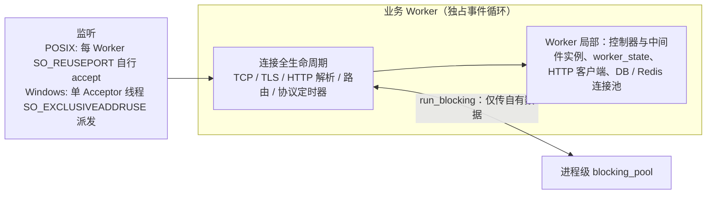

# `ruvia::web` 应用框架使用指南与 API 参考

`ruvia-web`（CMake target `ruvia::web`）是 Ruvia 的应用框架与异步 I/O 驱动层，建立在 [`ruvia::core`](ruvia-core.md) 运行时与 [`ruvia::http`](ruvia-http.md) Sans-I/O 协议引擎之上。本手册以 `ruvia-web/CMakeLists.txt` 中 `ruvia_install_public_headers(web ...)` 的安装集合为唯一范围，逐头列出全部非 `detail` 公开 API；构建接入与示例索引见 [README.md](README.md)。

## 目录

- [1. 定位、Target 与公开头](#web-overview)
- [2. 最短接入](#web-quickstart)
- [3. 生命周期、线程与错误模型](#web-lifecycle)
- [4. 应用与 Worker 运行时](#web-runtime)：`app.h`、`env.h`、`web_worker.h`、`worker_services.h`、`worker_state.h`
- [5. 服务器、监听、TLS 与连接](#web-server)：`http_server.h`、`connection_transport.h`、`server_connection.h`、`server_observation.h`、`tls_config.h`、`tls_certificate_store.h`
- [6. 路由与控制器](#web-routing)：`callback_ref.h`、`controller.h`、`router.h`
- [7. 请求上下文、响应与 HTTP 错误](#web-context)：`context.h`、`outbound_bytes.h`、`http_error.h`
- [8. 中间件、安全、限流与会话](#web-middleware)：`middleware.h`、`security_middleware.h`、`rate_limiting.h`、`session.h`
- [9. 请求流、流式响应、WebSocket 与隧道](#web-streaming)：`request_stream.h`、`streaming.h`、`websocket.h`、`http_tunnel.h`
- [10. 静态文件](#web-static)：`static_root.h`
- [11. 出站客户端](#web-client)：`client_transport_config.h`、`http_client_types.h`、`http_client.h`、`tcp_client.h`
- [12. 模型、JSON 领域结果与校验](#web-model)：`fixed_string.h`、`model_value.h`、`json_codec.h`、`model.h`
- [13. 后端共享存储类型](#web-entity-storage)：`entity_storage.h`
- [14. SQL 数据库、迁移与 SQL 构建](#web-database)：`db_sql_scan.h`、`db_executor.h`、`db_migration.h`、`db_query.h`、`db_schema.h`
- [15. 关系型 ORM](#web-orm)：`db_entity.h`、`db_entity_codec.h`、`db_repository.h`
- [16. Redis 与 RediSearch ORM](#web-redis)：`redis_executor.h`、`redis_orm.h`
- [17. JWT](#web-jwt)：`jwt.h`
- [18. 内存测试门面](#web-testing)：`test_app.h`
- [19. 密码学字节原语](#web-crypto)：`crypto.h`

---

<a id="web-overview"></a>

## 1. 定位、Target 与公开头

- **定位**：`ruvia::web` 是 Ruvia 的应用框架与异步 I/O 驱动层：服务器与监听、路由与控制器、中间件、声明式 Model、静态文件、限流、TLS / QUIC、出站 HTTP / TCP 客户端、SQL 数据库与 ORM、Redis 与 RediSearch ORM、JWT。
- **依赖方向**：公开链接 [`ruvia::core`](ruvia-core.md)（协程、事件循环、阻塞池、停止令牌）与 [`ruvia::http`](ruvia-http.md)（Sans-I/O 协议引擎）；本手册只描述 `ruvia-web/include/` 安装头中的非 `detail` 公开 API，来自其他 target 的类型只链接到其所有者文档。
- **命名空间**：全部公开符号位于 `namespace ruvia`；`detail` 命名空间与 `RUVIA_DETAIL_*` 宏不是公开契约。

<a id="web-cmake"></a>

### 1.1 CMake target 与条件编译

```cmake
find_package(ruvia REQUIRED COMPONENTS web)   # 自动追加 core 与 http 组件
target_link_libraries(my_service PRIVATE ruvia::web)
```

| CMake 选项 | 默认值 | `ruvia::web` 新增内容 | PUBLIC 编译宏 | Web 追加的依赖 |
| --- | --- | --- | --- | --- |
| `RUVIA_BUILD_WEB` | `ON` | 基础安装集（下表无门槛的头）；要求 `RUVIA_BUILD_CORE` 与 `RUVIA_BUILD_HTTP` | — | `OpenSSL 3.0+`（`SSL`、`Crypto`） |
| `RUVIA_ENABLE_HTTP2` | `ON` | 头内 `RUVIA_ENABLE_HTTP2` 段（HTTP/2 服务端会话、客户端、观测类型） | `RUVIA_ENABLE_HTTP2`（由 `ruvia::http` 传递） | — |
| `RUVIA_ENABLE_HTTP3` | `ON` | 头内 `RUVIA_ENABLE_HTTP3` 段（HTTP/3 / QUIC 监听、客户端、观测类型）；开启时强制开启 `RUVIA_ENABLE_HTTP2` | `RUVIA_ENABLE_HTTP3`（由 `ruvia::http` 传递） | `ngtcp2` OpenSSL QUIC crypto |
| `RUVIA_ENABLE_MARIADB` | `OFF` | 8 个数据库头（第 14、15 章）、`application::db()`、`db()` 执行器入口 | `RUVIA_ENABLE_MARIADB`、`RUVIA_ENABLE_DATABASE` | `unofficial-libmariadb` |
| `RUVIA_ENABLE_POSTGRESQL` | `OFF` | 同上（PostgreSQL 驱动） | `RUVIA_ENABLE_POSTGRESQL`、`RUVIA_ENABLE_DATABASE` | `PostgreSQL` |
| `RUVIA_ENABLE_REDIS` | `OFF` | `redis_executor.h`、`redis_orm.h`、`session.h`、`application::redis()`、`redis()` 执行器入口；与数据库同时开启时提供数据库查询缓存 | `RUVIA_ENABLE_REDIS` | `hiredis` |
| `RUVIA_ENABLE_JWT` | `OFF` | `jwt.h` | `RUVIA_ENABLE_JWT` | — |

- **门槛单一来源**：安装头集合由 [`ruvia-web/CMakeLists.txt`](../ruvia-web/CMakeLists.txt) 的 `ruvia_install_public_headers(web ...)` 显式列出；未启用功能既不编译源码也不安装对应头。
- **`RUVIA_ENABLE_DATABASE`**：MariaDB 与 PostgreSQL 任一开启即定义；头内数据库条件段统一以它为门槛。
- **静态库控制器**：控制器在静态初始化期自注册；控制器放在独立 `STATIC_LIBRARY` / `OBJECT_LIBRARY` 时，用包配置提供的 `ruvia_link_controllers(<app> <controller-targets>...)` 整档链接，避免目标文件被链接器丢弃（构建接入细节见 [README.md](README.md)）。

<a id="web-headers"></a>

### 1.2 公开头索引

| 公开头 | 章节 | 门槛 | 主题 |
| --- | --- | --- | --- |
| `app.h` | [4.1](#api-app-h) | — | 进程单例 `application`、Worker 与文档根配置、启动 / 停止 |
| `env.h` | [4.2](#api-env-h) | — | `.env` 加载与类型化环境变量 |
| `web_worker.h` | [4.3](#api-web-worker-h) | — | Worker 句柄与跨 Worker 投递 |
| `worker_services.h` | [4.4](#api-worker-services-h) | — | Worker 资源访问（状态、阻塞池、客户端、执行器） |
| `worker_state.h` | [4.5](#api-worker-state-h) | — | 仅 `detail`：Worker 局部状态的实现支撑 |
| `http_server.h` | [5.1](#api-http-server-h) | — | 服务器 / 监听配置、独立入站宿主、统计 |
| `connection_transport.h` | [5.2](#api-connection-transport-h) | — | 连接端点与传输事实 |
| `server_connection.h` | [5.3](#api-server-connection-h) | — | 原始连接分发 |
| `server_observation.h` | [5.4](#api-server-observation-h) | — | 连接与协议观测钩子 |
| `tls_config.h` | [5.5](#api-tls-config-h) | — | TLS 配置 |
| `tls_certificate_store.h` | [5.6](#api-tls-certificate-store-h) | — | 增量证书库 |
| `callback_ref.h` | [6.1](#api-callback-ref-h) | — | 仅 `detail`：非拥有回调视图 |
| `controller.h` | [6.2](#api-controller-h) | — | 控制器与路由宏、分发配置 |
| `router.h` | [6.3](#api-router-h) | — | 显式路由组合 |
| `context.h` | [7.1](#api-context-h) | — | 请求上下文、请求 / 响应门面 |
| `outbound_bytes.h` | [7.2](#api-outbound-bytes-h) | — | 出站写入字节所有权 |
| `http_error.h` | [7.3](#api-http-error-h) | — | 应用错误与错误处理器 |
| `middleware.h` | [8.1](#api-middleware-h) | — | 中间件与 `next` |
| `security_middleware.h` | [8.2](#api-security-middleware-h) | — | 安全响应头与 CSRF |
| `rate_limiting.h` | [8.3](#api-rate-limiting-h) | — | 限流 |
| `session.h` | [8.4](#api-session-h) | `RUVIA_ENABLE_REDIS` | Redis 服务端会话 |
| `request_stream.h` | [9.1](#api-request-stream-h) | — | 请求流分发 |
| `streaming.h` | [9.2](#api-streaming-h) | — | 流式请求体、流式响应、SSE |
| `websocket.h` | [9.3](#api-websocket-h) | — | WebSocket 会话 |
| `http_tunnel.h` | [9.4](#api-http-tunnel-h) | — | `CONNECT` / `CONNECT-UDP` 隧道 |
| `static_root.h` | [10.1](#api-static-root-h) | — | 静态文件快照 |
| `client_transport_config.h` | [11.1](#api-client-transport-config-h) | — | 出站传输 / TLS 配置 |
| `http_client_types.h` | [11.2](#api-http-client-types-h) | — | HTTP 客户端值类型与配置 |
| `http_client.h` | [11.3](#api-http-client-h) | — | HTTP 客户端 |
| `tcp_client.h` | [11.4](#api-tcp-client-h) | — | 原始 TCP / TLS 出站 |
| `fixed_string.h` | [12.1](#api-fixed-string-h) | — | 编译期字符串 |
| `model_value.h` | [12.2](#api-model-value-h) | — | Model 值类型 |
| `json_codec.h` | [12.3](#api-json-codec-h) | — | JSON 字符串、数字与容器词法编解码 |
| `model.h` | [12.4](#api-model-h) | — | `RUVIA_MODEL`、解析领域结果、绑定与校验 |
| `entity_storage.h` | [13.1](#api-entity-storage-h) | — | 后端共享错误与存储类型 |
| `db_sql_scan.h` | [14.1](#api-db-sql-scan-h) | `RUVIA_ENABLE_DATABASE` | 仅 `detail`：SQL 字面量与注释跳读 |
| `db_executor.h` | [14.2](#api-db-executor-h) | `RUVIA_ENABLE_DATABASE` | 连接池、执行器、事务 |
| `db_migration.h` | [14.3](#api-db-migration-h) | `RUVIA_ENABLE_DATABASE` | 迁移 |
| `db_query.h` | [14.4](#api-db-query-h) | `RUVIA_ENABLE_DATABASE` | SQL 构建器 |
| `db_schema.h` | [14.5](#api-db-schema-h) | `RUVIA_ENABLE_DATABASE` | DDL / 过程构建 |
| `db_entity.h` | [15.1](#api-db-entity-h) | `RUVIA_ENABLE_DATABASE` | 实体与字段声明 |
| `db_entity_codec.h` | [15.2](#api-db-entity-codec-h) | `RUVIA_ENABLE_DATABASE` | 字段与实体映射 |
| `db_repository.h` | [15.3](#api-db-repository-h) | `RUVIA_ENABLE_DATABASE` | 仓储与查询构建 |
| `redis_executor.h` | [16.1](#api-redis-executor-h) | `RUVIA_ENABLE_REDIS` | Redis 客户端与命令 |
| `redis_orm.h` | [16.2](#api-redis-orm-h) | `RUVIA_ENABLE_REDIS` | Redis 实体与 RediSearch |
| `jwt.h` | [17.1](#api-jwt-h) | `RUVIA_ENABLE_JWT` | JWT 签发、`jwt_result` 与 `jwt_error_code` |
| `test_app.h` | [18.1](#api-test-app-h) | — | 内存测试门面 |
| `crypto.h` | [19](#api-crypto-h) | — | SHA-256、HMAC、常量时间比较与安全随机字节 |

<a id="web-quickstart"></a>

## 2. 最短接入

```cpp
#include "app.h"
#include "controller.h"

#include <exception>
#include <iostream>

class hello_controller final {
public:
    RUVIA_ROUTES_BEGIN(hello_controller)
    RUVIA_GET("/hello/:name", hello);
    RUVIA_ROUTES_END

private:
    ruvia::task<ruvia::http_response> hello(ruvia::context& c) {
        co_return c.text(c.req().param("name").value_or("world"));
    }
};

int main() {
    try {
        ruvia::app()
            .listen({.address_ = "0.0.0.0", .http_ = 8080})
            .workers({.process_signal_handlers_ = ruvia::process_signal_handler_policy::install})
            .run();
    } catch (...) {
        std::cerr << ruvia::exception_text(std::current_exception()) << '\n';
        return 1;
    }
}
```

- **注册**：控制器类内宏在静态初始化期注册路由，无需在 `main()` 中引用控制器（宏契约见 [6.2](#api-controller-h)）。
- **配置**：`ruvia::app()` 的 setter 只接受左值宿主并在停止态生效，`run()` 阻塞到 `request_stop()` 后全部 Worker 退役（[4.1](#api-app-h)）。
- **监听**：`listen_config` 的字段与 TLS / HTTP/3 监听见 [5.1](#api-http-server-h)。
- **完整示例**：[basic_http.cpp](../examples/basic_http.cpp)（路由组、中间件、错误处理器）、[api_surface.cpp](../examples/api_surface.cpp)（`context` 全接口）、[runtime_config.cpp](../examples/runtime_config.cpp)（`.env`、压缩、CORS、TLS）、[testing.cpp](../examples/testing.cpp)（内存测试）；全部示例索引见 [README.md](README.md)。

<a id="web-lifecycle"></a>

## 3. 生命周期、线程与错误模型

本章给出跨头共享的运行模型；每项 API 的完整契约在其所有者小节。

<a id="web-threading"></a>

### 3.1 Share-Nothing Worker 与连接亲和



- **生产单例**：生产应用是进程单例 `ruvia::app()`，按 `application_worker_config::worker_count_` 启动同构 Worker（[4.1](#api-app-h)）。
- **连接亲和**：连接一经某 Worker 接纳，其 I/O、协议状态机、路由执行与定时器全程留在该 Worker；Worker 局部对象无需加锁。
- **Per-Worker 实例**：控制器、中间件、`use_worker_state<T>()` 状态、已注册的 HTTP 客户端与 DB / Redis 连接池每个 Worker 各一份（[4.5](#api-worker-state-h)、[4.4](#api-worker-services-h)）。
- **跨 Worker 通信**：经 `web_worker_ref::post`（[4.3](#api-web-worker-h)）或 core 的 [`worker_ref`](ruvia-core.md#api-worker-ref-h) / [有界通道](ruvia-core.md#api-channel-h)；只传独立所有权数据或不可变快照。
- **阻塞卸载**：阻塞或 CPU 密集工作经 `run_blocking(...)` 卸载到进程级阻塞池（`application::blocking_pool()` 配置）；闭包必须按值 / 移动持有全部数据，严禁在池线程访问 `context` 或任何 Worker 局部对象。
- **独立宿主**：不使用 `application` 时，[`http_server`](#api-http-server-h) 系列宿主运行在调用方提供的 core 事件循环上，没有 `application_worker_config` 对应物。

<a id="web-host-lifetime"></a>

### 3.2 宿主、配置与数据后端生命周期

| 宿主 | 配置时机 | 运行与停止 | 归属 |
| --- | --- | --- | --- |
| `application`（`ruvia::app()`） | setter 仅在停止态调用，运行中调用抛 `std::logic_error`；监听器运行期增删经 `listener_controls` | `run()` = 启动 + 等待；`request_stop()` 任意线程安全，直接断连、无排空阶段；返回后可再次 `run()` | [4.1](#api-app-h) |
| `http_server` / `http_server_group` | 在所属事件循环上、`start()` 前暂存配置；运行期增删监听器 | `co_await start()` 启动全部暂存服务；`request_stop()` 任意线程；`co_await shutdown()` 停止接纳、直接关闭连接并 join 会话 | [5.1](#api-http-server-h) |
| `db_client` / `redis_client` | 构造时绑定一个 core `event_loop` | `connect()` 惰性单次启动；`request_stop()` 任意线程；`co_await shutdown()` 在绑定循环上 join 全部操作 | [14.2](#api-db-executor-h)、[16.1](#api-redis-executor-h) |
| `test_app` | 构造即可用 | 无 socket，内存内分发 | [18.1](#api-test-app-h) |

- **左值宿主**：配置 setter、执行器 / 客户端入口均 `&` 限定并 `= delete` 右值重载，防止在临时宿主上配置或借出句柄。
- **数据后端两种宿主**：应用内经 `application::db()` / `application::redis()` 注册，每 Worker 一个连接池，请求中经 `c.db()` / `c.redis()` 取得绑定本请求取消的执行器；脱离应用时用 `db_client` / `redis_client` 绑定自管事件循环（示例 [event_loop_data.cpp](../examples/event_loop_data.cpp)）。
- **执行器句柄**：每次 `db()` / `redis()` 调用向宿主操作域登记一次能力；连续命令应复用同一句柄，句柄不得跨 Worker 或比宿主活得更久。
- **钩子**：`on_start` / `on_stop` 的运行时机与失败语义见 [4.1](#api-app-h)。
- **配置值**：配置结构体字段以 `_` 结尾、支持指定初始化器；`borrowed_text` / `borrowed_span` 字段借用调用方存储，各入口复制所借内容的时机在其所有者小节注明。
- **配置交接**：HTTP/Redis 已拥有的内部配置在注册项与连接池之间移动；跨 Worker 所需的独立副本保留。

<a id="web-borrowing"></a>

### 3.3 请求、响应与协程的借用期

- **请求视图**：`c.req()` 的 header / query / cookie / param / body 视图借用请求存储，仅在当前请求内有效；流式读取的分片只到下一次 `read()` 前有效（[7.1](#api-context-h)、[9.2](#api-streaming-h)）。
- **编译期借用防线**：返回借用视图的成员标注 `RUVIA_LIFETIMEBOUND` 并删除右值宿主重载；`borrowed_text` / `borrowed_span` 参数拒绝右值拥有容器与 `std::initializer_list`（契约见 [ruvia-http.md](ruvia-http.md#api-borrowed-text-h)）。
- **响应体所有权**：`outbound_bytes` 构造即复制视图输入、零拷贝接管精确 `std::string&&`；响应 builder 消费已拥有字节、仅 `static_text` 借用静态存储（[7.1](#api-context-h)、[7.2](#api-outbound-bytes-h)）。
- **异步入口拥有化**：返回冷 `task` 的出站写入、文件响应与客户端请求在返回前取得输入所有权；调用方缓冲区可在 `co_await` 前释放。
- **源缓冲释放**：事务失败语句的 SQL/参数在回滚 I/O 前释放；缓存命令拥有参数后，写入/删除的源缓冲在 Redis I/O 前释放。
- **协程契约**：`task<T>` 惰性、仅右值 `co_await`，已启动任务必须等待完成（[ruvia-core.md](ruvia-core.md#api-task-h)）；`operation_options` 的超时与停止令牌规则见 [ruvia-core.md](ruvia-core.md#api-operation-options-h)。
- **请求取消**：`c.stop_token()` 观察 Worker 停止、子请求取消与流式响应的客户端离开；`db()`、`redis()`、`run_blocking()` 自动绑定它。相同显式令牌直接复用，不同可停止来源才建立链接；取消是协作式的，不抢占 CPU 工作。

<a id="web-errors"></a>

### 3.4 错误模型

| 结果 | 形状 | 示例 |
| --- | --- | --- |
| 正常推进 / 背压 | 状态枚举或结果类型 | `web_worker_post_result`、`blocking_result::status()`、WebSocket / 流读写状态 |
| 不可信输入的数据错误 | 领域结果、`std::optional` 或状态值 | `parse_json<T>` / `parse_form<T>` 的 `model_parse_result<T>`、`jwt_verify` 的 `jwt_result`、`try_from_value`、流读取 EOF 的 `std::nullopt`（客户端 WebSocket 未经 Close 的 EOF 例外，见 [9.3.2](#api-websocket-h)） |
| 本地配置 / 编程错误 | 异常（`std::invalid_argument`、`std::logic_error`） | 非法 CIDR、运行中改配置、未注册的 `worker_state<T>` |
| 后端失败 | 类型化异常 | `db_error`、`redis_error` 均继承 `std::system_error`，`code()` 为 `std::error_code`（[13.1](#api-entity-storage-h)）；文本转换失败为 `conversion_error` |
| 请求处理失败 | 抛 `http_error`（[7.3](#api-http-error-h)）或任意异常，由框架映射为响应 | 见下表 |
| 生命周期违约 | `std::terminate()` | 析构已启动未完成的 `task` |

路由处理器与中间件抛出的异常按下表转换为响应，再交给匹配前缀最长的 `on_error` 处理器（无处理器时直接写默认 `application/problem+json` 错误体，格式见 [7.3](#api-http-error-h)）：

| 抛出 | 响应状态 | `code` | 附加行为 |
| --- | --- | --- | --- |
| `http_error` | 其 `status()` | 其 `code()` | 携带校验 issues |
| `http_protocol_error`（[ruvia-http.md](ruvia-http.md#api-http-protocol-h)） | 其 `status()` | 其 `code()` | `detail` 为 `what()` |
| 请求内容编码不受支持 | `415` | `unsupported_content_coding` | 写 `Accept-Encoding` |
| 限流拒绝（[8.3](#api-rate-limiting-h)） | `429` | `too_many_requests` | 写限流响应头 |
| 入站缓冲预算超限（`std::bad_alloc`） | `503` | `inbound_buffer_limit` | — |
| `blocking_operation_rejected`（[ruvia-core.md](ruvia-core.md#api-blocking-pool-h)） | `503` | `blocking_pool_unavailable` | — |
| 其他任何异常 | `500` | `internal_error` | 不回显 `what()`；`c.exception()` 保留原异常；未配置 `on_error` 时经 `report_unhandled_failure` 上报 |

- **处理器自身失败**：`on_error` 处理器再抛 `http_error` 时按其信息写默认错误体；抛其他异常时上报并写 `500 error_handler_failed`。
- **已提交输出**：流式响应或协议升级一经提交，后续异常不再改写响应，连接被关闭。
- **启动失败**：`application::run()` 把首个失败重抛给调用方（规则见 [4.1](#api-app-h)），调用方用 `exception_text()`（[7.3](#api-http-error-h)）打印。
- **后台故障**：脱离请求的未捕获异常经 core 的 `report_unhandled_failure`（[ruvia-core.md](ruvia-core.md#api-failure-report-h)）带限流上报。

---

<a id="web-runtime"></a>

## 4. 应用与 Worker 运行时

`application` 是框架模式的进程级入口：持有配置、业务 worker、生命周期钩子与注册客户端。本章覆盖应用配置面、环境变量、跨 worker 投递与 worker 级资源访问；监听/服务器配置聚合见 [第 5 章](#web-server)，分发配置（中间件、错误处理器、限流）见 [`"controller.h"`](#api-controller-h)。

<a id="api-app-h"></a>

### 4.1 `"app.h"` —— 应用单例与启动主链

源码：[../ruvia-web/include/app.h](../ruvia-web/include/app.h)

**定位要点**

- **单例**：`ruvia::app()` 返回进程唯一的 `application&`；类不可构造、复制，所有配置入口均为左值限定（`&`），右值重载 `= delete`。
- **两类配置**：普通 setter 与继承自 `dispatch_configuration<application>` 的分发配置只接受停机态应用，运行中调用抛 `std::logic_error`；继承自 `listener_controls` 的运行期监听控制（[`"http_server.h"`](#api-http-server-h)）只接受运行中的应用。
- **`run()` = start + wait**：绑定并服务到 `request_stop()`，所有 worker 退役后返回；可在返回后再次 `run()`。首个准备/启动/worker 失败重抛给调用方（由调用方打印）；被它取代的后续失败写到 stderr，同类 worker 失败合并成一行并附计数。
- **停止即断连**：`request_stop()` 任意线程可调；无排空阶段——停止准入（取消待决 accept 与 QUIC 接收）→ 立即关闭全部连接（HTTP/1、HTTP/2、WebSocket、隧道不发最终响应、`GOAWAY` 或关闭握手；HTTP/3 发送 `CONNECTION_CLOSE(H3_NO_ERROR)`）→ 处理器观察到 `context::stop_token()` → 停止 worker I/O 后 join 后台操作。停机态发出的请求锁存到下次 `run()`，该次直接返回不服务；启动期间请求立即回滚启动。
- **TLS 凭据加载时机**：`listen()` 只拥有配置不读文件；`run()` 在启动 worker 前加载并校验 TLS 凭据，失败从 `run()` 传播。替换已暂存的监听配置会清除其秘密并关闭任何未被消费的继承 socket。

**使用指引**

```cpp
#include "app.h"

int main() {
    ruvia::app()
        .load_dotenv()
        .listen({.address_ = "0.0.0.0", .http_ = 8080})
        .workers({
            .worker_count_ = 4,
            .process_signal_handlers_ = ruvia::process_signal_handler_policy::install,
        })
        .on_start([] { /* worker 已就绪、开始接入前 */ })
        .run();
}
```

- **钩子顺序**：worker 能力就绪 → `workers()` 句柄发布 → `on_start` 钩子（`run()` 调用线程）→ 开放 TCP 准入；停止时准入关闭、连接正在关闭 → `on_stop` 钩子 → join 运行时。任一 `on_start` 失败或停止请求回滚启动，`on_stop` 仍运行。
- **信号**：默认 `external_owner` 不安装信号处理；`install` 让 `run()` 安装 `SIGINT`/`SIGTERM` 处理并调用 `request_stop()`。
- **注册别名位置**：`db()` / `redis()` 的 `alias_` 在外层 `*_registration_config`（`db_config` / `redis_config` 也供无别名的独立客户端使用）；`client()` 直接取 `http_client_config`，其 `alias_` 也是独立多 origin `http_client` 的选择键。
- **回调整体替换**：`callbacks()` 每次替换整组 [`http_server_callbacks`](#api-http-server-h)，未列出的成员随之清除；旧集合在释放应用配置锁后析构，目标析构函数可调用 `request_stop()` 或查询应用状态。`on_start(nullptr)` / `on_stop(nullptr)` 同样在解锁后析构旧钩子。
- **错误处理器**：全局与前缀作用域 `on_error` / `on_not_found` 来自 `dispatch_configuration`（[`"controller.h"`](#api-controller-h)），处理器类型与 `http_error` 契约见 [`"http_error.h"`](#api-http-error-h)。
- 示例：[../examples/runtime_config.cpp](../examples/runtime_config.cpp)、[../examples/workers_blocking.cpp](../examples/workers_blocking.cpp)。

#### 4.1.1 配置类型

**`db_registration_config`**（仅 `RUVIA_ENABLE_DATABASE`，即 `RUVIA_ENABLE_MARIADB` 或 `RUVIA_ENABLE_POSTGRESQL`）

| 字段 | 类型 | 默认值 | 说明 |
| --- | --- | --- | --- |
| `alias_` | [`borrowed_text`](ruvia-http.md#api-borrowed-text-h) | `{"default"}` | 注册别名，`db(alias)` 按此解析 |
| `config_` | `db_config`（[`"db_executor.h"`](#api-db-executor-h)） | `{}` | 每 worker 连接池配置 |
| `query_cache_` | `std::optional<db_query_cache_registration>` | `{}` | 查询缓存；需 Redis 支持（`RUVIA_ENABLE_REDIS`），未启用时 `db()` 拒绝有值配置 |

**`redis_registration_config`**（仅 `RUVIA_ENABLE_REDIS`）

| 字段 | 类型 | 默认值 | 说明 |
| --- | --- | --- | --- |
| `alias_` | `borrowed_text` | `{"default"}` | 注册别名 |
| `config_` | `redis_config`（[`"redis_executor.h"`](#api-redis-executor-h)） | `{}` | 每 worker 连接池配置 |

**`enum class process_signal_handler_policy : std::uint8_t`**

| 枚举值 | 说明 |
| --- | --- |
| `external_owner` | 默认；应用不安装信号处理，由外部负责 |
| `install` | `run()` 安装 `SIGINT`/`SIGTERM` 处理器，触发 `request_stop()` |

**`application_worker_config`** —— `application::run()` 拥有的 worker；独立宿主（`http_server`、`http_server_group`）运行在调用方循环上，无对应配置。

| 字段 | 类型 | 默认值 | 说明 |
| --- | --- | --- | --- |
| `worker_count_` | `std::size_t` | `(std::max)(1U, std::thread::hardware_concurrency())` | 业务 worker 数，各有事件循环，连接固定在接收它的 worker。POSIX：每个 worker 以 `SO_REUSEPORT` 绑定每个 TCP 监听并在自身循环 accept；Windows：每个应用一个 acceptor 线程独占全部监听（`SO_EXCLUSIVEADDRUSE`），把 socket 交给连接最少的 worker，队列放不下则关闭并计入 `connections_refused_` |
| `process_signal_handlers_` | `process_signal_handler_policy` | `process_signal_handler_policy::external_owner` | 见上 |
| `worker_queue_capacity_` | `std::size_t` | `1024` | 每个 worker 跨线程任务队列上限 |

**`document_root_config`** —— 服务器绑定的文档根运行期行为；应用文档根始终刷新：每个应用一个刷新器按间隔重建索引，所有 worker 采用共享快照（独立 [`static_root`](#api-static-root-h) 无服务器运行时，保持不可变）。

| 字段 | 类型 | 默认值 | 说明 |
| --- | --- | --- | --- |
| `root_` | `std::filesystem::path` | `{}` | 根目录 |
| `static_options_` | `static_root_options`（[`"static_root.h"`](#api-static-root-h)） | `{}` | 索引选项 |
| `refresh_interval_` | [`timeout_duration`](ruvia-core.md#api-timeout-duration-h) | `std::chrono::seconds(1)` | 刷新间隔；失败计入 `http_server_stats::document_root_refresh_failures_`，旧快照保持生效 |
| `precompress_gzip_` | `bool` | `false` | 预生成 gzip 变体 |
| `precompress_brotli_` | `bool` | `false` | 预生成 br 变体 |
| `precompress_zstd_` | `bool` | `false` | 预生成 zstd 变体 |
| `precompress_min_bytes_` | `std::size_t` | `1024` | 预压缩下限 |
| `precompress_max_bytes_` | `std::size_t` | `std::size_t{256} * 1024` | 预压缩上限 |

**`using app_hook = move_only_function<void()>;`** —— 自包含的启动/停止回调，在 `run()` 调用线程执行；钩子值拥有可调用对象，其捕获的引用须活过注册的钩子。调用空钩子是编程错误，抛 `std::logic_error`；空函数指针与目标析构重入契约同 `access_log_callback`（[`"server_observation.h"`](#api-server-observation-h)）。

#### 4.1.2 `class application final : public listener_controls, public dispatch_configuration<application>`

继承成员：`listener_controls` 的 `prepare_listeners`、`add_listener`、`remove_listener`、`wait_connections_closed`、`replace_tls_identities`、`close_connection`、`duplicate_listener_sockets`（非 Windows）、`stats`，见 [`"http_server.h"`](#api-http-server-h)；运行中可用，增删的监听在之后的 `run()` 中保持。`stats()` 在 `run()` 启动 worker 前与返回后全为零，可在停止钩子中安全调用。`dispatch_configuration<application>` 的 `use`、`use_at`、`use_worker_state`、`on_error`、`on_not_found`、`rate_limit` 见 [`"controller.h"`](#api-controller-h)，仅停机态可用。

每个配置入口都是 `&` 限定；对应的 `&& = delete` 重载逐条列出，表达同一限制：应用是进程单例，只能经 `app()` 返回的左值配置，禁止对右值 `application` 表达式链式配置（避免把配置写进一个即将失效的引用表达式）。

| 声明 | 说明 |
| --- | --- |
| `const ruvia::env& env() const noexcept` | 应用的 [`env`](#api-env-h) |
| `application& load_dotenv(dotenv_options options = {}) &` | 加载可执行文件旁 `.env` 到应用 `env` |
| `application& load_dotenv(dotenv_options options = {}) && = delete` | 禁止对右值应用加载 |
| `application& load_dotenv(const std::filesystem::path& path, dotenv_options options = {}) &` | 加载指定文件 |
| `application& load_dotenv(const std::filesystem::path& path, dotenv_options options = {}) && = delete` | 禁止对右值应用加载 |
| `application& workers(application_worker_config config) &` | 整体校验并替换 worker 配置 |
| `application& workers(application_worker_config config) && = delete` | 禁止对右值应用配置 |
| `application& server(server_config config) &` | 服务器运行期配置，见 [`server_config`](#api-http-server-h) |
| `application& server(server_config config) && = delete` | 禁止对右值应用配置 |
| `application& listen(listen_config config) &` | 替换整组监听为单个配置 |
| `application& listen(listen_config config) && = delete` | 禁止对右值应用配置 |
| `application& listen(std::span<const listen_config> configs) &` | 替换整组监听为多个配置 |
| `application& listen(std::span<const listen_config> configs) && = delete` | 禁止对右值应用配置 |
| `application& listen(std::initializer_list<listen_config> configs) &` | 同上，花括号列表 |
| `application& listen(std::initializer_list<listen_config> configs) && = delete` | 禁止对右值应用配置 |
| `application& document_root(document_root_config config) &` | 启用文档根 |
| `application& document_root(document_root_config config) && = delete` | 禁止对右值应用配置 |
| `application& document_root(std::nullptr_t) &` | 禁用文档根 |
| `application& document_root(std::nullptr_t) && = delete` | 禁止对右值应用配置 |
| `application& blocking_pool(blocking_pool_options config) &` | 配置进程级普通线程池（[`blocking_pool_options`](ruvia-core.md#api-blocking-pool-h)）；各 worker 借用它执行 `run_blocking()`、文件读取、大缓冲响应压缩、文档根刷新、注册客户端的 DNS 查询、TLS 准备与数据库原生启动步骤。默认启用、按 CPU 有界定额；`run()` 在首个请求前启动线程；普通 `run_blocking()` 可调用对象在 worker 停止后不等待；客户端已启动的不可抢占准备必须 join 后才结束取消 |
| `application& blocking_pool(blocking_pool_options config) && = delete` | 禁止对右值应用配置 |
| `application& blocking_pool(std::nullptr_t) &` | 显式禁用：`run_blocking()` 报告 `blocking_status::unavailable`；超过 `sync_bytes_` 的缓冲响应保持 identity（拒绝 identity 则 406）；文件响应在响应头前回 503；配置了文档根或主机不是 IP 字面量的注册客户端时 `run()` 失败。TLS 凭据／默认 CA 准备及数据库原生启动也需要池，缺池在对应异步准备中失败，不同步回退（[11.1](#api-client-transport-config-h)、[14.2](#api-db-executor-h)）。Windows 明文 TCP 上大于 16 KiB 的单范围文件仍走 `TransmitFile` |
| `application& blocking_pool(std::nullptr_t) && = delete` | 禁止对右值应用配置 |
| `application& trusted_proxies(trusted_proxy_config config) &` | 可信代理集合（地址或 CIDR，如 `"10.0.0.0/8"`、`"2001:db8::/32"`、`"127.0.0.1"`）；格式错误在配置时抛 `std::invalid_argument`。默认空（安全默认）。客户端取转发列表中最后一个不可信跳；不命名 IP 的跳（无 RFC 7239 `for`、`unknown`、混淆名）终止遍历，`client()` 取其后最近的可信地址或 `remote()` |
| `application& trusted_proxies(trusted_proxy_config config) && = delete` | 禁止对右值应用配置 |
| `application& trusted_proxies(std::nullptr_t) &` | 清空，不信任任何转发头 |
| `application& trusted_proxies(std::nullptr_t) && = delete` | 禁止对右值应用配置 |
| `application& callbacks(http_server_callbacks callbacks) &` | 整体替换宿主回调集，空成员即清除；运行中抛 `std::logic_error`；监听的 `dispatch_` 需要的 `request_stream_` / `connection_` 缺失时 `run()` 抛 `std::invalid_argument` |
| `application& callbacks(http_server_callbacks callbacks) && = delete` | 禁止对右值应用配置 |
| `application& on_start(app_hook hook) &` | 追加启动钩子：worker 能力就绪后、TCP 准入前运行；全部成功才开始服务，失败或停止请求回滚启动；就绪 worker 已可执行投递任务 |
| `application& on_start(app_hook hook) && = delete` | 禁止对右值应用配置 |
| `application& on_stop(app_hook hook) &` | 追加停止钩子：所有 worker 已被告知停止（准入关闭、连接关闭中、处理器可能仍在退栈）后、join 运行时前运行；启动被取消或启动钩子失败时也运行。不得抛出：失败只上报不重抛 |
| `application& on_stop(app_hook hook) && = delete` | 禁止对右值应用配置 |
| `application& on_start(std::nullptr_t) &` | 清空启动钩子，解锁后析构 |
| `application& on_start(std::nullptr_t) && = delete` | 禁止对右值应用配置 |
| `application& on_stop(std::nullptr_t) &` | 清空停止钩子，解锁后析构 |
| `application& on_stop(std::nullptr_t) && = delete` | 禁止对右值应用配置 |
| `application& db(db_registration_config config) &` | 仅 `RUVIA_ENABLE_DATABASE`：按别名注册每 worker SQL 连接池，供 `db()` / `db(alias)` 解析 |
| `application& db(db_registration_config config) && = delete` | 仅 `RUVIA_ENABLE_DATABASE`；禁止对右值应用配置 |
| `application& db(std::nullptr_t) &` | 仅 `RUVIA_ENABLE_DATABASE`：清除数据库注册 |
| `application& db(std::nullptr_t) && = delete` | 仅 `RUVIA_ENABLE_DATABASE`；禁止对右值应用配置 |
| `application& redis(redis_registration_config config) &` | 仅 `RUVIA_ENABLE_REDIS`：按别名注册每 worker Redis 连接池 |
| `application& redis(redis_registration_config config) && = delete` | 仅 `RUVIA_ENABLE_REDIS`；禁止对右值应用配置 |
| `application& redis(std::nullptr_t) &` | 仅 `RUVIA_ENABLE_REDIS`：清除 Redis 注册 |
| `application& redis(std::nullptr_t) && = delete` | 仅 `RUVIA_ENABLE_REDIS`；禁止对右值应用配置 |
| `application& client(http_client_config config) &` | 按 `alias_` 注册每 worker 出站 HTTP 客户端，见 [`"http_client_types.h"`](#api-http-client-types-h) |
| `application& client(http_client_config config) && = delete` | 禁止对右值应用配置 |
| `application& client(std::nullptr_t) &` | 清除客户端注册 |
| `application& client(std::nullptr_t) && = delete` | 禁止对右值应用配置 |
| `void run() &` | 启动并阻塞服务，详见定位要点 |
| `void run() && = delete` | 禁止对右值应用运行 |
| `void request_stop() &` | 任意线程请求停止，详见定位要点 |
| `void request_stop() && = delete` | 禁止对右值应用请求停止 |
| `::ruvia::blocking_pool_stats blocking_pool_stats() const` | 阻塞池计数；无池或未运行时全零；任意线程。队列深度与拒绝计数是调整 `thread_count`/`queue_capacity` 的依据 |
| `std::vector<web_worker_ref> workers() const` | worker 句柄：所有 worker 就绪后（`on_start` 前）发布，直到 `run()` 返回；否则为空 |
| `web_worker_ref worker_for(std::uint64_t key) const` | 按 `key % worker 数` 选择 worker；未就绪时返回无效句柄 |
| `web_worker_ref worker_for(std::string_view key) const` | 以 [`worker_selection_hash(key)`](ruvia-core.md#api-worker-ref-h) 选择，同一键稳定落到同一 worker |

#### 4.1.3 自由函数

| 声明 | 说明 |
| --- | --- |
| `application& app()` | 进程唯一应用实例 |

<a id="api-env-h"></a>

### 4.2 `"env.h"` —— `.env` 与环境变量

源码：[../ruvia-web/include/env.h](../ruvia-web/include/env.h)

**定位要点**

- **实例隔离**：`env` 只加载到自身实例，从不写进程环境；`app().env()`、`c.env()`（[`worker_services_access`](#api-worker-services-h)）与独立实例使用同一契约。
- **原子加载**：文件完整解析后才应用；被拒绝的文件不改变任何变量。格式错误抛 `std::invalid_argument`，消息含 `<path>:<line>`。
- **视图寿命**：`get()` 返回的视图借用实例；成功加载可能使之前的视图失效。并发读取前完成加载。

**文件格式**

- 空行与 `#` 开头行忽略；首行 UTF-8 BOM 剥离；允许 `export ` 前缀；变量名须匹配 `[A-Za-z_][A-Za-z0-9_]*`。
- 未加引号的值去首尾空白，行首或空白后的 `#` 起为注释；单引号值按字面保留。
- 双引号值只识别 `\n`、`\r`、`\t`、`\"`、`\\`；其他字符前的反斜杠与该字符一起保留（`"\q"` 得 `\q`，同 POSIX sh）。
- 引号闭合后只允许空白或 `#` 注释；不支持多行值与变量展开。
- 同一文件重复赋值同一名称视为重复变量名错误；`existing_variables_` 只裁决与先前加载的冲突。
- 值须为合法 UTF-8；编码错误在提交前拒绝整个文件。

**类型化读取**：`get<T>(name)` 区分缺失与格式错误——缺失返回 `std::nullopt`，存在但无法解析为 `T` 抛 `std::invalid_argument`（`invalid value for environment variable '<name>'`）。因此 `value_or()` 适合可选部署项，却不会掩盖拼错的端口、上限或布尔值。支持类型：`std::string_view`（原样）、`bool`（`1`/`0`，ASCII 大小写无关的 `true`/`yes`/`on`、`false`/`no`/`off`）、整型（`parse_integer`，见 [`"decimal_text.h"`](ruvia-http.md#api-decimal-text-h)）、浮点（`std::from_chars` 完整消费且有限）；其他类型 `static_assert` 失败。

```cpp
ruvia::env variables;
variables.load_dotenv("deploy/.env", {.missing_file_ = ruvia::dotenv_missing_file_policy::require});
const auto port = variables.get<std::uint16_t>("PORT").value_or(8080);
```

#### 4.2.1 枚举与选项

**`enum class dotenv_existing_variable_policy : std::uint8_t`**：`preserve`（保留先前加载的值）、`override`（覆盖先前加载的值）。

**`enum class dotenv_missing_file_policy : std::uint8_t`**：`ignore`（文件不存在时直接返回，不改变实例）、`require`（文件不存在时抛 `std::runtime_error`）。文件存在但不可读时两种策略都抛 `std::runtime_error`。

**`dotenv_options`**

| 字段 | 类型 | 默认值 | 说明 |
| --- | --- | --- | --- |
| `existing_variables_` | `dotenv_existing_variable_policy` | `dotenv_existing_variable_policy::preserve` | 与先前加载变量冲突的处理 |
| `missing_file_` | `dotenv_missing_file_policy` | `dotenv_missing_file_policy::ignore` | 文件缺失的处理 |

#### 4.2.2 `class env final`

视图借用实例存储，因此实例不可复制、不可移动。

| 声明 | 说明 |
| --- | --- |
| `env()` | 空实例 |
| `~env()` | 析构，此后全部 `get()` 视图失效 |
| `env(const env&) = delete` | 禁止复制：视图绑定唯一实例 |
| `env& operator=(const env&) = delete` | 禁止复制赋值 |
| `env(env&&) = delete` | 禁止移动：移动会使已发出的视图悬空 |
| `env& operator=(env&&) = delete` | 禁止移动赋值 |
| `env& load_dotenv(dotenv_options options = {}) &` | 读取可执行文件所在目录的 `.env` |
| `env& load_dotenv(dotenv_options = {}) && = delete` | 禁止对临时实例加载 |
| `env& load_dotenv(const std::filesystem::path& path, dotenv_options options = {}) &` | 读取指定文件 |
| `env& load_dotenv(const std::filesystem::path&, dotenv_options = {}) && = delete` | 禁止对临时实例加载 |
| `std::optional<std::string_view> get(std::string_view name) const& noexcept` | 原始值视图，`RUVIA_LIFETIMEBOUND` 借用实例 |
| `std::optional<std::string_view> get(std::string_view) const&& = delete` | 禁止从临时实例取视图 |
| `template <typename t_type> std::optional<std::remove_cvref_t<t_type>> get(std::string_view name) const&` | 类型化读取，见上 |
| `template <typename t_type> std::optional<std::remove_cvref_t<t_type>> get(std::string_view) const&& = delete` | 禁止从临时实例读取（与原始视图重载保持同一借用规则） |
| `bool loaded() const noexcept` | 是否有文件成功加载过（缺失文件被 `ignore` 时不算） |
| `std::size_t size() const noexcept` | 已加载变量数 |
| `bool empty() const noexcept` | `size() == 0` |

<a id="api-web-worker-h"></a>

### 4.3 `"web_worker.h"` —— 跨线程任务投递

源码：[../ruvia-web/include/web_worker.h](../ruvia-web/include/web_worker.h)

**定位要点**

- **句柄**：`web_worker_ref` 由 `application::workers()` / `worker_for()` 返回，持有稳定终端端点；服务器关闭时端点关闭，持有句柄不会延长服务器或其 io_context 寿命。默认构造为空句柄。
- **投递**：`post(fn)` 从任意线程把 `task<void>(web_worker_context&)` 投到该 worker；返回 `web_worker_post_result`（即 [`post_outcome<task<void>(web_worker_context&)>`](ruvia-core.md#api-delivery-result-h)，状态 `post_status::accepted` / `queue_full` / `stopping`，被拒时交还可调用对象）。空句柄以 `stopping` 拒绝。
- **作业上下文**：每个作业获得 `web_worker_context`，可访问 worker、该 worker 的停止令牌与 [`worker_services_access`](#api-worker-services-h) 资源；执行器与客户端绑定本作业独立的操作寿命，不计入请求 I/O 指标。

```cpp
for (const auto& worker : ruvia::app().workers()) {
    auto outcome = worker.post([](ruvia::web_worker_context& ctx) -> ruvia::task<void> {
        ++ctx.worker_state<worker_metrics>().counter_;
        co_return;
    });
}
```

#### 4.3.1 `class web_worker_context final : public worker_services_access<web_worker_context>`

由框架构造；作业只借用它，因此不可复制、不可移动。继承 `worker_state<T>()`、`run_blocking()`、`env()`、`client()`、`db()`、`redis()`（[4.4](#api-worker-services-h)）。

| 声明 | 说明 |
| --- | --- |
| `web_worker_context(const web_worker_context&) = delete` | 禁止复制：上下文借用 worker 拥有的状态 |
| `web_worker_context& operator=(const web_worker_context&) = delete` | 禁止复制赋值 |
| `web_worker_context(web_worker_context&&) = delete` | 禁止移动：上下文地址在作业期间固定 |
| `web_worker_context& operator=(web_worker_context&&) = delete` | 禁止移动赋值 |
| `const worker_ref& worker() const& noexcept` | 作业所在核心 worker（[`worker_ref`](ruvia-core.md#api-worker-ref-h)），`RUVIA_LIFETIMEBOUND` |
| `const worker_ref& worker() const&& = delete` | 禁止从临时上下文借用 |
| `::ruvia::stop_token stop_token() const noexcept` | worker 停止令牌 |

#### 4.3.2 类型别名与统计

| 声明 | 说明 |
| --- | --- |
| `using web_worker_post_result = post_outcome<task<void>(web_worker_context&)>;` | `post()` 结果 |

**`web_worker_stats`**

| 字段 | 类型 | 默认值 | 说明 |
| --- | --- | --- | --- |
| `accepted_` | `std::uint64_t` | `0` | 被接纳的投递数 |
| `queue_full_` | `std::uint64_t` | `0` | 因队列满被拒数 |
| `worker_stopping_` | `std::uint64_t` | `0` | 因 worker 停止被拒数 |
| `completed_` | `std::uint64_t` | `0` | 已结束作业数 |
| `failed_` | `std::uint64_t` | `0` | 以异常结束的作业数 |
| `outstanding_` | `std::size_t` | `0` | 当前在途（已预留未结束）作业数 |

#### 4.3.3 `class web_worker_ref final`

| 声明 | 说明 |
| --- | --- |
| `web_worker_ref() noexcept = default` | 空句柄 |
| `bool valid() const noexcept` | 指向存活的 worker 端点 |
| `bool accepting() const noexcept` | 当前接纳投递 |
| `bool is_current() const noexcept` | 调用线程即该 worker |
| `worker_id_type id() const noexcept` | worker ID；空句柄为 `0` |
| `web_worker_stats stats() const noexcept` | 投递计数；空句柄全零 |
| `template <typename fn_type> requires std::invocable<std::decay_t<fn_type>&, web_worker_context&> && std::same_as<std::invoke_result_t<std::decay_t<fn_type>&, web_worker_context&>, task<void>> web_worker_post_result post(fn_type&& fn) const` | 投递作业；可调用对象须以 `web_worker_context&` 调用并返回 `task<void>` |

<a id="api-worker-services-h"></a>

### 4.4 `"worker_services.h"` —— Worker 级资源访问

源码：[../ruvia-web/include/worker_services.h](../ruvia-web/include/worker_services.h)

**定位要点**

- **共享基类**：`context`、`request_stream`、`web_worker_context` 公有继承 CRTP 基类 `worker_services_access<host>`，各能力只定义一次；构造函数私有，仅宿主类型可派生。
- **绑定**：执行器、客户端句柄与 `run_blocking` 绑定宿主的操作寿命与 `stop_token()`，因此 `client` / `db` / `redis` 只对左值宿主提供（右值重载 `= delete`）。在 [`router::dispatch()`](#api-router-h) 中解析 router 借入的状态与客户端。
- **worker 状态**：`worker_state<T>()` 借用本 worker 的实例，绝不交给其他 worker；未注册类型抛 `std::logic_error`。注册见 [4.5](#api-worker-state-h)。

**`run_blocking` 契约**：可调用对象在阻塞池执行，须拥有其触及的一切；完成后在本 worker 恢复。`options.timeout_` 或停机停止等待但不 join 仍在运行的外部可调用对象；`options.stop_token_` 与宿主 `stop_token()` 合并。拒绝与可调用对象的异常保存在 [`blocking_result`](ruvia-core.md#api-blocking-pool-h) 中：检查 `status()` 做降载，或 `std::move(result).take_value()` 以抛出。`application::blocking_pool(nullptr)` 时结果为 `blocking_status::unavailable`，不提交可调用对象。

```cpp
auto result = co_await c.run_blocking([path = std::string(path)] { return read_report(path); },
    {.timeout_ = std::chrono::seconds(5)});
if (result.status() != ruvia::blocking_status::completed) { /* 降载 */ }
```

#### 4.4.1 `template <typename host_type> class worker_services_access`

| 声明 | 说明 |
| --- | --- |
| `template <typename state_type> state_type& worker_state() const` | 本 worker 的已注册实例 |
| `template <typename callable_type> task<blocking_result<std::invoke_result_t<callable_type&>>> run_blocking(callable_type callable, operation_options options = {}) const` | 见上；`operation_options` 见 [`"operation_options.h"`](ruvia-core.md#api-operation-options-h) |
| `const ruvia::env& env() const noexcept` | 应用 [`env`](#api-env-h)；宿主无环境时为空 `env` |
| `http_client_ref client() const&` | 默认别名出站客户端（[`"http_client.h"`](#api-http-client-h)） |
| `http_client_ref client(std::string_view alias) const&` | 指定别名 |
| `http_client_ref client() const&& = delete` | 禁止从临时宿主取：句柄绑定宿主的操作寿命 |
| `http_client_ref client(std::string_view) const&& = delete` | 同上 |
| `db_executor db() const&` | 仅 `RUVIA_ENABLE_DATABASE`：默认别名执行器（[`"db_executor.h"`](#api-db-executor-h)） |
| `db_executor db(std::string_view alias) const&` | 仅 `RUVIA_ENABLE_DATABASE`：指定别名 |
| `db_executor db() const&& = delete` | 仅 `RUVIA_ENABLE_DATABASE`；禁止从临时宿主取：执行器绑定宿主的操作寿命 |
| `db_executor db(std::string_view) const&& = delete` | 仅 `RUVIA_ENABLE_DATABASE`；同上 |
| `redis_executor redis() const&` | 仅 `RUVIA_ENABLE_REDIS`：默认别名执行器（[`"redis_executor.h"`](#api-redis-executor-h)） |
| `redis_executor redis(std::string_view alias) const&` | 仅 `RUVIA_ENABLE_REDIS`：指定别名 |
| `redis_executor redis() const&& = delete` | 仅 `RUVIA_ENABLE_REDIS`；禁止从临时宿主取：执行器绑定宿主的操作寿命 |
| `redis_executor redis(std::string_view) const&& = delete` | 仅 `RUVIA_ENABLE_REDIS`；同上 |

`client` / `db` / `redis` 在库内为每种宿主实例化定义。

<a id="api-worker-state-h"></a>

### 4.5 `"worker_state.h"` —— Worker 局部状态

源码：[../ruvia-web/include/worker_state.h](../ruvia-web/include/worker_state.h)

**定位要点**

- **无公开符号**：本头只含 `detail` 实现，是 `dispatch_configuration::use_worker_state<T>()`（[`"controller.h"`](#api-controller-h)）与 `worker_services_access::worker_state<T>()`（[4.4](#api-worker-services-h)）的支撑；用户通过这两个入口使用。
- **每 worker 一份**：每个类型注册一个配方，每个 worker 由配方构造自己的实例，只在该 worker 线程上访问，无需同步。
- **工厂约束**：`use_worker_state<T>(factory)` 的工厂须可无参调用，且返回值可构造 `T`（编译期 `static_assert`）；`use_worker_state<T>()` 默认构造。
- **生命周期**：工厂在 worker 开始分发回调或请求前、于 worker 线程上运行一次；抛出则 worker 启动失败。实例按注册顺序构造、逆序销毁；请求期查找无分配。

```cpp
struct worker_metrics { std::uint64_t counter_{0}; };

ruvia::app().use_worker_state<worker_metrics>();
// 处理器内：
++c.worker_state<worker_metrics>().counter_;
```

---

<a id="web-server"></a>

## 5. 服务器、监听、TLS 与连接

本章定义所有宿主（`application`、`test_app`、`http_server`、`http_server_group`）共用的服务器配置、监听配置与运行期监听控制，以及独立入站宿主、原始连接分发、连接观察回调和 TLS 身份/证书库。

<a id="api-http-server-h"></a>

### 5.1 `"http_server.h"` —— 服务器配置、监听控制与独立宿主

源码：[../ruvia-web/include/http_server.h](../ruvia-web/include/http_server.h)

**定位要点**

- **一份服务器配置**：`server_config` 由每个宿主整体校验并向所有 worker 发布相同的规范化值；`std::optional` 字段为空只禁用该项策略。worker 调度不在其中（`application` 用 [`application_worker_config`](#api-app-h)，独立宿主运行在调用方循环上）。
- **一个监听描述**：`listen_config` 是一个绑定地址加可选的 HTTP / HTTPS / HTTP/3 服务端口；省略端口即禁用该服务。`dispatch_` 选择该监听服务路由、`request_stream` 回调还是原始连接回调。
- **一套运行期控制**：`listener_controls` 是多 worker 宿主（`application`、`http_server_group`）共用的运行期监听控制面；单循环 `http_server` 提供不带 `caller` 的同名成员。
- **停止即断连**：三种宿主都没有排空模式；`request_stop()` 直接断开连接，“先移除监听 → 等待连接结束 → 关闭”需用 `remove_listener` + `wait_connections_closed` 组合。

**连接收尾行为（`server_config` 所有宿主共同生效）**

- **关闭延迟（lingering close，RFC 9112 §9.6）**：关闭 HTTP/1 的最终响应与以 `GOAWAY` 结束的 HTTP/2 会话：TLS 发 `close_notify`，TCP 关闭发送侧，读取并丢弃对端输入直到其结束，最多 2 s 与 4 MiB（固定产品上限），再关闭 TCP；期间仍计为活动连接，worker 停止会关闭它。
- **超时关闭**：等待请求的连接因空闲或请求头超时关闭时发送 TLS `close_notify`（RFC 9112 §9.8）；写超时、传输错误与 `application::request_stop()` 立即关闭。
- **HTTP/2 优雅结束（RFC 9113 §6.8）**：达到 `max_requests_per_connection_` 或连接超时触发时，先发 `GOAWAY` + `PING`，`PING` 往返或 1 s（取先到者）后发最终 `GOAWAY`；超时引发的排空在最终 `GOAWAY` 处结束会话并取消仍打开的流，仍阻塞的写在超时后 2 s 关闭。HTTP/3 以 shutdown-notice 与最终 `GOAWAY` 同样处理（RFC 9114 §5.2）。
- **Linux 发送提示**：最终的缓冲明文响应可与 `FIN` 共用最后一个 TCP 段；可复用、流式与 TLS 输出不使用此提示。

**使用指引**

```cpp
ruvia::app()
    .server({
        .idle_timeout_ = std::chrono::seconds(30),
        .max_connections_per_worker_ = 4096,
        .compression_ = ruvia::compression_config{},
        .cors_ = ruvia::http_cors_policy_options{.allowed_origins_ = {"https://app.example.com"}},
    })
    .listen({
        .address_ = "0.0.0.0", .http_ = 8080, .https_ = 8443, .http3_ = 8443,
        .tls_ = {.identities_ = ruvia::tls_fixed_identities{.primary_ = {
            .certificate_chain_file_ = "certs/server.crt", .private_key_file_ = "certs/server.key"}}},
        .auto_https_redirect_ = true,
    })
    .trusted_proxies({.cidrs_ = {"10.0.0.0/8"}});
```

- **压缩**：`compression_` 只编码文本类媒体类型（`text/*`、JSON、XML 及 `+json`/`+xml` 后缀、JavaScript、WebAssembly、SVG、图标、未压缩字体）；缺失或其他 `Content-Type`、类型名含 zip 容器的保持 identity。文件响应（`context::file`、`context::static_file`）请求时从不编码，GET 与 HEAD 描述同一表示；静态文件使用文档根自己的预压缩阈值并优先已有的预压缩旁路文件。声明了 `Content-Length` 的流式响应遵循与缓冲体相同的 `min_bytes_`/`max_bytes_` 规则。
- **CORS**：`cors_` 作用于宿主准备的每个 HTTP 响应（路由、`router::dispatch()`、`request_stream` 回调），并跟随路由引擎的 `OPTIONS` 预检答复；字段契约见 [`"http_cors.h"`](ruvia-http.md#api-http-cors-h)。
- **共享端口**：`http_` 与 `https_` 同号时共享一个物理 TCP 监听：首字节 `0x16` 选 TLS，其余选明文（连接分发亦然）；探测共用 TLS 握手期限，TLS 失败不回退明文。开启 `auto_https_redirect_` 时只有明文连接重定向。
- **HTTP/3**：需要 `https_` 与 `RUVIA_ENABLE_HTTP3` 构建；可与 `https_` 同号（UDP 与 TCP 端口独立）。HTTPS 监听的每个 HTTP/1.1、HTTP/2 响应自动带 `Alt-Svc: h3=":<port>"; ma=<http3_alt_svc_max_age_>`，除非应用自设 `Alt-Svc`。
- **PROXY 协议**：`proxy_protocol_ = true` 要求每条 TCP 连接以 HAProxy PROXY v1/v2 头开始，缺失或非法头在 TLS/HTTP 前关闭连接，仅在只有可信前置代理可达该端口时启用。
- **热交接**：POSIX 上旧进程以 `duplicate_listener_sockets()` 复制句柄，经 exec 传给新进程的 `listen_config::inherited_sockets_`。
- 示例：[../examples/ops.cpp](../examples/ops.cpp)、[../examples/runtime_config.cpp](../examples/runtime_config.cpp)、[../examples/tunnels.cpp](../examples/tunnels.cpp)。

#### 5.1.1 `compression_config`

| 字段 | 类型 | 默认值 | 说明 |
| --- | --- | --- | --- |
| `min_bytes_` | `std::size_t` | `1024` | 小于此值的缓冲内存响应保持 identity；请求拒绝 identity（如 `"gzip, identity;q=0"`）时任意大小都编码，而不回 406 |
| `sync_bytes_` | `std::size_t` | `std::size_t{64} * 1024` | 在 worker 上同步编码的上限；更大的正文在启用阻塞池时卸载编码，否则保持 identity（拒绝 identity 则 406） |
| `max_bytes_` | `std::size_t` | `std::size_t{64} * 1024 * 1024` | 超过此值的缓冲正文保持 identity |

#### 5.1.2 `server_config`

| 字段 | 类型 | 默认值 | 说明 |
| --- | --- | --- | --- |
| `idle_timeout_` | `std::optional<timeout_duration>` | `std::chrono::seconds(75)` | 连接不活动：keep-alive 等待下一请求，以及处理器（缓冲或流式）既不读也不写的时间（流式时为两次写之间）。无流的 HTTP/2 连接从最后一个流结束起算空闲，不开流的帧与本端写入不续期，到期以 `GOAWAY` 排空。WebSocket 与隧道使用各自期限（`websocket_lifecycle_options`、`http_tunnel_route_config::idle_timeout_`，见 [第 9 章](#web-streaming)） |
| `connection_scan_interval_` | [`timeout_duration`](ruvia-core.md#api-timeout-duration-h) | `std::chrono::seconds(1)` | 连接超时检查周期；超时在到期后至多约两个周期内触发；无连接的 worker 停止扫描 |
| `request_header_timeout_` | `std::optional<timeout_duration>` | `std::chrono::seconds(60)` | 请求头不活动；也约束 HTTP/2 连接前言与 SETTINGS 到达前的阶段（与 `header_completion_timeout_` 一起） |
| `request_body_timeout_` | `std::optional<timeout_duration>` | `std::chrono::seconds(60)` | 请求体不活动；HTTP/2 逐流计时，超时（或超出 `body_completion_timeout_`）的流以 `RST_STREAM(CANCEL)` 重置，连接与其他流不受影响 |
| `header_completion_timeout_` | `timeout_duration` | `std::chrono::seconds(30)` | 绝对阶段期限，进度不续期；覆盖 PROXY 头、TLS/QUIC 握手、请求头与 HTTP/2 前言，始终生效，无“未设置” |
| `body_completion_timeout_` | `std::optional<timeout_duration>` | `std::chrono::seconds(120)` | 请求体绝对完成期限 |
| `write_timeout_` | `std::optional<timeout_duration>` | `std::chrono::seconds(60)` | 写入不活动：缓冲响应、流式单次写、WebSocket/CONNECT 隧道写、HTTP/2 帧输出；TCP/TLS 仅按原生传输的实际写进度续期，不等待整个 `SSL_write` 完成，与读侧状态和心跳无关，对端不读即关闭。HTTP/2 流等待对端流控窗口超时以 `RST_STREAM(CANCEL)` 重置。文件正文读（阻塞池）同受此限：到期时在响应头前回 503，或结束连接（HTTP/1）/流（HTTP/2）；打开 `context::file()`/`static_file()` 的等待超时抛 503 `file_read_unavailable` 的 `http_error` |
| `write_completion_timeout_` | `std::optional<timeout_duration>` | `std::chrono::minutes(5)` | 单次写操作的绝对期限：一个缓冲响应（头与内存正文）、一次流式或升级写、一片文件正文（头后至多 64 KiB）、一次 HTTP/2/HTTP/3 传输写，或一次跨流控等待的 HTTP/2/HTTP/3 流写（以 `CANCEL`/`H3_REQUEST_CANCELLED` 重置该流）。默认值约合单次 64 MiB 写 220 KiB/s |
| `max_connections_per_worker_` | `std::optional<std::size_t>` | `1024` | 每 worker 连接上限；满时新连接接替空闲最久的连接（等待下一请求的 HTTP/1 keep-alive 或无流的 HTTP/2），其 socket 立即关闭，`active_connections_` 可因此暂时超限；无空闲连接时新 socket 在 TLS/协议探测前关闭并计入 `connections_refused_` |
| `max_requests_per_connection_` | `std::optional<std::size_t>` | `1000` | 每连接累计请求上限；HTTP/2 优雅排空，最终 `GOAWAY` 前已发出的流仍被服务（最多超出 128）；HTTP/3 同样先发 shutdown-notice 再发最终 `GOAWAY` |
| `max_buffered_body_bytes_` | `std::size_t` | `default_max_buffered_body_bytes`（[`"http_protocol.h"`](ruvia-http.md#api-http-protocol-h)，16 MiB） | 缓冲请求体上限 |
| `max_inbound_buffer_bytes_per_worker_` | `std::size_t` | `256 * 1024 * 1024` | 每 worker 活动入站缓冲分配预算：缓冲与流式请求体、CONNECT 隧道读（含处理器仍持有的块）、等待读者的 HTTP/3 隧道数据报、WebSocket 会话；含容量与重分配重叠，不可禁用。超限分配抛 `std::bad_alloc`（未处理时回 503）；HTTP/2/HTTP/3 隧道未读字节超限被重置，数据报被丢弃 |
| `max_inbound_buffer_bytes_per_connection_` | `std::size_t` | `64 * 1024 * 1024` | 每连接同类预算 |
| `max_stream_body_bytes_` | `std::optional<std::size_t>` | `{}` | 流式请求体上限；空为不限 |
| `max_websocket_message_bytes_` | `std::size_t` | `default_max_websocket_message_bytes`（16 MiB） | WebSocket 消息上限 |
| `http_client_worker_` | `http_client_worker_config`（[`"http_client_types.h"`](#api-http-client-types-h)） | `{}` | 每 worker 所有注册出站客户端别名共享的配置 |
| `compression_` | `std::optional<compression_config>` | `{}` | 响应压缩；有值时也启用索引预压缩静态变体的协商 |
| `cors_` | `std::optional<http_cors_policy_options>` | `{}` | CORS 策略 |

#### 5.1.3 `trusted_proxy_config`

| 字段 | 类型 | 默认值 | 说明 |
| --- | --- | --- | --- |
| `cidrs_` | `std::vector<std::string>` | `{}` | 可信代理地址或 CIDR；前缀长度按字面量的地址族计位（`127.0.0.0/8` 与 `::ffff:127.0.0.0/104` 是同一映射网段） |
| `forwarding_headers_` | `std::vector<http_forwarded_header_spec>`（[`"http_client_ip.h"`](ruvia-http.md#api-http-client-ip-h)） | `{}` | 按优先级排列的转发头；为空时等价 `{"X-Forwarded-For", "Forwarded"}` |
| `trust_x_forwarded_proto_` | `bool` | `false` | 仅当每个可信代理都清洗并追加匹配的 `X-Forwarded-For`/`X-Forwarded-Proto` 时开启 |

可信代理同时豁免 [TLS 421 检查](#api-tls-config-h)。客户端判定规则见 [`application::trusted_proxies`](#api-app-h)。

#### 5.1.4 Socket 句柄、继承 socket 与分发方式

| 声明 | 说明 |
| --- | --- |
| `using native_socket = std::uintptr_t;`（`_WIN32`） / `using native_socket = int;`（其他） | 平台 socket 句柄：Windows `SOCKET`，POSIX 文件描述符 |

**`listener_sockets`** —— 一个 `listen_config` 各服务已绑定的 socket。POSIX 上非空向量按 worker 顺序每 worker 一个（同一 `SO_REUSEPORT` 组成员）；Windows 上为 acceptor 线程拥有的一个 socket。`http_` 与 `https_` 同端口时只有一组 TCP socket，放在 `https_` 中，`http_` 须为空。

| 字段 | 类型 | 默认值 | 说明 |
| --- | --- | --- | --- |
| `http_` | `std::vector<native_socket>` | `{}` | 监听中的 TCP socket（明文服务） |
| `https_` | `std::vector<native_socket>` | `{}` | 监听中的 TCP socket（HTTPS 服务） |
| `http3_` | `std::vector<native_socket>` | `{}` | 已绑定的 UDP socket（HTTP/3） |

**`enum class listener_dispatch : std::uint8_t`**

| 枚举值 | 说明 |
| --- | --- |
| `routes` | 经应用路由、中间件与控制器服务 HTTP；只有 `application` 有路由，`http_server` / `http_server_group` 拒绝（其 `request_stream` 回调可 `co_await router::dispatch()`） |
| `request_stream` | 每个 HTTP 请求（HTTP/1.1、HTTP/2、HTTP/3）以 `request_stream` 交给 `http_server_callbacks::request_stream_`（[`"request_stream.h"`](#api-request-stream-h)） |
| `connection` | 每个已接受连接（TLS 监听在握手完成后）以字节流 [`server_connection`](#api-server-connection-h) 交给 `http_server_callbacks::connection_`；服务器不解析 HTTP |

#### 5.1.5 `listen_config`

一个绑定地址与可选服务端口；`application` 原子校验展开。POSIX 上每个 worker 以 `SO_REUSEADDR` + `SO_REUSEPORT` 绑定每个启用服务（无 `SO_REUSEPORT` 的平台启动失败）；Windows 上 acceptor 线程独占绑定（`SO_EXCLUSIVEADDRUSE`）。

| 字段 | 类型 | 默认值 | 说明 |
| --- | --- | --- | --- |
| `address_` | `borrowed_text` | `{"0.0.0.0"}` | 数字 IPv4/IPv6 绑定地址；被消费时规范化 |
| `ipv6_only_` | `std::optional<bool>` | `{}` | 未设置保留系统默认；显式值仅接受 IPv6 地址，绑定前同时作用于 TCP 与 QUIC UDP；继承 socket 必须已具有相同值 |
| `http_` | `std::optional<port_number>`（[`"ip_address.h"`](ruvia-http.md#api-ip-address-h)） | `{}` | 明文 HTTP 端口；启用的服务须非零，收窄前检查 |
| `https_` | `std::optional<port_number>` | `{}` | HTTPS 端口；与 `http_` 同号时共享 TCP 监听（见使用指引） |
| `http3_` | `std::optional<port_number>` | `{}` | HTTP/3（RFC 9114）over QUIC 的 UDP 端口，使用 HTTPS 监听 `tls_` 身份、TLS 1.3、ALPN 仅 `h3`；需 `https_` 与 `RUVIA_ENABLE_HTTP3`。详见下方 HTTP/3 行为 |
| `http3_alt_svc_max_age_` | `std::chrono::seconds` | `std::chrono::hours(24)` | `Alt-Svc` 的 `ma`（RFC 7838 §3）；须为正 |
| `http3_early_data_` | `bool` | `false` | 启用可重放的 QUIC 0-RTT；不安全方法以 425 拒绝 |
| `http3_retry_` | `bool` | `false` | 开会话前要求无状态 QUIC Retry 地址验证 |
| `tls_` | `tls_config`（[`"tls_config.h"`](#api-tls-config-h)） | `{}` | HTTPS 与 HTTP/3 的 TLS 设置 |
| `auto_https_redirect_` | `bool` | `false` | `http_` 服务只做到 HTTPS 服务端口的重定向；共享端口时仅明文连接重定向，TLS 连接（含 HTTP/2 与配对 HTTP/3）正常服务 |
| `dispatch_` | `std::optional<listener_dispatch>` | `{}` | 作用于 `http_`、`https_`、`http3_` 全部服务。未设置：`application` 服务路由；独立宿主按回调推导（只设 `request_stream_` → `request_stream`，只设 `connection_` → `connection`，两者皆设或皆无抛 `std::invalid_argument`）。显式值对应回调缺失同样拒绝。`connection` 拒绝 `http3_` 与 `auto_https_redirect_`。独立宿主在加载监听时检查：`listen()` 于 `start()`，`add_listener()`、`prepare_listeners()`、`add_connection_service()` 于调用时 |
| `proxy_protocol_` | `bool` | `false` | TCP 服务的每条连接须以 PROXY v1/v2 头开始，否则在 TLS/HTTP 前关闭。头上限 4096 字节（v1 107 字节）；绝对期限取 `header_completion_timeout_` 与已设 `request_header_timeout_` 的较小值。PROXY 命令的源成为该连接对所有使用方的远端（准入、打开/关闭事件、`conn_info`、访问日志、限流、可信代理判定）；`LOCAL` 命令或无 IP 端点的地址族保留真实对端；本端保持 socket 的。与 `http3_` 同设抛 `std::invalid_argument` |
| `inherited_sockets_` | `std::optional<listener_sockets>` | `{}` | 替代绑定的已绑定 socket，见下方 |

**HTTP/3 行为**：POSIX worker 各以 `SO_REUSEPORT` 绑定 UDP 端口，按连接 ID 把包导向所属 worker；Windows 上 acceptor 线程独占 UDP socket，按连接 ID 转包，新连接 Initial 按客户端所选 ID 的键控哈希选 worker（重传落到同一 worker），并经有界队列发送 worker 交回的数据报（超出即丢，同 UDP 可丢包）。支持主动客户端连接迁移与 NAT 重绑定、按需 0-RTT（`http3_early_data_`）与 Retry（`http3_retry_`）、对已退役服务端连接 ID 发送 Stateless Reset，以及 CONNECT、RFC 9220 WebSocket、RFC 9297/9298 CONNECT-UDP / HTTP Datagrams。服务器限制像 HTTP/2 一样逐请求流生效：`idle_timeout_` 管理空闲连接，通告的 QUIC `max_idle_timeout` 比它多两个 `connection_scan_interval_` 加 2 s 关闭宽限（对端通告更小值时仍以其为界，RFC 9000 §10.1）；`header_completion_timeout_` 约束握手；请求体或输出等待超时只以 `H3_REQUEST_CANCELLED` 重置该流。请求上限或连接超时发送 shutdown-notice `GOAWAY`，`min(1 s, 三个探测超时)` 后发最终 `GOAWAY`，所有已接纳流关闭后发 `CONNECTION_CLOSE(H3_NO_ERROR)`；`application::request_stop()` 立即发送 `CONNECTION_CLOSE(H3_NO_ERROR)`。

**`inherited_sockets_` 契约**

- **要求**：每个句柄须已在 `address_` 与所配端口上服务其服务（`http_`/`https_` 为监听 TCP，`http3_` 为已绑定 UDP；通配 `address_` 匹配通配绑定）；非空向量要求对应服务已启用。空向量照常绑定。
- **所有权**：`listen()` 与 `add_listener()` 从调用起拥有每个句柄并设为 close-on-exec（Windows 不可继承）；句柄重复或检查失败抛 `std::invalid_argument`，该次调用的任何失败都关闭它收到的全部句柄。
- **消费**：下一次 `run()` 无论结果都消费它们，之后的运行重新绑定；被 `listen()` 替换而未消费的句柄被关闭。
- **POSIX**：向量须每 worker 一个，否则 `run()`（或 `add_listener()`）抛 `std::invalid_argument`；socket *i* 服务 worker *i*；`http3_` 的 socket *i* 须是其 `SO_REUSEPORT` 组的第 *i* 个成员（即 `duplicate_listener_sockets()` 返回顺序），否则 QUIC 包只能经用户态转交到达所属 worker。
- **Windows**：向量至多一个（否则 `std::invalid_argument`），acceptor 线程像自绑 socket 一样使用；已被其他进程关联 I/O 完成端口的 socket 不能接管，启动失败。
- **共享端口**：只接受 `https_` 中的 TCP 句柄；非空 `http_` 被拒绝，提供的句柄全部关闭。

#### 5.1.6 端点、移除、接管与统计类型

**`listener_endpoint`** —— 命名 `listen_config` 启用的一个 TCP 服务；配对 HTTP/3 经其 HTTPS 端点访问。

| 字段 | 类型 | 默认值 | 说明 |
| --- | --- | --- | --- |
| `address_` | `borrowed_text` | `{"0.0.0.0"}` | 同 `listen_config::address_` 规范化 |
| `port_` | `port_number` | `{}` | 其 `http_` 或 `https_` 端口 |

**`listener_remove_options`**

| 字段 | 类型 | 默认值 | 说明 |
| --- | --- | --- | --- |
| `close_connections_` | `bool` | `false` | `true` 时按稳定监听身份立即关闭该监听的全部既有连接（含 TLS、多路复用与升级）；默认只停止新接入。同端点后来新增的监听不受影响 |

**`adopt_options`** —— `adopt()` 接管他处 accept（可能已读过）的连接。

| 字段 | 类型 | 默认值 | 说明 |
| --- | --- | --- | --- |
| `prefix_` | `std::span<const std::byte>` | `{}` | 已从 socket 读出的字节，按序先于 socket 剩余字节被消费（PROXY 头、TLS 探测与 ClientHello、HTTP/1、HTTP/2 或连接回调输入）；`adopt()` 返回前复制（group 版本在其任务开始前） |
| `remote_` | `std::optional<ip_endpoint>` | `{}` | 替代 socket 对端作为远端（如调用方已自行解析 PROXY 头）；服务自身解析的 PROXY 头仍优先 |

**`listener_stats`** —— 一个服务中或已移除但未退役监听的存活连接；配对 HTTP/3 的 QUIC 连接计入其 HTTPS 端点。

| 字段 | 类型 | 默认值 | 说明 |
| --- | --- | --- | --- |
| `address_` | `ip_address` | `{}` | 规范化地址 |
| `port_` | `port_number` | `{}` | `http_` 或 `https_` 端口 |
| `active_connections_` | `std::size_t` | `0` | 它接纳且仍存活的连接 |

**`http_server_stats`** —— 健康检查与指标计数。自 worker 启动累计且不重置，`active_connections_` 与 `listeners_` 为瞬时量；宿主 `stats()` 跨 worker 求和，各字段独立采样，应视为一组仪表而非一致快照。

| 字段 | 类型 | 默认值 | 说明 |
| --- | --- | --- | --- |
| `listeners_` | `std::vector<listener_stats>` | `{}` | 按监听顺序每监听一项；已移除的监听保留到最后一个连接结束 |
| `active_connections_` | `std::size_t` | `0` | 当前持有连接数（对照 `max_connections_per_worker_`） |
| `connections_refused_` | `std::size_t` | `0` | 预算已满且无空闲连接可让位而在 accept 时关闭的连接（被驱逐的空闲连接不计）；持续上升表示正在降载 |
| `connection_failures_` | `std::size_t` | `0` | 因异常丢失的连接，即交付给 `connection_failure_` 的那些（对端复位/关闭、服务器取消的 I/O 不算） |
| `accept_failures_` | `std::size_t` | `0` | 失败的 accept 或会话启动（不含对端断开与本端取消）；致命监听失败也会停止 worker |
| `worker_failures_` | `std::size_t` | `0` | 逃逸到 worker io_context 并使其停止的失败 |
| `document_root_refresh_failures_` | `std::size_t` | `0` | 文档根刷新失败次数（每应用一个刷新器，每次失败计一次）；旧快照保持生效，原因写入限速的未处理失败报告（stderr） |

#### 5.1.7 `class prepared_listener final`

一批已绑定但尚未接入的监听事务票据：TCP 握手可能完成但处理器不执行；准备成功时 TLS、QUIC 与全部 worker 资源已就绪。持票期间同宿主的其他监听控制等待该事务结束，因此多个端点须用一次 `prepare_listeners` 同批准备，持票时不得再 `await` 本宿主监听控制。推荐顺序：先发布业务配置，再 `activate()`。任一项失败、放弃票据或宿主关闭都回滚整批，原有监听不受影响。

| 声明 | 说明 |
| --- | --- |
| `prepared_listener(prepared_listener&&) noexcept` | 移动构造：转移事务所有权；可跨线程移动 |
| `prepared_listener& operator=(prepared_listener&&) noexcept` | 移动赋值 |
| `prepared_listener(const prepared_listener&) = delete` | 禁止复制：一个事务只能被激活或取消一次 |
| `prepared_listener& operator=(const prepared_listener&) = delete` | 禁止复制赋值 |
| `~prepared_listener()` | 请求回滚，不阻塞 |
| `task<void> activate() &&` | 消耗票据并开放整批接入；只提交已完成的准备，宿主已关闭或空句柄抛 `std::logic_error` |
| `task<void> cancel() &&` | 消耗票据并等待回滚完成 |
| `bool valid() const noexcept` | 是否仍持有事务 |

`activate()` / `cancel()` 须在 `prepare` 时的 caller worker 上等待；消耗型操作在调用时接管句柄，丢弃其冷任务同样请求回滚；caller 与宿主循环须驱动至操作完成。

```cpp
auto prepared = co_await ruvia::app().prepare_listeners(caller, std::span(configs));
publish_business_config();
co_await std::move(prepared).activate();
```

#### 5.1.8 `class listener_controls`

`application` 与 `http_server_group` 的运行期监听控制面（构造函数与析构函数受保护，只能经宿主使用）。每个控制都在显式 `caller` worker（可为宿主自己的 worker）上等待并在其上恢复，控制逐个生效。输入（配置、继承 socket、TLS 秘密、端点文本）在调用返回、任务开始前即被拥有或解析；秘密在任务完成或被丢弃时清除。端点不是非零端口的数字地址，或无运行中监听服务该端点，抛 `std::invalid_argument`；宿主未运行、或在每个 worker 接受控制前开始停止，抛 `std::logic_error`，宿主照旧服务。删除的右值重载禁止在右值宿主表达式上发起控制：返回的冷任务引用宿主，宿主须是活过任务的左值。

| 声明 | 说明 |
| --- | --- |
| `task<prepared_listener> prepare_listeners(worker_ref caller, std::span<const listen_config> configs) &` | 像宿主 `listen()` 一样校验并加载（已服务的端点抛 `std::invalid_argument`），在 caller 的阻塞池上准备，属主线程绑定或接管 socket；所有 worker 准备完整批后返回，`activate()` 前不接入；失败回滚整批。单个配置用单元素 span |
| `task<prepared_listener> prepare_listeners(worker_ref, std::span<const listen_config>) && = delete` | 禁止对右值宿主发起 |
| `task<void> add_listener(worker_ref caller, listen_config config) &` | 单配置 `prepare_listeners` 后 `activate()`；宿主为之后的运行保留该监听 |
| `task<void> add_listener(worker_ref, listen_config) && = delete` | 禁止对右值宿主发起 |
| `task<void> remove_listener(worker_ref caller, const listener_endpoint& endpoint, listener_remove_options options = {}) &` | 所有 worker 停止接入该 TCP 服务（及其 HTTP/3）、关闭 socket 且 accept 循环退出后完成；既有连接服务到结束或宿主停止，`close_connections_` 则立即关闭（会话独立退役，连接自己的处理器可移除其监听） |
| `task<void> remove_listener(worker_ref, const listener_endpoint&, listener_remove_options = {}) && = delete` | 禁止对右值宿主发起 |
| `task<void> wait_connections_closed(worker_ref caller, const listener_endpoint& endpoint, operation_options options = {}) &` | 该端点的服务中或最近移除的监听不再有 TCP/TLS 或 QUIC 连接时完成（无连接则立即）；`options` 超时/停止或宿主停止抛 `std::system_error`（`timed_out` / `operation_canceled`），不动连接 |
| `task<void> wait_connections_closed(worker_ref, const listener_endpoint&, operation_options = {}) && = delete` | 禁止对右值宿主发起 |
| `task<void> replace_tls_identities(worker_ref caller, const listener_endpoint& endpoint, tls_config config) &` | 替换该 HTTPS 监听（TCP TLS 与其 HTTP/3）的身份来源 `identities_`；`client_certificates_` 与 `max_outgoing_records_` 须与监听一致，否则 `std::invalid_argument`；凭据在 caller 阻塞池加载；之后处理的 ClientHello 从新集合选择，既有连接保留身份，会话缓存与票据密钥不变 |
| `task<void> replace_tls_identities(worker_ref, const listener_endpoint&, tls_config) && = delete` | 禁止对右值宿主发起 |
| `task<bool> close_connection(worker_ref caller, std::uint64_t connection_id) &` | 关闭该连接的全部协议流；`false` 表示无此存活连接；ID 不会指向其他连接。`true` 表示已请求关闭，不代表已回收 |
| `task<bool> close_connection(worker_ref, std::uint64_t) && = delete` | 禁止对右值宿主发起 |
| `task<listener_sockets> duplicate_listener_sockets(worker_ref caller, const listener_endpoint& endpoint) const&` | 仅非 `_WIN32`：按 worker 顺序 `dup()` 该 TCP 服务及其 HTTP/3 的每个 worker socket 到 `http_` 或 `https_` 与 `http3_`；副本非 close-on-exec，归调用方；QUIC 连接不随 UDP socket 迁移 |
| `task<listener_sockets> duplicate_listener_sockets(worker_ref, const listener_endpoint&) const&& = delete` | 仅非 `_WIN32`；禁止对右值宿主发起 |
| `http_server_stats stats() const` | 跨 worker 求和；任意线程 |

#### 5.1.9 `http_server_callbacks`

一个宿主的全部观察与分发回调：`http_server` 构造参数、`http_server_group` 工厂的每成员结果、或 `application::callbacks()`。空成员不安装，相应路径不做观察工作。回调类型见 [`"server_observation.h"`](#api-server-observation-h)、[`"server_connection.h"`](#api-server-connection-h)、[`"request_stream.h"`](#api-request-stream-h)。

| 字段 | 类型 | 默认值 | 说明 |
| --- | --- | --- | --- |
| `request_stream_` | `request_stream_callback` | 空 | 服务全部 `request_stream` 监听；有此类监听时必需 |
| `connection_` | `connection_callback` | 空 | 服务全部 `connection` 监听；有此类监听时必需 |
| `access_` | `access_log_callback` | 空 | 访问日志 |
| `connection_failure_` | `connection_failure_callback` | 空 | 因逃逸会话的异常丢失的连接（响应已提交或错误处理器自身失败，`on_error` 无法回答的情形）；未设置时报告到 stderr。对端复位/关闭或本服务器取消的 I/O（停止、超时）属正常结束，不交付不计数 |
| `tls_client_hello_` | `tls_client_hello_callback` | 空 | TLS 监听（TCP 与 HTTP/3）收到的每个 ClientHello，证书选择前；HelloRetryRequest 后有第二条记录 |
| `http2_input_` | `http2_input_callback` | 空 | 每个 HTTP/2 连接（TLS ALPN h2 与明文 prior knowledge）的解密输入，每次读取一次，解析前 |
| `http2_frame_` | `http2_frame_callback` | 空 | 仅 `RUVIA_ENABLE_HTTP2`：协议解析器的帧事实，线上顺序 |
| `http2_headers_` | `http2_headers_callback` | 空 | 仅 `RUVIA_ENABLE_HTTP2`：HPACK 字段事实 |
| `http3_frame_` | `http3_frame_callback` | 空 | 仅 `RUVIA_ENABLE_HTTP3`：HTTP/3 帧事实 |
| `http3_field_` | `http3_field_callback` | 空 | 仅 `RUVIA_ENABLE_HTTP3`：QPACK 字段事实 |
| `connection_admission_` | `connection_admission_callback` | 空 | 准入，先于 TLS/HTTP 处理 |
| `connection_open_` | `connection_open_callback` | 空 | 打开，可返回连接附加状态 |
| `connection_close_` | `connection_close_callback` | 空 | 关闭，退役后在所属 worker 运行 |

#### 5.1.10 `class http_server final` —— 单循环独立宿主

运行在调用方拥有的一个事件循环上；不涉及 `application`、控制器注册表、业务线程或进程信号处理；Windows 监听复用专用原生 acceptor。`server_config` 的限额作用于这一个 worker。宿主拥有回调直到所有会话退役，在 shutdown join 全部会话后于该循环上释放。宿主地址被会话与冷任务引用，因此不可复制、不可移动；删除的右值重载禁止对右值宿主表达式配置或发起控制。

| 声明 | 说明 |
| --- | --- |
| `http_server(event_loop loop, http_server_callbacks callbacks, server_config config = {})` | 绑定循环（[`event_loop`](ruvia-core.md#api-event-loop-h)） |
| `~http_server()` | 请求与 `request_stop()` 相同的停止；循环须继续运行到 `shutdown()` 完成或其退役 join 停止回调 |
| `http_server(const http_server&) = delete` | 禁止复制：宿主唯一拥有监听与会话 |
| `http_server& operator=(const http_server&) = delete` | 禁止复制赋值 |
| `http_server(http_server&&) = delete` | 禁止移动：会话与冷任务引用宿主地址 |
| `http_server& operator=(http_server&&) = delete` | 禁止移动赋值 |
| `http_server& listen(listen_config config) &` | 所属循环、仅 `start()` 前：暂存配置，不加载凭据；`start()` 加载并检查（含 `dispatch_`）；运行期新增用 `add_listener()` |
| `http_server& listen(listen_config) && = delete` | 禁止对右值宿主配置 |
| `task<prepared_listener> prepare_listeners(std::span<const listen_config> configs) &` | 整批准备、共享一次提交/回滚，全部就绪后返回；地址/TLS 配置在调用时复制，继承 socket 所有权同时转入（含冷任务） |
| `task<prepared_listener> prepare_listeners(std::span<const listen_config>) && = delete` | 禁止对右值宿主发起 |
| `task<void> add_listener(listen_config config) &` | 运行期新增 |
| `task<void> add_listener(listen_config) && = delete` | 禁止对右值宿主发起 |
| `task<void> add_connection_service(listen_config config) &` | 暂存或新增不绑定监听 socket 的 TCP/TLS 服务，由 `http_`/`https_` 标识供 `adopt()` 使用；HTTP/3、继承监听与自动重定向须用 `listen()` |
| `task<void> add_connection_service(listen_config) && = delete` | 禁止对右值宿主发起 |
| `void adopt(const listener_endpoint& service, native_socket socket, adopt_options options = {}) &` | 所属循环、`start()` 后：接管已连接 socket（失败也接管并关闭）；socket 不得已关联其他 Windows IOCP，先绑定到本循环；以与自身接受连接相同的准入、PROXY、TLS、预算、超时与会话驱动服务 `service` 命名的任何运行中 TCP 服务 |
| `void adopt(const listener_endpoint&, native_socket, adopt_options = {}) && = delete` | 禁止对右值宿主接管 |
| `http_server& trusted_proxies(trusted_proxy_config config) &` | 仅 `start()` 前：原子替换可信集合，非法 CIDR 不改变原值；空配置不信任转发头 |
| `http_server& trusted_proxies(trusted_proxy_config) && = delete` | 禁止对右值宿主配置 |
| `task<void> start() &` | 所属循环：一次启动所有暂存服务；失败先关闭并 join 已准备资源再传播；空宿主可启动后再添加服务 |
| `task<void> start() && = delete` | 禁止对右值宿主启动 |
| `task<void> remove_listener(const listener_endpoint& endpoint, listener_remove_options options = {}) &` | 所属循环、运行中：同 `listener_controls` |
| `task<void> remove_listener(const listener_endpoint&, listener_remove_options = {}) && = delete` | 禁止对右值宿主发起 |
| `task<void> wait_connections_closed(const listener_endpoint& endpoint, operation_options options = {}) &` | 所属循环、运行中：同 `listener_controls`；宿主 shutdown 抛 `operation_canceled`，未知端点抛 `std::invalid_argument` |
| `task<void> wait_connections_closed(const listener_endpoint&, operation_options = {}) && = delete` | 禁止对右值宿主发起 |
| `task<void> replace_tls_identities(const listener_endpoint& endpoint, tls_config config) &` | 同 `listener_controls` |
| `task<void> replace_tls_identities(const listener_endpoint&, tls_config) && = delete` | 禁止对右值宿主发起 |
| `task<listener_sockets> duplicate_listener_sockets(const listener_endpoint& endpoint) const&` | 仅非 `_WIN32`；同 `listener_controls` |
| `task<listener_sockets> duplicate_listener_sockets(const listener_endpoint&) const&& = delete` | 仅非 `_WIN32`；禁止对右值宿主发起 |
| `task<bool> close_connection(std::uint64_t connection_id) &` | 所属循环、运行中：请求整连接终止而非仅流重置；`false` 表示无此连接 |
| `task<bool> close_connection(std::uint64_t) && = delete` | 禁止对右值宿主发起 |
| `void request_stop() & noexcept` | 任意线程：只停止本宿主，不影响循环上无关工作 |
| `void request_stop() && = delete` | 禁止对右值宿主请求停止 |
| `task<void> shutdown() &` | 请求停止并等待退役（全部会话与后台操作），不停止循环 |
| `task<void> shutdown() && = delete` | 禁止对右值宿主关闭 |
| `http_server_stats stats() const` | 任意线程 |
| `const worker_ref& worker() const& noexcept` | 所属核心 worker，`RUVIA_LIFETIMEBOUND` |
| `const worker_ref& worker() const&& = delete` | 禁止从临时宿主借用 worker 引用 |

```cpp
ruvia::task<void> serve(ruvia::event_loop loop, ruvia::stop_token stop) {
    ruvia::http_server server(loop, {.request_stream_ = &answer});
    server.listen({.address_ = "127.0.0.1", .http_ = 8080,
        .dispatch_ = ruvia::listener_dispatch::request_stream});
    co_await server.start();
    (void)co_await ruvia::sleep_until(server.worker(),
        std::chrono::steady_clock::time_point::max(), stop);
    co_await server.shutdown();
}
```

- **TLS 准备**：TLS 凭据、CA 与上下文准备需要所属循环借用 `blocking_pool`；缺池或拒绝时传播失败，不退回 worker 同步执行；纯明文服务不需要池。
- **借用出站与状态**：同循环的 `http_client`、`db_client`、`redis_client` 与每 worker 状态由调用方拥有，经 [`router`](#api-router-h) 的 `bind_*` 入口借给路由请求。

#### 5.1.11 `class http_server_group final : public listener_controls` —— 多循环共享服务

| 声明 | 说明 |
| --- | --- |
| `using http_server_callbacks_factory = move_only_function<http_server_callbacks(const worker_ref&)>;` | 为一个成员构造其回调 |

同一服务部署在调用方拥有的多个循环上。启动前配置无需驱动循环；控制挂起时不阻塞成员循环并在显式 caller worker（可为成员）恢复；须驱动存活循环直到 shutdown 完成。`request_stop()` 从不停止调用方循环；任一成员退役停止整组。首次 `start()` 或 `add_connection_service()` 按成员顺序、在各成员自己的循环线程上（不并发）各构造一次回调，在准备任何监听前；该首个操作完成或失败前销毁工厂。每个成员须设置相同的回调成员（比较有无，不比较目标），否则抛 `std::invalid_argument`；共享的线程安全目标仍受支持。工厂抛出时该操作失败并关闭全部成员，已构造的回调像 shutdown 时一样在会话后于各自循环退役。同一监听的 TLS 票据密钥、QUIC secret 与 CID 目录在组内共享；Windows 共用一个原生 acceptor。

宿主地址被成员会话与冷任务引用，因此不可复制、不可移动；继承 `listener_controls` 全部成员。删除的右值重载禁止对右值宿主表达式配置或发起控制。

| 声明 | 说明 |
| --- | --- |
| `http_server_group(std::span<const event_loop> loops, http_server_callbacks_factory callbacks, server_config config = {})` | 成员循环与回调工厂 |
| `~http_server_group()` | 析构 |
| `http_server_group(const http_server_group&) = delete` | 禁止复制：组唯一拥有成员监听与会话 |
| `http_server_group& operator=(const http_server_group&) = delete` | 禁止复制赋值 |
| `http_server_group(http_server_group&&) = delete` | 禁止移动：会话与冷任务引用宿主地址 |
| `http_server_group& operator=(http_server_group&&) = delete` | 禁止移动赋值 |
| `http_server_group& listen(listen_config config) &` | 任意线程、仅启动前；`start()` 加载并检查（含 `dispatch_`） |
| `http_server_group& listen(listen_config) && = delete` | 禁止对右值宿主配置 |
| `task<void> add_connection_service(worker_ref caller, listen_config config) &` | 启动前或运行期准备供 `adopt` 的服务；失败整组回滚 |
| `task<void> add_connection_service(worker_ref, listen_config) && = delete` | 禁止对右值宿主发起 |
| `http_server_group& trusted_proxies(trusted_proxy_config config) &` | 仅启动前；替换每个 worker 的完整集合，解析与分配在发布前完成，非法输入不改变任何东西；空配置不信任转发头 |
| `http_server_group& trusted_proxies(trusted_proxy_config) && = delete` | 禁止对右值宿主配置 |
| `task<void> start(worker_ref caller) &` | 确保回调已构造，准备每个 worker 后才开放任何监听；失败回滚整个宿主，不取消调用方的无关工作 |
| `task<void> start(worker_ref) && = delete` | 禁止对右值宿主启动 |
| `task<void> adopt(worker_ref caller, std::size_t worker_index, const listener_endpoint& service, native_socket socket, adopt_options options = {}) &` | 显式目标 worker；即使被拒也接管 socket；其余同 `http_server::adopt()` |
| `task<void> adopt(worker_ref, std::size_t, const listener_endpoint&, native_socket, adopt_options = {}) && = delete` | 禁止对右值宿主接管 |
| `void request_stop() & noexcept` | 任意线程；同 `http_server::request_stop()` |
| `void request_stop() && = delete` | 禁止对右值宿主请求停止 |
| `task<void> shutdown(worker_ref caller) &` | 请求停止并等待全部成员退役 |
| `task<void> shutdown(worker_ref) && = delete` | 禁止对右值宿主关闭 |
| `std::size_t worker_count() const noexcept` | 成员数 |
| `const worker_ref& worker(std::size_t index) const&` | 第 `index` 个成员 worker，`RUVIA_LIFETIMEBOUND` |
| `const worker_ref& worker(std::size_t) const&& = delete` | 禁止从临时宿主借用 worker 引用 |

```cpp
ruvia::event_loop_pool runtime({.loop_count_ = 2});
const std::array loops{runtime.loop(0), runtime.loop(1)};
ruvia::http_server_group server(loops, [](const ruvia::worker_ref&) {
    return ruvia::http_server_callbacks{.request_stream_ = &answer};
});
server.listen({.address_ = "127.0.0.1", .http_ = 8080,
    .dispatch_ = ruvia::listener_dispatch::request_stream});
runtime.start();
const auto startup = [&]() -> ruvia::task<void> { co_await server.start(loops[0].worker()); };
loops[0].start(startup()).get();  // 仅外部控制线程阻塞
```

**三种宿主的生命周期动词**

| 角色 | `application` | `http_server` | `http_server_group` |
| --- | --- | --- | --- |
| 绑定并开始服务 | `run()`（start + 阻塞，可重复） | `co_await start()` | `co_await start(caller)` |
| 请求停止（任意线程） | `request_stop()`（停机态锁存到下次 `run()`） | `request_stop()` | `request_stop()` |
| 等待完全退役 | `run()` 返回 | `co_await shutdown()` | `co_await shutdown(caller)` |

<a id="api-connection-transport-h"></a>

### 5.2 `"connection_transport.h"` —— 连接端点与传输事实

源码：[../ruvia-web/include/connection_transport.h](../ruvia-web/include/connection_transport.h)

**定位要点**

- **统一端点**：`conn_info`、`connection_event`、`tls_client_hello_record`、`server_connection` 都派生自 `connection_endpoints`，`connection_id()` / `local()` / `remote()` 读法一致；纯值，可平凡复制（`static_assert(std::is_trivially_copyable_v<connection_endpoints>)`）。
- **连接 ID**：进程内跨 worker、宿主与重启唯一，退役 ID 永不复用；同一连接的请求与观察记录共享；服务中的连接永不为 0，`test_app` 请求为 0。
- **TLS 事实**：`tls_connection_transport` 的视图借用连接的 TLS 会话，会话活过该连接服务的每个请求与回调。

#### 5.2.1 `class connection_endpoints`

| 声明 | 说明 |
| --- | --- |
| `constexpr connection_endpoints() noexcept = default` | 全零 |
| `constexpr connection_endpoints(std::uint64_t id, ip_endpoint local, ip_endpoint remote) noexcept` | 构造 |
| `constexpr std::uint64_t connection_id() const noexcept` | 连接 ID，见上 |
| `constexpr ip_endpoint local() const noexcept` | 连接到达的服务器地址；HTTP/3 为监听 UDP socket 的绑定地址 |
| `constexpr ip_endpoint remote() const noexcept` | socket 对端；反向代理后是代理而非调用者，调用者用 `conn_info::client()`（[`"context.h"`](#api-context-h)） |
| `friend constexpr bool operator==(const connection_endpoints&, const connection_endpoints&) noexcept = default` | 逐字段相等 |

`ip_endpoint` 见 [`"ip_address.h"`](ruvia-http.md#api-ip-address-h)。

#### 5.2.2 `class plain_connection_transport final`

空类型，表示明文传输。

#### 5.2.3 `class tls_connection_transport final`

| 声明 | 说明 |
| --- | --- |
| `constexpr tls_connection_transport(std::optional<std::string_view> client_certificate_subject, std::string_view alpn, std::string_view server_name) noexcept` | 构造 |
| `constexpr std::optional<std::string_view> client_certificate_subject() const noexcept` | 已验证客户端证书主题 DN；无值表示无证书，有值的空串是 Subject 为空的证书（RFC 5280 §4.1.2.6），并非未认证 |
| `constexpr std::string_view alpn() const noexcept` | 握手选定的应用协议（RFC 7301）；客户端未提供 ALPN 时为空 |
| `constexpr std::string_view server_name() const noexcept` | 客户端 `server_name` 中的 host_name（RFC 6066 §3）；未发送时为空 |

<a id="api-server-connection-h"></a>

### 5.3 `"server_connection.h"` —— 原始连接分发

源码：[../ruvia-web/include/server_connection.h](../ruvia-web/include/server_connection.h)

**定位要点**

- **字节流**：`listener_dispatch::connection` 监听把每个已接受连接交给宿主 `connection_` 回调：TLS 握手后的解密字节流，明文则为 socket 字节。同一应用可同时拥有 `routes` 与 `connection` 监听。
- **借用**：对象由宿主拥有，仅在回调任务运行期间有效，全部成员在该回调的 worker 上运行；不可复制、不可移动。
- **并发**：一个读与一个输出操作（`write` 或 `finish`）可同时进行。
- **服务器限制**：占一个 `max_connections_per_worker_` 名额且从不被驱逐；读缓冲计入入站缓冲预算；`idle_timeout_` 在无读写完成时关闭，`write_timeout_` 在写无进度时关闭；宿主关闭立即关闭连接并请求 `stop_token()`。已关闭连接使待决及后续操作抛 `std::system_error`。
- **结束**：回调任务完成后服务器结束连接——处理器未 `finish`/`abort` 时 TLS 发 `close_notify`，再关闭 socket。任务抛出则中止连接，异常交给 `connection_failure_`，对端复位/关闭或服务器取消的 I/O（超时、宿主关闭）除外。

```cpp
ruvia::task<void> echo(ruvia::server_connection& connection) {
    while (auto chunk = co_await connection.read()) {
        co_await connection.write(*chunk);  // span<const std::byte> 在调用时被复制
    }
    co_await connection.finish();
}

ruvia::app()
    .listen({.address_ = "0.0.0.0", .http_ = 7000, .https_ = 7443,
        .tls_ = {.identities_ = ruvia::tls_fixed_identities{.primary_ = {
                     .certificate_chain_file_ = "certs/server.crt", .private_key_file_ = "certs/server.key"}},
            .alpn_ = {"echo/1"}},
        .dispatch_ = ruvia::listener_dispatch::connection})
    .callbacks({.connection_ = &echo});
```

#### 5.3.1 `class server_connection final : public connection_endpoints`

继承 `connection_id()`、`local()`、`remote()`（[5.2](#api-connection-transport-h)）。

| 声明 | 说明 |
| --- | --- |
| `server_connection(const server_connection&) = delete` | 禁止复制：对象由宿主拥有，只借给回调 |
| `server_connection& operator=(const server_connection&) = delete` | 禁止复制赋值 |
| `server_connection(server_connection&&) = delete` | 禁止移动：在途 I/O 引用对象地址 |
| `server_connection& operator=(server_connection&&) = delete` | 禁止移动赋值 |
| `constexpr const tls_connection_transport* tls() const& noexcept` | 明文监听为 `nullptr`；`RUVIA_LIFETIMEBOUND` |
| `const tls_connection_transport* tls() const&& = delete` | 禁止从临时连接借用 TLS 事实 |
| `::ruvia::stop_token stop_token() const noexcept` | 应用/宿主停止时被请求 |
| `const worker_ref& worker() const& noexcept` | 本回调借用的 worker，复制句柄以保留其调度器；`RUVIA_LIFETIMEBOUND` |
| `const worker_ref& worker() const&& = delete` | 禁止从临时连接借用 worker 引用 |
| `std::shared_ptr<void> connection_state() const noexcept` | `connection_open_` 返回的附加状态（共享所有权）；无则为空 |
| `task<std::optional<std::span<const std::byte>>> read(operation_options operation = {}) &` | 下一段至多 4 KiB 输入；对端结束发送方向（TCP FIN、TLS `close_notify`，或 TCP 关闭而无 `close_notify`）后为 `std::nullopt`；视图有效到下次读开始。超出入站预算抛 `std::bad_alloc`。`operation` 超时/停止只结束本次读并抛 `std::system_error`（`timed_out`/`operation_canceled`），不丢输入，可继续读；非正超时抛 `std::invalid_argument` |
| `task<std::optional<std::span<const std::byte>>> read(operation_options = {}) && = delete` | 禁止对右值连接发起：冷任务引用连接 |
| `task<void> write(outbound_bytes bytes, operation_options operation = {}) &` | 返回前拥有 `bytes`（[`outbound_bytes`](#api-outbound-bytes-h)；精确 `std::string` 右值移动不复制），等待时发送。`operation` 超时/停止中止连接（部分写无法撤回）并抛 `std::system_error`；操作开始前已停止则不发送；`write_timeout_` 仍生效 |
| `task<void> write(outbound_bytes, operation_options = {}) && = delete` | 禁止对右值连接发起：冷任务引用连接 |
| `task<void> finish(operation_options operation = {}) &` | 结束发送方向（TCP 关闭发送侧，TLS 发 `close_notify`），仍可读到对端结束；之后写抛 `std::logic_error`，重复 finish 无操作；超时/停止语义同 `write` |
| `task<void> finish(operation_options = {}) && = delete` | 禁止对右值连接发起：冷任务引用连接 |
| `void abort() & noexcept` | 立即关闭，使运行中的操作失败 |
| `void abort() && = delete` | 禁止对右值连接调用 |

#### 5.3.2 类型别名

| 声明 | 说明 |
| --- | --- |
| `using connection_callback = move_only_function<task<void>(server_connection&)>;` | 宿主拥有的 `connection` 监听处理器；`application` 可跨 worker 共享一个目标，`http_server_group` 经工厂每 worker 一个。空函数指针与目标析构重入契约同 `access_log_callback` |

<a id="api-server-observation-h"></a>

### 5.4 `"server_observation.h"` —— 访问日志、连接失败与协议观察

源码：[../ruvia-web/include/server_observation.h](../ruvia-web/include/server_observation.h)

**定位要点**

- **只读同步**：观察回调在连接所属 worker 线程上同步调用；多个 worker 并发调用同一目标，目标须线程安全。记录及其全部视图只在回调期间有效。连接只借用无分配的 `callback_ref`。
- **一处配置**：所有回调都是 [`http_server_callbacks`](#api-http-server-h) 的成员；未设置的成员不构造记录。
- **`noexcept` 编译期约束**：访问日志、连接失败、准入、关闭与协议观察回调签名都是 `noexcept`，由 [`move_only_function`](ruvia-core.md#api-move-only-function-h) 在构造时强制。`access_log_callback` 的空函数指针构造空回调，未配置时不得调用；所有权与退役同 `move_only_function`，其余回调别名沿用此契约。
- **连接事件配对**：准入为 `false` 时在创建 TLS 或协议会话资源前静默拒绝，被拒连接无打开/关闭事件；每个获准连接恰有一次打开与一次关闭（含握手失败与被取消的冷任务）。打开返回的共享状态保留到关闭；`context`/`request_stream`/`server_connection::connection_state()` 复制其共享所有权；关闭回调只借用该 `shared_ptr`。关闭在 ID 退役后、锁外、服务器释放状态引用前运行。准入与关闭不得抛出；打开抛出时关闭仍以空状态运行一次，失败送往失败汇。QUIC 迁移不重复准入或打开。

```cpp
ruvia::app().callbacks({
    .access_ = [](const ruvia::access_log_record& r) noexcept {
        log(r.method(), r.path(), r.status(), r.duration_micros());
    },
    .tls_client_hello_ = [](const ruvia::tls_client_hello_record& hello) noexcept {
        fingerprint(hello.connection_id(), hello.message());
    },
    .connection_open_ = [](const ruvia::connection_event& e) -> std::shared_ptr<void> {
        return std::make_shared<conn_stats>(e.remote());
    },
});
```

#### 5.4.1 `class access_log_record final`

一次带最终状态的终态响应：完整缓冲响应头到达传输、流式头已提交、或 CONNECT/WebSocket 握手头到达传输（长期处理器运行前）后交付。

| 声明 | 说明 |
| --- | --- |
| `constexpr std::string_view method() const noexcept` | 方法文本 |
| `constexpr http_known_method known_method() const noexcept` | 已知方法枚举（[`"http_message.h"`](ruvia-http.md#api-http-message-h)） |
| `constexpr std::string_view path() const noexcept` | 请求路径 |
| `constexpr ip_address client_address() const noexcept` | 经可信代理判定的客户端地址 |
| `constexpr ip_address remote_address() const noexcept` | socket 对端地址 |
| `constexpr http_status_code status() const noexcept` | 最终状态（[`"http_status.h"`](ruvia-http.md#api-http-status-h)） |
| `constexpr std::uint64_t duration_micros() const noexcept` | 耗时（微秒） |
| `constexpr std::uint64_t db_count() const noexcept` | 本请求数据库操作数 |
| `constexpr std::uint64_t db_duration_micros() const noexcept` | 数据库耗时 |
| `constexpr std::uint64_t redis_count() const noexcept` | Redis 操作数 |
| `constexpr std::uint64_t redis_duration_micros() const noexcept` | Redis 耗时 |
| `constexpr http_protocol_version protocol_version() const noexcept` | 协议版本 |

#### 5.4.2 `class connection_failure_record final`

一个因逃逸会话的异常而丢失的连接：响应不可撤回点之后的处理器缺陷、自身失败的错误处理器或资源耗尽。服务器关闭该连接并继续服务。响应提交前失败的请求经 `on_error` 以 5xx 回答，不到这里；唯一例外是在连接自身传输上写临时头或 `100 Continue` 失败，会结束连接并在此上报（对端复位/关闭或服务器取消的 I/O 除外）。

| 声明 | 说明 |
| --- | --- |
| `constexpr ip_address remote_address() const noexcept` | 对端地址；连接已消失或失败发生在解析前时为空 |
| `std::exception_ptr exception() const noexcept` | 从不为空；重抛以检查 |

#### 5.4.3 `class connection_event final : public connection_endpoints`

继承 `connection_id()`、`local()`、`remote()`；接入时的真实传输快照，不采用转发头；可复制。

| 声明 | 说明 |
| --- | --- |
| `constexpr connection_event(std::uint64_t id, ip_endpoint local, ip_endpoint remote, bool quic) noexcept` | 构造 |
| `constexpr bool quic() const noexcept` | HTTP/3（QUIC）连接为 `true` |

#### 5.4.4 `enum class connection_close_reason : std::uint8_t`

| 枚举值 | 说明 |
| --- | --- |
| `normal` | 正常结束 |
| `peer_eof` | 对端结束 |
| `timeout` | 超时 |
| `cancelled` | 被取消（停止、移除监听等） |
| `aborted` | 被中止 |
| `protocol_error` | 协议错误 |
| `transport_error` | 传输错误 |
| `handler_error` | 处理器错误 |

#### 5.4.5 `connection_close_info`

| 字段 | 类型 | 默认值 | 说明 |
| --- | --- | --- | --- |
| `reason_` | `connection_close_reason` | `connection_close_reason::normal` | 关闭原因 |
| `bytes_in_` | `std::uint64_t` | `{}` | 实际接收的传输字节（含 TLS 密文与 QUIC 重传；重放前缀不重复计） |
| `bytes_out_` | `std::uint64_t` | `{}` | 实际发送的传输字节 |
| `requests_` | `std::uint64_t` | `{}` | 新请求头数，每请求一次；原始连接为 0 |

#### 5.4.6 `class tls_client_hello_record final : public connection_endpoints`

继承 `connection_id()`、`local()`、`remote()`。

| 声明 | 说明 |
| --- | --- |
| `constexpr bool quic() const noexcept` | HTTP/3（QUIC）的 TLS 为 `true`，TCP 上的 TLS 为 `false` |
| `constexpr std::span<const std::byte> message() const noexcept` | 完整握手消息（RFC 9846 §4.1.2、RFC 5246 §7.4.1.2）：`msg_type` 1、3 字节长度与正文，已从多个记录或 CRYPTO 帧重组；HelloRetryRequest 后的第二个 ClientHello 作为独立记录再次交付 |

#### 5.4.7 `class http2_input_record final`

| 声明 | 说明 |
| --- | --- |
| `constexpr std::uint64_t connection_id() const noexcept` | 该连接所承载请求的 `conn_info::connection_id()` |
| `constexpr std::span<const std::byte> bytes() const noexcept` | 线上顺序的入站字节；同一连接的记录拼接即从客户端连接前言（RFC 9113 §3.4）起的完整输入；边界是读取边界而非帧边界 |

#### 5.4.8 结构化协议记录（仅 `RUVIA_ENABLE_HTTP2` / `RUVIA_ENABLE_HTTP3`）

来自唯一的协议解析器/字段解码器的类型化事实，而非 TCP 读取边界；记录与解码字段视图只在回调期间有效。帧在处理最后一个负载片段前被观察；字段在解码器开始/字段/结束点、HTTP 校验前被观察。观察者不能改变输入、取消校验，观察也不意味着帧被接受。元数据字段契约见 [`"http2_connection.h"`](ruvia-http.md#api-http2-connection-h)、[`"http3_connection.h"`](ruvia-http.md#api-http3-connection-h)。

| 类型 | 声明 | 门槛 |
| --- | --- | --- |
| `http2_frame_record` | `constexpr std::uint64_t connection_id() const noexcept`；`const http2_frame_metadata& metadata() const noexcept` | `RUVIA_ENABLE_HTTP2` |
| `http2_headers_record` | `constexpr std::uint64_t connection_id() const noexcept`；`const http2_header_metadata& metadata() const noexcept` | `RUVIA_ENABLE_HTTP2` |
| `http3_frame_record` | `constexpr std::uint64_t connection_id() const noexcept`；`const http3_frame_metadata& metadata() const noexcept` | `RUVIA_ENABLE_HTTP3` |
| `http3_field_record` | `constexpr std::uint64_t connection_id() const noexcept`；`const http3_field_metadata& metadata() const noexcept` | `RUVIA_ENABLE_HTTP3` |

#### 5.4.9 回调类型别名

| 声明 | 门槛 / 说明 |
| --- | --- |
| `using access_log_callback = move_only_function<void(const access_log_record&) noexcept>;` | 访问日志 |
| `using connection_failure_callback = move_only_function<void(const connection_failure_record&) noexcept>;` | 连接失败；不得抛出（最后防线，编译期强制） |
| `using connection_admission_callback = move_only_function<bool(const connection_event&) noexcept>;` | 准入；`false` 静默拒绝 |
| `using connection_open_callback = move_only_function<std::shared_ptr<void>(const connection_event&)>;` | 打开；返回附加状态，可抛出 |
| `using connection_close_callback = move_only_function<void(const connection_event&, const std::shared_ptr<void>&, const connection_close_info&) noexcept>;` | 关闭 |
| `using tls_client_hello_callback = move_only_function<void(const tls_client_hello_record&) noexcept>;` | ClientHello 观察 |
| `using http2_input_callback = move_only_function<void(const http2_input_record&) noexcept>;` | HTTP/2 原始输入 |
| `using http2_frame_callback = move_only_function<void(const http2_frame_record&) noexcept>;` | 仅 `RUVIA_ENABLE_HTTP2` |
| `using http2_headers_callback = move_only_function<void(const http2_headers_record&) noexcept>;` | 仅 `RUVIA_ENABLE_HTTP2` |
| `using http3_frame_callback = move_only_function<void(const http3_frame_record&) noexcept>;` | 仅 `RUVIA_ENABLE_HTTP3` |
| `using http3_field_callback = move_only_function<void(const http3_field_record&) noexcept>;` | 仅 `RUVIA_ENABLE_HTTP3` |

<a id="api-tls-config-h"></a>

### 5.5 `"tls_config.h"` —— TLS 监听配置与身份来源

源码：[../ruvia-web/include/tls_config.h](../ruvia-web/include/tls_config.h)

**定位要点**

- **协议**：监听协商 TLS 1.2 或 1.3；TLS 1.2 套件仅 ECDHE + AEAD，按服务器偏好；拒绝重协商；ALPN 选择 `h2`、`http/1.1` 或 `http/1.0`。配对 HTTP/3 用相同身份，TLS 1.3 与 ALPN `h3`。
- **会话**：会话在同一监听的各 worker 间恢复，且只在建立时的 `server_name`（ASCII 大小写无关）下恢复，跨 `replace_tls_identities()` 有效；票据密钥每两小时（会话寿命）轮换，最后一次用于新票据后一个周期销毁。
- **票据续发**：TLS 1.3 恢复成功后仍签发新票据，支持客户端单次消费票据后连续恢复；TLS 1.2 仅在旧密钥解密时续发。避免复用同一票据的隐私建议见 [RFC 9846 §C.4](https://www.rfc-editor.org/rfc/rfc9846.html#appendix-C.4)。
- **421 检查（RFC 9110 §7.4）**：目标为 `https` 资源的请求，若本连接出示的证书的 subjectAltName DNS/IP 项（仅整标签通配；忽略 subject CN）不含其主机，则回 421；HTTP/2 只拒绝该流。明文监听对 `https` 目标回 421。`trusted_proxy_config` 中的对端豁免两项检查。
- **身份三选一**：`identities_` 为固定身份、证书库中的一个 ID、或证书库上的每握手选择器。固定身份选择顺序：精确 `sni_` 主机 → 通配 `sni_` 主机 → `local_addresses_` 项 → `primary_`；未提供或不匹配 `server_name` 的客户端仍被服务（产品选择，不发 RFC 9325 §3.7 `unrecognized_name`）。
- **凭据来源**：每个 `tls_identity_config` 只能有一种来源——两个 PEM 文件，或内存中的相同 PEM 文本（叶证书 + 链，及私钥）；混用或只给一半抛 `std::invalid_argument`。路径不得为空或含 NUL，以 UTF-8 交给 OpenSSL 与数据库驱动。内存 PEM 只用于 HTTPS 监听，数据库、Redis 与 HTTP 客户端只读文件。非空口令解密私钥，二进制字节（含 NUL）保留。监听配置只暂存字节；启动/新增监听、替换身份与证书库更新在 worker 外解析一次并清除其拥有的口令/PEM 副本。

```cpp
ruvia::tls_config tls{
    .identities_ = ruvia::tls_fixed_identities{
        .primary_ = {.certificate_chain_file_ = "certs/default.crt", .private_key_file_ = "certs/default.key"},
        .sni_ = {{.host_ = "*.example.com", .identity_ = {.certificate_chain_file_ = "certs/wild.crt", .private_key_file_ = "certs/wild.key"}}},
    },
    .client_certificates_ = {.ca_file_ = "certs/clients-ca.pem", .requirement_ = ruvia::tls_client_certificate_requirement::required},
};
```

#### 5.5.1 `tls_identity_config`

| 字段 | 类型 | 默认值 | 说明 |
| --- | --- | --- | --- |
| `certificate_chain_file_` | `std::filesystem::path` | `{}` | 证书链 PEM 文件 |
| `private_key_file_` | `std::filesystem::path` | `{}` | 私钥 PEM 文件 |
| `certificate_chain_pem_` | `std::string` | `{}` | 内存证书链 PEM |
| `private_key_pem_` | `std::string` | `{}` | 内存私钥 PEM |
| `private_key_password_` | `std::string` | `{}` | 私钥口令 |
| `ocsp_response_` | `std::vector<std::byte>` | `{}` | 仅 HTTPS 监听身份（`primary_`、`sni_`、`local_addresses_`）；客户端与 `tls_certificate_store` 拒绝非空值（`std::invalid_argument`）。随该身份装订的 DER OCSPResponse（RFC 6960 §4.2.1；RFC 6066 §8 status_request；TLS 1.3 中为叶 CertificateEntry 扩展，RFC 8446 §4.4.2.1），只发给请求 OCSP 状态的客户端。空则不装订；非法 DER（含尾随字节或 BER）在身份加载时抛 `std::invalid_argument`。原样发送，证书关联、签名与新鲜度由调用方负责；不抓取不刷新，续期经 `replace_tls_identities()` 随身份安装 |

| 声明 | 说明 |
| --- | --- |
| `bool empty() const noexcept` | 未配置任何来源、口令或装订 |

#### 5.5.2 常量与别名

| 声明 | 说明 |
| --- | --- |
| `inline constexpr std::uint64_t max_outgoing_tls_records = std::uint64_t{1} << 23;` | 每个 `max_outgoing_records_` 的上限与默认值：连接级记录预算，低于 RFC 9846 §5.5 AES-GCM 单密钥使用上限；计入握手、控制与 KeyUpdate 记录，密钥更新不重置，到达即结束连接 |
| `using tls_certificate_id = std::uint64_t;` | 证书库中身份的 ID |
| `using tls_certificate_selector = move_only_function<std::optional<tls_certificate_id>(const tls_certificate_selection&)>;` | 每握手选择器：`nullopt` 拒绝握手；抛异常或返回快照中不存在的 ID 同样失败关闭（含恢复握手）；不同 worker 可并发调用，可变状态自行同步 |
| `class tls_certificate_store;` | 前置声明，定义见 [5.6](#api-tls-certificate-store-h) |

#### 5.5.3 `tls_certificate_selection`

不可变 ClientHello 视图，只在选择回调期间有效；线上列表已解码为主机字节序 `uint16` 协议标识与 ALPN 名视图，缺失扩展为空视图；不需要 OpenSSL 对象、文件访问或借用的应用身份。

| 字段 | 类型 | 默认值 | 说明 |
| --- | --- | --- | --- |
| `connection_id_` | `std::uint64_t` | `{}` | 连接 ID |
| `remote_address_` | `ip_address` | 默认构造 | 对端地址 |
| `remote_port_` | `std::uint16_t` | `{}` | 对端端口 |
| `server_name_` | `std::string_view` | 默认构造 | SNI；未发送为空 |
| `local_address_` | `std::optional<ip_address>` | 默认构造 | 实际目的地址 |
| `local_port_` | `std::uint16_t` | `{}` | 本端端口 |
| `quic_` | `bool` | `{}` | QUIC 握手 |
| `legacy_version_` | `std::uint16_t` | `{}` | ClientHello legacy_version |
| `cipher_suites_` | `std::span<const std::uint16_t>` | 默认构造 | 密码套件 |
| `signature_algorithms_` | `std::span<const std::uint16_t>` | 默认构造 | 签名算法 |
| `supported_versions_` | `std::span<const std::uint16_t>` | 默认构造 | 支持版本 |
| `supported_groups_` | `std::span<const std::uint16_t>` | 默认构造 | 支持组 |
| `alpn_` | `std::span<const std::string_view>` | 默认构造 | ALPN 协议名 |

| 声明 | 说明 |
| --- | --- |
| `bool offers_signature_algorithm(std::uint16_t algorithm) const noexcept` | 客户端是否提供该签名方案（可据此选 RSA / ECDSA 证书） |

#### 5.5.4 枚举

**`enum class tls_version : std::uint16_t`** —— TLS 线上 ProtocolVersion；不提供 TLS 1.0/1.1（RFC 8996 §2-3、RFC 9325 §3.1.1）。

| 枚举值 | 值 |
| --- | --- |
| `tls_1_2` | `0x0303` |
| `tls_1_3` | `0x0304` |

**`enum class tls_client_certificate_requirement : std::uint8_t`**

| 枚举值 | 说明 |
| --- | --- |
| `optional` | 接纳无证书客户端；提供的证书仍须验证 |
| `required` | 拒绝无证书客户端 |

#### 5.5.5 客户端证书与附加身份

**`tls_client_certificate_config`**

| 字段 | 类型 | 默认值 | 说明 |
| --- | --- | --- | --- |
| `ca_file_` | `std::optional<std::filesystem::path>` | `{}` | 验证客户端证书的 CA 包 |
| `requirement_` | `tls_client_certificate_requirement` | `tls_client_certificate_requirement::optional` | 要求程度 |

**`tls_sni_config`** —— 客户端 `server_name` 等于 `host_`（ASCII 大小写无关）时出示。`"*.example.com"` 通配恰好覆盖最左一个完整标签（RFC 6125 §6.4.3）：匹配 `a.example.com`，不匹配 `example.com` 或 `a.b.example.com`；精确主机优先于覆盖同名的通配。

| 字段 | 类型 | 默认值 | 说明 |
| --- | --- | --- | --- |
| `host_` | `std::string` | `{}` | 主机名或通配 |
| `identity_` | `tls_identity_config` | `{}` | 身份 |

**`tls_local_address_config`** —— 连接到达 `address_`（数字、非未指定地址；IPv4 映射 IPv6 等同其 IPv4）且客户端未发 `server_name` 或不匹配任何 `sni_` 时出示；典型是通配地址监听上以 IP 字面量连接的客户端（RFC 6066 禁止在 SNI 中写 IP）。TLS over TCP 与 HTTP/3 都使用实际目的地址，包括通配监听。

| 字段 | 类型 | 默认值 | 说明 |
| --- | --- | --- | --- |
| `address_` | `std::string` | `{}` | 本端地址 |
| `identity_` | `tls_identity_config` | `{}` | 身份 |

#### 5.5.6 身份来源

**`tls_fixed_identities`** —— 配置中固定的身份；每次握手在处理 ClientHello 时选择一次。

| 字段 | 类型 | 默认值 | 说明 |
| --- | --- | --- | --- |
| `primary_` | `tls_identity_config` | `{}` | 兜底身份 |
| `sni_` | `std::vector<tls_sni_config>` | `{}` | 按 SNI 的附加身份 |
| `local_addresses_` | `std::vector<tls_local_address_config>` | `{}` | 按本端地址的附加身份 |

**`tls_stored_identity`** —— 每次握手出示证书库中当前存于 `id_` 的证书；库由所有 worker 与两种 TLS 传输共享。`store_` 为空或 `id_` 为零抛 `std::invalid_argument`；`id_` 不在快照中时拒绝握手。更新库不重建上下文、票据密钥或缓存。

| 字段 | 类型 | 默认值 | 说明 |
| --- | --- | --- | --- |
| `store_` | `std::shared_ptr<tls_certificate_store>` | 空 | 证书库 |
| `id_` | `tls_certificate_id` | `{}` | 身份 ID |

**`tls_selected_identities`** —— `select_` 按握手从共享库中选择 ID；任一指针为空抛 `std::invalid_argument`。更新库不重建上下文、票据密钥或缓存。

| 字段 | 类型 | 默认值 | 说明 |
| --- | --- | --- | --- |
| `store_` | `std::shared_ptr<tls_certificate_store>` | 空 | 证书库 |
| `select_` | `std::shared_ptr<const tls_certificate_selector>` | 空 | 选择器 |

#### 5.5.7 `tls_config`

| 字段 | 类型 | 默认值 | 说明 |
| --- | --- | --- | --- |
| `identities_` | `std::variant<tls_fixed_identities, tls_stored_identity, tls_selected_identities>` | `{}`（即空的 `tls_fixed_identities`） | 唯一身份来源 |
| `client_certificates_` | `tls_client_certificate_config` | `{}` | 客户端证书验证 |
| `max_outgoing_records_` | `std::uint64_t` | `max_outgoing_tls_records` | 取值 `1..max_outgoing_tls_records` |
| `alpn_` | `std::vector<std::string>` | `{}` | `connection` 监听按服务器偏好提供的 ALPN；空则提供 `h2` 然后 `http/1.1`。每个名 1..255 字节；客户端提供 ALPN 但无一匹配时以 `no_application_protocol` 失败（RFC 7301 §3.2），未提供 ALPN 的客户端完成握手而无协议。`routes` 监听自行协商 HTTP 版本，拒绝非空列表 |

<a id="api-tls-certificate-store-h"></a>

### 5.6 `"tls_certificate_store.h"` —— 增量证书库

源码：[../ruvia-web/include/tls_certificate_store.h](../ruvia-web/include/tls_certificate_store.h)

**定位要点**

- **线程安全、可独立使用**：写操作串行化但不阻塞 worker；在 caller 的阻塞池上准备不可变快照，再在 caller 上原子发布。失败或被拒的更新不改变库。
- **快照语义**：握手在调用选择器前取得快照，替换或删除其所选 ID 不会使该握手失效；已建立连接保留其 OpenSSL 引用。冷任务保留库状态并拥有输入，即使本对象已销毁。
- **共享所有权**：不可复制；`tls_config` 经 `tls_stored_identity` / `tls_selected_identities` 的 `std::shared_ptr` 共享持有。
- **执行约束**：须在 `caller` 上 `co_await`，在别处等待抛 `std::logic_error`；caller 须附带 `blocking_pool` 用于解析或快照准备。池拒绝抛 `blocking_operation_rejected`；加载异常原样传播；停止中的 caller 无法发布——提交前/准备后抛 `std::runtime_error`，等待池时抛 `blocking_operation_rejected`。已开始的任务须被等待/join。无单次调用超时或令牌。
- **秘密处理**：返回冷任务前库把秘密复制到堆存储并清除传入副本（失败亦然）；丢弃冷任务清除其保留副本；任何分离的准备拥有并清除自身输入，从不发布。

```cpp
auto store = std::make_shared<ruvia::tls_certificate_store>();
co_await store->insert_or_assign(caller, 1, {.certificate_chain_file_ = "a.crt", .private_key_file_ = "a.key"});
listen_cfg.tls_.identities_ = ruvia::tls_stored_identity{.store_ = store, .id_ = 1};
```

#### 5.6.1 `class tls_certificate_store final`

| 声明 | 说明 |
| --- | --- |
| `tls_certificate_store()` | 空库 |
| `~tls_certificate_store()` | 析构；已返回的冷任务仍保留库状态并拥有输入 |
| `tls_certificate_store(const tls_certificate_store&) = delete` | 禁止复制：库经 `std::shared_ptr` 共享，而非复制 |
| `tls_certificate_store& operator=(const tls_certificate_store&) = delete` | 禁止复制赋值 |
| `task<void> insert_or_assign(worker_ref caller, tls_certificate_id id, tls_identity_config identity)` | 新增或替换一个身份；ID 为零抛 `std::invalid_argument`；`identity` 不得含 `ocsp_response_` |
| `task<bool> erase(worker_ref caller, tls_certificate_id id)` | 删除；ID 不存在时返回 `false`，不提交阻塞工作 |
| `bool contains(tls_certificate_id id) const noexcept` | 是否存在 |
| `std::size_t size() const noexcept` | 身份数 |

---

<a id="web-routing"></a>

## 6. 路由与控制器

本章覆盖路由声明的两条入口：控制器宏（`controller.h`，进程级静态注册，由 [`application`](#api-app-h) 与 [`test_app`](#api-test-app-h) 使用）与显式路由器（`router.h`，worker 本地、可独立挂在 `request_stream` 上）。三类宿主共用的分发配置 `dispatch_configuration` 定义于 `controller.h`。

<a id="api-callback-ref-h"></a>

### 6.1 `"callback_ref.h"` —— 非拥有回调视图

源码：[../ruvia-web/include/callback_ref.h](../ruvia-web/include/callback_ref.h)

- **无公开符号**：本头全部声明位于 `ruvia::detail`（`callback_ref_view`、`callback_signature`、`callback_ref`、`callback_access`、`callback_registration`），应用代码不直接命名或构造这些类型。
- **安装原因**：[`middleware.h`](#api-middleware-h)、[`controller.h`](#api-controller-h)、[`router.h`](#api-router-h) 的内联模板依赖它；包含这些头即间接包含本头。
- **用户可见契约**：控制器路由与中间件帧在运行期以“目标指针 + 调用 thunk”两指针视图调用（大小 `2 * sizeof(void*)`，可平凡复制），视图不分配、不延长被调对象寿命。因此控制器实例、中间件实例由框架按 worker 持有，处理器成员函数通过宏绑定到该实例；用户需要拥有型回调时使用 [`router`](#api-router-h) 的 `router_handler` / `router_stream_handler`（`move_only_function`）或 [`http_error_handler`](#api-http-error-h)。
- **右值拒绝**：内部绑定入口对右值可调用对象 `= delete`，框架只借用由它自己持有的左值可调用对象，从不借用临时对象。

<a id="api-controller-h"></a>

### 6.2 `"controller.h"` —— 控制器宏与分发配置

源码：[../ruvia-web/include/controller.h](../ruvia-web/include/controller.h)

示例：[../examples/basic_http.cpp](../examples/basic_http.cpp)、[../examples/request_policies.cpp](../examples/request_policies.cpp)

#### 6.2.1 定位要点

- **控制器**：`final`、可默认构造、不继承任何框架基类的类；宏在类内生成私有注册函数与静态注册标志。违反 `final` / 默认构造在注册处 `static_assert` 失败（“controller must be final” / “controller must be default constructible”）。
- **一次声明、每 worker 一实例**：路由在编译进程路由计划时声明一次；之后每个 worker 只构造（`new controller_type()`）并在退休时销毁自己的实例。处理器成员函数在所属 worker 上对该实例调用，可安全使用无锁的成员状态。
- **静态注册**：`RUVIA_ROUTES_END` 声明 `inline static const bool` 注册标志，静态初始化期把控制器加入进程注册表（GCC/Clang 以 `__attribute__((used))` 保留，MSVC 依赖内联变量动态初始化），`application` 启动时取用；[`test_app::controllers<...>()`](#api-test-app-h) 使用同一注册描述。
- **路径规范形式**：路由模式与请求路径按同一规范形式比较（`ruvia::uri_paths_equivalent`）：以字面 `/` 切段，段内按百分号解码后的字节比较；`"/users/%61dmin"` 命中 `"/users/admin"`，十六进制大小写无关，`%2F` 留在段内。前缀作用域中间件、前缀错误处理器与解码后的路径参数使用同一形式；仅拼写不同的两个模式属于重复注册。
- **路径模式**：静态段 `/api/hello`；命名参数段 `/api/users/:id`（`c.req().param("id")`）；尾部通配 `/api/files/*`（`c.req().param("*")`）。反向生成用 [`context::url_for`](#api-context-h)，模式即路由身份。
- **隐式 HEAD**：`GET` 路由（缓冲与响应流/SSE）同时应答 `HEAD`，同一处理器与中间件运行、正文省略；WebSocket `GET` 路由不提供隐式 `HEAD`，需显式 `RUVIA_HEAD`。

#### 6.2.2 使用指引

```cpp
#include "app.h"
#include "controller.h"
#include "rate_limiting.h"

class auth_middleware final {
public:
    ruvia::task<void> invoke(ruvia::context& c, ruvia::next& next_value) {
        if (!c.req().header("Authorization")) {
            c.respond(c.error({.status_ = ruvia::http_status::unauthorized}));
            co_return;
        }
        co_await next_value();
    }
};

class users_controller final {
public:
    RUVIA_CONTROLLER_GROUP("/api", auth_middleware)

    RUVIA_ROUTES_BEGIN(users_controller)
    RUVIA_GET("/users/:id", show);
    RUVIA_POST("/users", create, ruvia::body_limit<65536>, ruvia::rate_limit<10, 1000>);
    RUVIA_ON((ruvia::http_known_method::put, ruvia::http_known_method::delete_), ("/items/:id", "/legacy/:id"), item)
    RUVIA_GROUP_BEGIN("/admin", auth_middleware)
    RUVIA_GET("/status", status);
    RUVIA_GROUP_END
    RUVIA_ROUTES_END

    ruvia::task<ruvia::http_response> show(ruvia::context& c) {
        co_return c.text(std::string(c.req().param("id").value()));
    }
    ruvia::task<ruvia::http_response> create(ruvia::context& c) { co_return c.body({.status_ = ruvia::http_status::created}); }
    ruvia::task<ruvia::http_response> item(ruvia::context& c) { co_return c.body(); }
    ruvia::task<ruvia::http_response> status(ruvia::context& c) const { co_return c.text(ruvia::static_text("ok")); }
};
```

- **访问控制**：`RUVIA_CONTROLLER_GROUP` 与 `RUVIA_ROUTES_BEGIN` 都以 `private:` 开头，其后的成员默认私有；需要公开成员时在宏之后重新写 `public:`。处理器可为私有、可为 `const` 成员函数。
- **宏位置**：`RUVIA_CONTROLLER_GROUP` 写在类体内（惯例在 `RUVIA_ROUTES_BEGIN` 之前，每类至多一次）；`RUVIA_ROUTES_BEGIN(本类名)` 与 `RUVIA_ROUTES_END` 成对出现，二者之间只写路由宏与组宏，每类一对。
- **分号**：方法宏（`RUVIA_GET` 等）与 `RUVIA_GET_WS` / `RUVIA_CONNECT` / `RUVIA_CONNECT_PROTOCOL` 展开为表达式，需要结尾 `;`；`RUVIA_ALL`、`RUVIA_ON` 展开为语句块，`RUVIA_GROUP_BEGIN` / `RUVIA_GROUP_END` 打开/关闭语句块，不需要 `;`。
- **路由修饰类型**：每个路由宏末尾的 `...` 是 [`route_modifier`](#api-middleware-h) 类型列表：中间件类型（按默认构造创建，不能带构造参数）或路由策略（[`body_limit<N>`](#api-middleware-h)、[`stream_body`](#api-streaming-h)）；限流用模板参数配置的 [`rate_limit<N, Ms>`](#api-rate-limiting-h)；模型校验用 [`json_body<T>`](#api-model-h) 等。模板实参中的逗号无需额外括号，宏会原样拼回。
- **中间件顺序**：宿主 `use<T>()` / 命中的 `use_at<T>()` → 控制器组（`RUVIA_CONTROLLER_GROUP`）→ 外层到内层 `RUVIA_GROUP_BEGIN` → 路由自身列表 → 处理器。
- **前缀寿命**：`RUVIA_CONTROLLER_GROUP` / `RUVIA_GROUP_BEGIN` 的前缀必须可构造 [`borrowed_text`](ruvia-http.md#api-borrowed-text-h)（字符串字面量或长寿命字符串），临时 `std::string` 编译期拒绝（“prefixes must outlive route registration”）。
- **扩展方法**：`RUVIA_METHOD` 按精确线上 token 路由（区分大小写，须为合法 method token 且不能是 `http_known_method` 已分类的方法），路径必须是静态路径；405 与 `OPTIONS` 的 `Allow` 列出该路径的扩展方法。
- **CONNECT 隧道**：`RUVIA_CONNECT` 的 authority 为精确 `host:port` 或 `"*"`；`RUVIA_CONNECT_PROTOCOL` 唯一接受的升级协议是 `"connect-udp"`，其他协议注册时抛 `std::invalid_argument`。组前缀只作用于升级协议隧道路径；控制器与组中间件总会运行。

#### 6.2.3 宏参考

| 宏 | 展开结果（用户可见） | 约束与说明 |
| --- | --- | --- |
| `RUVIA_CONTROLLER_GROUP(prefix, ...)` | `private:`；静态 `constexpr std::string_view ruvia_controller_group_prefix() noexcept` 与静态 `ruvia_controller_group_middlewares()` | `prefix` 须可构造 `borrowed_text`；`...` 为控制器级 `route_modifier` 类型列表，作用于本控制器全部路由；省略本宏等价于空前缀、无中间件 |
| `RUVIA_ROUTES_BEGIN(controller_type)` | `private:`；类型别名 `ruvia_controller_type`、`ruvia_controller_access_type`；友元注册访问类；开始私有成员函数 `void register_routes(::ruvia::detail::router&)` 的函数体，并以控制器组前缀与中间件创建根作用域 `ruvia_route_scope` | `controller_type` 必须是外围类自身（`static_assert`：“RUVIA_ROUTES_BEGIN must name its enclosing controller”）；必须以 `RUVIA_ROUTES_END` 结束 |
| `RUVIA_ROUTES_END` | 关闭 `register_routes` 函数体；声明 `inline static const bool ruvia_controller_registered_`，其初始化把本控制器的注册描述加入进程注册表 | 控制器须 `final` 且可默认构造；注册发生在静态初始化期 |
| `RUVIA_GROUP_BEGIN(prefix, ...)` | 打开语句块，在当前作用域下创建嵌套组并以同名 `ruvia_route_scope` 遮蔽外层 | `prefix` 须可构造 `borrowed_text`；`...` 为组级修饰类型；可多层嵌套，前缀与中间件逐层累加 |
| `RUVIA_GROUP_END` | `}` | 关闭最近的 `RUVIA_GROUP_BEGIN` |
| `RUVIA_GET(path, handler, ...)` | 在当前作用域注册 `http_known_method::get` 路由 | 处理器见下表“方法路由处理器”；同时提供隐式 `HEAD` |
| `RUVIA_POST(path, handler, ...)` | 注册 `post` 路由 | 同上，无隐式 `HEAD` |
| `RUVIA_PUT(path, handler, ...)` | 注册 `put` 路由 | 同上 |
| `RUVIA_DELETE(path, handler, ...)` | 注册 `delete_` 路由 | 同上 |
| `RUVIA_PATCH(path, handler, ...)` | 注册 `patch` 路由 | 同上 |
| `RUVIA_HEAD(path, handler, ...)` | 注册显式 `head` 路由 | 同上 |
| `RUVIA_OPTIONS(path, handler, ...)` | 注册显式 `options` 路由 | 同上 |
| `RUVIA_METHOD(method_token, path, handler, ...)` | 以 `http_known_method::unknown` + 精确 token 注册扩展方法路由 | token 区分大小写、须合法且不属于已分类方法；`path` 须为静态路径 |
| `RUVIA_ALL(path, handler, ...)` | 语句块：对 `GET`、`POST`、`PUT`、`PATCH`、`DELETE`、`OPTIONS` 各注册一次 | 不含 `HEAD`（`GET` 已提供隐式 `HEAD`）；`path` 只求值一次 |
| `RUVIA_ON(methods, paths, handler, ...)` | 语句块：对“方法列表 × 路径列表”笛卡尔积逐一注册 | `methods` 为带括号的 `http_known_method` 值列表，`paths` 为带括号的路径列表；各至少一项；路径须可构造 `borrowed_text`（可转换为 `string_view` 但不能借用的实参，如临时 `std::string`，重载被删除） |
| `RUVIA_GET_WS(path, handler, ...)` | 注册 `GET` WebSocket 路由（HTTP/1.1 Upgrade 与扩展 CONNECT） | 处理器须为 `task<void>(context&)`；`...` 的首项可为一个 [`websocket_route_config`](#api-websocket-h) 表达式，其余为修饰类型；首项为类型时全部视为修饰类型 |
| `RUVIA_CONNECT(authority, handler, ...)` | 注册普通 `CONNECT` 隧道路由（协议为空） | 处理器须为 `task<void>(context&)`；`...` 首项可为 [`http_tunnel_route_config`](#api-http-tunnel-h) 表达式；authority 为 `host:port` 或 `"*"` |
| `RUVIA_CONNECT_PROTOCOL(protocol, path, handler, ...)` | 注册扩展 `CONNECT` 协议隧道路由 | 同上；`protocol` 仅 `"connect-udp"`，否则注册抛 `std::invalid_argument` |

| 处理器类别 | 接受的成员函数签名 | 编译期诊断 |
| --- | --- | --- |
| 方法路由（`RUVIA_GET`…`RUVIA_OPTIONS`、`RUVIA_METHOD`、`RUVIA_ALL`、`RUVIA_ON`） | `task<http_response> name(context&)` 或 `task<void> name(context&)`，均可带 `const` | 非 `context&` 参数或其他返回类型：“handler must take context& and return task<http_response> or task<void>”；`task<Model>`：提示用 `c.json(model)` |
| 流式/升级/隧道（`task<void>` 方法路由、`RUVIA_GET_WS`、`RUVIA_CONNECT`、`RUVIA_CONNECT_PROTOCOL`） | `task<void> name(context&)`（可 `const`） | “stream/upgrade/tunnel handler must take context& and return task<void>” |

- **返回类型语义**：返回 `task<http_response>` 的路由为缓冲响应路由；返回 `task<void>` 的方法路由为响应流路由，处理器通过 [`c.stream()` / `c.stream_text()` / `c.stream_sse()`](#api-context-h) 输出；WebSocket/隧道处理器在握手完成后运行，经 `c.websocket()` / `c.tunnel()` 访问会话。
- **`handler` 实参**：本控制器成员函数的非限定名；宏生成 `&ruvia_controller_type::handler` 并绑定到当前 worker 实例 `this`。

#### 6.2.4 `ruvia::dispatch_configuration<host_type>`

宿主共享的分发配置：中间件、per-worker 状态、回退处理器与宿主级限流，三个宿主为 [`application`](#api-app-h)、[`test_app`](#api-test-app-h)、[`router`](#api-router-h)（以 CRTP 公开继承）。构造函数私有，仅宿主可构造。

- **生命周期守卫**：调用受宿主守卫约束——已停止的 `application`、首次 `request()` 前的 `test_app`、所属 worker 上未 `freeze()` 的 `router`；守卫拒绝时抛 `std::logic_error`。
- **清除与析构**：`nullptr` 重载清除设置；被清除的处理器在宿主释放守卫后才销毁，其析构函数可重入宿主。
- **右值宿主**：下表每个 `&` 方法都有对应的 `&& = delete` 重载：宿主是按地址固定、被 worker 与处理器引用的具名对象，在临时宿主上配置会在完整表达式结束时随宿主一起丢失；链式调用基于返回的 `host_type&`。

| 声明 | 说明 |
| --- | --- |
| `template <middleware middleware_type, typename... args_types> host_type& use(args_types&&... args) &` | 按注册顺序登记宿主级中间件，位于命中路由的控制器与路由中间件之前；实参在注册时衰减复制一次，每个 worker 以 `const&` 实参构造独立实例（无实参时要求可默认构造）；路由模型校验器须声明在路由上；`body_limit` 等路由策略不满足 `middleware`，被拒绝 |
| `template <middleware middleware_type, typename... args_types> host_type& use(args_types&&...) && = delete` | 拒绝右值宿主 |
| `template <middleware middleware_type, typename... args_types> host_type& use_at(const middleware_scope_options& options, args_types&&... args) &` | 仅对路径在 `options.prefix_` 之下的请求运行：整段匹配、百分号解码比较、忽略尾随斜杠（`"/admin"` 覆盖 `/admin`、`/admin/x`、`/%61dmin/x`，不覆盖 `/administrator`）；作用域跟随请求路径而非路由模式；成员资格编入路由计划，只有同时服务作用域内外路径的路由在分发时检查；前缀 `"/"` 抛 `std::invalid_argument`；声明 `ruvia_runs_on_unmatched_requests` 的中间件不能前缀限定（编译期 `static_assert`） |
| `template <middleware middleware_type, typename... args_types> host_type& use_at(const middleware_scope_options&, args_types&&...) && = delete` | 拒绝右值宿主 |
| `template <typename state_type, typename factory_type> host_type& use_worker_state(factory_type&& factory) &` | 每类型一个配方，宿主的每个 worker 由 `factory` 构造独立实例；请求或投递任务只借用所在 worker 的实例（读取见 [`worker_services`](#api-worker-services-h)） |
| `template <typename state_type, typename factory_type> host_type& use_worker_state(factory_type&&) && = delete` | 拒绝右值宿主 |
| `template <typename state_type> host_type& use_worker_state() &` | 以默认构造创建；`state_type` 不可默认构造时 `static_assert` |
| `template <typename state_type> host_type& use_worker_state() && = delete` | 拒绝右值宿主 |
| `host_type& on_error(http_error_handler handler) &` | 注册宿主级错误处理器（类型见 [`http_error.h`](#api-http-error-h)）；重复注册抛 `std::invalid_argument` |
| `host_type& on_error(http_error_handler handler) && = delete` | 拒绝右值宿主 |
| `host_type& on_not_found(http_not_found_handler handler) &` | 注册宿主级未命中处理器；重复注册抛 `std::invalid_argument` |
| `host_type& on_not_found(http_not_found_handler handler) && = delete` | 拒绝右值宿主 |
| `host_type& on_error(std::nullptr_t) &` | 清除宿主级错误处理器 |
| `host_type& on_error(std::nullptr_t) && = delete` | 拒绝右值宿主 |
| `host_type& on_not_found(std::nullptr_t) &` | 清除宿主级未命中处理器 |
| `host_type& on_not_found(std::nullptr_t) && = delete` | 拒绝右值宿主 |
| `host_type& on_error(scoped_error_handler_options options) &` | 前缀作用域错误处理器：最深的匹配前缀胜出，整段匹配、百分号解码比较、忽略尾随斜杠；等价前缀重复（`"/api"`、`"/api/"`、`"/%61pi"`）或前缀 `"/"` 抛 `std::invalid_argument`；无前缀形式仍是宿主级回退 |
| `host_type& on_error(scoped_error_handler_options options) && = delete` | 拒绝右值宿主 |
| `host_type& on_not_found(scoped_not_found_handler_options options) &` | 前缀作用域未命中处理器，规则同上 |
| `host_type& on_not_found(scoped_not_found_handler_options options) && = delete` | 拒绝右值宿主 |
| `host_type& rate_limit(rate_limit_config config) &` | 宿主级限流（配置见 [`rate_limiting.h`](#api-rate-limiting-h)）：每个请求（命中与否）按客户端地址计数，替换先前规则；与路由级 `rate_limit<>` 同时生效，更严者为准；worker 本地计数，N 个 worker 最多放行 N 倍 |
| `host_type& rate_limit(rate_limit_config config) && = delete` | 拒绝右值宿主 |
| `host_type& rate_limit(std::nullptr_t) &` | 清除宿主级限流 |
| `host_type& rate_limit(std::nullptr_t) && = delete` | 拒绝右值宿主 |

<a id="api-router-h"></a>

### 6.3 `"router.h"` —— 显式路由器

源码：[../ruvia-web/include/router.h](../ruvia-web/include/router.h)

#### 6.3.1 定位要点

- **独立路由引擎**：显式拥有、worker 本地，不依赖 `application`、控制器宏或进程注册表；复用同一路由编译与分发引擎（参数、HEAD 回退、OPTIONS/405/501、single-shot 中间件、限流、错误处理、URL 生成、缓冲子请求）。
- **线程模型**：在所属 worker 上配置并 `freeze()`，再在同一 worker 的 `request_stream` 回调中 `co_await dispatch(stream)`。处理器与中间件实例属于本 router，并发请求只在该 worker 上交错；每个 worker 一个 router，不跨 worker 共享可变处理器。
- **寿命**：router 保留其 worker；配置、封存以及最后一个所有者的析构都在该 worker 上执行。处理器捕获的引用须覆盖全部分发。分发任务保留已封存状态，router 门面不必长于该任务，但请求必须长于它。
- **不可复制、不可移动**：拷贝/移动构造与赋值全部 `= delete`，按地址固定持有。

#### 6.3.2 使用指引

```cpp
#include "context.h"
#include "http_server.h"
#include "request_stream.h"
#include "router.h"

// 位于所属 loop 的服务协程内；server.shutdown() 完成前保持 routes 存活。
ruvia::router routes(loop.worker());
routes.rate_limit({.rule_ = {.max_requests_ = 100, .window_ = std::chrono::seconds(1)}});
routes.add("GET", "/items/:id", [](ruvia::context& c) -> ruvia::task<ruvia::http_response> {
    co_return c.text(std::string(c.req().param("id").value()));
});
routes.add<ruvia::body_limit<4096>>("POST", "/items", [](ruvia::context& c) -> ruvia::task<ruvia::http_response> {
    co_return c.body({.status_ = ruvia::http_status::created});
});
routes.websocket("/ws", [](ruvia::context& c) -> ruvia::task<void> {
    while (auto message = co_await c.websocket().read()) {
        co_await c.websocket().send(std::move(*message));
    }
});
routes.freeze();
ruvia::http_server server(loop,
    {.request_stream_ = [&](ruvia::request_stream& stream) { return routes.dispatch(stream); }});
```

- **升级路由**：WebSocket/隧道路由的中间件链终端经 `request_stream::accept_websocket()` / `accept_tunnel()` 握手（CONNECT 回 `200`，HTTP/1.1 Upgrade 回 `101`），再以 `c.websocket()` / `c.tunnel()` 运行处理器；握手被拒绝或请求未提供升级时回答 `400`，不运行处理器。见 [`request_stream.h`](#api-request-stream-h)。
- **借入客户端与状态**：`bind_*` 把调用方拥有的客户端/状态借给本 router 分发的请求，使 `c.redis(alias)`、`c.db(alias)`、`c.client(alias)`、`c.worker_state<T>()` 以及 [`session_middleware`](#api-session-h) 等基于它们的中间件在独立 `http_server` 下可用。借入任一客户端后，客户端查找只在本 router 借入集合内解析；借入任一状态后，状态查找同理；未借入的类别沿用宿主注册。
- **借入约束**：客户端必须运行在本 router 的 worker 上（否则 `std::invalid_argument`）；同类别别名唯一，`"default"` 为无别名查找所指；客户端与状态须覆盖全部分发——在服务本 router 的宿主 shutdown 完成后才关闭或销毁。

#### 6.3.3 API 目录

| 类型别名 | 定义 | 说明 |
| --- | --- | --- |
| `router_handler` | `move_only_function<task<http_response>(context&)>` | 拥有型缓冲响应处理器（[`move_only_function`](ruvia-core.md#api-move-only-function-h)） |
| `router_stream_handler` | `move_only_function<task<void>(context&)>` | 拥有型流式/WebSocket/隧道处理器 |

`class router final : public dispatch_configuration<router>`：继承 [`use` / `use_at` / `use_worker_state` / `on_error` / `on_not_found` / `rate_limit`](#api-controller-h)，在本 router 上作用于其分发的请求，按 router（即按 worker）计数与实例化，在所属 worker 上 `freeze()` 前接受。

| 声明 | 说明 |
| --- | --- |
| `explicit router(worker_ref worker)` | 绑定并保留 [`worker_ref`](ruvia-core.md#api-worker-ref-h) |
| `~router()` | 最后一个所有者的析构在所属 worker 上执行 |
| `router(const router&) = delete` | 不可复制：处理器、中间件实例与已封存状态只有一个所有者 |
| `router& operator=(const router&) = delete` | 不可复制赋值 |
| `router(router&&) = delete` | 不可移动：路由器按地址被所属 worker 上的配置与分发引用 |
| `router& operator=(router&&) = delete` | 不可移动赋值 |
| `template <route_modifier... modifiers> router& add(std::string_view method, std::string_view path, router_handler handler) &` | 缓冲响应路由；`method` 为区分大小写的 HTTP token，扩展方法同样仅允许静态路径；路径与回调在返回前被拥有；`modifiers` 与控制器路由列表含义相同（中间件 / `body_limit` / `stream_body` / `rate_limit<>` / 模型校验器） |
| `template <route_modifier... modifiers> router& stream(std::string_view method, std::string_view path, router_stream_handler handler) &` | 响应流路由（`task<void>` 处理器） |
| `template <route_modifier... modifiers> router& websocket(std::string_view path, router_stream_handler handler, websocket_route_config config = {}) &` | WebSocket 路由：HTTP/1.1 Upgrade `GET` 或扩展 CONNECT（RFC 8441、RFC 9220）；对应 `RUVIA_GET_WS` |
| `template <route_modifier... modifiers> router& connect(std::string_view authority, router_stream_handler handler, http_tunnel_route_config config = {}) &` | 普通 `CONNECT`：精确 `host:port` 或 `"*"`（RFC 9110 §9.3.6），终端以 `200` 建立隧道；对应 `RUVIA_CONNECT` |
| `template <route_modifier... modifiers> router& connect_protocol(std::string_view protocol, std::string_view path, router_stream_handler handler, http_tunnel_route_config config = {}) &` | 扩展 CONNECT 协议；`"connect-udp"`（RFC 9298）同时接受 HTTP/1.1 Upgrade（`101`）并隐含 HTTP Datagrams；对应 `RUVIA_CONNECT_PROTOCOL` |
| `router& bind_redis(std::string_view alias, const redis_client& client) &` | 仅 `RUVIA_ENABLE_REDIS`：按别名借入同 worker 的 [`redis_client`](#api-redis-executor-h) |
| `router& bind_redis(std::string_view, const redis_client&&) & = delete` | 仅 `RUVIA_ENABLE_REDIS`：拒绝借入临时客户端（借用须覆盖全部分发） |
| `router& bind_db(std::string_view alias, const db_client& client) &` | 仅 `RUVIA_ENABLE_DATABASE`（`RUVIA_ENABLE_MARIADB` 或 `RUVIA_ENABLE_POSTGRESQL`）：按别名借入 [`db_client`](#api-db-executor-h) |
| `router& bind_db(std::string_view, const db_client&&) & = delete` | 仅 `RUVIA_ENABLE_DATABASE`：拒绝借入临时客户端（借用须覆盖全部分发） |
| `router& bind_http_client(std::string_view alias, const http_client& client) &` | 借入 [`http_client`](#api-http-client-h)；`alias` 在本 router 中命名该客户端的默认配置 |
| `router& bind_http_client(std::string_view, const http_client&&) & = delete` | 拒绝借入临时客户端（借用须覆盖全部分发） |
| `template <typename state_type> router& bind_worker_state(state_type& state) &` | 借入调用方拥有的状态实例，每类型一份，router 从不销毁它；是 `use_worker_state()`（router 拥有实例）的借用对应物 |
| `void freeze() &` | 编译共享的路由/方法/参数/中间件引擎并创建本 worker 的中间件实例；失败保持配置可编辑，成功封存全部注册；重复 `freeze()` 为逻辑错误 |
| `void freeze() && = delete` | 拒绝在右值 router 上封存（封存结果随临时对象丢失） |
| `task<void> dispatch(request_stream& stream) &` | 每请求单次、须在选择其他响应前调用；使用传输的取消、正文预算、响应写出、WebSocket/隧道接受与连接服务；冷操作保留 router 状态并归属请求作用域，保存的操作与处理器都不得长于请求 |
| `task<void> dispatch(request_stream&) && = delete` | 拒绝在右值 router 上分发：门面须为具名对象，并在宿主 shutdown 前保持存活 |

- **右值限定**：`add`、`stream`、`websocket`、`connect`、`connect_protocol`、`bind_worker_state` 只有 `&` 重载（无右值重载可选），配合不可移动语义保证 router 以具名对象存在。

---

<a id="web-context"></a>

## 7. 请求上下文、响应与 HTTP 错误

本章覆盖处理器与中间件的唯一入口 `context`：请求读取（`context_request`）、连接信息（`conn_info`）、响应构造与元数据编辑、子请求、请求级状态，以及与 `request_stream` 共享的交换门面 `request_exchange`；外加出站字节 `outbound_bytes` 与应用错误 `http_error`。借用期、Share-Nothing 与响应体所有权的通用原则见 [生命周期、线程与错误模型](#web-lifecycle)。

<a id="api-context-h"></a>

### 7.1 `"context.h"` —— 请求上下文

源码：[../ruvia-web/include/context.h](../ruvia-web/include/context.h)

示例：[../examples/basic_http.cpp](../examples/basic_http.cpp)、[../examples/http_features.cpp](../examples/http_features.cpp)、[../examples/middleware_next.cpp](../examples/middleware_next.cpp)

#### 7.1.1 定位要点

- **组成**：`class context final : public worker_services_access<context>, public request_exchange<context>`。worker 资源（`worker_state<T>()`、`run_blocking()`、`env()`、`client()`、`db()`、`redis()`）来自 [`worker_services_access`](#api-worker-services-h)；连接、流式输出与响应 builder 来自本头的 `request_exchange`；`context` 自身增加请求读取、请求级状态、子请求、URL 生成与响应选择。
- **router 内**：在 [`router::dispatch`](#api-router-h) 中，worker 资源解析到该 router 借入的状态与客户端；执行器与客户端绑定本请求的操作寿命与 `stop_token()`。
- **不可复制/移动**：`context` 的拷贝/移动构造与赋值均 `= delete`，由框架按引用传给处理器；构造函数私有。
- **借用**：`req()`、`conn()`、`worker()` 等返回值借用 context，`const&&` 重载 `= delete` 以拒绝从临时对象取借用视图。
- **能力头**：经 context 访问的能力需包含其定义头：`http_client.h`（[客户端](#api-http-client-h)）、`websocket.h`、`http_tunnel.h`、`streaming.h`（`multipart_reader`、`response_stream_writer`、`sse_writer`、`body_reader`）、`session.h`（仅 `RUVIA_ENABLE_REDIS`）。

#### 7.1.2 使用指引

**读取请求**

```cpp
ruvia::task<ruvia::http_response> show(ruvia::context& c) {
    const auto id = c.req().param<std::uint64_t>("id");        // 非法整数抛 HTTP 400
    const auto verbose = c.req().query<bool>("verbose").value_or(false);
    const auto lang = c.req().negotiate(ruvia::context_request::negotiable_field::language, {"en", "zh"});
    const auto body = co_await c.req().text();                 // 视图借用 context
    co_return c.text(std::string(body), {.status_ = ruvia::http_status::ok});
}
```

- **类型化参数**：`param<T>` / `query<T>` 支持整数（`detail::parsed_integer` 约束的整数类型）与 `bool`；缺失返回 `std::nullopt`，存在但非法抛 HTTP 400。
- **重复字段**：`header()` / `query()` / `cookie()` 取首个出现；会话 ID、CSRF 令牌等安全单值字段用 `unique_cookie()` / `unique_header()`，重复时返回 `repeated` 而不选取任何一个（[`http_unique_field_lookup`](ruvia-http.md#api-http-header-h)）。
- **逐次等待正文**：`text()` / `bytes()` / `discard_body()` / `json_if()` / `form_if()` / `multipart()` 的 `operation` 限定本次等待正文字节：超时或停止只结束本次调用（`std::system_error`，`timed_out` / `operation_canceled`），已到字节保留，再次调用继续；启动前已停止抛 `operation_canceled`；非正超时抛 `std::invalid_argument`；服务器正文超时仍生效。
- **可复制句柄**：`context_request` 是可复制句柄，操作借用 context 而非句柄，可直接在 `c.req()` 临时句柄上调用。
- **流式正文**：`stream_body` 路由用 `c.request_body()` / `c.request_multipart()`（[`streaming.h`](#api-streaming-h)）；缓冲路由调用 `request_body()` 抛 `std::logic_error`。

**构造与选择响应**

```cpp
ruvia::task<ruvia::http_response> create(ruvia::context& c) {
    const std::array headers{ruvia::http_header_view{"X-Custom", "value"}};
    const std::array cookies{
        ruvia::set_cookie_options{.name_ = "sid", .value_ = "v", .secret_ = "signing-secret"},
        ruvia::set_cookie_options{.name_ = "legacy", .attributes_ = {.max_age_ = std::chrono::seconds{0}}},
    };
    std::string body("created\n");
    co_return c.text(std::move(body), {.status_ = ruvia::http_status::created, .headers_ = headers, .cookies_ = cookies});
}
```

- **builder 只构造**：`body` / `text` / `json` / `html` / `redirect` / `error` 返回独立 `http_response`；由缓冲处理器 `co_return`，或在中间件中交给 `c.respond()`。每次构造只带本次 `response_options`，不继承其他响应。
- **字段覆盖规则**：`headers_` 中某名称的首行替换 builder 已有同名字段，其后同名行追加（ASCII 不区分大小写）；builder 自行决定的字段（`redirect` 的 `extra.status_` / `Location`，`error` 的 `extra.status_` / `Content-Type`，健康/就绪响应的 `extra.status_`）由调用方提供时抛 `std::invalid_argument`。
- **三种编辑面**：`respond(http_response&&)` 替换选定响应（丢弃旧响应全部字段）；`edit_response()` 只修改当前已选响应；`policy()` 是跨替换策略，在缓冲交付、流提交或升级握手时应用一次，同名字段覆盖处理器的值，**也作用于错误响应**；显式 `policy().status()` 连错误状态也覆盖。需要跨 `next()` 保留的字段写入 `policy()`；`Content-Range`、`ETag` 等表示相关字段不要放入策略。
- **提交后**：响应头一旦提交（缓冲交付、流 commit、升级），任何 editor 修改、`respond()` 替换都抛 `std::logic_error`。
- **Cookie**：`set_cookie_options::secret_` 非空写入 HMAC 签名值，由 `c.req().signed_cookie()` 读回；`attributes_.max_age_ = 0s` 删除 Cookie（写为 `Expires=cookie_deletion_expires`）。

**协议高级能力**

| 能力 | 用法 |
| --- | --- |
| 1xx 临时响应 | `co_await c.inform(ruvia::http_interim_response_head(...))`，如 `103 Early Hints`；最终头提交后启动抛异常 |
| 响应优先级 | `response_options::priority_`、`c.edit_response().priority(...)`、`c.policy().priority(...)`；客户端请求优先级读 `c.req().priority()` |
| Server Push | `c.push(http_request_head_view)`（HTTP/2），返回 `false` 表示对端禁用推送或并发额度不足 |
| ORIGIN / ALTSVC | `c.advertise_origins(origins)`（HTTP/2、HTTP/3，需 TLS）、`c.advertise_alternative_service(value)`（HTTP/2） |
| 0-RTT 来源 | `c.early_data()` |
| 请求 trailer | 正文读到 EOF 后 `c.trailers()` / `c.trailer(name)`；trailer 不替换初始头、不影响路由选择 |

**请求级状态与子请求**

```cpp
class auth_middleware final {
public:
    ruvia::task<void> invoke(ruvia::context& c, ruvia::next& next_value) {
        current_user user{.id_ = "u_100"};
        const auto binding = c.bind_request_state(user);   // 按地址绑定，不复制
        co_await next_value();                             // 下游 c.request_state<current_user>()
    }                                                      // 此处解绑
};

auto sub = co_await c.dispatch({.method_ = "GET", .target_ = "/api/internal/profile"});
// sub.status(), sub.body(), sub.header("Content-Type")
```

- **请求状态**：绑定对象与返回句柄都须留在中间件协程帧内跨越 `co_await next_value()`；绑定临时对象编译期拒绝；同一类型一个槽，内层再次绑定遮蔽外层直到内层句柄销毁。与 `req().validated<T>()` 互不相通，手工绑定无法冒充校验结果。
- **子请求**：`dispatch()` 在当前 worker 重入不可变路由表，鉴权、校验与中间件在新 context 中运行；只接受 origin-form 目标与缓冲请求/响应正文；输入在返回冷操作前复制；取消合并 `stop_token_` 与调用方 context 的 token；子请求处理器无总执行超时。

#### 7.1.3 `ruvia::conn_info`

`class conn_info final : public connection_endpoints`：来自服务器适配器的连接元数据（不在 HTTP 消息字节中）。继承的 `remote()`、`local()`、`connection_id()` 等见 [`connection_endpoints`](#api-connection-transport-h)。可平凡 `noexcept` 拷贝/移动；构造私有。

| 声明 | 说明 |
| --- | --- |
| `constexpr ip_endpoint client() const noexcept` | 请求来源：默认等于 `remote()`；仅当对端是已配置的可信代理且发送了转发头时取该头所指（端口为 0）；从不采信不可信对端的头。限流键与访问日志应使用它 |
| `constexpr bool via_trusted_proxy() const noexcept` | `client()` / `scheme()` 是否来自转发头 |
| `constexpr http_scheme scheme() const noexcept` | 客户端到达所用 scheme：经 TLS（含代理终止并以 `X-Forwarded-Proto` 报告）为 `https`，否则 `http`；Secure Cookie、HSTS 据此决定 |
| `constexpr const plain_connection_transport* plain() const& noexcept` | 本跳为明文时非空（[`connection_transport.h`](#api-connection-transport-h)） |
| `const plain_connection_transport* plain() const&& = delete` | 拒绝从临时 `conn_info` 取指针（指向其内部存储，会悬空） |
| `constexpr const tls_connection_transport* tls() const& noexcept` | 本跳为 TLS 时非空；只描述本跳 |
| `const tls_connection_transport* tls() const&& = delete` | 拒绝从临时 `conn_info` 取指针（会悬空） |

#### 7.1.4 选项与小型值类型

`dispatch_options`（子请求输入；均在 `dispatch()` 返回前复制）：

| 字段 | 类型 | 默认值 | 说明 |
| --- | --- | --- | --- |
| `method_` | `borrowed_text` | `{}` | 请求方法 |
| `target_` | `borrowed_text` | `{}` | origin-form 目标 |
| `headers_` | `borrowed_http_headers` | `{}` | 请求头（[`http_header.h`](ruvia-http.md#api-http-header-h)） |
| `body_` | `borrowed_text` | `{}` | 缓冲请求正文 |
| `stop_token_` | `stop_token` | `{}` | 与调用方 context 的 token 合并 |

`dispatch_response`（子请求结果，独立拥有状态、头与正文；构造私有）：

| 声明 | 说明 |
| --- | --- |
| `http_status_code status() const noexcept` | 响应状态 |
| `std::string_view body() const& noexcept` | 正文视图，借用本 `dispatch_response` |
| `std::string_view body() const&& = delete` | 拒绝从临时 `dispatch_response` 借用正文视图（视图会在完整表达式结束时悬空） |
| `std::span<const http_header> headers() const& noexcept` | 全部响应头，借用本对象 |
| `std::span<const http_header> headers() const&& = delete` | 拒绝从临时对象借用头列表 |
| `std::optional<std::string_view> header(std::string_view name) const& noexcept` | 按名称取头，借用本对象 |
| `std::optional<std::string_view> header(std::string_view) const&& = delete` | 拒绝从临时对象借用头值 |

`template <typename t_type> using request_state_binding = detail::request_binding_guard<t_type>;`：`bind_request_state()` 返回的 RAII 句柄。不可复制、不可移动；析构即解绑（严格 LIFO）。只能保存在局部变量中（`const auto binding = ...`），不得延长到绑定对象之后。

`static_text`：显式零拷贝响应体，`consteval` 构造只接受引用静态存储的常量表达式（字符串字面量、命名空间作用域或 `static constexpr` 数组/视图），帧局部或运行期缓冲无法编译。

| 声明 | 说明 |
| --- | --- |
| `template <std::size_t n> consteval explicit static_text(const char (&literal)[n]) noexcept` | 保留内嵌 NUL，只去掉末尾终止符 |
| `consteval explicit static_text(std::string_view value) noexcept` | 静态存储视图 |
| `constexpr std::string_view view() const noexcept` | 借用字节 |

`request_name_value_list`：一个请求来源（头、查询、Cookie 或路径参数）的字段，按请求顺序保留重复；视图借用 context 请求存储。成员类型 `value_type = http_header_view`、`const_iterator = const http_header_view*`。构造私有，只通过 `context_request::*_fields()` 获得。

| 声明 | 说明 |
| --- | --- |
| `request_name_value_list(const request_name_value_list&) = delete` | 不可复制：列表借用 context 存储，副本会制造第二个借用者 |
| `request_name_value_list& operator=(const request_name_value_list&) = delete` | 不可复制赋值 |
| `request_name_value_list(request_name_value_list&& other) noexcept` | 移动构造：接管自有存储或借用视图，源列表变空 |
| `request_name_value_list& operator=(request_name_value_list&&) = delete` | 不可移动赋值 |
| `const_iterator begin() const& noexcept` | 迭代起点 |
| `const_iterator begin() const&& = delete` | 拒绝从临时列表取迭代器（迭代器会悬空） |
| `const_iterator cbegin() const& noexcept` | 同 `begin()` |
| `const_iterator cbegin() const&& = delete` | 拒绝从临时列表取迭代器 |
| `const_iterator end() const& noexcept` | 迭代终点 |
| `const_iterator end() const&& = delete` | 拒绝从临时列表取迭代器 |
| `const_iterator cend() const& noexcept` | 同 `end()` |
| `const_iterator cend() const&& = delete` | 拒绝从临时列表取迭代器 |
| `std::size_t size() const noexcept` | 字段数 |
| `bool empty() const noexcept` | 是否为空 |
| `const http_header_view* data() const& noexcept` | 连续存储 |
| `const http_header_view* data() const&& = delete` | 拒绝从临时列表取存储指针 |
| `const http_header_view& operator[](std::size_t index) const& noexcept` | 下标访问 |
| `const http_header_view& operator[](std::size_t) const&& = delete` | 拒绝从临时列表取元素引用 |
| `std::optional<std::string_view> get(std::string_view name) const noexcept` | 首个同名值；头列表名称 ASCII 不区分大小写，其他来源精确比较 |
| `http_unique_field_lookup unique(std::string_view name) const& noexcept` | 缺失 / 唯一 / 重复（`unique_lookup_status::absent` / `found` / `repeated`） |
| `http_unique_field_lookup unique(std::string_view) const&& = delete` | 拒绝从临时列表取借用结果 |
| `std::size_t count(std::string_view name) const noexcept` | 同名出现次数 |
| `std::span<const http_header_view> entries() const& noexcept` | 全部字段 |
| `std::span<const http_header_view> entries() const&& = delete` | 拒绝从临时列表借用字段 span |

`signed_cookie_lookup_options`：

| 字段 | 类型 | 默认值 | 说明 |
| --- | --- | --- | --- |
| `name_` | `borrowed_text` | `{}` | Cookie 名 |
| `secret_` | `borrowed_text` | `{}` | HMAC 密钥 |

`redirect_response_options`：

| 字段 | 类型 | 默认值 | 说明 |
| --- | --- | --- | --- |
| `location_` | `borrowed_text` | `{}` | URI 引用：保留已有 `%HH` 与首个 `#`，其后 `#` 编码为 `%23`；拒绝 CR/LF，以及绝对或 `//` 引用 authority 中的 `\` |
| `status_` | `http_status_code` | `http_status::found` | 重定向状态 |

`set_cookie_options`：

| 字段 | 类型 | 默认值 | 说明 |
| --- | --- | --- | --- |
| `name_` | `borrowed_text` | `{}` | Cookie 名 |
| `value_` | `borrowed_text` | `{}` | Cookie 值 |
| `secret_` | `borrowed_text` | `{}` | 非空时写 HMAC 签名值 |
| `attributes_` | `cookie_options` | `{}` | 属性（[`http_cookie.h`](ruvia-http.md#api-http-cookie-h)）；`max_age_ = 0s` 删除 |

`response_options`（调用期间读取，返回后不再借用源容器；`status_` 未设置时用 builder 默认值）：

| 字段 | 类型 | 默认值 | 说明 |
| --- | --- | --- | --- |
| `status_` | `std::optional<http_status_code>` | `{}` | 响应状态 |
| `headers_` | `borrowed_http_headers` | `{}` | 首行替换、后续同名追加 |
| `cookies_` | `borrowed_span<set_cookie_options>` | `{}` | 设置 Cookie（须为具名数组/vector 左值，见 [`borrowed_text.h`](ruvia-http.md#api-borrowed-text-h)） |
| `priority_` | `std::optional<http_priority_fields>` | `{}` | RFC 9218 优先级（[`http_priority.h`](ruvia-http.md#api-http-priority-h)） |

`context_response_editor`：已选响应（`edit_response()`）或跨替换策略（`policy()`）的元数据编辑能力；不暴露可绕过提交检查的引用，每次修改都检查尚未提交。构造私有。

| 声明 | 说明 |
| --- | --- |
| `void status(http_status_code status_code)` | 设置状态 |
| `void header(std::string_view name, std::string_view value, http_response_header_options options = {})` | 设置头，默认替换，可用 `http_response_header_mode::append` 追加（[`http_response_headers.h`](ruvia-http.md#api-http-response-headers-h)） |
| `void priority(http_priority_fields fields)` | 设置响应优先级 |
| `void remove_header(std::string_view name)` | 移除头 |
| `void set_cookie(set_cookie_options options)` | 设置 Cookie |

`static_file_response_options`（只由 `static_file()` 读取，返回前解析并复制）：

| 字段 | 类型 | 默认值 | 说明 |
| --- | --- | --- | --- |
| `relative_path_` | `borrowed_text` | `{}` | 根下已解码的相对路径（如 `req().param("*")`），不再百分号解码 |
| `content_type_` | `borrowed_text` | `{}` | 覆盖 Content-Type |

`borrowed_file_path`：`file()` 的路径，UTF-8 文本或 `std::filesystem::path` 左值（原生字符串原样使用）；`file()` 在返回任务前复制原生形式一次（文本加 NUL 终止，Windows 上转为 UTF-16）；像 `borrowed_text` 一样拒绝拥有型临时对象，按请求拼接的路径须由调用方具名持有。

| 声明 | 说明 |
| --- | --- |
| `constexpr borrowed_file_path() noexcept = default` | 空路径 |
| `template <typename text_type> requires std::constructible_from<borrowed_text, text_type&&> constexpr borrowed_file_path(text_type&& utf8) noexcept(std::is_nothrow_constructible_v<borrowed_text, text_type&&>)` | UTF-8 文本形式 |
| `borrowed_file_path(const std::filesystem::path& path) noexcept` | 借用 path 的原生字符串 |
| `borrowed_file_path(std::filesystem::path&&) = delete` | 拒绝临时 `std::filesystem::path`：其原生字符串会在 `file()` 读取前销毁 |
| `borrowed_file_path(const std::filesystem::path&&) = delete` | 拒绝 const 右值 path，同样会悬空 |
| `constexpr std::string_view text() const noexcept` | 文本形式；借用 path 时为空 |
| `constexpr http_native_path_view_type native() const noexcept` | 借用 path 的 NUL 终止原生字符串；文本形式时为空（[`http_response_body.h`](ruvia-http.md#api-http-response-body-h)） |

`file_response_options`（只由 `file()` 读取，返回前复制）：

| 字段 | 类型 | 默认值 | 说明 |
| --- | --- | --- | --- |
| `path_` | `borrowed_file_path` | `{}` | 文件路径 |
| `content_type_` | `borrowed_text` | `{}` | 覆盖 Content-Type |

#### 7.1.5 `ruvia::context_request`

`c.req()` 返回的仅借用请求门面；返回的字段与正文视图属于 context，而非此按值门面。构造私有。

| 声明 | 说明 |
| --- | --- |
| `std::string_view method() const noexcept` | 方法 token |
| `http_known_method known_method() const noexcept` | 方法分类（[`http_message.h`](ruvia-http.md#api-http-message-h)） |
| `std::string_view path() const noexcept` | 请求路径 |
| `std::string_view scheme() const noexcept` | 请求 scheme |
| `std::string_view authority() const noexcept` | 请求 authority |
| `std::string_view target() const noexcept` | 原始请求目标 |
| `http_protocol_version protocol_version() const noexcept` | 协议版本 |
| `http_request_target_form target_form() const noexcept` | 目标形式（[`http_request.h`](ruvia-http.md#api-http-request-h)） |
| `std::string_view route_path() const noexcept` | 命中的注册路由模式 |
| `http_priority priority() const noexcept` | 初始 RFC 9218 Priority 字段 |
| `enum class negotiable_field : std::uint8_t { media_type, language, encoding, charset }` | 协商字段：`media_type` 按媒体范围；`language` 按 RFC 4647 基本过滤；`charset` 匹配 token 或 `*`；`encoding` 处理编码别名与 identity 默认可接受性 |
| `std::optional<std::string_view> header(std::string_view name) const` | 首个同名头（不区分大小写） |
| `std::optional<std::string_view> negotiate(negotiable_field field, argument_list<std::string_view> offers) const noexcept` | 按客户端权重选出调用方提供的候选，服务器顺序打破平局；字段缺失选首个候选；无可接受者为 `nullopt` |
| `std::optional<std::string_view> query(std::string_view name) const` | 首个查询参数（已解码） |
| `std::span<const std::string_view> queries(std::string_view name) const` | 全部同名查询参数 |
| `std::optional<std::string_view> cookie(std::string_view name) const` | 首个同名 Cookie |
| `http_unique_field_lookup unique_cookie(std::string_view name) const` | 唯一 Cookie 查找（跨全部 `Cookie` 行） |
| `http_unique_field_lookup unique_header(std::string_view name) const` | 唯一头查找 |
| `std::optional<std::string_view> param(std::string_view name) const` | 已解码路径参数 |
| `template <detail::parsed_integer t_type> std::optional<t_type> query(std::string_view name) const` | 整数查询参数；非法抛 HTTP 400 |
| `template <std::same_as<bool> t_type> std::optional<bool> query(std::string_view name) const` | 布尔查询参数；非法抛 HTTP 400 |
| `template <detail::parsed_integer t_type> std::optional<t_type> param(std::string_view name) const` | 整数路径参数；非法抛 HTTP 400 |
| `template <std::same_as<bool> t_type> std::optional<bool> param(std::string_view name) const` | 布尔路径参数；非法抛 HTTP 400 |
| `const request_name_value_list& header_fields() const` | 全部请求头（一次物化，保留拼写与重复） |
| `const request_name_value_list& query_fields() const` | 全部查询参数 |
| `const request_name_value_list& cookie_fields() const` | 全部 Cookie（名称区分大小写） |
| `const request_name_value_list& param_fields() const` | 全部路径参数 |
| `std::optional<std::string_view> signed_cookie(signed_cookie_lookup_options options) const` | 按 `unique_cookie` 查找并验证 HMAC，返回原值；重复或验证失败为 `nullopt` |
| `task<std::string_view> text(operation_options operation = {}) const` | 完整缓冲正文文本视图 |
| `task<std::span<const std::byte>> bytes(operation_options operation = {}) const` | 与 `text()` 共用读取与解码主链，直接返回同一缓冲存储的字节视图 |
| `task<void> discard_body(operation_options operation = {}) const` | 丢弃剩余正文 |
| `template <typename t_type> task<std::optional<t_type>> json_if(operation_options operation = {}) const` | `t_type` 须为 `RUVIA_MODEL`（[`model.h`](#api-model-h)）；Content-Type 不匹配为 `nullopt`，格式错误抛 400，规则违反抛携带 issues 的 `http_error` |
| `template <typename t_type> task<std::optional<t_type>> form_if(operation_options operation = {}) const` | 同上，表单 |
| `template <typename t_type> const t_type& validated() const` | 路由校验中间件已解析校验的模型；不存在抛 `std::logic_error` |
| `task<std::vector<multipart_part>> multipart(operation_options operation = {}) const` | 缓冲并解析 `multipart/form-data`，解码受支持的 Content-Encoding；扁平表示，无点路径或数组/分组解释（[`multipart_part`](ruvia-http.md#api-http-multipart-h)） |

#### 7.1.6 `ruvia::request_exchange<host_type>`

`context` 与 [`request_stream`](#api-request-stream-h) 共享的交换门面：连接与 worker 句柄、临时与连接级输出、请求 trailer、流式 multipart、跨替换策略、流式响应与响应 builder。各宿主自己补充 `respond()` 与 `request_body()`。构造函数私有，仅宿主可用。

| 声明 | 说明 |
| --- | --- |
| `task<void> inform(const http_interim_response_head& response, operation_options operation = {}) &` | 在最终响应前发送无正文 1xx 头；字段在返回前复制；启动后线性输出，未启动的操作不阻塞最终响应，最终头提交后再启动抛异常；写失败抛 `std::system_error` 并结束连接（不经 `on_error`）；`operation` 超时/停止重置请求（HTTP/2、HTTP/3 重置流，HTTP/1 关闭连接）并抛 `timed_out` / `operation_canceled`；启动前已停止则不发送 |
| `task<void> inform(const http_interim_response_head&, operation_options = {}) && = delete` | 拒绝在右值宿主上启动：冷操作借用宿主，宿主须为具名请求对象 |
| `bool push(http_request_head_view request)` | 在本 HTTP/2 连接排入推送请求；`false` 表示对端禁用推送或流额度不足（[`http_request_head_view.h`](ruvia-http.md#api-http-request-head-view-h)） |
| `void advertise_origins(std::span<const std::string_view> origins)` | 连接级 ORIGIN 帧（HTTP/2、HTTP/3，需 TLS） |
| `void advertise_alternative_service(std::string_view value)` | 连接级 ALTSVC 帧（HTTP/2） |
| `bool early_data() const noexcept` | 请求是否携带 0-RTT 早期数据 |
| `const conn_info& conn() const& noexcept` | 连接元数据，借用本请求传输状态 |
| `const conn_info& conn() const&& = delete` | 拒绝从右值宿主借用连接元数据 |
| `std::shared_ptr<void> connection_state() const noexcept` | 复制 `connection_open_` 返回状态的共享所有权（见 [`http_server.h`](#api-http-server-h)） |
| `void abort_connection() noexcept` | 立即关闭整个传输（含 HTTP/2/3 全部流，取消其上其他在途请求）；`request_stream` 回调中是终态选择；虚拟测试连接无传输可关 |
| `const worker_ref& worker() const& noexcept` | 本请求借用的 worker 句柄；需长于处理器时复制 |
| `const worker_ref& worker() const&& = delete` | 拒绝从右值宿主借用 worker 句柄；需长于请求时复制 |
| `::ruvia::stop_token stop_token() const noexcept` | 观察 worker 关闭（`application::request_stop()` 立即关闭全部连接，无排空阶段）与子请求显式取消；`db()`、`redis()`、`run_blocking()` 自动绑定；显式 token 与之合并；协作式取消。流式响应的 token 还观察客户端离开（HTTP/1 正文完整消费后对端 FIN/RST 或写失败、HTTP/2 本流 `RST_STREAM` 或连接终止）；缓冲路由不监测读侧终止；`request_stream` 回调中非隧道请求被放弃同样触发 |
| `std::span<const http_header> trailers() const noexcept` | 正文读至 EOF 后的完整 trailer 段 |
| `std::optional<std::string_view> trailer(std::string_view name) const noexcept` | 按名取 trailer |
| `multipart_reader request_multipart() &` | 边到达边解析 multipart；不解码内容编码：有编码的正文 415，非法 Content-Encoding 400（[`streaming.h`](#api-streaming-h)） |
| `multipart_reader request_multipart() && = delete` | 拒绝在右值宿主上创建读取器（读取器借用宿主请求体） |
| `context_response_editor policy() & noexcept` | 跨替换策略 editor（规则见 7.1.2）；`context::response()` 观察的是未应用策略的选定响应 |
| `context_response_editor policy() && = delete` | 拒绝从右值宿主取 editor（editor 按地址引用宿主） |
| `response_stream_writer& stream(response_options head = {}) &` | 流式响应 writer；`head` 应用到待提交头（默认不改动），提交后传非默认值抛 `std::logic_error`，失败不改动已暂存头；缓冲路由抛 `std::logic_error`；`request_stream` 中被拒绝的隧道请求用它作答，成功的 CONNECT/101 必须走 accept 操作 |
| `response_stream_writer& stream(response_options = {}) && = delete` | 拒绝从右值宿主取 writer 引用（writer 属于宿主） |
| `response_stream_writer& stream_text(response_options head = {}) &` | 同上，并补 `text/plain; charset=UTF-8` 与 `X-Content-Type-Options: nosniff`（`head` 中已有则保留） |
| `response_stream_writer& stream_text(response_options = {}) && = delete` | 同上 |
| `sse_writer stream_sse(response_options head = {}) &` | SSE：Content-Type 固定 `text/event-stream`（`head` 含 Content-Type 抛 `std::invalid_argument`），Cache-Control 缺省 `no-cache` |
| `sse_writer stream_sse(response_options = {}) && = delete` | 拒绝在右值宿主上创建 SSE writer（writer 借用宿主流） |
| `http_response body(response_options options = {}) const` | 无正文响应 |
| `http_response body(outbound_bytes body, response_options options = {}) const` | 原始正文（[`outbound_bytes`](#api-outbound-bytes-h)：视图复制，`std::string&&` 接管） |
| `http_response body(static_text body, response_options options = {}) const` | 零拷贝静态正文 |
| `http_response text(outbound_bytes body, response_options options = {}) const` | `text/plain; charset=UTF-8` + `nosniff`，options 中已有则保留 |
| `http_response text(static_text body, response_options options = {}) const` | 同上，零拷贝 |
| `template <typename t_type> requires detail::is_model_json_value<t_type> http_response json(const t_type& value, response_options options = {}) const` | 序列化 `RUVIA_MODEL` 或模型数组/JSON 值为 `application/json`（[`model.h`](#api-model-h)） |
| `http_response html(outbound_bytes body, response_options options = {}) const` | HTML 响应 |
| `http_response html(static_text body, response_options options = {}) const` | HTML 响应，零拷贝 |
| `http_response redirect(redirect_response_options options, response_options extra = {}) const` | 状态取自 `options`；`extra.status_` 或 `extra.headers_` 含 Location 抛 `std::invalid_argument` |
| `http_response error(http_error_info_options info, response_options extra = {}) const` | 默认错误正文（见 [`http_error.h`](#api-http-error-h)）；状态与 Content-Type 来自 `info`，`extra.status_` 或 Content-Type 抛 `std::invalid_argument` |
| `http_response error(const http_error_info& info, response_options extra = {}) const` | 同上，保留 `validation_issues` |
| `task<http_response> file(file_response_options options, response_options head = {})` | 在 worker 的阻塞池上打开文件，完成时状态、校验器、长度/Content-Range 与打开的句柄均已确定；`head.status_` 是完整正文时的状态（未设为 200）；If-Range 只认匹配的强 ETag；池等待受 `server_config::write_timeout_` 与 `stop_token()` 约束，无法完成抛 503 `file_read_unavailable`；路径不可用 404；选项在返回前复制；明文 TCP 直接从已打开句柄发送，发送前复检，文件被原地修改则中止 |
| `task<http_response> static_file(const static_root& root, static_file_response_options options, response_options head = {})` | 从 [`static_root`](#api-static-root-h) 快照服务；`.`/`..`/空内部段/绝对路径/NUL 为 403，未索引 404，不可接受编码 406，文件已非索引版本 500 `static_file_changed`；`root` 须长于返回的任务 |
| `task<http_response> static_file(const static_root&&, static_file_response_options, response_options = {}) = delete` | 拒绝临时 `static_root`（会在任务读取前销毁） |

#### 7.1.7 `ruvia::context`

| 声明 | 说明 |
| --- | --- |
| `~context()` | 请求结束时由框架销毁 |
| `context(const context&) = delete` | 不可复制：context 拥有请求存储与操作作用域，处理器只按引用借用 |
| `context& operator=(const context&) = delete` | 不可复制赋值 |
| `context(context&&) = delete` | 不可移动：借用视图、绑定与子操作按地址引用 context |
| `context& operator=(context&&) = delete` | 不可移动赋值 |
| `context_request req() const& noexcept` | 请求门面 |
| `context_request req() const&& = delete` | 拒绝从右值 context 取请求门面（门面按地址借用 context） |
| `body_reader& request_body() &` | `stream_body` 路由的流式正文；缓冲路由抛 `std::logic_error`（[`streaming.h`](#api-streaming-h)） |
| `body_reader& request_body() && = delete` | 拒绝从右值 context 取读取器引用（读取器属于 context） |
| `std::exception_ptr exception() const noexcept` | 使当前中间件/处理器分发失败的异常，无则空；与构造错误响应的 `error()` 无关 |
| `ruvia::session session()` | 仅 `RUVIA_ENABLE_REDIS`：本请求绑定的会话（[`session.h`](#api-session-h)）；未绑定 `session_middleware` 抛 `std::logic_error` |
| `template <typename t_type> request_state_binding<t_type> bind_request_state(const t_type& value)` | 按地址绑定请求级状态，作用于下游动态 `next()` 作用域 |
| `template <typename t_type> requires(!std::is_lvalue_reference_v<t_type>) request_state_binding<std::remove_cvref_t<t_type>> bind_request_state(t_type&&) = delete` | 拒绝绑定临时对象 |
| `template <typename t_type> const std::remove_cvref_t<t_type>& request_state() const` | 读取绑定状态；未绑定抛 `std::logic_error` |
| `template <typename t_type> const std::remove_cvref_t<t_type>* try_request_state() const noexcept` | 读取绑定状态；未绑定为 `nullptr` |
| `task<dispatch_response> dispatch(dispatch_options options)` | 进程内子请求 |
| `bool is_subrequest() const noexcept` | 当前是否为子请求 |
| `std::string url_for(std::string_view pattern, argument_list<std::string_view> values = {}) const` | 按已注册模式生成路径：`c.url_for("/users/:id", {"42"})` → `"/users/42"`；`:name` 值作为百分号编码段且非空；尾部 `*` 值保留斜杠、可为空；结果不以 `//` 开头、不含 `.`/`..` 段；未注册模式、值数量不符、`.`/`..` 段、以空段开头的模式、或路由无法回捕的 `*` 值（含 `\`，或在根处以 `/` 开头）抛 `std::invalid_argument`；无路由表（手工构造的测试 context）抛 `std::logic_error` |
| `::ruvia::websocket& websocket() const` | 已协商 WebSocket 路由的会话（[`websocket.h`](#api-websocket-h)）；context 自身从不执行握手 |
| `http_tunnel& tunnel() const` | 已协商 CONNECT 路由的隧道（[`http_tunnel.h`](#api-http-tunnel-h)） |
| `context_response_editor edit_response() noexcept` | 编辑已 `respond` 的缓冲响应；无响应或已提交时修改抛 `std::logic_error`；字段不被下一次替换继承 |
| `const http_response* response() const noexcept` | 只读观察已选缓冲响应（不含待应用策略）；无响应为 `nullptr` |
| `bool committed() const noexcept` | 响应头或流/升级是否已提交 |
| `void respond(http_response&& response)` | 将独立响应移入 context，替换丢弃旧响应全部字段；`respond()` 后再启动 `next()` 是控制流错误；提交后不得替换 |
| `task<http_response> not_found()` | 调用当前匹配的未命中处理器生成响应 |

#### 7.1.8 健康与就绪探针

| 符号 | 说明 |
| --- | --- |
| `enum class readiness_state : std::uint8_t { ready, unavailable }` | 就绪状态 |
| `struct readiness_response_options` | 字段见下表 |
| `http_response make_health_response(context& context_value, response_options extra = {})` | `200` 健康响应；`extra.status_` 抛 `std::invalid_argument` |
| `http_response make_readiness_response(context& context_value, readiness_response_options options = {}, response_options extra = {})` | `ready` 为 `200`，`unavailable` 为 `503`；`extra.status_` 抛 `std::invalid_argument` |

| 字段 | 类型 | 默认值 | 说明 |
| --- | --- | --- | --- |
| `state_` | `readiness_state` | `readiness_state::ready` | 探针状态 |
| `unavailable_reason_` | `borrowed_text` | `"service is not ready"` | 不可用原因 |

<a id="api-outbound-bytes-h"></a>

### 7.2 `"outbound_bytes.h"` —— 出站字节

源码：[../ruvia-web/include/outbound_bytes.h](../ruvia-web/include/outbound_bytes.h)

- **定位**：交给一次出站写操作（响应 builder、流 writer、WebSocket 发送等）的字节。`outbound_bytes` 构造完成即拥有全部输入：视图在构造时复制一次，精确的 `std::string` 右值直接移动接管（零拷贝）；不保存借用视图或所有权 variant。空输入不分配数据块。消费者只移动已拥有的存储，输入源可在构造后、调用消费者前释放。原则见 [生命周期](#web-lifecycle)。
- **使用**：直接把字面量、`std::string_view`、`std::span<const std::byte>` 或 `std::move(str)` 传给接受 `outbound_bytes` 的参数，无需显式构造。传 `std::string` 左值在构造时复制一次。

| 声明 | 说明 |
| --- | --- |
| `outbound_bytes() noexcept = default` | 空 |
| `template <std::same_as<std::string> string_type> outbound_bytes(string_type&& owned) noexcept` | 仅精确 `std::string` 右值：移动接管 |
| `template <typename source_type> requires(!std::same_as<std::remove_cvref_t<source_type>, outbound_bytes> && !std::same_as<source_type, std::string> && std::convertible_to<source_type&&, std::string_view>) outbound_bytes(source_type&& text)` | 可转为 `std::string_view` 的文本（含 `std::string` 左值）：构造时复制为拥有型字符串 |
| `template <typename source_type> requires(!std::same_as<std::remove_cvref_t<source_type>, outbound_bytes> && !std::convertible_to<source_type&&, std::string_view> && std::convertible_to<source_type&&, std::span<const std::byte>>) outbound_bytes(source_type&& bytes)` | 字节 span：构造时复制为拥有型字符串 |
| `outbound_bytes(const outbound_bytes&) = delete` | 不可复制：避免重复复制或二次接管同一字符串 |
| `outbound_bytes& operator=(const outbound_bytes&) = delete` | 不可复制赋值 |
| `outbound_bytes(outbound_bytes&&) noexcept = default` | 移动构造 |
| `outbound_bytes& operator=(outbound_bytes&&) noexcept = default` | 移动赋值 |
| `~outbound_bytes() = default` | 析构并释放拥有的字符串 |
| `std::size_t size() const noexcept` | 字节数 |
| `bool empty() const noexcept` | 是否为空 |
| `std::string_view view() const& noexcept` | 字节视图 |
| `std::string_view view() const&& = delete` | 拒绝从临时对象取视图 |
| `std::string into_string() && noexcept` | 移出已拥有的存储，不再次复制 |

<a id="api-http-error-h"></a>

### 7.3 `"http_error.h"` —— 应用错误与错误处理器

源码：[../ruvia-web/include/http_error.h](../ruvia-web/include/http_error.h)

#### 7.3.1 定位要点

- **两种形态**：`http_error_info` 是非拥有错误视图（`context::error()`、错误处理器参数）；`http_error` 是唯一的拥有型应用错误异常，全部文本与 issues 深拷贝。
- **异常到响应的分类**：哪些异常映射为何种状态、`on_error` 自身抛错的回退等见 [错误模型](#web-errors)；本节只定义类型契约与默认正文。
- **规范化**：生成默认错误响应与调用错误处理器前，错误信息按下表规范化：

| 输入 | 规范化结果 |
| --- | --- |
| `status` 不是 4xx/5xx | `500` |
| `status_text` 为空或不是合法头值 | 状态的标准原因短语；扩展状态无原因短语时为 `"HTTP Error"` |
| `code` 为空 | `default_error_code(status)` |
| `message` 为空 | 规范化后的 `status_text` |

- **默认正文**：`Content-Type: application/problem+json`，JSON 字段依次为 `type`（`"about:blank"`）、`title`（标准原因短语，缺失为 `"HTTP Error"`）、`status`、`detail`（message）、`code`；有校验 issues 时追加 `errors` 数组，元素为 `{field, code, message}`。

```cpp
throw ruvia::http_error({.status_ = ruvia::http_status::bad_request, .code_ = "bad_input", .message_ = "name is required"});
// 或：co_return c.error({.status_ = ruvia::http_status::not_found, .code_ = "user_not_found"});

app.on_error([](ruvia::context& c, ruvia::http_error_info error) -> ruvia::task<ruvia::http_response> {
    c.policy().header("X-Error", "true");
    co_return c.error(error);
});
app.on_error({.prefix_ = "/api", .handler_ = &api_error});
```

#### 7.3.2 API 目录

| 符号 | 说明 |
| --- | --- |
| `inline constexpr std::size_t max_validation_text_bytes = 1024` | `validation_issue` 每个文本字段的最大字节数；超出按 UTF-8 完整码点截断 |
| `using borrowed_validation_issues = borrowed_span<validation_issue>` | 借用的 issues 范围；拒绝临时拥有型范围（[`borrowed_text.h`](ruvia-http.md#api-borrowed-text-h)） |
| `std::string_view default_error_code(http_status_code status) noexcept` | 状态到机器码：400 `bad_request`、401 `unauthorized`、403 `forbidden`、404 `not_found`、405 `method_not_allowed`、409 `conflict`、412 `precondition_failed`、413 `content_too_large`、416 `range_not_satisfiable`、417 `expectation_failed`、422 `unprocessable_content`、429 `too_many_requests`、431 `request_header_fields_too_large`、500 `internal_error`、501 `not_implemented`、503 `service_unavailable`、505 `http_version_not_supported`；其余 5xx 为 `internal_error`，其余为 `bad_request` |
| `std::string exception_text(const std::exception_ptr& exception)` | 任意异常的 UTF-8 描述（用于记录 `application::run` 重抛的失败）：`std::exception` 取 `what()`；Windows 上 system/Asio 类别 `std::system_error` 的 ANSI 系统消息替换为 UTF-8；非标准异常为固定描述 `"non-standard exception"`；空指针为空串 |
| `using http_error_handler = move_only_function<task<http_response>(context&, http_error_info)>` | 失败请求的应答处理器；接受函数指针（`on_error(&handler)`）或任意可调用（含捕获 logger/配置的 lambda），自包含可调用由处理器值拥有，捕获的引用须长于注册；空函数指针构造空处理器，未配置时不得调用；所有权与退休语义同 [`move_only_function`](ruvia-core.md#api-move-only-function-h) |
| `using http_not_found_handler = move_only_function<task<http_response>(context&)>` | 未命中路由的应答处理器；空函数指针与析构重入契约同上 |

`validation_issue_options`：

| 字段 | 类型 | 默认值 | 说明 |
| --- | --- | --- | --- |
| `field_` | `borrowed_text` | `{}` | 字段路径 |
| `code_` | `borrowed_text` | `{}` | 机器码 |
| `message_` | `borrowed_text` | `{}` | 可读消息 |

`validation_issue`：一条校验诊断，独立拥有三段文本（各自截断至 `max_validation_text_bytes`）；只能由 [`validator`](#api-model-h) 构造。

| 声明 | 说明 |
| --- | --- |
| `validation_issue(const validation_issue&) = default` | 复制构造；副本独立拥有文本 |
| `validation_issue(validation_issue&&) noexcept = default` | 移动构造 |
| `validation_issue& operator=(const validation_issue& other)` | 先构造完整副本再交换，分配失败保留原值 |
| `validation_issue& operator=(validation_issue&& other) noexcept` | 不分配 |
| `std::string_view field() const& noexcept` | 字段路径 |
| `std::string_view field() const&& = delete` | 拒绝从临时诊断借用文本（会悬空） |
| `std::string_view code() const& noexcept` | 机器码 |
| `std::string_view code() const&& = delete` | 拒绝从临时诊断借用文本 |
| `std::string_view message() const& noexcept` | 消息 |
| `std::string_view message() const&& = delete` | 拒绝从临时诊断借用文本 |

`http_error_info_options`：

| 字段 | 类型 | 默认值 | 说明 |
| --- | --- | --- | --- |
| `status_` | `http_status_code` | `http_status::internal_server_error` | 状态（[`http_status.h`](ruvia-http.md#api-http-status-h)） |
| `code_` | `borrowed_text` | `{}` | 机器码 |
| `message_` | `borrowed_text` | `{}` | 消息 |
| `status_text_` | `borrowed_text` | `{}` | 状态文本 |
| `validation_issues_` | `borrowed_validation_issues` | `{}` | 校验诊断 |

`http_error_info`：非拥有错误元数据；所有借用值须长于该视图。

| 声明 | 说明 |
| --- | --- |
| `constexpr explicit http_error_info(http_error_info_options options = {}) noexcept` | 从选项借用 |
| `constexpr http_status_code status() const noexcept` | 状态 |
| `constexpr std::string_view status_text() const noexcept` | 状态文本 |
| `constexpr std::string_view code() const noexcept` | 机器码 |
| `constexpr std::string_view message() const noexcept` | 消息 |
| `constexpr std::span<const validation_issue> validation_issues() const noexcept` | 校验诊断 |

`http_error final : public std::exception`：拥有型应用错误。

| 声明 | 说明 |
| --- | --- |
| `explicit http_error(http_error_info_options options)` | 深拷贝 status、code、message、status text 与 issues |
| `http_error(const http_error&) = default` | 复制 |
| `http_error& operator=(const http_error& other)` | 先完整复制再提交，分配失败保留原值 |
| `http_error(http_error&&) noexcept = default` | 移动构造，不分配 |
| `http_error& operator=(http_error&&) noexcept = default` | 移动赋值，不分配 |
| `const char* what() const noexcept override` | 返回 message |
| `http_error_info info() const& noexcept` | 借用本对象的信息视图（含 issues） |
| `http_error_info info() const&& = delete` | 拒绝从临时 `http_error` 取借用视图（视图会悬空） |
| `http_status_code status() const noexcept` | 状态 |
| `std::string_view status_text() const& noexcept` | 状态文本 |
| `std::string_view status_text() const&& = delete` | 拒绝从临时 `http_error` 借用文本 |
| `std::string_view code() const& noexcept` | 机器码 |
| `std::string_view code() const&& = delete` | 拒绝从临时 `http_error` 借用文本 |
| `std::string_view message() const& noexcept` | 消息 |
| `std::string_view message() const&& = delete` | 拒绝从临时 `http_error` 借用文本 |
| `std::span<const validation_issue> validation_issues() const& noexcept` | 校验诊断 |
| `std::span<const validation_issue> validation_issues() const&& = delete` | 拒绝从临时 `http_error` 借用诊断 span |

前缀作用域处理器选项（用于 [`dispatch_configuration::on_error` / `on_not_found`](#api-controller-h)）：

| 类型 | 字段 | 类型 | 默认值 | 说明 |
| --- | --- | --- | --- | --- |
| `scoped_error_handler_options` | `prefix_` | `borrowed_text` | `{}` | 路径前缀 |
| `scoped_error_handler_options` | `handler_` | `http_error_handler` | `nullptr` | 错误处理器 |
| `scoped_not_found_handler_options` | `prefix_` | `borrowed_text` | `{}` | 路径前缀 |
| `scoped_not_found_handler_options` | `handler_` | `http_not_found_handler` | `nullptr` | 未命中处理器 |

---

<a id="web-middleware"></a>

## 8. 中间件、安全、限流与会话

本章覆盖中间件协议（`middleware` 概念与单次 `next`）、路由策略、内置安全中间件、滑动窗口限流与 Redis 会话。注册入口（`use` / `use_at` / 路由修饰列表）见 [`dispatch_configuration`](#api-controller-h) 与 [控制器宏](#api-controller-h)；模型校验中间件见 [`model.h`](#api-model-h)；`stream_body` 见 [`streaming.h`](#api-streaming-h)。

<a id="api-middleware-h"></a>

### 8.1 `"middleware.h"` —— 中间件协议与路由策略

源码：[../ruvia-web/include/middleware.h](../ruvia-web/include/middleware.h)

示例：[../examples/middleware_next.cpp](../examples/middleware_next.cpp)

#### 8.1.1 定位要点

- **中间件**：任何 `final` 类，带公开成员 `task<void> invoke(context&, next&)`（可为 `const`），不继承任何基类。框架通过每类型入口组合它，并从静态成员读取路由属性。
- **单一响应路径**：自行产生响应的中间件在返回前调用 `c.respond(...)`；否则必须 `co_await next_value()`。两者都没做时，分发以 `std::logic_error`（“context is not finalized”）失败。
- **实例**：每个 worker 的路由表各构造一个实例；`use<T>(args...)` 的实参在注册时衰减复制并在每次构造时以 `const&` 传入；路由/控制器列表中的中间件默认构造。
- **包含要求**：本头只前向声明 `context`。自定义中间件的 `use<T>()` 调用处需包含 `controller.h`（`application` / `router`）或 `app.h`（`test_app`）；内置中间件头已带齐。

#### 8.1.2 `next` 的调用状态

| 状态 | 触发 | 结果 |
| --- | --- | --- |
| 就绪 | 本帧首次调用 `next_value()` 且尚无响应 | 运行下游（后续中间件与处理器） |
| 重复 | 同一帧第二次调用 `next_value()`，或同一 awaitable 再次等待 | 不运行下游；以 `std::logic_error` 记为 `c.exception()`，选定 500 响应，code `next_called_multiple_times` |
| 已 `respond` 后 | `c.respond()` 之后调用 `next_value()` | 不运行下游；500，code `next_called_after_response` |
| 过期 | 保存的 `next` 在其帧完成后才被调用 | 静默忽略，立即完成 |

- **下游失败被包含**：经 `next()` 运行的下游抛出异常时不会传播到中间件；若输出尚未提交，异常按 [错误模型](#web-errors) 经 `on_error` 转为选定响应，中间件在 `co_await next_value()` 之后可通过 `c.response()` 与 `c.exception()` 观察；若已提交，仅记录到 `c.exception()`。
- **后处理**：`co_await next_value()` 后用 `c.edit_response()` 修改当前缓冲响应；需跨替换（含错误响应、流式提交）保留的字段在 `next()` 之前写入 `c.policy()`（见 [`context.h`](#api-context-h)）。
- **请求级状态**：中间件把计算结果传给下游用 `c.bind_request_state(value)`，见 [`context`](#api-context-h)。

```cpp
class timing_middleware final {
public:
    ruvia::task<void> invoke(ruvia::context& c, ruvia::next& next_value) {
        c.policy().header("X-Policy", "retained");   // 跨替换、含错误响应
        co_await next_value();
        if (!c.committed() && c.response() != nullptr) {
            c.edit_response().header("X-Processed", "true");
        }
    }
};
```

#### 8.1.3 中间件可声明的静态属性

| 静态成员 | 类型 | 作用 |
| --- | --- | --- |
| `ruvia_runs_on_unmatched_requests` | `static constexpr bool` | `true` 时该中间件也包裹 404/405/501 终端（安全头、请求 ID 等）；此类中间件只能 `use<T>()` 全局注册，`use_at` 编译期拒绝 |
| `ruvia_request_body_limit_bytes` | `static constexpr std::size_t` | 路由正文上限，服务器在接收正文**之前**读取；只能收紧服务器上限，最严者生效 |
| `ruvia_stream_request_body` | `static constexpr bool` | 路由以流式消费请求体（[`stream_body`](#api-streaming-h)） |
| `ruvia_uses_route_rate_limit` | `static constexpr bool` | 标记使用路由级限流（[`rate_limit<>`](#api-rate-limiting-h) 使用） |

#### 8.1.4 API 目录

| 符号 | 说明 |
| --- | --- |
| `template <typename middleware_type> concept middleware` | `std::is_class_v` 且 `std::is_final_v`，并且 `&middleware_type::invoke` 可转换为 `task<void> (middleware_type::*)(context&, next&)` 或其 `const` 版本 |
| `template <typename policy_type> concept route_policy` | `final` 类、不满足 `middleware`，且声明 `ruvia_request_body_limit_bytes`（可转 `std::size_t`）或 `ruvia_stream_request_body`（可转 `bool`）；只在路由声明时生效，不作为中间件执行 |
| `template <typename modifier_type> concept route_modifier` | `middleware<modifier_type> \|\| route_policy<modifier_type>`；控制器宏 `...` 与 `router::add<...>` 等接受的类型 |
| `template <std::size_t max_bytes> class body_limit final` | 路由策略：`static constexpr std::size_t ruvia_request_body_limit_bytes = max_bytes`；`max_bytes > 0`（`static_assert`）；只用于控制器、组或路由列表，`use()` / `use_at()` 拒绝 |
| `struct middleware_scope_options` | `use_at` 的作用域，字段见下表 |

| 字段 | 类型 | 默认值 | 说明 |
| --- | --- | --- | --- |
| `middleware_scope_options::prefix_` | `borrowed_text` | `{}` | 路径前缀（整段、解码比较；`"/"` 被拒绝） |

`class next final`：一次中间件跳转的单次继续句柄，由框架构造并按引用传入 `invoke`。

| 声明 | 说明 |
| --- | --- |
| `next(const next&) = delete` | 不可复制：每跳只有一个单次继续句柄 |
| `next& operator=(const next&) = delete` | 不可复制赋值 |
| `next(next&&) = delete` | 不可移动：句柄位于框架为本跳分配的请求存储中，只能按引用借用 |
| `next& operator=(next&&) = delete` | 不可移动赋值 |
| `awaitable operator()() &` | 返回单次 awaitable，须立即 `co_await next_value()` |
| `awaitable operator()() const& = delete` | 拒绝经 `const next&` 调用：调用会消耗本跳的单次状态 |
| `awaitable operator()() && = delete` | 拒绝在右值 `next` 上调用 |
| `awaitable operator()() const&& = delete` | 拒绝在 const 右值 `next` 上调用 |
| `const next* operator&() const = delete` | 禁止对 const 句柄取地址，阻止把句柄保存到中间件帧外 |
| `next* operator&() = delete` | 禁止取地址，同上 |

`class next::awaitable final`：

| 声明 | 说明 |
| --- | --- |
| `awaitable(const awaitable&) = delete` | 不可复制：每个 awaitable 只等待一次 |
| `awaitable& operator=(const awaitable&) = delete` | 不可复制赋值 |
| `awaitable(awaitable&&) = delete` | 不可移动：只能作为临时对象立即等待 |
| `awaitable& operator=(awaitable&&) = delete` | 不可移动赋值 |
| `awaiter operator co_await() &&` | 只允许直接等待临时 awaitable（`co_await next_value()`）；同一 awaitable 再次等待按“重复”处理；返回的 `awaiter` 是私有嵌套类型 |
| `auto operator co_await() & = delete` | 禁止把 awaitable 存为左值后再等待 |
| `auto operator co_await() const& = delete` | 同上，const 左值 |
| `auto operator co_await() const&& = delete` | 拒绝 const 右值 |
| `const awaitable* operator&() const = delete` | 禁止取地址，阻止保存 awaitable |
| `awaitable* operator&() = delete` | 禁止取地址 |

- **内部 awaiter**：`operator co_await() &&` 返回的 awaiter 只组合 `task<void>` 的公开等待协议（`await_ready` / `await_suspend` / `await_resume`），不可复制、移动或取地址，用户不直接命名。

<a id="api-security-middleware-h"></a>

### 8.2 `"security_middleware.h"` —— CSRF 与安全响应头

源码：[../ruvia-web/include/security_middleware.h](../ruvia-web/include/security_middleware.h)

示例：[../examples/request_policies.cpp](../examples/request_policies.cpp)

#### 8.2.1 `csrf_middleware`

- **机制**：无状态 double-submit-cookie（无需服务端存储，跨 `SO_REUSEPORT` worker 可用）。安全方法（`GET`/`HEAD`/`OPTIONS`）没有 token Cookie 时签发新 token（JavaScript 可读，供 SPA 回显）；非安全方法必须在请求头中重复该 Cookie 的值，缺失或不匹配以 `403`（code `csrf_token_mismatch`）经 `on_error` 拒绝；Cookie 或头重复出现视同缺失。
- **注册位置**：挂在需要执行浏览器 XSRF 检查的控制器、组或路由上；需要构造参数时用 `use<csrf_middleware>(config)` / `use_at`。
- **边界**：依赖浏览器自定义请求头边界（Fetch CORS-safelisted 规则）；不认证用户，也不保护已被携带凭据 CORS 信任的源。部署方须保证代理不注入所选字段，且只向可信 origin 授予携带凭据的 CORS 权限。

| 字段（`csrf_config`） | 类型 | 默认值 | 说明 |
| --- | --- | --- | --- |
| `cookie_name_` | `std::string` | `"XSRF-TOKEN"` | token Cookie 名 |
| `header_name_` | `std::string` | `"X-XSRF-TOKEN"` | 脚本主动提交 token 的自定义字段；构造时拒绝 CORS-safelisted、浏览器保留及已知自动生成/代理字段（如 `Accept`、`Content-Type`、`Origin`、`Host`、`Sec-*`、`X-Forwarded-*`，名称不区分大小写） |

| 声明 | 说明 |
| --- | --- |
| `csrf_middleware()` | 默认配置 |
| `explicit csrf_middleware(const csrf_config& config)` | 校验并复制配置；非法字段名抛异常 |
| `csrf_middleware(const csrf_middleware&) = delete` | 不可复制：框架在每个 worker 原位构造实例 |
| `csrf_middleware& operator=(const csrf_middleware&) = delete` | 不可复制赋值 |
| `csrf_middleware(csrf_middleware&&) = delete` | 不可移动 |
| `csrf_middleware& operator=(csrf_middleware&&) = delete` | 不可移动赋值 |
| `task<void> invoke(context& c, next& next)` | 中间件入口 |

#### 8.2.2 `security_headers_middleware`

- **注册**：全局 `use<security_headers_middleware>()`（默认值）或 `use<security_headers_middleware>(config)`。声明 `static constexpr bool ruvia_runs_on_unmatched_requests = true`：404 同样获得 CSP、frame 与 referrer 策略；因此不能 `use_at`。
- **头**：`X-Content-Type-Options`、`X-Frame-Options`、`Strict-Transport-Security`（仅 TLS 请求，明文响应绝不携带）、`X-XSS-Protection: 0`、`Content-Security-Policy`、`Referrer-Policy`、`Permissions-Policy` 与自定义头；与已有响应头冲突时按 `existing_headers_` 处理。

| 枚举 | 值 | 含义 |
| --- | --- | --- |
| `xss_protection_header_policy : std::uint8_t` | `emit_disabled` | 发送 `X-XSS-Protection: 0` 关闭旧式过滤器 |
| | `omit` | 不发送该头 |
| `default_security_header_policy : std::uint8_t` | `omit` | 不发送 |
| | `emit_default` | 发送默认值 |
| `security_header_conflict_policy : std::uint8_t` | `preserve_existing` | 保留响应中已有同名头 |
| | `replace_existing` | 替换已有同名头 |

| 字段（`security_headers_config`） | 类型 | 默认值 | 说明 |
| --- | --- | --- | --- |
| `content_type_options_header_` | `default_security_header_policy` | `default_security_header_policy::emit_default` | `X-Content-Type-Options` |
| `frame_options_header_` | `default_security_header_policy` | `default_security_header_policy::emit_default` | `X-Frame-Options` |
| `strict_transport_security_header_` | `default_security_header_policy` | `default_security_header_policy::emit_default` | HSTS，仅 TLS 请求 |
| `xss_protection_header_` | `xss_protection_header_policy` | `xss_protection_header_policy::emit_disabled` | `X-XSS-Protection` |
| `content_security_policy_` | `std::string` | `"default-src 'self'"` | CSP |
| `referrer_policy_` | `std::string` | `"strict-origin-when-cross-origin"` | Referrer-Policy |
| `permissions_policy_` | `std::string` | `"geolocation=(), microphone=(), camera=()"` | Permissions-Policy |
| `custom_headers_` | `std::vector<http_header>` | `{}` | 附加头，构造期校验名称与值（[`http_header`](ruvia-http.md#api-http-header-h)） |
| `existing_headers_` | `security_header_conflict_policy` | `security_header_conflict_policy::preserve_existing` | 冲突处理 |

| 声明 | 说明 |
| --- | --- |
| `static constexpr bool ruvia_runs_on_unmatched_requests = true` | 也作用于未命中请求 |
| `security_headers_middleware()` | 默认配置 |
| `explicit security_headers_middleware(const security_headers_config& config)` | 复制并校验配置 |
| `security_headers_middleware(const security_headers_middleware&) = delete` | 不可复制：框架在每个 worker 原位构造实例 |
| `security_headers_middleware& operator=(const security_headers_middleware&) = delete` | 不可复制赋值 |
| `security_headers_middleware(security_headers_middleware&&) = delete` | 不可移动 |
| `security_headers_middleware& operator=(security_headers_middleware&&) = delete` | 不可移动赋值 |
| `task<void> invoke(context& context, next& next)` | 中间件入口 |

<a id="api-rate-limiting-h"></a>

### 8.3 `"rate_limiting.h"` —— 滑动窗口限流

源码：[../ruvia-web/include/rate_limiting.h](../ruvia-web/include/rate_limiting.h)

示例：[../examples/request_policies.cpp](../examples/request_policies.cpp)

#### 8.3.1 定位要点

- **两级规则**：宿主级 [`rate_limit(rate_limit_config)`](#api-controller-h)（每个请求，命中与否）与路由级 `ruvia::rate_limit<N, Ms>`（控制器/组/路由列表）。两者同时生效，更严者为准；同一路由叠加的每个声明各自独立计数，从不共享计数器。
- **worker 本地**：每个 worker 独立计数，N 个 worker 最多放行 N 倍规则。
- **键**：解析后的客户端地址（[`conn_info::client()`](#api-context-h)，受可信代理配置决定）：IPv4 与 IPv4-mapped IPv6 共用点分 IPv4 键；无 scope 的 IPv6 按 `/64` 前缀（`"v6/<16 hex>"`）；有 scope 的 IPv6 按完整 128 位地址加数值 scope（`"v6s/<32 hex>/<scope>"`）；等价 IPv6 拼写不产生额外配额。
- **算法**：每个键的窗口从首个请求开始、首尾相接。请求在 `previous × 当前窗口未经过比例 + current < max_requests_` 时放行并计入 `current`；间隔两个及以上窗口时 `previous` 归零；被拒绝的请求不计数。上一窗口计数线性淡出，不能在边界两侧各用一份完整配额。
- **拒绝**：`429`（code `too_many_requests`）经应用错误处理器应答，并附 `Retry-After`（估计值重新放行的最早整秒）与 `X-RateLimit-Limit` / `X-RateLimit-Remaining` / `X-RateLimit-Reset`（估计值降到零的时刻）。
- **容量**：每 worker 预分配 `capacity_per_worker_` 个键槽；键从其哈希位置探测一段有界槽位，该段全被其他键的存活条目占用时按规则的 `overflow_policy_` 处理（即使表的其他部分空闲）；条目在其键连续两个窗口无请求后失效。
- **独立使用**：`sliding_window_rate_limiter` 与 `format_rate_limit_address_key`、`apply_rate_limit_headers` 可用于 `request_stream`、`server_connection` 或自定义维度。

```cpp
RUVIA_GET("/ready", ready, ruvia::rate_limit<10, 1000>);
RUVIA_POST("/login", login, ruvia::rate_limit<5, 60000, ruvia::rate_limit_overflow_policy::allow>);

app.rate_limit({.rule_ = {.max_requests_ = 100, .window_ = std::chrono::seconds(1)}});

ruvia::sliding_window_rate_limiter limiter({.rule_ = {.max_requests_ = 20, .window_ = std::chrono::seconds(1)}});
if (const auto decision = limiter.decide(c.conn().client().address()); !decision) {
    auto response = c.error({.status_ = ruvia::http_status::too_many_requests});
    ruvia::apply_rate_limit_headers(response, decision);
}
```

#### 8.3.2 API 目录

| 符号 | 说明 |
| --- | --- |
| `inline constexpr std::size_t rate_limit_key_buffer_bytes = 48` | `format_rate_limit_address_key` 所需缓冲容量（`"v6s/"` + 32 hex + `/` + 至多 10 位 scope） |
| `inline constexpr std::size_t default_rate_limit_capacity_per_worker = 8192` | 有宿主级规则或路由级限流时每 worker 预分配的键槽数 |
| `enum class rate_limit_overflow_policy : std::uint8_t { deny, allow }` | 探测段已满时：`deny` 拒绝，`allow` 放行 |
| `std::string_view format_rate_limit_address_key(const ip_address& address, std::span<char, rate_limit_key_buffer_bytes> buffer) noexcept` | 把地址规范化为限流键，写入 `buffer` 并返回其视图（[`ip_address`](ruvia-http.md#api-ip-address-h)） |
| `std::string_view format_rate_limit_address_key(std::string_view address, std::span<char, rate_limit_key_buffer_bytes> buffer) noexcept` | 同上，文本地址 |
| `void apply_rate_limit_headers(http_response& response, const rate_limit_decision& decision)` | 写入 `Retry-After`（拒绝时）与 `X-RateLimit-*` 头 |

`rate_limit_rule`：

| 字段 | 类型 | 默认值 | 说明 |
| --- | --- | --- | --- |
| `max_requests_` | `std::size_t` | `0` | 窗口内上限 |
| `window_` | `std::chrono::milliseconds` | `0` | 窗口长度 |
| `overflow_policy_` | `rate_limit_overflow_policy` | `rate_limit_overflow_policy::deny` | 槽位溢出策略 |

`rate_limit_config`（配置是普通值，各所有者在发布运行时状态前校验一次）：

| 字段 | 类型 | 默认值 | 说明 |
| --- | --- | --- | --- |
| `rule_` | `rate_limit_rule` | `{}` | 默认规则 |
| `capacity_per_worker_` | `std::size_t` | `default_rate_limit_capacity_per_worker` | 每 worker 键槽数 |

`rate_limit_decision`：

| 字段 | 类型 | 默认值 | 说明 |
| --- | --- | --- | --- |
| `allowed_` | `bool` | `true` | 是否放行 |
| `limit_` | `std::size_t` | `0` | 规则上限 |
| `remaining_` | `std::size_t` | `0` | 剩余额度 |
| `retry_after_ms_` | `std::uint64_t` | `0` | 重新放行前的毫秒数 |
| `reset_after_ms_` | `std::uint64_t` | `0` | 估计值降为零前的毫秒数 |

| 声明 | 说明 |
| --- | --- |
| `constexpr bool allowed() const noexcept` | `allowed_` |
| `constexpr explicit operator bool() const noexcept` | `allowed_` |
| `constexpr std::size_t limit() const noexcept` | `limit_` |
| `constexpr std::size_t remaining() const noexcept` | `remaining_` |
| `constexpr std::uint64_t retry_after_ms() const noexcept` | `retry_after_ms_` |
| `constexpr std::uint64_t reset_after_ms() const noexcept` | `reset_after_ms_` |
| `constexpr std::uint64_t retry_after_seconds() const noexcept` | `retry_after_ms_` 向上取整到秒 |
| `constexpr std::uint64_t reset_after_seconds() const noexcept` | `reset_after_ms_` 向上取整到秒 |
| `friend constexpr bool operator==(const rate_limit_decision&, const rate_limit_decision&) noexcept = default` | 逐字段比较 |

`class sliding_window_rate_limiter final`：单 worker 的 SipHash-1-3 滑动窗口表；构造时预分配 2 的幂槽数组，决策路径无分配、无锁。不线程安全，只在一个 worker 上使用。

| 声明 | 说明 |
| --- | --- |
| `explicit sliding_window_rate_limiter(const rate_limit_config& config)` | 带默认规则与容量 |
| `explicit sliding_window_rate_limiter(std::size_t capacity_per_worker = default_rate_limit_capacity_per_worker)` | 无默认规则，只用带 `rule` 的 `decide` |
| `sliding_window_rate_limiter(const sliding_window_rate_limiter&) = delete` | 不可复制：计数表只有一个所有者，副本会分裂计数 |
| `sliding_window_rate_limiter& operator=(const sliding_window_rate_limiter&) = delete` | 不可复制赋值 |
| `sliding_window_rate_limiter(sliding_window_rate_limiter&&) noexcept` | 移动构造：转移计数表 |
| `sliding_window_rate_limiter& operator=(sliding_window_rate_limiter&&) noexcept` | 移动赋值：转移计数表 |
| `~sliding_window_rate_limiter()` | 释放表 |
| `bool has_default_rule() const noexcept` | 是否带默认规则 |
| `std::size_t capacity() const noexcept` | 槽容量 |
| `rate_limit_decision decide(std::string_view key, std::chrono::steady_clock::time_point now = std::chrono::steady_clock::now()) noexcept` | 按默认规则对任意键决策 |
| `rate_limit_decision decide(const ip_address& address, std::chrono::steady_clock::time_point now = std::chrono::steady_clock::now()) noexcept` | 按默认规则对地址（先规范化为地址键）决策 |
| `rate_limit_decision decide(std::string_view key, const rate_limit_rule& rule, std::uintptr_t scope = 1, std::chrono::steady_clock::time_point now = std::chrono::steady_clock::now()) noexcept` | 按给定规则决策；`scope` 区分同一键在不同规则声明下的独立计数 |
| `rate_limit_decision decide(const ip_address& address, const rate_limit_rule& rule, std::uintptr_t scope = 1, std::chrono::steady_clock::time_point now = std::chrono::steady_clock::now()) noexcept` | 同上，地址键 |

`template <std::size_t max_requests, std::int64_t window_ms, rate_limit_overflow_policy overflow_policy = rate_limit_overflow_policy::deny> class rate_limit final`：路由级限流中间件，配置全部在模板参数中，因而可默认构造、可写入路由/控制器类型列表，启动期定型、请求期零分配。

| 声明 | 说明 |
| --- | --- |
| `static_assert(max_requests > 0, "route rate limit max requests must be greater than 0")` | 上限须为正 |
| `static_assert(window_ms > 0, "route rate limit window must be greater than 0ms")` | 窗口须为正 |
| `static constexpr bool ruvia_uses_route_rate_limit = true` | 路由级限流标记 |
| `task<void> invoke(context& context_value, next& next_value)` | 按本声明与本路由独立计数，拒绝时抛 `429`，否则 `co_await next_value()` |

<a id="api-session-h"></a>

### 8.4 `"session.h"` —— Redis 服务端会话

源码：[../ruvia-web/include/session.h](../ruvia-web/include/session.h)

编译门槛：仅 `RUVIA_ENABLE_REDIS`（整个头内容及 `context::session()` 都只在该宏下声明）。

示例：[../examples/sessions.cpp](../examples/sessions.cpp)

#### 8.4.1 定位要点

- **加载**：`session_middleware` 只在 Cookie 中的 ID 恰为 48 个小写十六进制字符（本中间件铸造的固定长度）时读取，其他 ID 视为不存在且不触碰其拼出的 Redis 键；从 `key_prefix_ + id`（默认 `sess:<id>`）载入 blob 到 context。会话 Cookie 重复出现视同缺失（不加载，写入时签发新 ID）。
- **提交**：在响应头（含流头、WebSocket/CONNECT 握手）发送前，按 TTL 持久化变更或删除会话；新会话铸造随机 ID 写入 HttpOnly Cookie。提交开始后 `set()`、`clear()`、`regenerate()` 抛 `std::logic_error`，`payload()` 仍可读。
- **Redis 解析**：`redis_alias_` 经 `c.redis(alias)` 解析：`application` 宿主取其注册的 Redis，独立 `router` 取 [`bind_redis()`](#api-router-h) 借入。
- **命名空间**：同一 Redis 数据库与相同 `key_prefix_` 共享会话命名空间，隔离由配置方负责。blob 格式由应用决定（可配合 JSON）。
- **冲突**：替换已过期或已撤销的会话失败为 HTTP `409`（code `session_conflict`）。

```cpp
app.use<ruvia::session_middleware>(ruvia::session_config{.ttl_ = std::chrono::hours(2)});

ruvia::task<ruvia::http_response> login(ruvia::context& c) {
    auto session = c.session();      // 未绑定 session_middleware 抛 std::logic_error
    session.set(R"({"user":"u_100"})");
    co_return c.body();
}
```

#### 8.4.2 API 目录

`class session final`：请求本地能力，借用 context 状态，不能逃逸请求；只通过 [`context::session()`](#api-context-h) 获得。

| 声明 | 说明 |
| --- | --- |
| `std::string_view payload() const& noexcept` | 当前会话 blob |
| `std::string_view payload() const&& = delete` | 拒绝从临时 `session` 借用视图 |
| `bool empty() const noexcept` | `payload().empty()` |
| `void set(std::string_view payload)` | 写入；每次非空写入在提交时替换现有会话身份；同一请求多次写入只发布一个新 ID；只读不改变 ID |
| `void clear()` | 清空并在提交时删除会话 |
| `void regenerate()` | 不改变数据而轮换 ID（认证/提权且不写会话时使用）；只重新安排已加载会话：非空数据轮换 ID，空数据清除旧 ID；未加载会话或已有待提交动作时保持原计划；`set()` 已隐含轮换 |

`session_config`：

| 字段 | 类型 | 默认值 | 说明 |
| --- | --- | --- | --- |
| `redis_alias_` | `std::string` | `"default"` | 解析 Redis 的别名 |
| `cookie_name_` | `std::string` | `"sid"` | 会话 Cookie 名 |
| `key_prefix_` | `std::string` | `"sess:"` | Redis 键前缀 |
| `ttl_` | `std::chrono::seconds` | `std::chrono::hours(24)` | 会话 TTL；须为正且可表示为 `std::chrono::milliseconds`，否则构造抛 `std::invalid_argument` |

`class session_middleware final`：

| 声明 | 说明 |
| --- | --- |
| `session_middleware()` | 默认配置 |
| `explicit session_middleware(const session_config& config)` | 校验并复制配置 |
| `session_middleware(const session_middleware&) = delete` | 不可复制：框架在每个 worker 原位构造实例 |
| `session_middleware& operator=(const session_middleware&) = delete` | 不可复制赋值 |
| `session_middleware(session_middleware&&) = delete` | 不可移动 |
| `session_middleware& operator=(session_middleware&&) = delete` | 不可移动赋值 |
| `task<void> invoke(context& c, next& next)` | 加载会话、绑定 `c.session()`、运行下游，并在响应头发送前提交 |

---

<a id="web-streaming"></a>

## 9. 请求流、流式响应、WebSocket 与隧道

本章覆盖不经路由的请求流分发（`request_stream`）、流式请求体与流式响应写入器、服务端/客户端共用的 WebSocket 会话，以及 CONNECT / CONNECT-UDP / Upgrade 隧道与 Capsule / HTTP Datagram 适配器。取得这些对象的 `context` 入口（`request_body()`、`request_multipart()`、`stream()`、`stream_text()`、`stream_sse()`、`websocket()`、`tunnel()`）的契约见 [`"context.h"`](#api-context-h)；WebSocket 与 CONNECT 路由注册见 [`"router.h"`](#api-router-h) 与 [`"controller.h"`](#api-controller-h)。

<a id="api-request-stream-h"></a>

### 9.1 `"request_stream.h"` —— 请求流分发

源码：[../ruvia-web/include/request_stream.h](../ruvia-web/include/request_stream.h)

#### 9.1.1 定位要点

- **入口**：`listen_config::dispatch_ = listener_dispatch::request_stream` 的监听器把每个 HTTP/1.1、HTTP/2、HTTP/3 请求交给宿主的 `http_server_callbacks::request_stream_`（类型 `request_stream_callback`），不经过路由；监听与回调配置见 [`"http_server.h"`](#api-http-server-h)。`app.h` 已包含本头。
- **保留的服务器语义**：分帧与校验、无法在本连接承载的目标回 `421`、不支持的 `Expect` 回 `417`、声明正文超过 `server_config::max_stream_body_bytes_` 回 `413`、流控、服务器超时与 HTTP/3 0-RTT `425` 规则照常生效，这些回答使用框架默认错误表示。
- **宿主表示策略**：`server_config::cors_` 与 `compression_` 同样作用于回调选择的每个响应。
- **跳过的应用层**：路由、中间件、`document_root`、限流与 `on_error` 不自动参与；回调可显式 `co_await router::dispatch(stream)` 应用自己冻结的路由与中间件（见 [`"router.h"`](#api-router-h)）。
- **寿命**：对象由服务器拥有，不可复制或移动；只在回调任务运行期间有效，所有成员在该回调的 worker 上执行。多个 worker 可能共享同一回调目标（`application`）；`http_server_group` 为每个 worker 构建一个目标。
- **共用成员**：继承 `worker_services_access<request_stream>`（worker 状态、`run_blocking`、`env()`、`client()`、`db()`、`redis()`，见 [`"worker_services.h"`](#api-worker-services-h)）与 `request_exchange<request_stream>`（`conn()`、`stop_token()`、`policy()`、`stream()` / `stream_text()` / `stream_sse()`、`trailers()`、`request_multipart()`、`inform()`、`push()`、响应构造器、`file()` / `static_file()` 等，见 [`"context.h"`](#api-context-h)），均绑定本请求的取消（含客户端放弃）。

#### 9.1.2 使用指引

- **选择且只选择一次**：回调必须在 `respond()`、`stream().commit()`、`accept_tunnel()`、`accept_websocket()`、终结性的 `reset()` / `abort_connection()` 中选择一种；重复选择抛 `std::logic_error`。
- **未选择**：回调正常返回而未选择响应时回 `500`；已提交但未 `end()` 的响应流在返回后被正常结束。
- **失败归属**：线面提交前，回调失败用框架错误回答替换所选响应并释放其文件/正文资源；线面提交后，回调异常中止该流（HTTP/1 为整条连接）并上报到 `connection_failure_`。
- **隧道拒绝**：拒绝隧道请求时使用同一个 `stream()` writer 作答；成功的 CONNECT 2xx 或 `101` 只能经 `accept_tunnel()` 发送。
- **只取消读取**：`request_body().read(operation)` 的超时/停止与 `reset()` 互相独立，读取中断后仍可发送拒绝响应。
- **握手归属**：`context::websocket()` / `context::tunnel()` 只在已协商的路由内可用；`accept_websocket()` / `accept_tunnel()` 是请求流上的显式握手。

```cpp
ruvia::task<void> proxy(ruvia::request_stream& stream) {
    if (stream.tunnel_requested()) {
        auto* tunnel = co_await stream.accept_tunnel(
            stream.request().known_method() == ruvia::http_known_method::connect ? ruvia::http_status::ok
                                                                                 : ruvia::http_status::switching_protocols);
        while (auto chunk = co_await tunnel->read()) {
            co_await tunnel->write(*chunk);
        }
        co_await tunnel->finish();
        co_return;
    }
    const std::array head{ruvia::http_header_view{"content-type", "application/octet-stream"}};
    if (co_await stream.stream({.headers_ = head}).commit() == ruvia::stream_commit_result::body) {
        while (auto chunk = co_await stream.request_body().read()) {
            co_await stream.stream().write(*chunk);
        }
        co_await stream.stream().end();
    }
}
```

#### 9.1.3 `request_body_framing` 与 `request_body_state`

`enum class request_body_framing`：

| 枚举值 | 说明 |
| --- | --- |
| `none` | 请求无正文 |
| `known_length` | HTTP/1 声明了 `Content-Length` |
| `chunked` | HTTP/1 `chunked` 分帧 |
| `multiplexed` | HTTP/2 / HTTP/3 以帧界定 |

`struct request_body_state final`：初始协议计划的快照，读取正文不会改变这些字段。

| 字段 | 类型 | 默认值 | 说明 |
| --- | --- | --- | --- |
| `framing_` | `request_body_framing` | `request_body_framing::none` | 正文分帧方式 |
| `content_length_` | `std::optional<std::uint64_t>` | `{}` | 已声明的正文长度 |
| `initial_end_stream_` | `std::optional<bool>` | `{}` | HTTP/2 为初始 HEADERS 的 END_STREAM，HTTP/3 为初始 HEADERS 随 FIN 结束流；HTTP/1 与服务器合成的 push 请求为 `nullopt` |

#### 9.1.4 `class request_stream final`

基类：`worker_services_access<request_stream>`、`request_exchange<request_stream>`。

| 声明 | 说明 |
| --- | --- |
| `request_stream(const request_stream&) = delete` | 禁止复制：对象由服务器拥有、地址固定，回调只借用它 |
| `request_stream& operator=(const request_stream&) = delete` | 禁止复制赋值：对象由服务器拥有、地址固定，回调只借用它 |
| `request_stream(request_stream&&) = delete` | 禁止移动：对象由服务器拥有、地址固定，回调只借用它 |
| `request_stream& operator=(request_stream&&) = delete` | 禁止移动赋值：已绑定的状态与借用不能被替换 |
| `const http_request& request() const& noexcept` | 方法、目标与首部字段（[`http_request`](ruvia-http.md#api-http-request-h)）；正文经 `request_body()` 读取 |
| `const http_request& request() const&& = delete` | 禁止在临时对象上调用：返回值借用本对象，临时对象销毁后悬垂 |
| `void reset()` | 终结当前请求：HTTP/2 以 `CANCEL`、HTTP/3 以 `H3_REQUEST_CANCELLED` 只重置本流，HTTP/1 关闭连接；之后正常返回不再自动生成响应，后续异常仍上报 |
| `void reset(http2_error_code error)` | 同上，使用显式 HTTP/2 错误码；当前协议不是 HTTP/2 时抛 `std::invalid_argument` |
| `void reset(http3_error_code error)` | 同上，使用显式 HTTP/3 错误码；当前协议不是 HTTP/3 时抛 `std::invalid_argument` |
| `request_body_state body_state() const noexcept` | 初始正文分帧快照，无须先读取正文 |
| `body_reader& request_body() &` | 流式请求正文（[`body_reader`](#api-streaming-h)）；首次读取发送待发的 `100 Continue`；隧道请求抛 `std::logic_error`（首部之后的字节属于隧道） |
| `body_reader& request_body() && = delete` | 禁止在临时对象上调用：返回值借用本对象，临时对象销毁后悬垂 |
| `void respond(http_response&& response)` | 转移完整响应的元数据与正文所有权，回调返回后由最终响应驱动发送缓冲、文件与 multipart 范围；不立即提交到线面。已选择响应或已提交输出时抛 `std::logic_error` |
| `bool tunnel_requested() const noexcept` | CONNECT 或扩展 CONNECT（RFC 9110 §9.3.6、RFC 8441、RFC 9220），或无正文且提供 `Upgrade` 的 HTTP/1.1 请求（RFC 9110 §7.8）时为 `true` |
| `task<http_tunnel*> accept_tunnel(http_status_code status = http_status::ok, http_tunnel_route_config config = {}) &` | 提交成功头（含 `policy()`）并返回其后的字节流：CONNECT 须为 2xx，HTTP/1.1 Upgrade 须为 `101`，`101` 选用响应 `Upgrade` 字段命名的协议或客户端提供的第一个协议，否则抛 `std::invalid_argument`；非隧道请求或已提交响应/隧道时抛 `std::logic_error`。隧道有效至回调返回，之后服务器结束发送方向并按 `config.peer_transport_fin_timeout_` 排空对端；`config.idle_timeout_` 在无字节往来时中止；`config.datagrams_` 为升级协议显式启用 Capsule / HTTP Datagram，普通 CONNECT 拒绝，CONNECT-UDP 自动启用 |
| `task<http_tunnel*> accept_tunnel(http_status_code = http_status::ok, http_tunnel_route_config = {}) && = delete` | 禁止在临时对象上调用：返回的冷任务借用本对象，临时对象在任务运行前已销毁 |
| `task<websocket_accept_result> accept_websocket(websocket_route_config config = {}) &` | 调用时拥有配置（含子协议）；校验、握手与会话驱动在冷任务启动时执行。握手拒绝时结果的 `session()` 为 `nullptr`，并选定回调返回后发送的错误响应；已选择响应/接受时抛 `std::logic_error`；会话借用至回调结束 |
| `task<websocket_accept_result> accept_websocket(websocket_route_config = {}) && = delete` | 禁止在临时对象上调用：返回的冷任务借用本对象，临时对象在任务运行前已销毁 |

#### 9.1.5 `request_stream_callback`

| 声明 | 说明 |
| --- | --- |
| `using request_stream_callback = move_only_function<task<void>(request_stream&)>` | 宿主拥有的处理器，服务所有 `listener_dispatch::request_stream` 监听器；返回的任务完成即请求结束。空函数指针与目标析构重入的契约同 `access_log_callback`（见 [`"server_observation.h"`](#api-server-observation-h)） |

<a id="api-streaming-h"></a>

### 9.2 `"streaming.h"` —— 流式请求体与流式响应

源码：[../ruvia-web/include/streaming.h](../ruvia-web/include/streaming.h)

#### 9.2.1 定位要点

- **流式请求体**：路由附加 `stream_body` 策略后正文不预先缓冲，处理器经 `c.request_body()`（`body_reader&`）或 `c.request_multipart()`（`multipart_reader`）按块拉取；可与缓冲响应处理器（`task<http_response>`）或流式响应处理器（`task<void>`）组合。
- **内容编码**：`stream_body` 路由只移除传输编码，不解码 `Content-Encoding`，处理器读到编码后的原始字节；`request_multipart()` 对已编码正文回 `415`、对非法 `Content-Encoding` 回 `400`。
- **流式响应**：`c.stream()` / `c.stream_text()` 返回 `response_stream_writer&`，`c.stream_sse()` 返回 `sse_writer`；先 `commit()`，结果为 `stream_commit_result::body` 才可生产正文。
- **线性通道**：读取方向一次只运行一个读取；输出方向 `commit` / `write` / `writeln` / `end` 共用一条线性通道，并发启动抛 `std::logic_error`。未启动的冷任务可以共存。
- **多路复用分派**：HTTP/2 与 HTTP/3 先登记分派任务，再于所属 worker 的下一轮进入请求处理；沿用原任务与流的生命周期，不另建调度协程。
- **HTTP/2 DATA 信用**：单连接保留四份 16 KiB 正文信用，在途字节直至对应 socket 写完成才归还，流移除不视为已经写出。
- **信用竞争**：没有其他等待 DATA 信用的流时，可为同一流追加空闲槽；有竞争时，已持有信用的流不再追加，不抢占已提交的 DATA。
- **信用等待**：准入重试留在统一 DATA 写协程中，复用 `worker_signal` 的延迟唤醒，不在唤醒前预分配槽位。
- **逐次期限**：所有 I/O 末参数为 `operation_options operation = {}`（见 [`"operation_options.h"`](ruvia-core.md#api-operation-options-h)），只收紧服务器既有超时，非正超时抛 `std::invalid_argument`。
- **客户端断开**：流式响应路由中客户端离开会停止 `c.stop_token()`；`db()`、`redis()`、`run_blocking()` 与 `sleep()` 已自动绑定该令牌，自定义等待须显式传入。

#### 9.2.2 使用指引

```cpp
RUVIA_POST("/upload", upload_stream, ruvia::stream_body);

ruvia::task<ruvia::http_response> upload_stream(ruvia::context& c) {
    auto& reader = c.request_body();
    std::size_t total = 0;
    while (auto chunk = co_await reader.read()) {
        total += chunk->size();
    }
    co_return c.text("done\n");
}

RUVIA_GET("/events", stream_events);

ruvia::task<void> stream_events(ruvia::context& c) {
    auto sse = c.stream_sse();
    if (co_await sse.commit() == ruvia::stream_commit_result::completed) {
        co_return;
    }
    co_await sse.write({.data_ = "hello", .event_ = "greeting", .id_ = "1"});
    co_await sse.end();
}
```

- **读取中断**：`read()` 的超时或停止只结束本次等待并抛 `std::system_error`（`timed_out` / `operation_canceled`），不返回 EOF；已缓冲正文与读通道保留，可继续读取。
- **输出中断**：输出操作的超时或停止中止本请求流（HTTP/2、HTTP/3 重置流，HTTP/1 关闭连接，已写出部分无法撤回）并抛 `std::system_error`；启动前令牌已停止则不发出任何字节。
- **HTTP/1 分帧**：响应带合法 `Content-Length` 且无 `Transfer-Encoding` 时定长写出，非空定长头随首次正文写出；超长写入抛 `std::length_error` 且不发送超额字节，`end()` 时不足抛 `std::invalid_argument`；未知长度时 HTTP/1.1 用 `chunked`，HTTP/1.0 以关闭连接界定；框架压缩生效时移除 `Content-Length` 并退回分块。
- **写入块所有权**：`write()` 返回冷任务前完成输入拥有化，统一输出操作持有正文直到写出结束；丢弃未启动操作释放该块且不占用输出通道。
- **明文写出**：HTTP/1 缓冲、流式响应与 HTTP/2 复用非阻塞 gather 写原语，不额外拼接分帧和正文。
- **写出调度**：明文余量与 TLS 共用有界即时完成；可立即完成者在 worker 内联继续，未就绪或达到合作、嵌套上界时排队让出执行权。
- **TLS 分帧**：有界分块帧及较大的定长首块合并写出，小首块不新增拼接，大块保留 gather write；拼接空间只随当前流式响应存活，不随空闲连接保留。
- **出站转发**：上游 `http_client_response` 的正文可经 `pipe_to(writer)` 写入已提交的 writer（见 [`"http_client.h"`](#api-http-client-h)）。
- **SSE 订阅**：把 `c.stop_token()` 传给订阅接收等待，取消后返回并释放订阅；不要停止整个 worker 来取消单个 SSE。示例见 [../examples/streaming.cpp](../examples/streaming.cpp)、[../examples/redis_pubsub.cpp](../examples/redis_pubsub.cpp)。

#### 9.2.3 `struct stream_body final`

| 成员 | 类型 | 值 | 说明 |
| --- | --- | --- | --- |
| `ruvia_stream_request_body` | `static constexpr bool` | `true` | 路由级策略标记：把匹配路由的请求正文从缓冲切换为流式；在路由宏或 `router` 注册时作为策略参数传入 |

#### 9.2.4 `class body_reader final`

经 `context::request_body()` 或 `request_stream::request_body()` 取得引用；无公开构造。

| 声明 | 说明 |
| --- | --- |
| `body_reader(const body_reader&) = delete` | 禁止复制：唯一的请求正文读通道，由宿主拥有并借出 |
| `body_reader& operator=(const body_reader&) = delete` | 禁止复制赋值：唯一的请求正文读通道，由宿主拥有并借出 |
| `task<std::optional<std::span<const std::byte>>> read(operation_options operation = {}) &` | 读取下一块；视图借用连接读缓冲，只在下一次读取启动前有效；空 `optional` 为正文结束。同时只能运行一个读取，重叠启动抛异常。HTTP/1 仅在 `100 Continue` 待发时进入临时写操作。`operation` 超时/停止只结束本次等待（`timed_out` / `operation_canceled`），不取消响应方向、不放宽服务器正文超时；已启动任务须等待完成后再释放宿主 |
| `task<std::optional<std::span<const std::byte>>> read(operation_options = {}) && = delete` | 禁止在临时对象上调用：返回的冷任务借用本对象，临时对象在任务运行前已销毁 |
| `task<std::optional<std::string_view>> read_text(operation_options operation = {}) &` | 同一读通道，以字符视图返回，不做字符集转换或 UTF-8 校验，块边界可能切开多字节字符 |
| `task<std::optional<std::string_view>> read_text(operation_options = {}) && = delete` | 禁止在临时对象上调用：返回的冷任务借用本对象，临时对象在任务运行前已销毁 |

#### 9.2.5 `enum class stream_commit_result`

| 枚举值 | 说明 |
| --- | --- |
| `body` | 头已提交，可生产正文 |
| `completed` | 整个响应已完成（HEAD、304 等），属于正常完成，不设置 `aborted()` 也不停止取消令牌；必须停止生产 |

#### 9.2.6 `class response_stream_writer final`

经 `context::stream()` / `stream_text()` 或 `request_stream` 的同名成员取得引用；无公开构造。

| 声明 | 说明 |
| --- | --- |
| `response_stream_writer(const response_stream_writer&) = delete` | 禁止复制：唯一的响应输出通道，由宿主拥有并借出 |
| `response_stream_writer& operator=(const response_stream_writer&) = delete` | 禁止复制赋值：唯一的响应输出通道，由宿主拥有并借出 |
| `task<stream_commit_result> commit(operation_options operation = {}) &` | 显式提交响应头（含 session 持久化）；重复 `commit` 抛 `std::logic_error`；提交前失败仍可由框架替换为缓冲错误响应 |
| `task<stream_commit_result> commit(operation_options = {}) && = delete` | 禁止在临时对象上调用：返回的冷任务借用本对象，临时对象在任务运行前已销毁 |
| `task<void> write(outbound_bytes chunk, operation_options operation = {}) &` | 仅在 `commit` 返回 `body` 后写正文，提交前或完成后调用抛 `std::logic_error`；接管构造时已拥有的字节（视图输入在构造时复制，`std::string` 右值直接移入，见 [`outbound_bytes`](#api-outbound-bytes-h)），输出缓冲与写超时作用域保留至传输完成 |
| `task<void> write(outbound_bytes, operation_options = {}) && = delete` | 禁止在临时对象上调用：返回的冷任务借用本对象，临时对象在任务运行前已销毁 |
| `task<void> writeln(std::string_view chunk, operation_options operation = {}) &` | 写入文本并追加 `\n`，前置条件同 `write` |
| `task<void> writeln(std::string_view, operation_options = {}) && = delete` | 禁止在临时对象上调用：返回的冷任务借用本对象，临时对象在任务运行前已销毁 |
| `task<timer_sleep_result> sleep(timeout_duration duration, stop_token stop = {}) &` | 仅在正文阶段挂起生产者：正常到期返回 `elapsed`，`context::stop_token()` 或 `stop` 取消（含客户端断开）返回 `stop_requested`；`duration` 是睡眠目标而非操作时限，故不接受 `operation_options`；提交前或完成后调用抛 `std::logic_error`；HTTP/2 对端终止作为传输错误报告 |
| `task<timer_sleep_result> sleep(timeout_duration, stop_token = {}) && = delete` | 禁止在临时对象上调用：返回的冷任务借用本对象，临时对象在任务运行前已销毁 |
| `bool aborted() const noexcept` | 只报告已观察到的真实失败或取消（写失败、HTTP/1 请求体完整消费后的 FIN/RST、HTTP/2 流终止）；正常完成不为 `true`；`false` 不保证对端仍连接 |
| `bool committed() const noexcept` | 响应头是否已提交 |
| `task<void> end(std::span<const http_header_view> trailers = {}, operation_options operation = {}) &` | 正常结束正文并可附 Trailer（调用返回前复制）；未提交时可用于提交空响应；HTTP/1.0 等无法承载的可选 Trailer 被省略；禁止 Trailer 的状态在未发头前拒绝非空 Trailer；已完成后空 `end()` 幂等，非空 Trailer 抛 `std::logic_error`。生产正文仍须先显式 `commit()` |
| `task<void> end(std::span<const http_header_view> = {}, operation_options = {}) && = delete` | 禁止在临时对象上调用：返回的冷任务借用本对象，临时对象在任务运行前已销毁 |

#### 9.2.7 `class sse_writer final`

经 `context::stream_sse()` / `request_stream::stream_sse()` 取得；是可复制的句柄，操作借用上下文的响应流而非句柄。`Content-Type` 固定为 `text/event-stream`（`head` 中设置抛 `std::invalid_argument`），`Cache-Control` 默认 `no-cache`。事件格式 `sse_message` 见 [`"http_server_sent_events.h"`](ruvia-http.md#api-http-server-sent-events-h)。

| 声明 | 说明 |
| --- | --- |
| `sse_writer(const sse_writer& other) noexcept` | 复制句柄（拷贝赋值 `= delete`） |
| `sse_writer& operator=(const sse_writer&) = delete` | 禁止复制赋值：句柄绑定到一个响应流，不能改绑到另一个流 |
| `sse_writer(sse_writer&& other) noexcept` | 移动句柄（移动赋值 `= delete`） |
| `sse_writer& operator=(sse_writer&&) = delete` | 禁止移动赋值：句柄绑定到一个响应流，不能改绑到另一个流 |
| `task<stream_commit_result> commit(operation_options operation = {}) &` | 同 `response_stream_writer::commit`；`completed` 时停止事件生产，不伪造取消 |
| `task<stream_commit_result> commit(operation_options = {}) && = delete` | 禁止在临时对象上调用：返回的冷任务借用本对象，临时对象在任务运行前已销毁 |
| `task<void> write(const sse_message& message, operation_options operation = {}) &` | 格式化并发送一条事件（多行 `data:` 切分与 UTF-8 校验） |
| `task<void> write(const sse_message&, operation_options = {}) && = delete` | 禁止在临时对象上调用：返回的冷任务借用本对象，临时对象在任务运行前已销毁 |
| `task<timer_sleep_result> sleep(timeout_duration duration, stop_token stop = {}) &` | 同 `response_stream_writer::sleep` |
| `task<timer_sleep_result> sleep(timeout_duration, stop_token = {}) && = delete` | 禁止在临时对象上调用：返回的冷任务借用本对象，临时对象在任务运行前已销毁 |
| `bool aborted() const noexcept` | 句柄失效（响应流寿命结束）或底层流已中止时为 `true` |
| `bool committed() const noexcept` | 底层流是否已提交 |
| `task<void> end(std::span<const http_header_view> trailers = {}, operation_options operation = {}) &` | 同 `response_stream_writer::end` |
| `task<void> end(std::span<const http_header_view> = {}, operation_options = {}) && = delete` | 禁止在临时对象上调用：返回的冷任务借用本对象，临时对象在任务运行前已销毁 |

#### 9.2.8 `class multipart_reader final`

在 `body_reader` 之上增量解析 `multipart/form-data`；通常经 `context::request_multipart()` 取得。分片类型 `multipart_stream_part` 与 `multipart_parse_options` 见 [`"http_multipart.h"`](ruvia-http.md#api-http-multipart-h)。

| 声明 | 说明 |
| --- | --- |
| `multipart_reader(body_reader& body_reader_value, multipart_parse_options options)` | 绑定一个仍活动的 `body_reader`；读取器寿命已结束时构造出已失效的读取器 |
| `multipart_reader(const multipart_reader&) = delete` | 禁止复制：解析状态借用父 `body_reader`，地址须稳定 |
| `multipart_reader& operator=(const multipart_reader&) = delete` | 禁止复制赋值：解析状态借用父 `body_reader`，地址须稳定 |
| `multipart_reader(multipart_reader&&) = delete` | 禁止移动：解析状态借用父 `body_reader`，地址须稳定 |
| `multipart_reader& operator=(multipart_reader&&) = delete` | 禁止移动赋值：已绑定的状态与借用不能被替换 |
| `task<std::optional<multipart_stream_part>> read(operation_options operation = {}) &` | 返回当前分片的一个类型化块，空 `optional` 表示解析完成；返回的视图只在下一次读取启动、父 `body_reader` 失效或本读取器销毁前有效；`operation` 约束本次调用内的全部正文读取，超时/停止只结束本次调用，下次调用继续解析 |
| `task<std::optional<multipart_stream_part>> read(operation_options = {}) && = delete` | 禁止在临时对象上调用：返回的冷任务借用本对象，临时对象在任务运行前已销毁 |

<a id="api-websocket-h"></a>

### 9.3 `"websocket.h"` —— WebSocket 会话

源码：[../ruvia-web/include/websocket.h](../ruvia-web/include/websocket.h)

#### 9.3.1 定位要点

- **两种角色一个类型**：服务端路由（`c.websocket()`）、`request_stream::accept_websocket()` 与客户端 `http_client_websocket_request::connect()`（见 [`"http_client.h"`](#api-http-client-h)）都交付 `websocket`；服务端会话借用请求寿命，客户端返回拥有型句柄。
- **协议承载**：服务端支持 HTTP/1.1 `Upgrade: websocket`、HTTP/2 扩展 CONNECT（RFC 8441）与 HTTP/3 扩展 CONNECT（RFC 9220），路由代码统一。
- **握手写出**：HTTP/1.1 直接散写协议计划的稳定首部切片，不额外拼接完整首部；需要 `100 Continue` 时先于 `101` 写出。
- **帧写出**：同一输出协程持有协议计划至写出结束；HTTP/1 使用 gather write，HTTP/2/3 按序写出协议输出与借用负载，仅末段携带结束标记。
- **协议核心类型**：`websocket_message`、`websocket_opcode`、`websocket_termination`、`websocket_close_code` / `websocket_close_status`、`websocket_server_deflate_options`、`websocket_client_deflate_offer` 见 [`"websocket_connection.h"`](ruvia-http.md#api-websocket-connection-h)；`protocol_byte_limit` 见 [`"http_protocol.h"`](ruvia-http.md#api-http-protocol-h)。
- **生命周期时限**：`websocket_lifecycle_options` 由服务端路由、`accept_websocket()` 与客户端 `lifecycle()` 共用；设置值必须为正，否则配置时抛 `std::invalid_argument`；超时中止传输（不发 Close），`termination()` 记为 `timeout`。
- **worker 亲和**：会话只能在所属 worker 上使用。

#### 9.3.2 使用指引

```cpp
inline const ruvia::websocket_route_config chat_ws_options{
    .subprotocols_ = {"chat.v1", "json.v1"},
    .require_subprotocol_ = true,
    .lifecycle_ = {
        .heartbeat_ = {.ping_interval_ = std::chrono::seconds(15), .pong_timeout_ = std::chrono::seconds(5)},
    },
    .max_message_bytes_ = ruvia::protocol_byte_limit::limited(256 * 1024),
};

ruvia::task<void> echo(ruvia::context& c) {
    auto& ws = c.websocket();
    while (auto message = co_await ws.read()) {
        co_await ws.send(std::move(*message));  // 零拷贝回显，保持 opcode
    }
    co_await ws.close({.code_ = ruvia::websocket_close_status::normal_closure, .reason_ = "bye"});
}
```

- **通道**：同一时刻最多一个读取与一个输出操作；同方向重叠抛 `std::logic_error`。读者可与写者重叠，在消息边界轮询控制帧。
- **结束信号**：服务端会话（路由 `c.websocket()`、`accept_websocket()`）的 `read()` 返回 `nullopt` 是唯一结束：双方关闭握手完成、传输 EOF（未收到 Close 帧，`termination()` 为 `eof`）、拒收帧、`abort()`、心跳或关闭超时；原因由 `termination()` 区分，首个原因胜出。
- **客户端 EOF**：`http_client_websocket_request::connect()` 返回的会话在对端未发送 Close 帧即结束传输（`termination()` 为 `eof`）时，观察到该结束的 `read()` 不返回 `nullopt`，而抛 `http_client_error`（`code()` 为 `http_client_errc::websocket_eof_before_close`，[11.2.11](#api-http-client-types-h)）；`close()` 完成时若 `termination()` 为 `eof` 同样抛出。其余结束原因与服务端相同，`read()` 返回 `nullopt`。
- **优雅关闭**：`close()` 只占写通道，可与挂起的 `read()` 并发——对端应答后该读取返回 `nullopt`（`local_close`），关闭握手超时则返回 `nullopt`（`timeout`）且 `close()` 抛 `timed_out`；无挂起读取时 `close()` 自己读到对端 Close，期间启动的 `read()` 抛 `std::logic_error`。
- **单会话接收限额**：`max_message_bytes_` 只能收紧 `server_config::max_websocket_message_bytes_`；帧声明、分片累计与解压后增长都受限，超限发送 Close `1009`、记为 `message_too_large`。
- **入站预算**：服务端读缓冲、分片重组与解压输出计入 `server_config::max_inbound_buffer_bytes_per_connection_` / `_per_worker_`。
- **分片发送**：`begin_text()` / `begin_binary()` 返回 `websocket_message_writer`，适合按外部带宽预算发送大消息。
- **计数口径**：`bytes_received()` / `bytes_sent()` 为 RFC 6455 帧线上字节（帧头、掩码键、负载，`permessage-deflate` 后），不含 HTTP 升级握手与 HTTP/2、HTTP/3 承载帧。
- **访问期限**：服务端会话在处理器结束后失效，访问器返回 `none` 与 `0`；需要最终值时在处理器内读取。示例见 [../examples/websocket.cpp](../examples/websocket.cpp)、[../examples/websocket_client.cpp](../examples/websocket_client.cpp)。

#### 9.3.3 配置类型

`struct websocket_heartbeat_config final`：

| 字段 | 类型 | 默认值 | 说明 |
| --- | --- | --- | --- |
| `ping_interval_` | `std::optional<timeout_duration>` | `{}` | 空闲达此间隔后发 Ping；缺省禁用心跳 |
| `pong_timeout_` | `std::optional<timeout_duration>` | `{}` | Ping 完整写出后等待 Pong 的时限；设置了 Ping 而未设置时在配置规范化中取 Ping 间隔 |

`struct websocket_lifecycle_options final`：运行时活性策略（帧与关闭握手状态在 ruvia-http，计时器与传输中止策略属于 Web 运行时）。

| 字段 | 类型 | 默认值 | 说明 |
| --- | --- | --- | --- |
| `heartbeat_` | `websocket_heartbeat_config` | `{}` | 心跳配置 |
| `close_handshake_timeout_` | `std::optional<timeout_duration>` | `std::chrono::seconds(5)` | 本端发起 Close 起等待对端 Close 的时限，含写出 Close 帧；`nullopt` 关闭 |
| `idle_timeout_` | `std::optional<timeout_duration>` | `std::chrono::minutes(5)` | 会话打开期间连续这么久未读/写任何帧字节即中止（`timeout`）；写入进行中不算空闲；心跳 Ping/Pong 计入；对端字节只在读取取出时计入 |
| `message_completion_timeout_` | `std::optional<timeout_duration>` | `std::chrono::seconds(60)` | 一条消息从首个接收字节到最终分片的绝对时限，Ping/Pong 与后续分片不续期；只在有挂起读取时计时；到期中止会话（`timeout`） |

`struct websocket_route_config final`：服务端路由与 `accept_websocket()` 共用。

| 字段 | 类型 | 默认值 | 说明 |
| --- | --- | --- | --- |
| `subprotocols_` | `std::vector<std::string>` | `{}` | 服务器偏好顺序；每项须为非空、唯一的 HTTP token |
| `require_subprotocol_` | `bool` | `false` | 默认客户端未提供任一子协议仍接受且不回 `Sec-WebSocket-Protocol`（RFC 6455 §4.2.2）；为 `true` 时在任何中间件或处理器运行前以 `400` 拒绝，且 `subprotocols_` 必须非空 |
| `lifecycle_` | `websocket_lifecycle_options` | `{}` | 活性策略 |
| `deflate_` | `websocket_server_deflate_options` | `{}` | `permessage-deflate` 服务端选项 |
| `max_message_bytes_` | `protocol_byte_limit` | `{}` | 单会话接收消息上限（含解压后）；`unlimited` 继承服务器上限，只能收紧 |

`struct websocket_send_options final`：

| 字段 | 类型 | 默认值 | 说明 |
| --- | --- | --- | --- |
| `compress_` | `bool` | `true` | `false` 绕过压缩，且负载不进入压缩字典 |

`struct websocket_close_options final`：

| 字段 | 类型 | 默认值 | 说明 |
| --- | --- | --- | --- |
| `code_` | `websocket_close_code` | `websocket_close_status::normal_closure` | 受检关闭码（拒绝隐式整数转换） |
| `reason_` | `::ruvia::borrowed_text` | `{}` | 关闭原因（[`borrowed_text`](ruvia-http.md#api-borrowed-text-h)） |

#### 9.3.4 握手结果

`struct websocket_rejection final`：服务器拒绝的握手；所选响应在请求回调返回后以该状态发送。

| 字段 | 类型 | 默认值 | 说明 |
| --- | --- | --- | --- |
| `status_` | `http_status_code` | 无（未初始化聚合成员） | 错误响应状态 |
| `code_` | `std::string_view` | 无 | 失败的握手检查，与错误响应的 code 相同：`invalid_websocket_handshake`、`unsupported_websocket_version` 或 `unsupported_websocket_subprotocol` |

`class websocket_accept_result final`：构造时固定的接受结果。

| 声明 | 说明 |
| --- | --- |
| `websocket_accept_result(const websocket_accept_result&) = delete` | 禁止复制：结果借用已建立的会话，只能转移 |
| `websocket_accept_result& operator=(const websocket_accept_result&) = delete` | 禁止复制赋值：结果借用已建立的会话，只能转移 |
| `websocket_accept_result(websocket_accept_result&&) noexcept = default` | 移动构造 |
| `websocket_accept_result& operator=(websocket_accept_result&&) = delete` | 禁止移动赋值：结果借用已建立的会话，只能转移 |
| `websocket* session() const noexcept` | 已建立的会话（借用至请求回调结束）；握手被拒绝时为 `nullptr` |
| `const websocket_rejection* rejection() const& noexcept` | 拒绝信息；会话已建立时为 `nullptr` |
| `const websocket_rejection* rejection() const&& = delete` | 禁止在临时对象上调用：返回值借用本对象，临时对象销毁后悬垂 |

#### 9.3.5 `class websocket final`

移动保留写入器与冷/运行中的操作，但不会延长服务端请求寿命；客户端拥有型会话析构时中止并收束在途 I/O。

| 声明 | 说明 |
| --- | --- |
| `websocket(const websocket&) = delete` | 禁止复制：会话状态唯一，复制会产生两个共享读写通道的使用者 |
| `websocket& operator=(const websocket&) = delete` | 禁止复制赋值：会话状态唯一，复制会产生两个共享读写通道的使用者 |
| `websocket(websocket&&) noexcept` | 移动构造；保留写入器与冷/运行中的操作，不延长服务端请求寿命 |
| `websocket& operator=(websocket&&) noexcept` | 移动赋值；语义同移动构造 |
| `~websocket()` | 析构；客户端拥有型会话中止并收束在途 I/O |
| `task<std::optional<websocket_message>> read(operation_options operation = {}) &` | 读取下一条完整数据消息（分片重组与控制帧自动处理）；`nullopt` 与客户端 EOF 异常见使用指引“结束信号”“客户端 EOF”；`operation` 超时/停止只结束本次读取（`std::system_error`：`operation_canceled` / `timed_out`），缓冲输入、读通道与会话保持可用。消息负载在下一次 `read()` 启动前有效 |
| `task<std::optional<websocket_message>> read(operation_options = {}) && = delete` | 禁止在临时对象上调用：返回的冷任务借用本对象，临时对象在任务运行前已销毁 |
| `task<void> text(outbound_bytes payload, websocket_send_options options = {}, operation_options operation = {}) &` | 发送文本消息；接管构造时已拥有的负载（视图输入在构造时复制，精确 `std::string` 右值转移分配）；输出操作共用写通道，第二个并发启动抛 `std::logic_error`；`operation` 超时/停止中止会话并抛 `std::system_error`，启动前已停止则不输出 |
| `task<void> text(outbound_bytes, websocket_send_options = {}, operation_options = {}) && = delete` | 禁止在临时对象上调用：返回的冷任务借用本对象，临时对象在任务运行前已销毁 |
| `task<void> binary(outbound_bytes payload, websocket_send_options options = {}, operation_options operation = {}) &` | 发送二进制消息，契约同 `text` |
| `task<void> binary(outbound_bytes, websocket_send_options = {}, operation_options = {}) && = delete` | 禁止在临时对象上调用：返回的冷任务借用本对象，临时对象在任务运行前已销毁 |
| `task<void> pong(outbound_bytes payload = {}, operation_options operation = {}) &` | 发送 Pong 控制帧 |
| `task<void> pong(outbound_bytes = {}, operation_options = {}) && = delete` | 禁止在临时对象上调用：返回的冷任务借用本对象，临时对象在任务运行前已销毁 |
| `task<void> ping(outbound_bytes payload = {}, operation_options operation = {}) &` | 发送 Ping 控制帧 |
| `task<void> ping(outbound_bytes = {}, operation_options = {}) && = delete` | 禁止在临时对象上调用：返回的冷任务借用本对象，临时对象在任务运行前已销毁 |
| `task<void> send(websocket_message&& message, websocket_send_options options = {}, operation_options operation = {}) &` | 以消息自身 opcode 零拷贝发送本连接 `read()` 返回的消息（如回显）；帧借用读存储，因此立即占用读通道直到操作完成或销毁，期间 `read()`、`close()` 抛 `std::logic_error`，有挂起读取时本调用抛 `std::logic_error`；用 `websocket_message::borrow` 构造的消息须保持源存储不变直至完成 |
| `task<void> send(websocket_message&&, websocket_send_options = {}, operation_options = {}) && = delete` | 禁止在临时对象上调用：返回的冷任务借用本对象，临时对象在任务运行前已销毁 |
| `task<void> close(websocket_close_options options = {}, operation_options operation = {}) &` | 发起或完成关闭握手，只占写通道；行为见使用指引（含客户端 EOF）；握手超时抛 `std::system_error`（`timed_out`）；`operation` 像输出操作一样约束整个关闭 |
| `task<void> close(websocket_close_options = {}, operation_options = {}) && = delete` | 禁止在临时对象上调用：返回的冷任务借用本对象，临时对象在任务运行前已销毁 |
| `void abort() & noexcept` | 立即中止传输，不执行关闭握手 |
| `void abort() && = delete` | 禁止对临时对象调用：该操作只对仍被持有的对象有意义 |
| `websocket_message_writer begin_text(websocket_send_options options = {}) &` | 开始一条分片发送的文本消息；已有未完成的分片消息时抛 `std::logic_error` |
| `websocket_message_writer begin_text(websocket_send_options = {}) && = delete` | 禁止在临时对象上调用：返回的对象借用本对象，临时对象销毁后失效 |
| `websocket_message_writer begin_binary(websocket_send_options options = {}) &` | 开始一条分片发送的二进制消息，契约同上 |
| `websocket_message_writer begin_binary(websocket_send_options = {}) && = delete` | 禁止在临时对象上调用：返回的对象借用本对象，临时对象销毁后失效 |
| `std::string_view subprotocol() const& noexcept` | 协商选中的子协议，未选中为空 |
| `std::string_view subprotocol() const&& = delete` | 禁止在临时对象上调用：返回值借用本对象，临时对象销毁后悬垂 |
| `std::optional<std::uint16_t> peer_close_code() const noexcept` | 对端 Close 帧状态码 |
| `std::string_view peer_close_reason() const& noexcept` | 对端 Close 原因 |
| `std::string_view peer_close_reason() const&& = delete` | 禁止在临时对象上调用：返回值借用本对象，临时对象销毁后悬垂 |
| `websocket_termination termination() const noexcept` | 会话结束原因；活动中为 `none`；首个原因胜出，`read()` 返回 `nullopt` 后稳定可读 |
| `std::uint64_t bytes_received() const noexcept` | 接收的 RFC 6455 帧线上字节 |
| `std::uint64_t bytes_sent() const noexcept` | 发送的 RFC 6455 帧线上字节 |
| `bool connected() const noexcept` | 会话是否仍连接 |
| `const worker_ref& worker() const&` | 所属 worker（[`worker_ref`](ruvia-core.md#api-worker-ref-h)） |
| `const worker_ref& worker() const&& = delete` | 禁止在临时对象上调用：返回值借用本对象，临时对象销毁后悬垂 |

#### 9.3.6 `class websocket_message_writer final`

把一条数据消息拆成多帧发送（RFC 6455 §5.4）。

- **独占数据通道**：`finish()` 完成前 `text()`、`binary()`、`send()` 与再次 `begin_*()` 抛 `std::logic_error`；`ping()`、`pong()`、`close()` 与自动控制帧可插在分片之间，分片操作与它们共用写通道并接受相同的 `operation_options`。
- **压缩**：压缩消息的分片延续同一条 `permessage-deflate` 流。
- **未完成中止**：销毁或 `abort()` 未完成的消息会中止会话（对端无法得知消息边界）；写入器借用 `websocket` 并随之失效。

| 声明 | 说明 |
| --- | --- |
| `websocket_message_writer(websocket_message_writer&& other) noexcept` | 移动写入器 |
| `websocket_message_writer& operator=(websocket_message_writer&&) = delete` | 禁止移动赋值：一条未完成的分片消息只能有一个写入者 |
| `websocket_message_writer(const websocket_message_writer&) = delete` | 禁止复制：一条未完成的分片消息只能有一个写入者 |
| `websocket_message_writer& operator=(const websocket_message_writer&) = delete` | 禁止复制赋值：一条未完成的分片消息只能有一个写入者 |
| `~websocket_message_writer()` | 消息未完成时中止会话 |
| `task<void> write(outbound_bytes chunk, operation_options operation = {}) &` | 发送一个非最终帧，传输接受后完成 |
| `task<void> write(outbound_bytes, operation_options = {}) && = delete` | 禁止在临时对象上调用：返回的冷任务借用本对象，临时对象在任务运行前已销毁 |
| `task<void> finish(outbound_bytes last_chunk = {}, operation_options operation = {}) &` | 发送最终帧 |
| `task<void> finish(outbound_bytes = {}, operation_options = {}) && = delete` | 禁止在临时对象上调用：返回的冷任务借用本对象，临时对象在任务运行前已销毁 |
| `void abort() & noexcept` | 放弃消息并中止会话 |
| `void abort() && = delete` | 禁止对临时对象调用：该操作只对仍被持有的对象有意义 |

<a id="api-http-tunnel-h"></a>

### 9.4 `"http_tunnel.h"` —— CONNECT 隧道、Capsule 与 HTTP Datagram

源码：[../ruvia-web/include/http_tunnel.h](../ruvia-web/include/http_tunnel.h)

#### 9.4.1 定位要点

- **两种角色一个类型**：`http_tunnel` 是已建立的 CONNECT 字节流；服务端会话拥有路由隧道（`context::tunnel()`、`request_stream::accept_tunnel()`），客户端经 `http_client_tunnel::stream()` 借到其拥有的隧道（见 [`"http_client.h"`](#api-http-client-h)）。worker 亲和。
- **承载**：普通 CONNECT（RFC 9110 §9.3.6、RFC 9114 §4.4）、扩展 CONNECT（RFC 8441、RFC 9220）、HTTP/1.1 Upgrade 与 CONNECT-UDP（RFC 9298）。路由注册（`connect` / `connect_protocol`）见 [`"router.h"`](#api-router-h)。
- **适配器**：`capsules()` 返回 RFC 9297 可靠 Capsule 流；`datagrams()` 交换原始 HTTP Datagram 负载（保留协议自己的 Context ID）；`udp()` 交换 CONNECT-UDP 的 UDP 包（自动加/去 Context ID 0、静默丢弃未知 Context ID）。适配后隧道的 `read()` / `write()` 抛 `std::logic_error`，不得交错使用。`http_capsule_options`、`http_datagram_mode` 见 [`"http_capsule.h"`](ruvia-http.md#api-http-capsule-h)。
- **协商**：协议负责协商；未协商时三者抛 `std::logic_error` 且隧道保持可用。服务端路由声明 `http_tunnel_route_config::datagrams_` 即协商三者；客户端每个已接受隧道都可 `capsules()`，`datagrams()` 与 `udp()` 需要已接受的 CONNECT-UDP 隧道。Capsule Protocol 负载上限同时作用于原生数据报与可靠 DATAGRAM Capsule。
- **预算**：服务端隧道收到的块计入连接级与 worker 级入站缓冲预算（`server_config::max_inbound_buffer_bytes_per_connection_` / `_per_worker_`），超出时读取抛 `std::bad_alloc`；客户端隧道每次写入受 `http_client_tunnel_config::max_chunk_bytes_` 约束（`std::length_error`），传输失败、中断与已关闭隧道上的操作报告为 `http_client_error`。

#### 9.4.2 使用指引

```cpp
ruvia::task<void> handle_connect(ruvia::context& c) {
    auto& tunnel = c.tunnel();
    while (auto chunk = co_await tunnel.read()) {
        co_await tunnel.write(*chunk);
    }
    co_await tunnel.finish();
}

ruvia::task<void> handle_udp(ruvia::context& c) {
    auto udp = c.tunnel().udp();
    while (auto datagram = co_await udp.read()) {
        co_await udp.send(datagram->bytes());
    }
    co_await udp.finish();
}
```

- **通道**：一个读取与一个输出操作可并发；操作在启动时占用通道，未启动冷任务可共存。
- **读取中断**：`operation` 超时/停止只结束本次读取（`std::system_error`：`timed_out` / `operation_canceled`），不丢输入，半个 Capsule 留给下一次读取。
- **输出中断**：`write` / `send` / `finish` 中的超时/停止中止隧道（部分写出无法撤回）并抛同类异常；启动前已停止则不发送任何内容。
- **半关闭**：`finish()` 只关闭发送方向，读取继续到对端 EOF；成功后幂等。
- **原生数据报**：HTTP/3 在协商 `SETTINGS_H3_DATAGRAM` 与 QUIC DATAGRAM 且在路径上限内时使用原生数据报，否则使用可靠 DATAGRAM Capsule；成功 `send()` 不代表对端已收到（原生数据报不重传）。
- **畸形输入**：读取方不使用的 Capsule 类型被静默跳过；保留的 Capsule 超过上限、流在 Capsule 中途结束或 DATAGRAM 格式错误按畸形消息处理（RFC 9297 §3.3），只终止本隧道。
- **借用顺序**：适配器借用 `http_tunnel`，须先于路由处理器返回或客户端 `http_client_tunnel` 销毁而销毁；客户端适配器晚于拥有者存活即视为已关闭（操作抛 `std::logic_error`，`abort()` 无操作），已返回的 `http_capsule` / `http_datagram` 仍有效。`abort()` 唤醒挂起 I/O，销毁前须收束已启动操作。示例见 [../examples/tunnels.cpp](../examples/tunnels.cpp)。

#### 9.4.3 `struct http_tunnel_route_config final`

服务端隧道路由与 `request_stream::accept_tunnel()` 共用。

| 字段 | 类型 | 默认值 | 说明 |
| --- | --- | --- | --- |
| `idle_timeout_` | `std::optional<timeout_duration>` | `std::chrono::minutes(5)` | 连接扫描器测得连续这么久无隧道字节读写即中止传输；写入进行中不算空闲（由服务器写超时约束）；`nullopt` 关闭，设置值须为正 |
| `peer_transport_fin_timeout_` | `timeout_duration` | `5000` | 处理器返回后写出本端 FIN 并排空对端输入的时限；处理器自行半关闭后继续读取不受此时限约束 |
| `datagrams_` | `bool` | `{}`（`false`） | 为升级协议隧道声明 HTTP Datagram 语义：2xx 携带 `Capsule-Protocol: ?1`（RFC 9297 §3.4），处理器可用 `datagrams()`、`udp()`、`capsules()`；CONNECT-UDP 自动启用；普通 CONNECT 拒绝 |

#### 9.4.4 `class http_tunnel final`

无公开构造。

| 声明 | 说明 |
| --- | --- |
| `http_tunnel(const http_tunnel&) = delete` | 禁止复制：唯一的隧道字节流，由会话或 `http_client_tunnel` 拥有并借出 |
| `http_tunnel& operator=(const http_tunnel&) = delete` | 禁止复制赋值：唯一的隧道字节流，由会话或 `http_client_tunnel` 拥有并借出 |
| `task<std::optional<std::span<const std::byte>>> read(operation_options operation = {}) &` | 读取下一块；视图借用本隧道直到下一次读取启动；`nullopt` 为 EOF，从不返回空块；非正超时抛 `std::invalid_argument` |
| `task<std::optional<std::span<const std::byte>>> read(operation_options = {}) && = delete` | 禁止在临时对象上调用：返回的冷任务借用本对象，临时对象在任务运行前已销毁 |
| `task<std::optional<std::string_view>> read_text(operation_options operation = {}) &` | 同一读通道，以字符视图返回，不解码、不校验字符集，多字节字符可能跨块 |
| `task<std::optional<std::string_view>> read_text(operation_options = {}) && = delete` | 禁止在临时对象上调用：返回的冷任务借用本对象，临时对象在任务运行前已销毁 |
| `task<void> write(outbound_bytes bytes, operation_options operation = {}) &` | 返回前拥有 `bytes`（精确 `std::string` 右值零拷贝移动） |
| `task<void> write(outbound_bytes, operation_options = {}) && = delete` | 禁止在临时对象上调用：返回的冷任务借用本对象，临时对象在任务运行前已销毁 |
| `task<void> finish(operation_options operation = {}) &` | 半关闭发送方向；成功后幂等 |
| `task<void> finish(operation_options = {}) && = delete` | 禁止在临时对象上调用：返回的冷任务借用本对象，临时对象在任务运行前已销毁 |
| `void abort() & noexcept` | 中止隧道 |
| `void abort() && = delete` | 禁止对临时对象调用：该操作只对仍被持有的对象有意义 |
| `http_capsule_stream capsules(http_capsule_options config = {}) &` | 独占借用为 Capsule 流 |
| `http_capsule_stream capsules(http_capsule_options = {}) && = delete` | 禁止在临时对象上调用：返回的对象借用本对象，临时对象销毁后失效 |
| `http_datagram_stream datagrams(http_capsule_options config = {}) &` | 独占借用为原始 HTTP Datagram 通道 |
| `http_datagram_stream datagrams(http_capsule_options = {}) && = delete` | 禁止在临时对象上调用：返回的对象借用本对象，临时对象销毁后失效 |
| `http_datagram_stream udp(http_capsule_options config = {}) &` | 独占借用为 CONNECT-UDP 数据包通道 |
| `http_datagram_stream udp(http_capsule_options = {}) && = delete` | 禁止在临时对象上调用：返回的对象借用本对象，临时对象销毁后失效 |

#### 9.4.5 `class http_capsule final`

拥有一个 Capsule 负载；存储在后续读取、流销毁与连接退役后仍有效（即使仍有未读输入）。须在所属 worker 退役前在该 worker 上销毁。

| 声明 | 说明 |
| --- | --- |
| `http_capsule(const http_capsule&) = delete` | 禁止复制：独立拥有负载存储，只能转移 |
| `http_capsule& operator=(const http_capsule&) = delete` | 禁止复制赋值：独立拥有负载存储，只能转移 |
| `http_capsule(http_capsule&& other) noexcept` | 移动构造 |
| `http_capsule& operator=(http_capsule&& other) noexcept` | 移动赋值 |
| `~http_capsule()` | 析构 |
| `std::uint64_t type() const noexcept` | Capsule 类型 |
| `std::span<const std::byte> bytes() const& noexcept` | 负载字节 |
| `std::span<const std::byte> bytes() const&& = delete` | 禁止在临时对象上调用：返回值借用本对象，临时对象销毁后悬垂 |
| `std::string_view text() const& noexcept` | 负载字符视图 |
| `std::string_view text() const&& = delete` | 禁止在临时对象上调用：返回值借用本对象，临时对象销毁后悬垂 |

#### 9.4.6 `class http_capsule_stream final`

RFC 9297 可靠 Capsule Protocol。只能经 `http_tunnel::capsules()` 创建。客户端隧道上的中断与失败抛 `http_client_error`（`std::system_error` 子类）。

| 声明 | 说明 |
| --- | --- |
| `http_capsule_stream(const http_capsule_stream&) = delete` | 禁止复制：独占借用隧道的读写通道 |
| `http_capsule_stream& operator=(const http_capsule_stream&) = delete` | 禁止复制赋值：独占借用隧道的读写通道 |
| `http_capsule_stream(http_capsule_stream&& other) noexcept` | 移动构造；仍借用同一隧道 |
| `http_capsule_stream& operator=(http_capsule_stream&& other) noexcept` | 移动赋值 |
| `~http_capsule_stream()` | 析构 |
| `task<std::optional<http_capsule>> read(operation_options operation = {}) &` | 读取下一个 Capsule；`nullopt` 为 EOF；未知类型也交付，由协议使用方忽略不理解的类型 |
| `task<std::optional<http_capsule>> read(operation_options = {}) && = delete` | 禁止在临时对象上调用：返回的冷任务借用本对象，临时对象在任务运行前已销毁 |
| `task<void> write(std::uint64_t type, outbound_bytes payload, operation_options operation = {}) &` | 返回冷任务前接管已拥有的负载并前插帧头；容量足够时不另建拼接缓冲 |
| `task<void> write(std::uint64_t, outbound_bytes, operation_options = {}) && = delete` | 禁止在临时对象上调用：返回的冷任务借用本对象，临时对象在任务运行前已销毁 |
| `task<void> finish(operation_options operation = {}) &` | 结束发送方向 |
| `task<void> finish(operation_options = {}) && = delete` | 禁止在临时对象上调用：返回的冷任务借用本对象，临时对象在任务运行前已销毁 |
| `void abort() & noexcept` | 中止流并唤醒挂起 I/O |
| `void abort() && = delete` | 禁止对临时对象调用：该操作只对仍被持有的对象有意义 |

#### 9.4.7 `class http_datagram final`

拥有一个不透明 HTTP Datagram 负载，在后续读取、流与连接退役、客户端停机后仍有效；须在所属 worker 退役前销毁。

| 声明 | 说明 |
| --- | --- |
| `http_datagram(const http_datagram&) = delete` | 禁止复制：独立拥有负载存储，只能转移 |
| `http_datagram& operator=(const http_datagram&) = delete` | 禁止复制赋值：独立拥有负载存储，只能转移 |
| `http_datagram(http_datagram&&) noexcept = default` | 移动构造 |
| `http_datagram& operator=(http_datagram&&) noexcept = default` | 移动赋值 |
| `std::span<const std::byte> bytes() const& noexcept` | 负载字节（`udp()` 模式已剥离 Context ID 0） |
| `std::span<const std::byte> bytes() const&& = delete` | 禁止在临时对象上调用：返回值借用本对象，临时对象销毁后悬垂 |
| `std::string_view text() const& noexcept` | 负载字符视图 |
| `std::string_view text() const&& = delete` | 禁止在临时对象上调用：返回值借用本对象，临时对象销毁后悬垂 |

#### 9.4.8 `class http_datagram_stream final`

RFC 9297 数据报通道：可用时使用原生 QUIC DATAGRAM，否则回退可靠 DATAGRAM Capsule，读取同时接受两种表示；模式在创建时固定（`datagrams()` 或 `udp()`），其他 Capsule 类型被静默丢弃，畸形 DATAGRAM Capsule 只终止本隧道；任意 Capsule 流不能提升为本通道。空负载是数据，空 `optional` 是 EOF。`operation` 与借用规则同 `http_capsule_stream`。

| 声明 | 说明 |
| --- | --- |
| `http_datagram_stream(const http_datagram_stream&) = delete` | 禁止复制：独占借用隧道的读写通道 |
| `http_datagram_stream& operator=(const http_datagram_stream&) = delete` | 禁止复制赋值：独占借用隧道的读写通道 |
| `http_datagram_stream(http_datagram_stream&&) noexcept = default` | 移动构造 |
| `http_datagram_stream& operator=(http_datagram_stream&&) noexcept = default` | 移动赋值 |
| `task<std::optional<http_datagram>> read(operation_options operation = {}) &` | 读取下一个数据报 |
| `task<std::optional<http_datagram>> read(operation_options = {}) && = delete` | 禁止在临时对象上调用：返回的冷任务借用本对象，临时对象在任务运行前已销毁 |
| `task<void> send(outbound_bytes payload, operation_options operation = {}) &` | 返回前拥有负载并发送 |
| `task<void> send(outbound_bytes, operation_options = {}) && = delete` | 禁止在临时对象上调用：返回的冷任务借用本对象，临时对象在任务运行前已销毁 |
| `task<void> finish(operation_options operation = {}) &` | 结束发送方向 |
| `task<void> finish(operation_options = {}) && = delete` | 禁止在临时对象上调用：返回的冷任务借用本对象，临时对象在任务运行前已销毁 |
| `void abort() & noexcept` | 中止通道 |
| `void abort() && = delete` | 禁止对临时对象调用：该操作只对仍被持有的对象有意义 |

---

<a id="web-static"></a>

## 10. 静态文件

本章覆盖不可变目录快照 `static_root` 及其选项。单文件响应 `context::file()` 与目录响应 `context::static_file()` 的契约见 [`"context.h"`](#api-context-h)；由应用托管并自动刷新的 `application::document_root()` 与 `document_root_config` 见 [`"app.h"`](#api-app-h)。

<a id="api-static-root-h"></a>

### 10.1 `"static_root.h"` —— 不可变目录索引

源码：[../ruvia-web/include/static_root.h](../ruvia-web/include/static_root.h)

#### 10.1.1 定位要点

- **一次建索引**：构造函数扫描根目录，为每个条目记录大小、`ETag`、`Last-Modified` 与身份（设备、inode、修改时间）；服务请求时查索引，不再访问目录。相对 URL 键在所有平台使用通用 UTF-8 形式，文件系统 I/O 使用原生路径。
- **独立根不刷新**：独立 `static_root` 永不刷新、不压缩。目录变化后：被修改的文件打开时身份校验失败、该请求出错（不以旧大小发送新内容）；新增文件不在索引中，回 `404`；删除的文件打开失败、请求出错；索引构建中任何文件系统操作失败即整体失败。这些状态持续到构造新的 `static_root`。
- **文档根刷新**：`application::document_root()` 由应用唯一的刷新者在 worker 之外重建替换快照（默认每秒），各 worker 在请求间隙采纳；失败保留上一份完整快照。
- **驻留文件**：不超过 `resident_max_bytes_` 的文件字节按索引顺序驻留内存，总量不超过 `resident_budget_bytes_`；驻留文件在下一次快照前按索引内容服务，即使磁盘已修改。
- **安全默认**：默认拒绝点文件；`static_file()` 的相对路径含 `.` / `..` 段、空中间段、绝对路径或 NUL 一律 `403`。Linux 在保留的根目录句柄之下打开条目（`openat2` 的 `RESOLVE_BENEATH | RESOLVE_NO_SYMLINKS`，不支持时逐段 `O_NOFOLLOW`），不会服务根目录之外的文件；Windows 以卷序列号与 FileId 身份校验。
- **HTTP 语义**：内置 `ETag` / `Last-Modified` 条件请求（`304`）、`Range`（`206`，多范围为 `multipart/byteranges`）与目录索引（按 `index_file_` 查找，路径末尾分隔符不影响选择）。

#### 10.1.2 使用指引

```cpp
// 启动前构造，寿命覆盖所有使用它的请求
ruvia::static_root assets("public/", {.cache_control_ = "public, max-age=3600"});

ruvia::task<ruvia::http_response> serve_asset(ruvia::context& c) {
    co_return co_await c.static_file(assets, {.relative_path_ = c.req().param("*").value_or("")});
}
```

- **借用**：`static_file()` 借用根至任务完成，传入临时根的重载已删除。
- **扩展名白名单**：`file_types_` 为 `kind::only` 时必须给出非空 `extensions_`（可带或不带前导 `.`，大小写不敏感）；`defaults` 与 `all` 时 `extensions_` 必须为空，否则构造抛 `std::invalid_argument`。
- **MIME 覆盖**：`mime_types_` 中扩展名大小写不敏感、可省略前导 `.`，重复扩展名抛 `std::invalid_argument`；未覆盖的扩展名按内置猜测，猜测结果为 `application/octet-stream` 时改用 `default_content_type_`。
- **公开隐藏路径**：仅为有意发布隐藏路径的根（如 ACME 的 `.well-known/`）设置 `dotfiles_ = static_dotfile_policy::serve`。
- 示例：[../examples/files_static.cpp](../examples/files_static.cpp)。

#### 10.1.3 `struct static_mime_type final`

| 字段 | 类型 | 默认值 | 说明 |
| --- | --- | --- | --- |
| `extension_` | `borrowed_text` | `{}` | 文件扩展名（[`borrowed_text`](ruvia-http.md#api-borrowed-text-h)） |
| `content_type_` | `borrowed_text` | `{}` | 对应的 `Content-Type` |

#### 10.1.4 `struct static_file_type_policy final`

嵌套 `enum class kind : std::uint8_t`：

| 枚举值 | 说明 |
| --- | --- |
| `defaults` | 只服务内置默认扩展名集合 |
| `all` | 服务任意扩展名 |
| `only` | 只服务 `extensions_` 列出的扩展名 |

| 字段 | 类型 | 默认值 | 说明 |
| --- | --- | --- | --- |
| `kind_` | `kind` | `kind::defaults` | 文件类型策略 |
| `extensions_` | `std::vector<std::string>` | `{}` | `only` 模式的白名单；其他模式必须为空 |

#### 10.1.5 策略枚举

| 枚举 | 枚举值 | 说明 |
| --- | --- | --- |
| `enum class static_range_request_policy : std::uint8_t` | `ignore`、`honor` | 是否处理 `Range` 请求 |
| `enum class static_response_validator_policy : std::uint8_t` | `omit`、`emit` | 是否输出 `ETag` / `Last-Modified` 验证器 |
| `enum class static_dotfile_policy : std::uint8_t` | `deny`、`serve` | 是否服务名称以 `.` 开头的文件与目录 |

#### 10.1.6 `struct static_root_options final`

| 字段 | 类型 | 默认值 | 说明 |
| --- | --- | --- | --- |
| `cache_control_` | `borrowed_text` | `{}` | 响应 `Cache-Control`；空不发送 |
| `index_file_` | `borrowed_text` | `"index.html"` | 目录索引文件名 |
| `default_content_type_` | `borrowed_text` | `"application/octet-stream"` | 无法识别扩展名时的类型 |
| `mime_types_` | `std::vector<static_mime_type>` | `{}` | 扩展名到类型的覆盖表 |
| `file_types_` | `static_file_type_policy` | `{}` | 允许的文件类型 |
| `range_requests_` | `static_range_request_policy` | `static_range_request_policy::honor` | Range 策略 |
| `response_validators_` | `static_response_validator_policy` | `static_response_validator_policy::emit` | 验证器策略 |
| `dotfiles_` | `static_dotfile_policy` | `static_dotfile_policy::deny` | 点文件策略；默认拒绝，避免暴露 `.env`、`.git/config`、`.htpasswd` |
| `resident_max_bytes_` | `std::optional<std::size_t>` | `{}` | 单文件驻留上限；未指定时独立根为 0，`document_root` 为 64 KiB；显式 0 禁用驻留 |
| `resident_budget_bytes_` | `std::optional<std::size_t>` | `{}` | 驻留总预算（按索引顺序）；未指定时独立根为 0，`document_root` 为 16 MiB；显式 0 禁用驻留 |

#### 10.1.7 `class static_root final`

| 声明 | 说明 |
| --- | --- |
| `explicit static_root(const std::filesystem::path& root, static_root_options options = {})` | 构建一次性索引；选项非法抛 `std::invalid_argument`，文件系统操作失败使构造失败 |
| `~static_root()` | 释放索引 |
| `static_root(const static_root&) = delete` | 禁止复制：请求与 `static_file()` 任务借用其地址，索引须地址稳定 |
| `static_root& operator=(const static_root&) = delete` | 禁止复制赋值：请求与 `static_file()` 任务借用其地址，索引须地址稳定 |
| `static_root(static_root&&) = delete` | 禁止移动：请求与 `static_file()` 任务借用其地址，索引须地址稳定 |
| `static_root& operator=(static_root&&) = delete` | 禁止移动赋值：已绑定的状态与借用不能被替换 |
| `std::filesystem::path path() const` | 根目录路径 |

---

<a id="web-client"></a>

## 11. 出站客户端

本章覆盖所有出站客户端共享的 TLS/TCP 传输配置、HTTP 客户端（配置、请求构建、响应、上传、隧道、WebSocket、Server Push、连接通告）与原始 TCP/TLS 客户端。应用内注册入口 `application::client()` 见 [`"app.h"`](#api-app-h)，处理器内借用入口 `client()` / `client(alias)` 见 [`"worker_services.h"`](#api-worker-services-h)。

<a id="api-client-transport-config-h"></a>

### 11.1 `"client_transport_config.h"` —— 出站传输配置

源码：[../ruvia-web/include/client_transport_config.h](../ruvia-web/include/client_transport_config.h)

#### 11.1.1 定位要点

- **共享形状**：HTTP、原始 TCP、Redis 与数据库客户端都用这两个结构配置 TLS 与 TCP 套接字策略。
- **TLS 总是认证对端**：默认 TLS 1.2 及以上，可经 `minimum_version_` 要求 TLS 1.3；TLS 1.2 只提供 ECDHE + AEAD 套件，所有版本拒绝重协商。
- **身份校验（RFC 9525）**：DNS 名匹配 DNS-ID，IP 字面量匹配 IP SAN，从不使用主题 Common Name，DNS 通配符只覆盖完整的最左标签。
- **异步准备**：HTTP、原始 TCP、Redis 与数据库的构造／注册只拥有配置并做纯校验，不读取凭据。凭据文件、默认 CA 与 TLS 上下文在 `connect()`、HTTP 首次请求或显式异步注册准备时经绑定的 `blocking_pool` 读取、解析及物化；缺池或拒绝传播失败，不回退到 worker 同步执行。准备计入同一次绝对预算与取消范围；调用方已启动的不可抢占工作必须先 join，再拒绝过期／已取消结果的发布，因此取消返回可能晚于截止期。
- **TCP 策略**：已启用的策略无法应用时建连失败。
- **信任快照**：HTTP、TCP 与 Redis 成功准备后共享／复用不可变凭据与默认 CA 快照，握手不再延迟读取 hash 目录；系统 CA 更新只在新建或重新准备配置后生效。TLS 会话的 `SSL_new` 在异步 prepare 完成后执行。数据库驱动的原生启动边界见 [14.2](#api-db-executor-h)。
- **共享准入**：HTTP、TCP 与 Redis 的同一 TLS 配置只保留一次在途解析；已就绪结果不再进入阻塞池。
- **等待取消**：只等待共享结果的调用方可独立取消或超时，不终止其他调用方的准备。
- `tls_version`、`tls_identity_config`、`max_outgoing_tls_records` 见 [`"tls_config.h"`](#api-tls-config-h)。

#### 11.1.2 类型目录

`enum class client_tls_mode : std::uint8_t`：

| 枚举值 | 说明 |
| --- | --- |
| `verify_identity` | TLS 并验证对端身份 |
| `disabled` | 明文 |

`struct client_tls_config final`：

| 字段 | 类型 | 默认值 | 说明 |
| --- | --- | --- | --- |
| `mode_` | `client_tls_mode` | `client_tls_mode::verify_identity` | TLS 模式 |
| `minimum_version_` | `tls_version` | `tls_version::tls_1_2` | 最低 TLS 版本；QUIC 另外要求 TLS 1.3，不会降低此值 |
| `ca_file_` | `std::optional<std::filesystem::path>` | `{}` | 认证服务器的 CA 包；`nullopt` 使用系统或驱动信任库 |
| `identity_` | `std::optional<tls_identity_config>` | `{}` | 双向 TLS 时本端出示的证书 |
| `server_name_` | `std::optional<std::string>` | `{}` | SNI 与校验名（IP 字面量或 ASCII DNS 名）；`nullopt` 用配置的主机；IP 字面量匹配 IP SAN |
| `max_outgoing_records_` | `std::uint64_t` | `max_outgoing_tls_records` | 出站 TLS 记录数上限，取值 `1..max_outgoing_tls_records`；也适用于数据库连接 |

`enum class tcp_no_delay_policy : std::uint8_t` / `enum class tcp_keep_alive_policy : std::uint8_t`：

| 枚举值 | 说明 |
| --- | --- |
| `system_default` | 保留系统默认 |
| `enable` | 启用 `TCP_NODELAY` / TCP keep-alive |

`struct client_tcp_config final`：

| 字段 | 类型 | 默认值 | 说明 |
| --- | --- | --- | --- |
| `no_delay_` | `tcp_no_delay_policy` | `tcp_no_delay_policy::enable` | Nagle 策略 |
| `keep_alive_` | `tcp_keep_alive_policy` | `tcp_keep_alive_policy::enable` | keep-alive 策略 |

<a id="api-http-client-types-h"></a>

### 11.2 `"http_client_types.h"` —— HTTP 客户端配置与值类型

源码：[../ruvia-web/include/http_client_types.h](../ruvia-web/include/http_client_types.h)

#### 11.2.1 定位要点

- **alias 隔离**：每个 `http_client_config` 是一个具名 origin，独立拥有传输、TLS、Cookie 与连接上限；`http_client_worker_config` 由同一拥有者（或应用 worker）的全部 alias 共享，两级上限取更紧者。
- **按需建连**：连接按路由（拨号 host、拨号端口、TLS server name、ALPN 报价）按需创建，首个请求前不存在任何连接；Host / `:authority` 不入复用键。
- **拨号与身份分离**：`base_url_` 决定逻辑 origin、默认 SNI 与证书校验名；`dial_host_` / `dial_port_` 只改物理拨号；请求可经 `http_client_request_options` 逐请求覆盖。
- **无固定源站的出口 alias**：`base_url_` 只写 scheme（`"https://"` / `"http://"`）时每个请求必须给 `authority_`，构造期要求 `address_validator_`，并拒绝 Cookie 配置与 `tls_.server_name_`。
- **错误模型**：协议与连接池失败为 `http_client_errc`；超时与取消统一报告为 `std::errc::timed_out` / `std::errc::operation_canceled`（`generic_category`），一个 `std::system_error` 处理器即可覆盖服务端与客户端。
- **跨 target 类型**：`timeout_duration`（[core](ruvia-core.md#api-timeout-duration-h)）、`ip_address` / `ip_endpoint` / `port_number`（[ruvia-http](ruvia-http.md#api-ip-address-h)）、`http_content_length`（[ruvia-http](ruvia-http.md#api-http-content-length-h)）、`http_client_request_expectation` 与 `http_request_field_source`（[ruvia-http](ruvia-http.md#api-http-request-head-view-h)）、`http_origin_view`（[ruvia-http](ruvia-http.md#api-http-authority-h)）、`default_max_buffered_body_bytes`（[ruvia-http](ruvia-http.md#api-http-protocol-h)）。

#### 11.2.2 使用指引

```cpp
ruvia::app().client({
    .alias_ = "api",
    .base_url_ = "https://api.example.com",
    .request_timeout_ = std::chrono::seconds(10),
});
```

- **期限分层**：origin 配置是上限：`connect_timeout_`、`write_timeout_`、`read_timeout_`（无活动）、`acquire_timeout_`（准入）在 `request_timeout_`（整次交换总期限）之内；`http_client_phase_timeouts` 的逐请求正时长与各自配置取更紧者，`operation_options::timeout_` 与 `request_timeout_` 同样取更紧者。未设单次值只继承，不能禁用或延长配置上限，也不改变宿主取消。禁用可选阶段或整体上限须在 origin 配置中显式设为 `nullopt`（`connect_timeout_` 不可为空）。
- **慢速上传**：最终响应头到达前，请求内容的写出进展同样重启读无活动预算。
- **隧道空闲**：已接受的 CONNECT / Upgrade 隧道不再受 `read_timeout_` 约束，改用 `http_client_tunnel_config::idle_timeout_`。
- **SSRF 策略**：`address_validator_` 校验每个实际数值候选（含替代服务端点），被拒的候选不会拨号；与重定向 origin 策略分开配置。
- **DNS 刷新**：`dns_refresh_interval_` 每周期只重新解析仍有存活连接的拨号域名（IP 字面量不查询），地址集合变化时退役不再包含的地址上的连接。
- **重试判断**：`http_client_error::request_written() == false` 保证尚未向传输提交本请求字节；没有协议保证时非幂等请求不得自动重试。

#### 11.2.3 版本、Cookie 与超时收紧

`struct http_client_versions final`：请求可用的 HTTP 版本集合，至少一个且须已编译进库（否则 `std::invalid_argument`）。https：TCP 连接的 TLS ALPN 报价 `http1_` / `http2_`；只有 `http3_` 时直连 QUIC；`http3_` 与 TCP 版本并存时，跟随同一路由已认证响应通告的 Alt-Svc `h3` 升级；无 `http3_` 时 Alt-Svc 从不升级请求。http：`http1_` 用 HTTP/1.1，只有 `http2_` 为 prior-knowledge h2c，`http3_` 需要 https。

| 字段 | 类型 | 默认值 | 说明 |
| --- | --- | --- | --- |
| `http1_` | `bool` | `true` | HTTP/1.1 |
| `http2_` | `bool` | 定义 `RUVIA_ENABLE_HTTP2` 时 `true`，否则 `false` | HTTP/2 |
| `http3_` | `bool` | `false` | HTTP/3（需 `RUVIA_ENABLE_HTTP3` 编译支持） |

| 声明 | 说明 |
| --- | --- |
| `friend constexpr bool operator==(const http_client_versions&, const http_client_versions&) noexcept = default` | 逐字段比较 |

`enum class http_client_received_cookie_policy : std::uint8_t`：

| 枚举值 | 说明 |
| --- | --- |
| `ignore` | 忽略响应 `Set-Cookie` |
| `retain_and_send` | 保存到 alias 的 Cookie jar 并在后续请求发送 |

`struct http_client_phase_timeouts final`：各字段为可选正时长，未设继承 origin；已设只收紧对应上限（如 `{.read_ = std::chrono::milliseconds(100)}`），非正值抛 `std::invalid_argument`。不能逐请求禁用配置阶段期限。

| 字段 | 类型 | 默认值 | 说明 |
| --- | --- | --- | --- |
| `connect_` | `std::optional<timeout_duration>` | `std::nullopt` | 继承或收紧 `connect_timeout_` |
| `read_` | `std::optional<timeout_duration>` | `std::nullopt` | 继承或收紧 `read_timeout_` |
| `write_` | `std::optional<timeout_duration>` | `std::nullopt` | 继承或收紧 `write_timeout_` |
| `acquire_` | `std::optional<timeout_duration>` | `std::nullopt` | 继承或收紧 `acquire_timeout_` |

#### 11.2.4 回调别名

| 声明 | 说明 |
| --- | --- |
| `using http_client_informational_callback = move_only_function<task<void>(http_status_code, std::span<const http_header>, stop_token)>` | 按线序等待每个 1xx 中间响应；字段借用至回调完成；回调应响应 `stop`，不得等待本交换或依赖其释放池容量的操作；异常使交换失败。HTTP/2/3 只背压本响应；总截止期不因回调暂停；重定向各跳共用同一回调 |
| `using http_client_address_validator = move_only_function<bool(const ip_address&, std::uint16_t)>` | 拨号前校验每个数值候选地址与端口；服务该 alias 的所有 worker 可能并发调用同一共享目标 |
| `using http_client_redirect_observer = move_only_function<bool(const http_client_redirect_hop&)>` | 同步重定向观察；返回 `false` 停止跟随并返回当前重定向响应 |
| `using http_client_async_redirect_observer = move_only_function<task<bool>(const http_client_redirect_hop&, stop_token)>` | 异步重定向观察，语义同上 |

#### 11.2.5 `struct http_client_request_options final`

只可移动（拥有 1xx 回调）。经 `configure()` 整体替换。

| 字段 | 类型 | 默认值 | 说明 |
| --- | --- | --- | --- |
| `decode_content_` | `std::optional<bool>` | 值初始化（`nullopt`） | `nullopt` 继承 origin；`false` 保留编码字节与原字段的原样流 |
| `field_source_` | `http_request_field_source` | `http_request_field_source::generated` | `forwarded` 使用接收/转发语义，不套用自生成字段的发送方限制；分帧与歧义校验不放松 |
| `fresh_connection_` | `bool` | `false` | 使用独立物理连接，不借用也不归还业务复用池（仍计入 `max_open_`） |
| `timeouts_` | `http_client_phase_timeouts` | 默认构造 | 只收紧 origin 的阶段超时上限 |
| `informational_` | `http_client_informational_callback` | 空 | 1xx 回调 |
| `authority_` | `std::optional<std::string>` | 空 | 逻辑 Host / `:authority`（`host[:port]`，无 userinfo）；不同于 alias authority 时不使用 Cookie jar，跨 origin 重定向丢弃全部覆盖；Alt-Svc 按实际路由记录 |
| `dial_host_` | `std::optional<std::string>` | 空 | 物理拨号主机；域名只在新建连接时解析并经 `address_validator_` |
| `dial_port_` | `std::optional<port_number>` | 空 | 物理拨号端口 |
| `server_name_` | `std::optional<std::string>` | 空 | TLS SNI 与证书校验名，默认取有效 authority 的 host（IP 字面量不发 SNI，按 IP SAN 校验）；HTTP/2/3 连接上发送其他 authority 时由调用方保证证书覆盖它（RFC 9113 §9.1.1、RFC 9114 §3.3） |
| `versions_` | `std::optional<http_client_versions>` | 空 | 替换 alias 的 `versions_`，属于连接键 |

未设字段继承 alias；scheme 始终来自 alias 的 `base_url_`。

#### 11.2.6 响应分帧与连接信息

`enum class http_client_response_framing : std::uint8_t`：

| 枚举值 | 说明 |
| --- | --- |
| `none` | 无正文 |
| `fixed_length` | HTTP/1 `Content-Length` 定长 |
| `chunked` | HTTP/1 `chunked` |
| `close_delimited` | HTTP/1 以关闭连接界定 |
| `stream` | HTTP/2 / HTTP/3 流分帧 |
| `tunnel` | 已建立的 CONNECT 隧道 |
| `protocol_upgrade` | HTTP/1.1 `101` 协议升级 |

`struct http_client_connection_info final`：

| 字段 | 类型 | 默认值 | 说明 |
| --- | --- | --- | --- |
| `id_` | `std::uint64_t` | `{}` | 物理连接身份（非槽位）；重新拨号产生新 id，旧 id 不能关闭新连接 |
| `remote_` | `ip_endpoint` | `{}` | 对端（服务器）地址与端口 |
| `reused_` | `bool` | `false` | 是否复用连接 |
| `connect_duration_` | `std::chrono::steady_clock::duration` | `{}` | 建连耗时 |
| `tls_duration_` | `std::chrono::steady_clock::duration` | `{}` | TLS 握手耗时 |

#### 11.2.7 `class http_client_redirect_hop final`

跟随重定向前传给 `on_redirect` 的逐跳观察；视图只在回调期间有效。

| 声明 | 说明 |
| --- | --- |
| `http_client_redirect_hop(std::size_t hop_index, http_origin_view source_origin, std::string_view source_target, std::string_view source_url, const http_client_connection_info& connection_info, http_status_code status, std::string_view location, http_origin_view target_origin, std::string_view target, std::string_view target_url, bool cross_origin) noexcept` | 构造观察（框架内部生成，测试中可直接构造） |
| `constexpr std::size_t hop_index() const noexcept` | 跳序号 |
| `constexpr http_origin_view source_origin() const noexcept` | 源 origin |
| `constexpr std::string_view source_target() const noexcept` | 源请求目标 |
| `constexpr std::string_view source_url() const noexcept` | 源 URL |
| `const http_client_connection_info& connection_info() const noexcept` | 承载重定向响应的连接信息 |
| `constexpr http_status_code status() const noexcept` | 重定向状态码 |
| `constexpr std::string_view location() const noexcept` | 原始 `Location` 字段 |
| `constexpr http_origin_view target_origin() const noexcept` | 目标 origin |
| `constexpr std::string_view target() const noexcept` | 目标请求目标 |
| `constexpr std::string_view target_url() const noexcept` | 目标 URL |
| `constexpr bool cross_origin() const noexcept` | 是否跨 origin |

#### 11.2.8 `struct http_client_endpoint_address final`

`dns_snapshot()` / `update_dns()` 使用的数值地址。

| 声明 / 字段 | 默认值 | 说明 |
| --- | --- | --- |
| `http_client_endpoint_address() noexcept = default` | — | 默认构造 |
| `constexpr http_client_endpoint_address(ip_address ip, port_number port) noexcept` | — | 由数值地址构造 |
| `http_client_endpoint_address(std::string_view ip, port_number port)` | — | 解析 IP 字面量；非法抛 `std::invalid_argument` |
| `ip_address ip_` | `{}` | 地址 |
| `port_number port_` | `{}` | 端口 |

#### 11.2.9 扩展与预算配置

`struct http_client_advertisement_config final`：连接通告只是可选观察，不改变注册的 origin、连接合并、TLS 身份或缓存策略。

| 字段 | 类型 | 默认值 | 说明 |
| --- | --- | --- | --- |
| `receive_origins_` | `bool` | `false` | 接收 HTTP/2、HTTP/3 `ORIGIN` 帧 |
| `receive_alternative_services_` | `bool` | `false` | 接收 HTTP/2 `ALTSVC` 帧 |
| `max_queued_advertisements_` | `std::size_t` | `32` | 排队通告上限，超出计入 `dropped_advertisements_` |
| `max_retained_bytes_` | `std::size_t` | `64 * 1024` | 保留字节上限，含调用方轮询后仍持有的观察 |

`struct http_client_push_config final`（HTTP/2 Server Push）：

| 字段 | 类型 | 默认值 | 说明 |
| --- | --- | --- | --- |
| `enabled_` | `bool` | `false` | 是否接受推送 |
| `max_queued_pushes_` | `std::size_t` | `16` | 排队推送上限 |
| `max_concurrent_pushes_` | `std::size_t` | `16` | 并发推送上限 |
| `timeout_` | `std::optional<timeout_duration>` | `30000` | 推送超时 |

`struct http_client_upload_config final`（`upload()` 参数）：

| 字段 | 类型 | 默认值 | 说明 |
| --- | --- | --- | --- |
| `content_length_` | `std::optional<http_content_length>` | `{}` | 已知长度必须恰好写满；HTTP/1 Trailer 需要 `chunked`，无 Trailer 时 HTTP/1 收尾使用定长线面存储 |
| `expectation_` | `http_client_request_expectation` | `http_client_request_expectation::none` | 是否发送 `Expect: 100-continue` |
| `max_chunk_bytes_` | `std::size_t` | `64 * 1024` | 单次 `write()` 的块上限；更大的源须拆成顺序写入 |
| `continue_timeout_` | `timeout_duration` | `1000` | 等待 `100 Continue` 的时限 |

`struct http_client_tunnel_config final`（`connect()` 参数，CONNECT、CONNECT-UDP 与 HTTP/1.1 Upgrade 共用）：

| 字段 | 类型 | 默认值 | 说明 |
| --- | --- | --- | --- |
| `max_chunk_bytes_` | `std::size_t` | `64 * 1024` | 单次传输写入上限，独立于 Capsule 负载上限 |
| `idle_timeout_` | `std::optional<timeout_duration>` | `{}` | 接受后任一方向无字节达此时长即以 timeout 关闭；`read_timeout_` 不再适用；`nullopt` 仅受 `request_timeout_` 约束 |

`struct http_client_result_budget_config final`：约束 `bytes()` / `text()` 与流收集保留的字节——独立客户端按拥有者计，应用内按一个业务 worker 的全部 alias 计。

| 字段 | 类型 | 默认值 | 说明 |
| --- | --- | --- | --- |
| `max_retained_bytes_` | `std::size_t` | `std::size_t{64} * 1024 * 1024` | 收集结果保留字节上限 |
| `max_in_flight_bytes_` | `std::size_t` | `std::size_t{64} * 1024 * 1024` | worker 本地在途响应分配（含压缩输入、解码输出、元数据与缓冲增长） |

`struct http_client_worker_config final`：由独立 `http_client` 的全部 alias（或一个应用 worker）共享；alias 的 `connection_limits_` 仍适用，取更紧者。

| 字段 | 类型 | 默认值 | 说明 |
| --- | --- | --- | --- |
| `result_budget_` | `http_client_result_budget_config` | `{}` | 结果预算 |
| `max_idle_http1_` | `std::size_t` | `256` | 全部 alias 合计保留的空闲 HTTP/1 连接，超出关闭任一 alias 最久未用者 |
| `max_idle_multiplexed_` | `std::size_t` | `256` | 无流的 HTTP/2、HTTP/3 连接合计上限 |
| `max_concurrent_dns_refreshes_` | `std::size_t` | `8` | 同时进行的后台 DNS 刷新；无空位的周期顺延 |

`struct http_client_http3_config final`：

| 字段 | 类型 | 默认值 | 说明 |
| --- | --- | --- | --- |
| `max_concurrent_streams_` | `std::size_t` | `100` | 每连接并发流 |
| `max_alt_svc_entries_` | `std::size_t` | `16` | 跨路由 Alt-Svc 缓存条目，最久未用先淘汰；重新通告时移动旧记录并保留失败退避 |
| `enable_early_data_` | `bool` | `false` | 启用 0-RTT；只对无正文、非上传、非隧道的 `GET` / `HEAD` / `OPTIONS` / `TRACE` 提前发送，被拒或 `425` 时握手后最多重发一次 |
| `max_datagram_bytes_` | `std::size_t` | `1350` | 数据报大小上限 |
| `max_stream_output_bytes_` | `std::size_t` | `256 * 1024` | 每流待确认输出上限 |

`struct http_client_connection_limits final`：

| 字段 | 类型 | 默认值 | 说明 |
| --- | --- | --- | --- |
| `max_open_` | `std::optional<std::size_t>` | 空 | 全部路由与协议的物理连接（含拨号中与空闲）；到达上限时关闭最久未用的空闲连接，否则在 `acquire_timeout_` 内等待；`nullopt` 不限 |
| `max_idle_http1_` | `std::size_t` | `64` | 跨路由保留的空闲 HTTP/1 连接，超出立即关闭最久未用者 |
| `max_idle_multiplexed_` | `std::size_t` | `64` | 无流的 HTTP/2、HTTP/3 连接 |

#### 11.2.10 `struct http_client_config final`

| 字段 | 类型 | 默认值 | 说明 |
| --- | --- | --- | --- |
| `alias_` | `borrowed_text` | `"default"` | alias 名 |
| `base_url_` | `borrowed_text` | `{}` | origin（scheme://host[:port]）；只写 scheme 时为无固定源站的出口 alias |
| `dial_host_` | `std::optional<borrowed_text>` | 空 | 仅覆盖物理拨号主机 |
| `dial_port_` | `std::optional<port_number>` | 空 | 仅覆盖物理拨号端口 |
| `address_validator_` | `std::shared_ptr<const http_client_address_validator>` | 空 | 数值候选校验器；配置可复制并被多个 worker 共享，因此共享同一目标 |
| `dns_refresh_interval_` | `std::optional<timeout_duration>` | 空 | 后台 DNS 刷新周期 |
| `decode_content_` | `bool` | `true` | 自动解码 `Content-Encoding` |
| `connection_limits_` | `http_client_connection_limits` | `{}` | 连接上限 |
| `max_concurrent_http2_streams_per_connection_` | `std::size_t` | `100` | 每 HTTP/2 连接并发流 |
| `max_buffered_requests_` | `std::size_t` | `1024` | 等待连接的请求上限 |
| `max_cookies_` | `std::size_t` | `256` | Cookie jar 条目上限 |
| `max_cookie_bytes_` | `std::size_t` | `std::size_t{32} * 1024` | Cookie jar 字节上限 |
| `connect_timeout_` | `timeout_duration` | `5000` | 建连时限 |
| `write_timeout_` | `std::optional<timeout_duration>` | `30000` | 每次传输写入的时限；普通 HTTP/1 请求头与即时正文共享一次写入 |
| `read_timeout_` | `std::optional<timeout_duration>` | `30000` | 响应读取无活动时限，每次收到字节重启；最终响应头前发送请求内容也重启；等待调用方消费缓冲正文时不算无活动；到期以 timeout 失败 |
| `request_timeout_` | `std::optional<timeout_duration>` | `30000` | 一次交换的总期限（准入、建连、请求传输、响应头与完整正文，含等待慢消费者）；到期以 timeout 失败并丢弃连接；操作自身超时只能收紧它；已接受 WebSocket 无隐式总寿命 |
| `acquire_timeout_` | `std::optional<timeout_duration>` | `5000` | 在 `request_timeout_` 内等待连接准入的时限；`request_timeout_` 为 `nullopt` 时也生效 |
| `idle_timeout_` | `std::optional<timeout_duration>` | `90000` | 池化 HTTP/1 连接或无流 HTTP/2 连接空闲这么久即关闭；空闲 HTTP/1 直接等待 socket 就绪，对端结束或发送字节即关闭 |
| `http2_ping_interval_` | `std::optional<timeout_duration>` | 空 | HTTP/2 无输入达此间隔发 PING，再过一个间隔仍无输入以 timeout 失败；`nullopt` 不发 PING |
| `max_response_bytes_` | `std::size_t` | `default_max_buffered_body_bytes` | 响应缓冲正文上限 |
| `versions_` | `http_client_versions` | `{}` | alias 请求默认版本 |
| `advertisements_` | `http_client_advertisement_config` | `{}` | 连接通告观察 |
| `push_` | `http_client_push_config` | `{}` | Server Push |
| `http3_` | `http_client_http3_config` | `{}` | HTTP/3 参数 |
| `tls_` | `client_tls_config` | `{}` | https 使用；`client_tls_mode::disabled` 被拒绝（改用 http） |
| `tcp_` | `client_tcp_config` | `{}` | TCP 套接字策略 |
| `received_cookies_` | `http_client_received_cookie_policy` | `http_client_received_cookie_policy::ignore` | 响应 Cookie 策略 |
| `user_agent_` | `borrowed_text` | `"Ruvia"` | 请求或握手未带 `User-Agent` 时发送；调用方字段替换它，空值不发送；须为合法字段值 |
| `cookies_` | `std::vector<http_header_view>` | 空 | 预置 Cookie，与保留 Cookie 同样存储：从不随 TRACE（RFC 9110 §9.3.8）或到其他 authority 的隧道（RFC 6265 §5.4）发送；同名后者替换前者；受 `max_cookies_` / `max_cookie_bytes_` 约束；调用方显式 `Cookie` 字段独立合并 |

#### 11.2.11 错误类型

`enum class http_client_errc : std::uint8_t`（`std::is_error_code_enum<ruvia::http_client_errc>` 特化为 `std::true_type`，可隐式构造 `std::error_code`）：

| 枚举值 | 值 | 说明 |
| --- | --- | --- |
| `not_configured` | `1` | alias 未配置 |
| `invalid_request` | `2` | 请求非法 |
| `resolve_failed` | `3` | DNS 解析失败 |
| `connect_failed` | `4` | 建连失败 |
| `tls_failed` | `5` | TLS 失败 |
| `protocol_unavailable` | `6` | 所选版本集合不可用（如 Upgrade 需要 HTTP/1.1 而集合不含） |
| `io_error` | `7` | 传输 I/O 错误 |
| `protocol_error` | `8` | 协议错误（含畸形 `Content-Encoding`） |
| `response_too_large` | `9` | 响应超过上限 |
| `queue_full` | `10` | 等待队列满 |
| `closing` | `11` | 客户端或连接正在关闭 |
| `result_budget_exceeded` | `12` | 结果预算耗尽 |
| `handshake_rejected` | `13` | WebSocket 握手被拒，`status()` 给出拒绝状态 |
| `message_too_large` | `14` | 消息超过上限 |
| `websocket_eof_before_close` | `15` | WebSocket 客户端会话的对端未发送 Close 帧即结束传输（抛出时机见 [9.3.2](#api-websocket-h)）；按错误码识别，不匹配异常文本 |

| 声明 | 说明 |
| --- | --- |
| `const std::error_category& http_client_category() noexcept` | 错误类别 |
| `inline std::error_code make_error_code(http_client_errc value) noexcept` | ADL 入口，构造 `{value, http_client_category()}` |

`class http_client_error final : public std::system_error`：`code()` 为 `http_client_errc`，或中断时为 `std::errc::timed_out` / `std::errc::operation_canceled`。

| 声明 | 说明 |
| --- | --- |
| `http_client_error(std::error_code code, std::string_view message, std::optional<http_status_code> status = std::nullopt, const http_client_connection_info* connection = nullptr, bool request_written = true, std::size_t redirect_hops = 0)` | 构造；连接信息被复制为自有快照 |
| `http_client_error(const http_client_error& other)` | 复制，含连接快照 |
| `http_client_error(http_client_error&&) noexcept = default` | 移动 |
| `http_client_error& operator=(const http_client_error& other)` | 复制，含连接快照 |
| `http_client_error& operator=(http_client_error&&) = default` | 移动 |
| `std::optional<http_status_code> status() const noexcept` | 相关 HTTP 状态（如 `handshake_rejected`） |
| `const http_client_connection_info* connection_info() const& noexcept` | 已建立连接的失败保留快照；拨号尚未建连时为空 |
| `const http_client_connection_info* connection_info() const&& = delete` | 禁止在临时对象上调用：返回值借用本对象，临时对象销毁后悬垂 |
| `bool request_written() const noexcept` | `false` 保证尚未向传输提交任何字节（排队、拨号、TLS 阶段）；`true` 表示可能已有字节到达对端，超时与取消同样保留；HTTP/2 REFUSED_STREAM / GOAWAY 与 HTTP/3 request_unprocessed 只保证未处理，不抹去写出进度 |
| `std::size_t redirect_hops() const noexcept` | 失败前已完成的重定向跳数 |
| `bool followed_redirect() const noexcept` | `redirect_hops() != 0` |

#### 11.2.12 `struct http_client_stats final`

| 字段 | 类型 | 默认值 | 说明 |
| --- | --- | --- | --- |
| `buffered_requests_` | `std::size_t` | `0` | 等待连接的请求（`max_open_` 槽位、协商中的同路由连接、HTTP/2/3 流容量或 HTTP/1 串行交换），受 `max_buffered_requests_` 约束 |
| `in_flight_requests_` | `std::size_t` | `0` | 连接正在承载的请求 |
| `completed_requests_` | `std::size_t` | `0` | 已完成请求 |
| `failed_requests_` | `std::size_t` | `0` | 失败请求 |
| `plaintext_bytes_sent_` | `std::size_t` | `0` | 在 HTTP/隧道边界完成的明文应用字节（含 I/O 错误时已完成的前缀与 HTTP 分帧、隧道负载；不含 TLS 开销与解码膨胀） |
| `plaintext_bytes_received_` | `std::size_t` | `0` | 同上，接收方向 |
| `idle_connections_with_pending_data_` | `std::size_t` | `0` | 空闲期间收到传输字节或缓冲 TLS 记录而退役的 HTTP/1 连接 |
| `open_connections_` | `std::size_t` | `0` | 全部路由与协议的连接对象（拨号中、使用中、空闲或关闭但仍有请求在收束） |
| `idle_connections_` | `std::size_t` | `0` | 交换之间的 HTTP/1 连接与无流的 HTTP/2/3 连接 |
| `dns_refreshes_` | `std::size_t` | `0` | 已启动的后台 DNS 刷新查询 |
| `dropped_advertisements_` | `std::size_t` | `0` | 因队列或字节上限丢弃的通告 |
| `received_pushes_` | `std::size_t` | `0` | 收到的推送 |
| `rejected_pushes_` | `std::size_t` | `0` | 拒绝的推送 |

<a id="api-http-client-h"></a>

### 11.3 `"http_client.h"` —— HTTP 客户端、请求与响应

源码：[../ruvia-web/include/http_client.h](../ruvia-web/include/http_client.h)

#### 11.3.1 定位要点

- **两种拥有者**：独立 `http_client(event_loop, ...)` 可直接用于其他项目，不要求 `application`、路由或 `context`；应用内用 `application::client(config)` 注册，处理器经 `c.client()` / `c.client(alias)` 借用。两者都返回 `http_client_ref` 句柄。
- **句柄作用域**：请求中的 `http_client_ref` 受请求作用域约束，不能跨请求保存；`with_options(operation_options)` 附加用户取消与更紧期限，但不能替换请求宿主取消。
- **单次消费构建器**：`http_client_request`、`http_client_connect_request`、`http_client_websocket_request` 的终结方法只接受右值（左值重载 `= delete`）；设置方法保持值类别——临时对象链直接调用终结方法，具名构造器写 `std::move(builder).send()`，重复消费在编译期拒绝。构建器在返回冷任务前拥有全部输入。
- **终结动词**：`send()` 一次 HTTP 交换；`upload()` 流式上传交换；`connect()` 建立隧道（CONNECT、CONNECT-UDP、HTTP/1.1 Upgrade）或 WebSocket。
- **线性正文**：`bytes()`、`json<T>()`、`stream()` 消费同一条线性正文流，不缓存可重读副本；收集同时受 `max_bytes`、alias `max_response_bytes_` 与 worker 结果预算约束。
- **逐次操作期限**：出站流式与会话 I/O 的末参数为 `operation_options operation = {}`（见 [core](ruvia-core.md#api-operation-options-h)），从操作启动起计时，非正超时在调用处抛 `std::invalid_argument`；请求自身期限与宿主取消仍约束整个交换。
- **就绪读取**：单次明文读取的已就绪完成在等待器挂起前消费，不额外排队；未就绪读取仍在所属 worker 上恢复，TLS 组合读取保持异步驱动。
- **失败阶段**：后续正文失败不撤销已校验的终态头，正文接口保留并抛出原失败；信息回调与必需内容解码失败仍阻断头交付。
- **重连筛选**：已连接或仍有 HTTP/1 操作的槽位不做 HTTP/2 存活查询；其余槽位继续校验会话与流占用，路由隔离与空闲复用顺序不变。
- **worker 亲和**：响应、隧道、推送与通告是 worker 亲和的独立拥有对象，可在客户端停机后存活，但须在所属 `event_loop` 退役前销毁。

#### 11.3.2 使用指引

```cpp
auto client = c.client("api");
auto response = co_await client.get("/users")
    .query("name", "Ada Lovelace")
    .header("Accept", "application/json")
    .send();
if (!response.ok()) {
    co_return c.text("upstream failed", {.status_ = ruvia::http_status::bad_gateway});
}
auto body = co_await response.bytes();
co_return c.text(body.text());
```

| 入口 | 超时或取消时 |
| --- | --- |
| 正文 `read()` / `read_text()`、`bytes()` / `json<T>()`，隧道 `read()` / `read_text()` | 只结束本次等待，抛 `http_client_error`（`errc::timed_out` / `operation_canceled`）；已缓冲正文与读通道保留 |
| `http_client_exchange::response()`、`http_client_push::response()` | 只结束本次等待响应头，之后可再次调用 |
| 上传 `write()` / `end()`，隧道 `write()` / `finish()` | 中止该交换或隧道（已写出部分无法撤回）；启动前已停止则不排队任何内容 |
| `stream().pipe_to(writer)`、`pipe_to(c)` / `pipe_to(stream)` | 约束整次转发；已提交的下游随异常中止 |

- **重定向**：默认最多 5 跳，只跟随同一 origin 或当前拥有者已注册的其他 origin，未知 origin 或 HTTPS → HTTP 降级返回原响应；`on_redirect` 可在每一跳观察并停止；后续跳的期限与首跳共用同一绝对截止期。
- **全文转发**：`response.pipe_to(c)` 与 `response.pipe_to(request_stream)` 共用提交、正文消费与结束主链；转发状态、端到端字段、未读正文与 Trailer，移除逐跳与 `Connection` 命名字段。
- **转发准入**：元数据在冷任务启动后、目标输出通道内从本响应当前的 `headers()` 准备，不留存冷任务构造时的响应头引用；目标已提交时抛 `std::logic_error`。
- **`Connection` 字段非法或超限**：上游 `Connection` 提名字段集不为 `http_connection_fields_status::valid`（状态与上限见 [ruvia-http 8.3.3](ruvia-http.md#api-http-proxy-forwarding-h)）时抛 `http_client_error`（`std::system_error` 派生，`code()` 为 `http_client_errc::protocol_error`）。准备转发头时检出：目标头未改动、仍未提交，异常按 [3.4](#web-errors) 提交前规则处理；正文结束、有 Trailer 需要转发时按同一字段再次判定，若检出异常：已提交下游随异常中止，不发送结束与 Trailer。
- **转发长度**：冷任务启动时按累计成功消费量重建未读 `Content-Length`，覆盖目标原有分帧字段；仅当上游字段中仍有未被 `Connection` 提名的 `Content-Length`、没有 `Transfer-Encoding` 且分帧为 `fixed_length` / `none` / `stream` 时才写出，否则由目标按流式分帧；解码后不沿用原始线面长度；上游 HEAD 转成普通正文响应时长度为零，HEAD / 304 的表示长度元数据仍按无正文规则处理。
- **`take_headers()` 之后转发**：字段数组已移出，`pipe_to(c)` / `pipe_to(request_stream)` 只转发状态、未读正文与 Trailer：不转发任何上游字段，也不再按上游 `Content-Length` 重建长度（即使 `content_length()` 仍返回解析值；仅上游 HEAD 的零长度规则仍适用），Trailer 只按固定逐跳名单过滤（已无 `Connection` 提名可用）。
- **转发 Trailer**：HTTP/1.1 在长度未知、已有 Trailer 或多路复用上游尚可能产生尾部字段时使用 `chunked`，不为定长分帧丢弃尾部字段；HTTP/1.0 按协议能力省略可选 Trailer。
- **仅转发正文**：先设置目标元数据并 `commit()`，仅 `body` 结果才调用 `stream().pipe_to(writer)`；此入口不提交或结束目标。分块在下游接受后才推进消费，写出失败不预先丢弃未消费正文。
- **SSE 上游**：把 `stream().read()` 的分块交给 `sse_parser`（见 [`"http_server_sent_events.h"`](ruvia-http.md#api-http-server-sent-events-h)）。
- **通用 Upgrade**：`request.connect()` 总在 HTTP/1.1 上进行（复用 HTTP/1.1 空闲连接或新建只报价 `http/1.1` 的连接），只校验 HTTP 切换协定并交付 101 之后的原始字节；非 101 保留为普通 HTTP 响应。普通 `send()` 不接受意外的 101。
- **放弃上传**：`exchange.body().abandon()` 只停止发送；HTTP/1 读完响应后关闭连接，HTTP/2 / HTTP/3 只结束发送方向。据 `writable()` 停止泵送正文。
- **WebSocket 客户端**：origin、TLS 与协议选择沿用所属 alias；握手失败抛 `http_client_error`（`handshake_rejected` 时 `status()` 为拒绝状态）；会话契约见 [`"websocket.h"`](#api-websocket-h)。
- **独立拥有者收尾**：结束前 `co_await owner.shutdown()`，并在事件循环退役前收束所有已启动任务、销毁响应。
- 示例：[../examples/http_client.cpp](../examples/http_client.cpp)、[../examples/http_client_advanced.cpp](../examples/http_client_advanced.cpp)、[../examples/websocket_client.cpp](../examples/websocket_client.cpp)、[../examples/tunnels.cpp](../examples/tunnels.cpp)。

#### 11.3.3 `class http_client final`

绑定一个 Ruvia `event_loop`（[core](ruvia-core.md#api-event-loop-h)）的出站 origin 集合，可在所属 worker 动态更新；构造不创建线程，`send()` 按需建连。

| 声明 | 说明 |
| --- | --- |
| `http_client(event_loop loop, const http_client_config& config, const http_client_worker_config& worker = {})` | 单 origin；配置在构造返回前拥有化 |
| `http_client(event_loop loop, std::span<const http_client_config> configs, const http_client_worker_config& worker = {})` | 多 alias 集合 |
| `~http_client()` | 析构 |
| `http_client(const http_client&) = delete` | 禁止复制：句柄与操作借用其地址与开放生命周期 |
| `http_client& operator=(const http_client&) = delete` | 禁止复制赋值：句柄与操作借用其地址与开放生命周期 |
| `http_client(http_client&&) = delete` | 禁止移动：句柄与操作借用其地址与开放生命周期 |
| `http_client& operator=(http_client&&) = delete` | 禁止移动赋值：已绑定的状态与借用不能被替换 |
| `http_client_ref client() const&` | 选择唯一配置，或集合中的 `"default"` |
| `http_client_ref client() const&& = delete` | 禁止在临时对象上调用：返回的对象借用本对象，临时对象销毁后失效——临时客户端会立即析构并开始停机，只有左值客户端能创建句柄 |
| `http_client_ref client(std::string_view alias) const&` | 按 alias 选择 |
| `http_client_ref client(std::string_view) const&& = delete` | 禁止在临时对象上调用：返回的对象借用本对象，临时对象销毁后失效 |
| `task<void> upsert(const http_client_config& config, operation_options options = {}) &` | worker 本地发布：调用时拥有配置，`co_await` 时在 `blocking_pool` 准备 TLS 后原子替换（TLS 默认 CA 物化同样需要池；纯明文且无其他准备工作时不需要）；取消或准备失败不改变既有 alias；已启动不可抢占准备须 join 后才返回取消；旧池取消并 join，最后一个旧句柄/冷操作释放后回收；其他 alias 不变 |
| `task<void> upsert(const http_client_config&, operation_options = {}) && = delete` | 禁止在临时对象上调用：返回的冷任务借用本对象，临时对象在任务运行前已销毁 |
| `bool remove(std::string_view alias) &` | 撤销 alias，返回是否存在 |
| `bool remove(std::string_view) && = delete` | 禁止对临时对象调用：该操作只对仍被持有的对象有意义 |
| `void request_stop() noexcept` | 幂等、任意线程可调用，只请求立即停机 |
| `task<void> shutdown() &` | 取消并 join 全部准备、退休任务、客户端生产者与发送操作，再在绑定循环上退役传输借用；响应正文消费者不归它管 |
| `task<void> shutdown() && = delete` | 禁止在临时对象上调用：返回的冷任务借用本对象，临时对象在任务运行前已销毁 |
| `const worker_ref& worker() const& noexcept` | 所属 worker |
| `const worker_ref& worker() const&& = delete` | 禁止在临时对象上调用：返回值借用本对象，临时对象销毁后悬垂 |

#### 11.3.4 `class http_client_ref final`

携带的 `operation_options` 默认空令牌。

| 声明 | 说明 |
| --- | --- |
| `http_client_ref(const http_client_ref& other)` | 复制句柄 |
| `http_client_ref& operator=(const http_client_ref&) = delete` | 禁止复制赋值：句柄注册在宿主作用域上，只能复制构造出新句柄，不能改绑已有句柄 |
| `http_client_ref with_options(operation_options options) const` | 派生句柄：提供的令牌替换用户取消，超时只能收紧；累积用 `linked_operation_options`；请求宿主取消独立且不可替换 |
| `http_client_request request(std::string_view method, std::string_view path) const` | 任意方法请求构建器 |
| `http_client_request get(std::string_view path) const` | `GET` |
| `http_client_request post(std::string_view path) const` | `POST` |
| `http_client_request put(std::string_view path) const` | `PUT` |
| `http_client_request patch(std::string_view path) const` | `PATCH` |
| `http_client_request delete_(std::string_view path) const` | `DELETE` |
| `http_client_request head(std::string_view path) const` | `HEAD` |
| `http_client_request options(std::string_view path) const` | `OPTIONS` |
| `http_client_connect_request connect(std::string_view authority) const` | CONNECT 隧道构建器 |
| `http_client_connect_request udp(std::string_view path) const` | CONNECT-UDP（RFC 9298）构建器 |
| `http_client_websocket_request websocket(std::string_view path) const` | WebSocket 构建器 |
| `task<void> migrate(std::string_view local_address, std::uint16_t port = 0) const` | 只迁移已认证的 HTTP/3 会话，不重连、不重放；取消与操作/建连期限中更紧者覆盖握手确认、CID 可用与路径验证 |
| `http_client_stats stats() const` | 统计快照 |
| `std::vector<http_client_endpoint_address> dns_snapshot() const` | 自有数值地址快照 |
| `void update_dns(std::span<const http_client_endpoint_address> addresses)` | 同步校验并发布外部地址快照；出口 alias 抛 `std::logic_error` |
| `task<void> refresh_dns() const` | 主动解析拨号名并淘汰地址已变的连接；出口 alias 抛 `std::logic_error` |
| `task<std::vector<ip_address>> resolve_dns(operation_options options = {}) const` | 非破坏性解析 alias 拨号主机，返回排序去重的地址，不退役现有连接或 WebSocket |
| `task<std::vector<ip_address>> resolve_dns(std::string_view host, operation_options options = {}) const` | 同上，解析指定主机 |
| `bool close_connection(std::uint64_t id)` | 按物理连接 id 关闭（旧 id 不命中新连接）；共享多路复用连接上的流一并终止 |
| `std::optional<http_client_advertisement> next_advertisement()` | 取下一条连接通告 |
| `std::optional<http_client_push> next_push()` | 取下一个已接受的推送 |
| `std::string_view host() const&` | origin 主机 |
| `std::string_view host() const&& = delete` | 禁止在临时对象上调用：返回值借用本对象，临时对象销毁后悬垂 |
| `std::uint16_t port() const` | origin 端口 |
| `http_scheme scheme() const` | origin scheme（[ruvia-http](ruvia-http.md#api-http-message-h)） |
| `http_origin_view origin() const&` | origin 视图 |
| `http_origin_view origin() const&& = delete` | 禁止在临时对象上调用：返回的对象借用本对象，临时对象销毁后失效 |

#### 11.3.5 `class http_client_request final`

设置方法的 `&` 版本返回 `http_client_request&`，`&&` 版本返回 `http_client_request&&`（`std::move` 自身），值类别保持。

| 声明 | 说明 |
| --- | --- |
| `http_client_request(const http_client_request&) = delete` | 禁止复制：构建器拥有请求输入且只能被消费一次 |
| `http_client_request& operator=(const http_client_request&) = delete` | 禁止复制赋值：构建器拥有请求输入且只能被消费一次 |
| `http_client_request(http_client_request&&) = default` | 移动构造 |
| `http_client_request& operator=(http_client_request&&) = delete` | 禁止移动赋值：构建器拥有请求输入且只能被消费一次 |
| `http_client_request& header(std::string_view name, std::string_view value) &` | 追加一个请求字段 |
| `http_client_request&& header(std::string_view name, std::string_view value) &&` | 右值版本：返回 `http_client_request&&`，供临时对象链式调用后直接调用终结方法 |
| `http_client_request& headers(std::span<const http_header_view> fields) &` | 追加多个字段 |
| `http_client_request&& headers(std::span<const http_header_view> fields) &&` | 右值版本：返回 `http_client_request&&`，供临时对象链式调用后直接调用终结方法 |
| `http_client_request& query(std::string_view name, std::string_view value) &` | 追加查询参数 |
| `http_client_request&& query(std::string_view name, std::string_view value) &&` | 右值版本：返回 `http_client_request&&`，供临时对象链式调用后直接调用终结方法 |
| `http_client_request& body(outbound_bytes bytes) &` | 设置拥有型正文（精确 `std::string` 右值零拷贝） |
| `http_client_request&& body(outbound_bytes bytes) &&` | 右值版本：返回 `http_client_request&&`，供临时对象链式调用后直接调用终结方法 |
| `http_client_request& configure(http_client_request_options options) &` | 整体替换每请求选项，含 1xx 回调 |
| `http_client_request&& configure(http_client_request_options options) &&` | 右值版本：返回 `http_client_request&&`，供临时对象链式调用后直接调用终结方法 |
| `http_client_request& on_redirect(http_client_redirect_observer observer) &` | 每跳（同源与跨源）跟随前回调，返回 `false` 停止并返回重定向响应 |
| `http_client_request&& on_redirect(http_client_redirect_observer observer) &&` | 右值版本：返回 `http_client_request&&`，供临时对象链式调用后直接调用终结方法 |
| `http_client_request& on_redirect(http_client_async_redirect_observer observer) &` | 异步版本 |
| `http_client_request&& on_redirect(http_client_async_redirect_observer observer) &&` | 右值版本：返回 `http_client_request&&`，供临时对象链式调用后直接调用终结方法 |
| `template <typename value_type> requires detail::is_model_json_value<value_type> http_client_request& json(const value_type& value) &` | 按 Model JSON 契约编码为正文并设置 `Content-Type: application/json`（见 [`"model.h"`](#api-model-h)） |
| `template <typename value_type> requires detail::is_model_json_value<value_type> http_client_request&& json(const value_type& value) &&` | 右值版本：返回 `http_client_request&&`，供临时对象链式调用后直接调用终结方法 |
| `http_client_request& redirects(std::size_t maximum) &` | 最大重定向次数（默认 5） |
| `http_client_request&& redirects(std::size_t maximum) &&` | 右值版本：返回 `http_client_request&&`，供临时对象链式调用后直接调用终结方法 |
| `task<http_client_response> send() &&` | 一次交换 |
| `task<http_client_response> send() & = delete` | 左值重载删除：构建器只能被消费一次，具名构建器须写 `std::move(builder).send(…)` |
| `task<http_client_exchange> upload(http_client_upload_config config = {}) &&` | 流式上传交换 |
| `task<http_client_exchange> upload(http_client_upload_config = {}) & = delete` | 左值重载删除：构建器只能被消费一次，具名构建器须写 `std::move(builder).upload(…)` |
| `task<http_client_tunnel_result> connect(http_client_tunnel_config config = {}) &&` | 带 `Connection: Upgrade` / `Upgrade` 的 HTTP/1.1 升级为字节隧道；非 101 保留为普通响应 |
| `task<http_client_tunnel_result> connect(http_client_tunnel_config = {}) & = delete` | 左值重载删除：构建器只能被消费一次，具名构建器须写 `std::move(builder).connect(…)` |

#### 11.3.6 `class http_client_connect_request final`

由 `connect(authority)` 或 `udp(path)` 构建；设置方法同样保持值类别。

| 声明 | 说明 |
| --- | --- |
| `http_client_connect_request(const http_client_connect_request&) = delete` | 禁止复制：构建器拥有请求输入且只能被消费一次 |
| `http_client_connect_request& operator=(const http_client_connect_request&) = delete` | 禁止复制赋值：构建器拥有请求输入且只能被消费一次 |
| `http_client_connect_request(http_client_connect_request&&) = default` | 移动构造 |
| `http_client_connect_request& operator=(http_client_connect_request&&) = delete` | 禁止移动赋值：构建器拥有请求输入且只能被消费一次 |
| `http_client_connect_request& header(std::string_view name, std::string_view value) &` | 追加字段 |
| `http_client_connect_request&& header(std::string_view name, std::string_view value) &&` | 右值版本：返回 `http_client_connect_request&&`，供临时对象链式调用后直接调用终结方法 |
| `http_client_connect_request& headers(std::span<const http_header_view> fields) &` | 追加多个字段 |
| `http_client_connect_request&& headers(std::span<const http_header_view> fields) &&` | 右值版本：返回 `http_client_connect_request&&`，供临时对象链式调用后直接调用终结方法 |
| `http_client_connect_request& configure(http_client_request_options options) &` | 每请求选项 |
| `http_client_connect_request&& configure(http_client_request_options options) &&` | 右值版本：返回 `http_client_connect_request&&`，供临时对象链式调用后直接调用终结方法 |
| `http_client_connect_request& protocol(std::string_view value) &` | 扩展 CONNECT 的 `:protocol` |
| `http_client_connect_request&& protocol(std::string_view value) &&` | 右值版本：返回 `http_client_connect_request&&`，供临时对象链式调用后直接调用终结方法 |
| `http_client_connect_request& target(std::string_view value) &` | 覆盖请求目标 |
| `http_client_connect_request&& target(std::string_view value) &&` | 右值版本：返回 `http_client_connect_request&&`，供临时对象链式调用后直接调用终结方法 |
| `task<http_client_tunnel_result> connect(http_client_tunnel_config config = {}) &&` | 建立隧道 |
| `task<http_client_tunnel_result> connect(http_client_tunnel_config = {}) & = delete` | 左值重载删除：构建器只能被消费一次，具名构建器须写 `std::move(builder).connect(…)` |

#### 11.3.7 `class http_client_websocket_request final`

`connect()` 返回冷任务前拥有全部输入并消费构建器；`header` 字段始终是应用字段，不是握手字段。

| 声明 | 说明 |
| --- | --- |
| `http_client_websocket_request(const http_client_websocket_request&) = delete` | 禁止复制：构建器拥有请求输入且只能被消费一次 |
| `http_client_websocket_request& operator=(const http_client_websocket_request&) = delete` | 禁止复制赋值：构建器拥有请求输入且只能被消费一次 |
| `http_client_websocket_request(http_client_websocket_request&&) = default` | 移动构造 |
| `http_client_websocket_request& operator=(http_client_websocket_request&&) = delete` | 禁止移动赋值：构建器拥有请求输入且只能被消费一次 |
| `http_client_websocket_request& headers(std::span<const http_header_view> fields) &` | 追加应用字段 |
| `http_client_websocket_request&& headers(std::span<const http_header_view> fields) &&` | 右值版本：返回 `http_client_websocket_request&&`，供临时对象链式调用后直接调用终结方法 |
| `http_client_websocket_request& header(std::string_view name, std::string_view value) &` | 追加应用字段 |
| `http_client_websocket_request&& header(std::string_view name, std::string_view value) &&` | 右值版本：返回 `http_client_websocket_request&&`，供临时对象链式调用后直接调用终结方法 |
| `http_client_websocket_request& configure(http_client_request_options options) &` | 每请求选项 |
| `http_client_websocket_request&& configure(http_client_request_options options) &&` | 右值版本：返回 `http_client_websocket_request&&`，供临时对象链式调用后直接调用终结方法 |
| `http_client_websocket_request& subprotocol(std::string_view value) &` | 追加提议的子协议 |
| `http_client_websocket_request&& subprotocol(std::string_view value) &&` | 右值版本：返回 `http_client_websocket_request&&`，供临时对象链式调用后直接调用终结方法 |
| `http_client_websocket_request& deflate(websocket_client_deflate_offer offer) &` | `permessage-deflate` 提议（[ruvia-http](ruvia-http.md#api-websocket-connection-h)） |
| `http_client_websocket_request&& deflate(websocket_client_deflate_offer offer) &&` | 右值版本：返回 `http_client_websocket_request&&`，供临时对象链式调用后直接调用终结方法 |
| `http_client_websocket_request& lifecycle(websocket_lifecycle_options options) &` | 活性策略（见 [`"websocket.h"`](#api-websocket-h)）；Pong 过期只在接收能观察时运行，阻塞写保留独立活性界限；无 Ping 间隔则不探测 |
| `http_client_websocket_request&& lifecycle(websocket_lifecycle_options options) &&` | 右值版本：返回 `http_client_websocket_request&&`，供临时对象链式调用后直接调用终结方法 |
| `http_client_websocket_request& max_message_bytes(std::size_t limit) &` | 接收消息与提交的应用帧上限（默认 `default_max_websocket_message_bytes`）；0 非法 |
| `http_client_websocket_request&& max_message_bytes(std::size_t limit) &&` | 右值版本：返回 `http_client_websocket_request&&`，供临时对象链式调用后直接调用终结方法 |
| `task<websocket> connect() &&` | 握手并返回拥有型 `websocket`；建连与请求期限只约束打开过程 |
| `task<websocket> connect() & = delete` | 左值重载删除：构建器只能被消费一次，具名构建器须写 `std::move(builder).connect(…)` |

#### 11.3.8 `class http_client_response final`

拥有 worker 亲和的响应存储，独立于客户端传输；元数据视图借用本响应，正文块在下一次正文操作启动前有效。

| 声明 | 说明 |
| --- | --- |
| `http_client_response(const http_client_response&) = delete` | 禁止复制：独立拥有 worker 亲和的响应状态与线性正文流，只能转移 |
| `http_client_response& operator=(const http_client_response&) = delete` | 禁止复制赋值：独立拥有 worker 亲和的响应状态与线性正文流，只能转移 |
| `http_client_response(http_client_response&& other) noexcept` | 移动构造；正文操作绑定地址稳定的状态，冷/运行中操作不失效 |
| `http_client_response& operator=(http_client_response&& other) noexcept` | 移动赋值；语义同移动构造 |
| `~http_client_response()` | 析构 |
| `std::span<const http_client_informational_response> informational_responses() const&` | 按线序保留的 1xx 头（无条数上限，受字段字节与在途预算约束） |
| `std::span<const http_client_informational_response> informational_responses() const&& = delete` | 禁止在临时对象上调用：返回值借用本对象，临时对象销毁后悬垂 |
| `http_status_code status() const` | 处理时采用的状态；收到 600..999 时按 500 处理 |
| `bool ok() const` | 状态在 200..299 |
| `http_received_status received_status() const` | 原始收到的状态码，含非法 600..999（[ruvia-http](ruvia-http.md#api-http-status-h)） |
| `http_protocol_version protocol_version() const` | 实际协议版本 |
| `http_client_response_framing framing() const` | 线面分帧计划 |
| `std::optional<std::uint64_t> content_length() const` | 已解析的长度元数据（不等于解码后字节数） |
| `const http_client_connection_info& connection_info() const&` | 连接信息 |
| `const http_client_connection_info& connection_info() const&& = delete` | 禁止在临时对象上调用：返回值借用本对象，临时对象销毁后悬垂 |
| `void reprioritize(http_priority priority) &` | 对仍在传输的 HTTP/2 响应排队 RFC 9218 `PRIORITY_UPDATE`；对端已完成则不变；传输已退役抛 `http_client_error(closing)` |
| `void reprioritize(http_priority) && = delete` | 禁止对临时对象调用：该操作只对仍被持有的对象有意义 |
| `std::span<const http_header> headers() const&` | 响应字段 |
| `std::span<const http_header> headers() const&& = delete` | 禁止在临时对象上调用：返回值借用本对象，临时对象销毁后悬垂 |
| `std::vector<http_header> take_headers() &&` | 移交原字段数组，不逐条复制；此后 `headers()`、`header()`、`unique_header()` 看到空字段集，既有字段视图失效；`status()`、`framing()`、`content_length()` 等已解析元数据不变；对转发的影响见 11.3.2 |
| `std::span<const http_header> trailers() const&` | Trailer 字段 |
| `std::span<const http_header> trailers() const&& = delete` | 禁止在临时对象上调用：返回值借用本对象，临时对象销毁后悬垂 |
| `std::optional<std::string_view> header(std::string_view name) const&` | 大小写不敏感，首行胜出 |
| `std::optional<std::string_view> header(std::string_view) const&& = delete` | 禁止在临时对象上调用：返回值借用本对象，临时对象销毁后悬垂 |
| `http_unique_field_lookup unique_header(std::string_view name) const&` | 报告重复字段而不择一（[ruvia-http](ruvia-http.md#api-http-header-h)） |
| `http_unique_field_lookup unique_header(std::string_view) const&& = delete` | 禁止在临时对象上调用：返回的对象借用本对象，临时对象销毁后失效 |
| `std::optional<std::string_view> trailer(std::string_view name) const&` | 查找 Trailer |
| `std::optional<std::string_view> trailer(std::string_view) const&& = delete` | 禁止在临时对象上调用：返回值借用本对象，临时对象销毁后悬垂 |
| `http_client_response_body& stream() & noexcept` | 借用的正文门面 |
| `http_client_response_body& stream() && = delete` | 禁止在临时对象上调用：返回值借用本对象，临时对象销毁后悬垂 |
| `task<http_client_response_bytes> bytes(std::size_t max_bytes = default_max_buffered_body_bytes, operation_options operation = {}) &` | 在 `stream()` 读通道上收集未读正文；`max_bytes` 为附加上限；中断保留已收字节供下一次正文操作 |
| `task<http_client_response_bytes> bytes(std::size_t = default_max_buffered_body_bytes, operation_options = {}) && = delete` | 禁止在临时对象上调用：返回的冷任务借用本对象，临时对象在任务运行前已销毁 |
| `template <typename value_type> requires detail::is_model_json_value<value_type> task<model_parse_result<value_type>> json(std::size_t max_bytes = default_max_buffered_body_bytes, operation_options operation = {}) &` | 收集正文并以 `parse_json<value_type>` 解析；语法、结构及字段规则失败返回领域错误，不抛本服务的 `http_error`；传输中断及分配／配置异常仍传播 |
| `template <typename value_type> requires detail::is_model_json_value<value_type> task<model_parse_result<value_type>> json(std::size_t = default_max_buffered_body_bytes, operation_options = {}) && = delete` | 禁止在临时对象上调用：返回的冷任务借用本对象，临时对象在任务运行前已销毁 |
| `task<void> pipe_to(context& output, operation_options operation = {}) &` | 转发状态、端到端字段、未读正文与 Trailer 到当前服务端响应；准入、`Connection` 错误（`protocol_error`）的提交前 / 后区别、长度与 `take_headers()` 之后的行为见 11.3.2；冷操作随本响应或目标失效 |
| `task<void> pipe_to(context&, operation_options = {}) && = delete` | 禁止在临时对象上调用：返回的冷任务借用本对象，临时对象在任务运行前已销毁 |
| `task<void> pipe_to(request_stream& output, operation_options operation = {}) &` | 同上，目标为 `request_stream` |
| `task<void> pipe_to(request_stream&, operation_options = {}) && = delete` | 禁止在临时对象上调用：返回的冷任务借用本对象，临时对象在任务运行前已销毁 |

#### 11.3.9 `class http_client_response_body final`

嵌入 `http_client_response` 的借用门面，不能独立销毁（析构函数私有）。受支持的 `Content-Encoding` 栈（gzip、deflate、br、zstd）在暴露首字节前解码，并移除 `Content-Encoding` 与编码后的 `Content-Length`（RFC 9110 §8.4）；`206` 或含未知编码的栈原样暴露并保留字段；畸形或过深的 `Content-Encoding` 以 `protocol_error` 失败。`decode_content(false)` 保留编码字节与原字段，不等正文结束即交付首块。HTTP/1 完整响应之后多收的字节使连接退役并被丢弃，不使该响应失败。

| 声明 | 说明 |
| --- | --- |
| `http_client_response_body(const http_client_response_body&) = delete` | 禁止复制：嵌入响应的借用门面，不能脱离或复制 |
| `http_client_response_body& operator=(const http_client_response_body&) = delete` | 禁止复制赋值：嵌入响应的借用门面，不能脱离或复制 |
| `http_client_response_body(http_client_response_body&&) = delete` | 禁止移动：嵌入响应的借用门面，不能脱离或复制 |
| `http_client_response_body& operator=(http_client_response_body&&) = delete` | 禁止移动赋值：已绑定的状态与借用不能被替换 |
| `task<std::optional<std::span<const std::byte>>> read(operation_options operation = {}) &` | 下一块；视图在下一次正文操作启动前有效；空 `optional` 是唯一结束信号，从不返回空块；读取线性，并发操作被拒 |
| `task<std::optional<std::span<const std::byte>>> read(operation_options = {}) && = delete` | 禁止在临时对象上调用：返回的冷任务借用本对象，临时对象在任务运行前已销毁 |
| `task<std::optional<std::string_view>> read_text(operation_options operation = {}) &` | 同一读通道，以字符视图返回，不解码或校验字符集 |
| `task<std::optional<std::string_view>> read_text(operation_options = {}) && = delete` | 禁止在临时对象上调用：返回的冷任务借用本对象，临时对象在任务运行前已销毁 |
| `task<void> pipe_to(response_stream_writer& output, operation_options operation = {}) &` | 以自然背压转发正文；调用者须先对 `output` 执行 `commit()`，仅 `body` 结果才启动转发；中断抛 `timed_out` / `operation_canceled`，已提交下游随之中止，上游游标停在最后成功写出的块 |
| `task<void> pipe_to(response_stream_writer&, operation_options = {}) && = delete` | 禁止在临时对象上调用：返回的冷任务借用本对象，临时对象在任务运行前已销毁 |
| `bool complete() const` | 尚有未读正文或接收未终止时为 `false`；耗尽后仅正常完成为 `true`；失败时像 `read()` 一样抛出；独立上传失败不影响已完整接收的响应；移出后的响应返回 `true` |

#### 11.3.10 `class http_client_informational_response final`

由 `http_client_response` 保留的不可变 1xx 元数据；HTTP/1、HTTP/2、HTTP/3 均转移协议解析已拥有的字段存储，不重复复制。

| 声明 | 说明 |
| --- | --- |
| `http_client_informational_response(const http_client_informational_response&) = delete` | 禁止复制：元数据由所属响应保留，只能转移 |
| `http_client_informational_response& operator=(const http_client_informational_response&) = delete` | 禁止复制赋值：元数据由所属响应保留，只能转移 |
| `http_client_informational_response(http_client_informational_response&&) noexcept = default` | 移动构造 |
| `http_client_informational_response& operator=(http_client_informational_response&&) = delete` | 禁止移动赋值：元数据由所属响应保留，只能转移 |
| `http_status_code status() const noexcept` | 1xx 状态 |
| `std::span<const http_header> headers() const& noexcept` | 字段，借用所属响应 |
| `std::span<const http_header> headers() const&& = delete` | 禁止在临时对象上调用：返回值借用本对象，临时对象销毁后悬垂 |

#### 11.3.11 `class http_client_response_bytes final`

独立拥有的正文收集结果；地址稳定的存储与客户端/worker 生命周期分离，只读视图跨移动有效直至销毁；空结果不保留存储或预算。

| 声明 | 说明 |
| --- | --- |
| `http_client_response_bytes(const http_client_response_bytes&) = delete` | 禁止复制：独立拥有收集结果与预算预留，只能转移 |
| `http_client_response_bytes& operator=(const http_client_response_bytes&) = delete` | 禁止复制赋值：独立拥有收集结果与预算预留，只能转移 |
| `http_client_response_bytes(http_client_response_bytes&&) noexcept` | 移动构造 |
| `http_client_response_bytes& operator=(http_client_response_bytes&&) noexcept` | 移动赋值 |
| `~http_client_response_bytes()` | 析构 |
| `std::size_t size() const noexcept` | 字节数 |
| `bool empty() const noexcept` | 是否为空 |
| `std::span<const std::byte> bytes() const& noexcept` | 字节视图 |
| `std::span<const std::byte> bytes() const&& = delete` | 禁止在临时对象上调用：返回值借用本对象，临时对象销毁后悬垂 |
| `std::string_view text() const& noexcept` | 字符视图 |
| `std::string_view text() const&& = delete` | 禁止在临时对象上调用：返回值借用本对象，临时对象销毁后悬垂 |
| `class allocation_deleter final`（`http_client_response_bytes::allocation_deleter`） | `owned_allocation` 的删除器：携带有效长度与本结果的保留字节预算；隐式可复制 / 移动，复制品共享同一预算域，只应由所属 `owned_allocation` 调用一次 |
| `allocation_deleter() noexcept = default` | 空删除器：`size()` 为 `0`，不持有预算；供 `owned_allocation` 默认构造 |
| `void allocation_deleter::operator()(std::byte* bytes) const noexcept` | `delete[] bytes` 后把保留字节归还结果预算 |
| `std::size_t allocation_deleter::size() const noexcept` | 分配中的有效字节数 |
| `using owned_allocation = std::unique_ptr<std::byte[], allocation_deleter>`（`http_client_response_bytes::owned_allocation`） | 移交出的正文存储；地址稳定，独立于客户端与 worker 生命周期；释放时才归还预算 |
| `owned_allocation take_bytes() && noexcept` | 移交原分配与保留字节预算，不复制；`get_deleter().size()` 为有效长度；空结果得到空指针且 `size()` 为 `0`；源变为空结果（`size() == 0`，视图为空） |

#### 11.3.12 上传：`http_client_exchange` 与 `http_client_request_body_writer`

`class http_client_exchange final`：在一个 worker 上拥有流式请求及其最终响应；移动保留操作（状态地址稳定）；析构放弃未完成上传；客户端停机唤醒并 join 其生产者。

| 声明 | 说明 |
| --- | --- |
| `http_client_exchange(const http_client_exchange&) = delete` | 禁止复制：独立拥有流式请求及其响应，只能转移 |
| `http_client_exchange& operator=(const http_client_exchange&) = delete` | 禁止复制赋值：独立拥有流式请求及其响应，只能转移 |
| `http_client_exchange(http_client_exchange&& other) noexcept` | 移动构造 |
| `http_client_exchange& operator=(http_client_exchange&& other) noexcept` | 移动赋值 |
| `~http_client_exchange()` | 析构；放弃未完成上传 |
| `http_client_request_body_writer& body() & noexcept` | 上传通道 |
| `http_client_request_body_writer& body() && = delete` | 禁止在临时对象上调用：返回值借用本对象，临时对象销毁后悬垂 |
| `task<http_client_response> response(operation_options operation = {}) &` | 等待最终响应头；超时/停止只结束本次等待，之后可重试，上传通道不受影响 |
| `task<http_client_response> response(operation_options = {}) && = delete` | 禁止在临时对象上调用：返回的冷任务借用本对象，临时对象在任务运行前已销毁 |

`class http_client_request_body_writer final`：嵌入交换的上传通道（析构私有）。每个块/Trailer 在返回前拥有化；`write()` 完成表示传输已接受整块；同一时刻只能运行一个 `write` / `end`，冷操作可共存；块大小受 `max_chunk_bytes_` 约束。HTTP/1 传输写失败不丢弃对端已到达的完整最终响应，`response()` 仍可消费，失败上传独立报告且连接不复用。

| 声明 | 说明 |
| --- | --- |
| `http_client_request_body_writer(const http_client_request_body_writer&) = delete` | 禁止复制：嵌入交换的唯一上传通道 |
| `http_client_request_body_writer& operator=(const http_client_request_body_writer&) = delete` | 禁止复制赋值：嵌入交换的唯一上传通道 |
| `task<void> write(outbound_bytes bytes, operation_options operation = {}) &` | 写一块；超时/停止中止交换 |
| `task<void> write(outbound_bytes, operation_options = {}) && = delete` | 禁止在临时对象上调用：返回的冷任务借用本对象，临时对象在任务运行前已销毁 |
| `task<void> end(std::span<const http_header_view> trailers = {}, operation_options operation = {}) &` | 结束正文并可附 Trailer |
| `task<void> end(std::span<const http_header_view> = {}, operation_options = {}) && = delete` | 禁止在临时对象上调用：返回的冷任务借用本对象，临时对象在任务运行前已销毁 |
| `bool complete() const noexcept` | 请求内容是否已完整发送 |
| `bool writable() const noexcept` | `write()` / `end()` 是否仍可启动：内容已结束或 `end()` 已开始、`abandon()` 之后、交换自行停止上传（提前收到完成交换的最终响应或失败）时为 `false`；`false` 从不让之后的响应变为失败 |
| `void abandon() & noexcept` | 停止发送而不使交换失败：HTTP/1 响应后关闭连接，HTTP/2、HTTP/3 只结束发送方向（RFC 9113 §8.1、RFC 9114 §4.1）；运行中的 `write()` / `end()` 以 `operation_canceled` 完成；幂等，`complete()` 后无操作 |
| `void abandon() && = delete` | 禁止对临时对象调用：该操作只对仍被持有的对象有意义 |

#### 11.3.13 隧道：`http_client_tunnel` 与 `http_client_tunnel_result`

`class http_client_tunnel final`：在客户端 worker 上拥有已建立的隧道——2xx 响应元数据（借用本拥有者）与连接租约；`stream()` 即与服务端相同的 [`http_tunnel`](#api-http-tunnel-h)。字节流与其 Capsule / Datagram 适配器绑定地址稳定的状态，移动拥有者保留它们，随拥有者失效（晚于拥有者的适配器视为已关闭）。析构中止双向，`shutdown` 收束传输驱动。流操作的失败报告为 `http_client_error`；在已关闭隧道或已关闭发送方向上写入在调用时抛出；成功的 `finish` 在传输退役后仍幂等。

| 声明 | 说明 |
| --- | --- |
| `http_client_tunnel(const http_client_tunnel&) = delete` | 禁止复制：独立拥有隧道与连接租约，只能转移 |
| `http_client_tunnel& operator=(const http_client_tunnel&) = delete` | 禁止复制赋值：独立拥有隧道与连接租约，只能转移 |
| `http_client_tunnel(http_client_tunnel&& other) noexcept` | 移动构造 |
| `http_client_tunnel& operator=(http_client_tunnel&& other) noexcept` | 移动赋值 |
| `~http_client_tunnel()` | 析构；中止隧道双向 |
| `http_status_code status() const` | 2xx 状态 |
| `http_protocol_version protocol_version() const` | 协议版本 |
| `http_client_response_framing framing() const` | 分帧（`tunnel` / `protocol_upgrade`） |
| `std::optional<std::uint64_t> content_length() const` | 长度元数据 |
| `const http_client_connection_info& connection_info() const&` | 连接信息 |
| `const http_client_connection_info& connection_info() const&& = delete` | 禁止在临时对象上调用：返回值借用本对象，临时对象销毁后悬垂 |
| `std::span<const http_header> headers() const&` | 响应字段 |
| `std::span<const http_header> headers() const&& = delete` | 禁止在临时对象上调用：返回值借用本对象，临时对象销毁后悬垂 |
| `std::optional<std::string_view> header(std::string_view name) const&` | 查找字段 |
| `std::optional<std::string_view> header(std::string_view) const&& = delete` | 禁止在临时对象上调用：返回值借用本对象，临时对象销毁后悬垂 |
| `std::span<const http_client_informational_response> informational_responses() const&` | 1xx 头 |
| `std::span<const http_client_informational_response> informational_responses() const&& = delete` | 禁止在临时对象上调用：返回值借用本对象，临时对象销毁后悬垂 |
| `http_tunnel& stream() &` | 隧道字节流；拥有者已被移出时抛 `std::logic_error` |
| `http_tunnel& stream() && = delete` | 禁止在临时对象上调用：返回值借用本对象，临时对象销毁后悬垂 |

`class http_client_tunnel_result final`：被拒绝的 CONNECT 保留普通 HTTP 状态、字段与响应正文，只有成功握手暴露隧道。

| 声明 | 说明 |
| --- | --- |
| `http_client_tunnel_result(const http_client_tunnel_result&) = delete` | 禁止复制：持有唯一的隧道或拒绝响应，只能转移 |
| `http_client_tunnel_result& operator=(const http_client_tunnel_result&) = delete` | 禁止复制赋值：持有唯一的隧道或拒绝响应，只能转移 |
| `http_client_tunnel_result(http_client_tunnel_result&&) noexcept = default` | 移动构造 |
| `http_client_tunnel_result& operator=(http_client_tunnel_result&&) noexcept = default` | 移动赋值 |
| `http_client_tunnel* tunnel() & noexcept` | 已建立的隧道，被拒时为 `nullptr` |
| `http_client_tunnel* tunnel() && = delete` | 禁止在临时对象上调用：返回值借用本对象，临时对象销毁后悬垂 |
| `http_client_response* response() & noexcept` | 拒绝响应，成功时为 `nullptr` |
| `http_client_response* response() && = delete` | 禁止在临时对象上调用：返回值借用本对象，临时对象销毁后悬垂 |

#### 11.3.14 连接通告与 Server Push

`class http_client_advertisement final`：worker 亲和的独立观察，其元数据在客户端停机与后续观察后仍有效，随本对象失效；须在 `event_loop` 退役前销毁。槽位标识观察连接在池中的位置而非持久连接，回收后会被复用。通告类型见 [`"http_connection_advertisement.h"`](ruvia-http.md#api-http-connection-advertisement-h)。

| 声明 | 说明 |
| --- | --- |
| `http_client_advertisement(http_client_advertisement&& other) noexcept` | 移动构造 |
| `http_client_advertisement& operator=(http_client_advertisement&& other) noexcept` | 移动赋值 |
| `http_client_advertisement(const http_client_advertisement&) = delete` | 禁止复制：独立拥有观察状态，只能转移 |
| `http_client_advertisement& operator=(const http_client_advertisement&) = delete` | 禁止复制赋值：独立拥有观察状态，只能转移 |
| `~http_client_advertisement()` | 析构 |
| `http_protocol_version protocol_version() const noexcept` | 承载通告的协议版本 |
| `std::size_t connection_slot() const noexcept` | 池槽位 |
| `const http_origin_advertisement* origins() const& noexcept` | `ORIGIN` 帧内容，非此类时为 `nullptr` |
| `const http_origin_advertisement* origins() const&& = delete` | 禁止在临时对象上调用：返回值借用本对象，临时对象销毁后悬垂 |
| `const http_alternative_service_advertisement* alternative_service() const& noexcept` | `ALTSVC` 帧内容，非此类时为 `nullptr` |
| `const http_alternative_service_advertisement* alternative_service() const&& = delete` | 禁止在临时对象上调用：返回值借用本对象，临时对象销毁后悬垂 |

`class http_client_push final`：已接受的推送承诺，在客户端 worker 上拥有复制的请求与响应存储；析构取消未完成推送；可在客户端停机后存活但须先于 `event_loop` 退役。`http_push_request` 见 [`"http2_push.h"`](ruvia-http.md#api-http2-push-h)。

| 声明 | 说明 |
| --- | --- |
| `http_client_push(const http_client_push&) = delete` | 禁止复制：独立拥有推送承诺与响应存储，只能转移 |
| `http_client_push& operator=(const http_client_push&) = delete` | 禁止复制赋值：独立拥有推送承诺与响应存储，只能转移 |
| `http_client_push(http_client_push&&) noexcept` | 移动构造 |
| `http_client_push& operator=(http_client_push&&) noexcept` | 移动赋值 |
| `~http_client_push()` | 析构；取消未完成推送 |
| `const http_push_request& request() const&` | 承诺的请求 |
| `const http_push_request& request() const&& = delete` | 禁止在临时对象上调用：返回值借用本对象，临时对象销毁后悬垂 |
| `task<http_client_response> response(operation_options operation = {}) &` | 操作启动时一次性转移响应；承诺元数据仍可经本对象读取；超时/停止只结束本次等待，之后可重试 |
| `task<http_client_response> response(operation_options = {}) && = delete` | 禁止在临时对象上调用：返回的冷任务借用本对象，临时对象在任务运行前已销毁 |

#### 11.3.15 独立 DNS 解析

| 声明 | 说明 |
| --- | --- |
| `task<std::vector<ip_address>> resolve_dns(const worker_ref& worker, std::string_view host, operation_options options = {})` | 绑定 worker 的非破坏性异步解析；调用时拥有主机名，系统查询接管输入存储；返回排序去重的数值地址 |
| `task<std::vector<ip_address>> resolve_dns(event_loop loop, std::string_view host, operation_options options = {})` | 同上，绑定 `event_loop` |

<a id="api-tcp-client-h"></a>

### 11.4 `"tcp_client.h"` —— 原始 TCP/TLS 出站

源码：[../ruvia-web/include/tcp_client.h](../ruvia-web/include/tcp_client.h)

#### 11.4.1 定位要点

- **字节流拥有者**：地址稳定，持有一条出站字节流，不解析 HTTP、不创建线程；复用共享的 DNS、Happy Eyeballs、TCP 策略与 SAN 认证的 TLS / mTLS 传输。
- **线程**：操作在 `worker()` 上运行；构造、`request_stop()` 与析构可在其他线程执行。
- **一次连接**：只 `connect()` 一次；读与写可并发，同方向重叠抛 `std::logic_error`。
- **期限**：在等待开始时起算；每次调用的 `operation` 只能收紧配置期限。
- **失败**：取消或 I/O 失败关闭双向，不复用部分发送的 TLS 记录；I/O 失败抛 `std::system_error`（期限/取消为 `timed_out` / `operation_canceled`）。
- **冷任务**：保留输入与拥有者；停机与循环停止使未启动读写失效，并在退役传输前 join 运行中的操作。

#### 11.4.2 使用指引

```cpp
ruvia::tcp_client client(loop, {.host_ = "example.com", .port_ = ruvia::port_number(443), .alpn_ = {"h2", "http/1.1"}});
co_await client.connect();
co_await client.write(std::string("PING\r\n"));
while (auto bytes = co_await client.read()) {
    // *bytes 借用至下一次 read 启动
}
co_await client.shutdown();
```

- **明文**：TLS 默认验证身份；明文须显式设置 `tls_.mode_ = client_tls_mode::disabled`，此时 `alpn_` 必须为空。
- **DNS**：主机名解析与 TLS 准备要求绑定事件循环带有 `blocking_pool`；构造不读取凭据，准备及其取消／join 规则见 [11.1](#api-client-transport-config-h)。

#### 11.4.3 `struct tcp_client_config final`

配置在构造返回前被拥有化。

| 字段 | 类型 | 默认值 | 说明 |
| --- | --- | --- | --- |
| `host_` | `std::string` | 空 | 不带方括号的 IP 字面量或 ASCII DNS 名 |
| `port_` | `port_number` | `{}` | 端口（受检类型，见 [ruvia-http](ruvia-http.md#api-ip-address-h)） |
| `tls_` | `client_tls_config` | `{}` | TLS 配置（[11.1](#api-client-transport-config-h)） |
| `tcp_` | `client_tcp_config` | `{}` | TCP 套接字策略 |
| `alpn_` | `std::vector<std::string>` | 空 | RFC 7301 不透明协议名，按偏好顺序；每项 1..255 字节，编码总长至多 65535；非空要求 TLS |
| `connect_timeout_` | `std::optional<timeout_duration>` | `std::chrono::seconds(30)` | 建连期限 |
| `read_timeout_` | `std::optional<timeout_duration>` | `{}` | 读取期限 |
| `write_timeout_` | `std::optional<timeout_duration>` | `{}` | 写入期限 |

#### 11.4.4 `class tcp_client final`

| 声明 | 说明 |
| --- | --- |
| `tcp_client(event_loop loop, const tcp_client_config& config)` | 绑定事件循环并拥有配置 |
| `~tcp_client()` | 析构 |
| `tcp_client(const tcp_client&) = delete` | 禁止复制：地址稳定的单一连接拥有者，冷任务与运行中操作借用它 |
| `tcp_client& operator=(const tcp_client&) = delete` | 禁止复制赋值：地址稳定的单一连接拥有者，冷任务与运行中操作借用它 |
| `tcp_client(tcp_client&&) = delete` | 禁止移动：地址稳定的单一连接拥有者，冷任务与运行中操作借用它 |
| `tcp_client& operator=(tcp_client&&) = delete` | 禁止移动赋值：已绑定的状态与借用不能被替换 |
| `task<void> connect(operation_options operation = {}) &` | 异步准备凭据与默认 CA 后建立连接（含 TLS 握手）；全程共用建连预算与取消范围 |
| `task<void> connect(operation_options = {}) && = delete` | 禁止在临时对象上调用：返回的冷任务借用本对象，临时对象在任务运行前已销毁 |
| `std::string_view alpn() const&` | 所属循环上、`connect()` 之后读取协商的 ALPN；TCP 或对端未选 ALPN 时为空；视图借用连接直至 `request_stop`、`shutdown` 或 I/O 失败 |
| `std::string_view alpn() const&& = delete` | 禁止在临时对象上调用：返回值借用本对象，临时对象销毁后悬垂 |
| `task<std::optional<std::span<const std::byte>>> read(operation_options operation = {}) &` | 至多 4 KiB；`nullopt` 为 EOF（TCP FIN、TLS `close_notify` 或截断）；字节在下一次读取启动或 `shutdown` join 前有效；EOF 不结束写方向 |
| `task<std::optional<std::span<const std::byte>>> read(operation_options = {}) && = delete` | 禁止在临时对象上调用：返回的冷任务借用本对象，临时对象在任务运行前已销毁 |
| `task<void> write(outbound_bytes bytes, operation_options operation = {}) &` | 返回冷任务前拥有输入（精确 `std::string` 右值不复制），全部写完后完成；失败可能已发出前缀并总会退役流 |
| `task<void> write(outbound_bytes, operation_options = {}) && = delete` | 禁止在临时对象上调用：返回的冷任务借用本对象，临时对象在任务运行前已销毁 |
| `void request_stop() noexcept` | 立即拆除整条连接（不是发送半关闭）；TLS 先尽力有界发送 `close_notify` |
| `task<void> shutdown() &` | 中止并等待操作与套接字退役；不是 TLS 优雅关闭或半关闭；须在 `worker()` 上运行 |
| `task<void> shutdown() && = delete` | 禁止在临时对象上调用：返回的冷任务借用本对象，临时对象在任务运行前已销毁 |
| `const worker_ref& worker() const& noexcept` | 所属 worker |
| `const worker_ref& worker() const&& = delete` | 禁止在临时对象上调用：返回值借用本对象，临时对象销毁后悬垂 |

---

<a id="web-model"></a>

## 12. 模型、JSON 与校验

本章覆盖编译期反射模型 `RUVIA_MODEL`、模型字段值类型、JSON/Form 编解码、动态 JSON 视图、声明式与命令式校验，以及按请求来源绑定模型的校验中间件。
只用字段值类型（SQL / Redis 实体）时单独包含 `"model_value.h"`，不引入路由、校验与 JSON；完整模型能力包含 `"model.h"`。
可运行示例：[../examples/models_validation.cpp](../examples/models_validation.cpp)、[../examples/model_values.cpp](../examples/model_values.cpp)。

<a id="api-fixed-string-h"></a>

### 12.1 `"fixed_string.h"` —— 编译期字符串字面量

源码：[../ruvia-web/include/fixed_string.h](../ruvia-web/include/fixed_string.h)

**定位**：`fixed_string<n>` 把字符串字面量变成结构化 NTTP，是模型字段名（`m.get<"name">()`）、实体列名、关系名与校验消息的统一编译期键类型。
**长度语义**：`n` 含结尾 NUL；`size()` 为 `n - 1`，`empty()` 等价 `n == 1`。
**借用限制**：`view()`、`data()` 与到 `std::string_view` 的转换只在左值上可用，右值重载 `= delete`，阻止从临时 `fixed_string` 取出悬垂视图。
**比较**：不同长度的两个 `fixed_string` 直接比较为 `false`；同长度逐字节比较。

```cpp
constexpr ruvia::fixed_string key{"username"};
static_assert(key.size() == 8);
static_assert(key == ruvia::fixed_string{"username"});
std::string_view v = key;  // 左值转换；对临时对象转换编译失败
```

#### 12.1.1 `ruvia::fixed_string<std::size_t n>`

| 字段 | 类型 | 默认值 | 说明 |
| --- | --- | --- | --- |
| `value_` | `char[n]` | `{}` | 原始字符存储，含结尾 NUL；公开以满足结构化 NTTP 要求 |

| 声明 | 说明 |
| --- | --- |
| `constexpr fixed_string(const char (&text)[n]) noexcept` | 从字符串字面量逐字节复制（含 NUL） |
| `constexpr std::string_view view() const& noexcept` | 不含结尾 NUL 的视图，生命周期绑定 `*this` |
| `constexpr std::string_view view() const&& = delete` | 禁止从右值取视图 |
| `constexpr const char* data() const& noexcept` | 首字节指针（以 NUL 结尾） |
| `constexpr const char* data() const&& = delete` | 禁止从右值取指针 |
| `constexpr std::size_t size() const noexcept` | `n - 1` |
| `constexpr bool empty() const noexcept` | `n == 1` |
| `constexpr operator std::string_view() const& noexcept` | 等价 `view()` |
| `constexpr operator std::string_view() const&& = delete` | 禁止右值隐式转换 |

#### 12.1.2 推导指引与运算符

| 声明 | 说明 |
| --- | --- |
| `template <std::size_t n> fixed_string(const char (&)[n]) -> fixed_string<n>` | `ruvia::fixed_string{"abc"}` 推导为 `fixed_string<4>` |
| `template <std::size_t left_n, std::size_t right_n> constexpr bool operator==(const fixed_string<left_n>& left, const fixed_string<right_n>& right) noexcept` | 长度不同恒为 `false`；否则逐字节相等 |

<a id="api-model-value-h"></a>

### 12.2 `"model_value.h"` —— 模型字段值类型

源码：[../ruvia-web/include/model_value.h](../ruvia-web/include/model_value.h)

**定位**：`RUVIA_MODEL`、SQL 实体与 Redis 实体共用的字段值类型；不依赖 HTTP 路由、校验或 JSON（只经 `"http_header.h"` 引入 `unique_lookup_status`，见 [`http_header.h`](ruvia-http.md#api-http-header-h)）。
**可空性不在值类型里**：值类型本身都“有值”；字段缺失 / `null` / 有值三态由模型字段（`std::optional` + 状态）表达，见 [12.4](#api-model-h)。
**只移不拷**：`string`、`bytes`、`array`、`boxed_array` 不能复制（各表中的删除拷贝成员）；需要复制时显式构造（如 `ruvia::string(other.view())`）。
**借用与拥有**：`string` 可借用请求体字节（由解析器内部构造），也可拥有；移动构造保留借用/拥有状态，移动赋值总是让目标拥有数据（借用的会被复制）。用户构造的 `string`/`bytes` 总是拥有数据。
**移动后的源**：`bytes`、`array`、`boxed_array` 移动后源为空；`string` 移动构造后源为空串。自移动赋值不改变值。
**失败原子性**：`array`/`boxed_array` 移动赋值先完整准备拥有型候选再消费源；重绑定抛异常时目标与源都保持原值。源拥有目标（目标是源的元素或嵌套于其中）时抛 `std::invalid_argument("model move source owns its destination")`。
**插入原子性**：`emplace_back`/`push_back` 先取得存储再构造元素；分配失败不消费移动源、不破坏已有元素，即使输入来自容器自身元素。`resize` 中途失败回滚到原长度。
**右值宿主限制**：返回内部引用/视图/迭代器的成员只能在左值上调用，向临时容器插入也被禁止；各删除重载逐条列在类型表中，阻止通过临时对象取得悬垂引用或向即将销毁的对象插入。

#### 12.2.1 `ruvia::string`

UTF-8 文本字段（JSON 字符串）。内容可为任意字节，序列化时非良构 UTF-8 被替换为 U+FFFD（见 [12.3](#api-json-codec-h)）。

| 声明 | 说明 |
| --- | --- |
| `string() noexcept = default` | 空串 |
| `string(std::string_view value)` | 复制并拥有 `value`（隐式） |
| `template <std::same_as<std::string> string_type> string(string_type&& value) noexcept` | 接管 `value` 的缓冲（隐式） |
| `string(const string&) = delete` | 禁止拷贝 |
| `string& operator=(const string&) = delete` | 禁止拷贝赋值 |
| `string(string&& other) noexcept = default` | 保留借用/拥有状态；源变为空串 |
| `string& operator=(string&& other)` | 目标改为拥有源内容（借用内容被复制，可能抛 `std::bad_alloc`）；源变为空串；自赋值无操作 |
| `std::string_view view() const& noexcept` | 当前文本视图 |
| `std::string_view view() const&& = delete` | 禁止从右值取视图 |
| `const char* data() const& noexcept` | `view().data()`（不保证 NUL 结尾） |
| `const char* data() const&& = delete` | 禁止从右值取指针 |
| `std::size_t size() const noexcept` | 字节长度 |
| `bool empty() const noexcept` | 是否为空 |
| `operator std::string_view() const& noexcept` | 等价 `view()` |
| `operator std::string_view() const&& = delete` | 禁止右值隐式转换 |
| `friend bool operator==(const string& left, const string& right) noexcept` | 按字节比较 |
| `void assign_owned(std::string_view value)` | 复制并拥有 `value` |
| `void assign_owned(std::string&& value) noexcept` | 接管 `value` 的缓冲 |

#### 12.2.2 标量包装 `bool_value` / `float_value` / `double_value`

| 类型 | 字段 | 字段类型 | 默认值 |
| --- | --- | --- | --- |
| `bool_value` | `value_` | `bool` | `false` |
| `float_value` | `value_` | `float` | `0` |
| `double_value` | `value_` | `double` | `0` |

| 声明 | 说明 |
| --- | --- |
| `constexpr bool_value() noexcept = default` | `false` |
| `constexpr bool_value(bool input) noexcept` | 隐式构造 |
| `constexpr operator bool() const noexcept` | 读取 `value_` |
| `constexpr float_value() noexcept = default` | `0` |
| `constexpr float_value(float input) noexcept` | 精确类型，不检查 |
| `template <std::floating_point input_type> requires(!std::same_as<input_type, float>) constexpr float_value(input_type input) noexcept(noexcept(detail::checked_model_float<float>(input)))` | 更宽浮点在窄化前检查：有限值超出 `float` 有限范围抛 `std::out_of_range`；显式 NaN/±inf 原样保留；范围内按 `float` 舍入。源类型范围不大于 `float` 时为 `noexcept` |
| `constexpr float_value(const double_value& input)` | 同上，按 `input.value_` 检查 |
| `constexpr operator float() const noexcept` | 读取 `value_` |
| `constexpr double_value() noexcept = default` | `0` |
| `constexpr double_value(double input) noexcept` | 精确类型，不检查 |
| `template <std::floating_point input_type> requires(!std::same_as<input_type, double>) constexpr double_value(input_type input) noexcept(noexcept(detail::checked_model_float<double>(input)))` | 规则同 `float_value`（如 `long double` 超出 `double` 范围抛 `std::out_of_range`） |
| `constexpr operator double() const noexcept` | 读取 `value_` |

**非有限值输出**：NaN/±inf 在 `to_json` 中输出为 `null`；JSON 与 Form 输入不接受非有限值。

#### 12.2.3 整数包装 `integer_value<t_type>` 与别名

`template <typename t_type> struct integer_value`：精确整数类型不检查；其他整数类型（不含 `bool`、`char`、`wchar_t`、`char8_t`、`char16_t`、`char32_t`）经范围检查；任何非整数类型（浮点、`bool`、字符类型等）在编译期被拒绝。

| 字段 | 类型 | 默认值 | 说明 |
| --- | --- | --- | --- |
| `value_` | `t_type` | `0` | 存储值 |

| 声明 | 说明 |
| --- | --- |
| `constexpr integer_value() noexcept = default` | `0` |
| `constexpr integer_value(t_type input) noexcept` | 精确类型，隐式 |
| `template <typename input_type> requires(detail::is_model_integer<input_type> && !std::is_same_v<std::remove_cv_t<input_type>, t_type>) constexpr integer_value(input_type input)` | 其他整数类型（不含 `bool` 与字符类型）；超出 `t_type` 范围抛 `std::out_of_range("model integer value is out of range")` |
| `template <typename input_type> requires(!detail::is_model_integer<input_type>) integer_value(input_type) = delete` | 拒绝浮点、`bool`、字符类型等隐式数值转换 |
| `constexpr operator t_type() const noexcept` | 读取 `value_` |

| 别名 | 定义 |
| --- | --- |
| `int8` | `integer_value<std::int8_t>` |
| `uint8` | `integer_value<std::uint8_t>` |
| `int16` | `integer_value<std::int16_t>` |
| `uint16` | `integer_value<std::uint16_t>` |
| `int32` | `integer_value<std::int32_t>` |
| `uint32` | `integer_value<std::uint32_t>` |
| `int64` | `integer_value<std::int64_t>` |
| `uint64` | `integer_value<std::uint64_t>` |

#### 12.2.4 `ruvia::bytes`

二进制字段；JSON 中为带填充的标准 Base64 字符串（空串表示空字节），非法 Base64 视为类型错误（`must be a padded base64 string`）。Form/Query 等名值来源不支持 `bytes`。

| 声明 | 说明 |
| --- | --- |
| `bytes() noexcept = default` | 空 |
| `bytes(std::span<const std::uint8_t> value)` | 复制并拥有（隐式） |
| `bytes(const bytes&) = delete` | 禁止拷贝 |
| `bytes& operator=(const bytes&) = delete` | 禁止拷贝赋值 |
| `bytes(bytes&& other) noexcept` | 接管；源清空 |
| `bytes& operator=(bytes&& other) noexcept` | 接管；源清空；自赋值无操作 |
| `std::span<const std::uint8_t> view() const& noexcept` | 字节视图 |
| `std::span<const std::uint8_t> view() const&& = delete` | 禁止从右值取视图 |
| `const std::uint8_t* data() const& noexcept` | 首字节指针 |
| `const std::uint8_t* data() const&& = delete` | 禁止从右值取指针 |
| `operator std::span<const std::uint8_t>() const& noexcept` | 等价 `view()` |
| `operator std::span<const std::uint8_t>() const&& = delete` | 禁止右值隐式转换 |
| `std::size_t size() const noexcept` | 字节数 |
| `bool empty() const noexcept` | 是否为空 |
| `void assign_owned(std::span<const std::uint8_t> value)` | 复制并替换（强异常保证） |
| `void assign_owned(std::vector<std::uint8_t>&& value) noexcept` | 接管缓冲 |
| `friend bool operator==(const bytes& left, const bytes& right) noexcept` | 逐字节比较 |

#### 12.2.5 `ruvia::array<t_type>`

连续存储的模型数组（JSON 数组）。元素类型须为模型字段值（见 [12.4.3](#api-model-h)）。

| 成员类型 | 定义 |
| --- | --- |
| `value_type` | `t_type` |
| `size_type` | `std::size_t` |
| `difference_type` | `std::ptrdiff_t` |
| `reference` | `t_type&` |
| `const_reference` | `const t_type&` |
| `iterator` | `typename std::vector<t_type>::iterator` |
| `const_iterator` | `typename std::vector<t_type>::const_iterator` |

| 声明 | 说明 |
| --- | --- |
| `array() noexcept = default` | 空数组 |
| `array(const array&) = delete` | 禁止拷贝构造 |
| `array& operator=(const array&) = delete` | 禁止拷贝赋值 |
| `array(array&& other) noexcept` | 接管；源清空 |
| `array& operator=(array&& other)` | 先完整重绑定（字符串/模型元素改为拥有）再提交；失败保留双方；源拥有目标时抛 `std::invalid_argument`；自赋值无操作 |
| `~array()` | 用户提供的析构，允许元素类型在声明处仍不完整 |
| `bool empty() const noexcept` | 是否为空 |
| `size_type size() const noexcept` | 元素数 |
| `size_type capacity() const noexcept` | 容量 |
| `reference operator[](size_type index) & noexcept` | 可变元素引用（不检查边界） |
| `const_reference operator[](size_type index) const& noexcept` | 只读元素引用 |
| `const_reference operator[](size_type) const&& = delete` | 禁止从右值取引用 |
| `reference front() & noexcept` | 可变首元素 |
| `const_reference front() const& noexcept` | 只读首元素 |
| `const_reference front() const&& = delete` | 禁止从右值取引用 |
| `reference back() & noexcept` | 可变尾元素 |
| `const_reference back() const& noexcept` | 只读尾元素 |
| `const_reference back() const&& = delete` | 禁止从右值取引用 |
| `iterator begin() & noexcept` | 可变起始迭代器 |
| `const_iterator begin() const& noexcept` | 只读起始迭代器 |
| `iterator begin() const&& = delete` | 禁止在右值上迭代（含对临时数组的 range-for），迭代器不能比容器活得久 |
| `iterator end() & noexcept` | 可变结束迭代器 |
| `const_iterator end() const& noexcept` | 只读结束迭代器 |
| `iterator end() const&& = delete` | 同 `begin() const&&` |
| `void reserve(size_type count)` | 预留容量 |
| `void clear() noexcept` | 清空 |
| `void resize(size_type count)` | 缩小直接截断；扩大逐个默认构造，失败回滚到原长度 |
| `void resize(size_type count, const t_type& value)` | 扩大时先把 `value` 重绑定为拥有型副本再逐个追加；失败回滚 |
| `template <typename... args_type> t_type& emplace_back(args_type&&... args) &` | 追加并返回新元素引用；单个同类型参数按拷贝（重绑定为拥有）或移动处理；字符串/模型等先取得存储再构造 |
| `template <typename... args_type> t_type& emplace_back(args_type&&...) && = delete` | 禁止向右值数组插入 |
| `void push_back(const t_type& value) &` | 追加拥有型副本（即使元素类型不可拷贝，也经重绑定复制） |
| `void push_back(const t_type&) && = delete` | 禁止向右值数组插入 |
| `void push_back(t_type&& value) &` | 移动追加 |
| `void push_back(t_type&&) && = delete` | 禁止向右值数组插入 |
| `friend bool operator==(const array& left, const array& right)` | 长度相同且逐元素相等 |

#### 12.2.6 `ruvia::boxed_array<t_type>`

逐元素堆分配的数组，元素类型可以在字段声明处尚不完整，用于自引用递归模型（如 `RUVIA_OPTIONAL_FIELD(children, ruvia::boxed_array<category>)`）。迭代器为前向迭代器。

| 成员类型 | 定义 |
| --- | --- |
| `value_type` | `t_type` |

| 声明 | 说明 |
| --- | --- |
| `boxed_array() noexcept = default` | 空数组 |
| `boxed_array(const boxed_array&) = delete` | 禁止拷贝构造 |
| `boxed_array& operator=(const boxed_array&) = delete` | 禁止拷贝赋值 |
| `boxed_array(boxed_array&& other) noexcept` | 接管；源清空 |
| `boxed_array& operator=(boxed_array&& other)` | 先准备完整候选（含嵌套值与盒子）再提交；失败保留双方；源拥有目标时抛 `std::invalid_argument`；自赋值无操作 |
| `~boxed_array()` | 释放全部元素 |
| `bool empty() const noexcept` | 是否为空 |
| `std::size_t size() const noexcept` | 元素数 |
| `const t_type& operator[](std::size_t index) const& noexcept` | 只读元素引用 |
| `t_type& operator[](std::size_t index) & noexcept` | 可变元素引用 |
| `const t_type& operator[](std::size_t) const&& = delete` | 禁止从右值取引用 |
| `const t_type& front() const& noexcept` | 只读首元素 |
| `t_type& front() & noexcept` | 可变首元素 |
| `const t_type& front() const&& = delete` | 禁止从右值取引用 |
| `const t_type& back() const& noexcept` | 只读尾元素 |
| `t_type& back() & noexcept` | 可变尾元素 |
| `const t_type& back() const&& = delete` | 禁止从右值取引用 |
| `auto begin() & noexcept` | 可变前向迭代器（解引用得到 `t_type&`，支持 `*`、`->`、前后置 `++`、`==`） |
| `auto begin() const& noexcept` | 只读前向迭代器（解引用得到 `const t_type&`） |
| `void begin() const&& = delete` | 禁止在右值上迭代，迭代器不能比容器活得久 |
| `auto end() & noexcept` | 可变结束迭代器 |
| `auto end() const& noexcept` | 只读结束迭代器 |
| `void end() const&& = delete` | 同 `begin() const&&` |
| `void clear() noexcept` | 释放全部元素 |
| `void reserve(std::size_t count)` | 预留指针槽 |
| `void resize(std::size_t count)` | 缩小释放尾部；扩大逐个默认构造，失败回滚 |
| `template <typename... args_type> t_type& emplace_back(args_type&&... args) &` | 先预留指针槽再构造盒子；语义同 `array::emplace_back`；超过 `max_size()` 抛 `std::length_error` |
| `template <typename... args_type> t_type& emplace_back(args_type&&...) && = delete` | 禁止向右值数组插入 |
| `void push_back(const t_type& value) &` | 追加拥有型副本 |
| `void push_back(const t_type&) && = delete` | 禁止向右值数组插入 |
| `void push_back(t_type&& value) &` | 移动追加 |
| `void push_back(t_type&&) && = delete` | 禁止向右值数组插入 |
| `friend bool operator==(const boxed_array& left, const boxed_array& right)` | 长度相同且逐元素相等 |

<a id="api-json-codec-h"></a>

### 12.3 `"json_codec.h"` —— JSON 词法与编码核心

源码：[../ruvia-web/include/json_codec.h](../ruvia-web/include/json_codec.h)

**定位**：作为安装头由 `"model.h"` 引入，是模型编解码、动态 JSON token（[12.4.11](#api-model-h)）与对象字段查找共用的唯一 JSON 语法、字符串转义与容器遍历实现；也可被包含方直接用于自定义增量解析或写出。
**范围**：下列 `ruvia` 命名空间符号全部公开；`detail::convert_decimal_number` / `detail::parse_decimal_number` 不是公开契约；SIMD 选择宏 `RUVIA_JSON_SCAN_SSE2` / `RUVIA_JSON_SCAN_NEON` 在头末 `#undef`，不泄漏给包含方。UTF-8 序列扫描与十六进制数字来自 [`"utf8.h"`](ruvia-http.md#api-utf8-h) 与 [`"binary_text_encoding.h"`](ruvia-http.md#api-binary-text-encoding-h)。
**通用约定**：除注明外，原语以返回 `false` / `std::nullopt` / 空 token 报告输入不合法，不抛异常；输出容器的分配异常、调用方回调抛出的异常原样传播。以 `std::string_view&` 接收输入的入口只在成功时把游标推进到所消费值之后，例外在各行注明。

#### 12.3.1 常量、枚举与 token 类型

| 声明 | 说明 |
| --- | --- |
| `inline constexpr std::size_t max_json_depth = 64` | 容器层级上限：各容器入口在 `depth > max_json_depth` 时失败；顶层值的 `depth` 为 `0`，成员 / 元素值由调用方以 `depth + 1` 继续 |
| `enum class json_string_encoding : std::uint8_t { literal, escaped }` | 字符串 token 类别：`literal` 不含转义，原始字节即文本；`escaped` 含至少一个转义，文本须经解码 |
| `class json_string_token final` | `parse_json_string` 的结果；构造函数私有，只能由 `parse_json_string` 生成，可平凡复制；不拥有字节 |
| `std::string_view json_string_token::raw() const noexcept` | 引号之间的原始（未解码）字节，借用被扫描的输入 |
| `json_string_encoding json_string_token::encoding() const noexcept` | token 类别；调用方不能得到不带类别的原始视图 |
| `struct json_number_token final` | `scan_json_number_token` 的结果；聚合 |
| `std::size_t json_number_token::length_ {0}` | 输入开头合法 RFC 8259 数字的字节数；`0` 表示开头不是合法数字 |
| `bool json_number_token::nonzero_significand_ {false}` | 整数或小数部分是否含非零数字；全零有效数字决定浮点结果为带符号零 |
| `enum class json_object_visit_result : unsigned char { complete, stopped, invalid }` | `visit_json_object_fields` 结果：完整遍历、访问器返回 `false` 停止、格式错误或尾随内容 |

#### 12.3.2 输入游标与字节扫描

| 声明 | 说明 |
| --- | --- |
| `inline void skip_json_whitespace(std::string_view& input) noexcept` | 跳过前导 JSON 空白（SP、HT、CR、LF） |
| `[[nodiscard]] inline bool consume_json_char(std::string_view& input, char expected) noexcept` | 先跳过空白，再消费一个 `expected`；失败返回 `false`，已跳过的空白不回退 |
| `[[nodiscard]] inline bool consume_json_literal(std::string_view& input, std::string_view literal) noexcept` | 先跳过空白，再消费完整前缀 `literal`（如 `true`）；不检查其后字节；失败时已跳过的空白不回退 |
| `[[nodiscard]] inline std::size_t find_json_string_token_byte(std::string_view input, std::size_t offset) noexcept` | 返回 `offset` 起首个 `"`、`\`、`< 0x20` 或 `>= 0x80` 字节的下标；没有或 `offset >= input.size()` 时为 `std::string_view::npos`；SSE2 / NEON 可用时每次扫描 16 字节 |
| `[[nodiscard]] inline bool read_json_hex4(std::string_view input, std::uint32_t& value) noexcept` | 把 `input` 前 4 个十六进制数字（大小写均可）读为一个 UTF-16 码元；不足 4 字节或含非十六进制数字返回 `false`，此时 `value` 内容未指定；第 4 字节之后的输入不检查 |
| `[[nodiscard]] inline bool is_json_high_surrogate(std::uint32_t code_unit) noexcept` | `code_unit` 在 `0xD800`–`0xDBFF` |
| `[[nodiscard]] inline bool is_json_low_surrogate(std::uint32_t code_unit) noexcept` | `code_unit` 在 `0xDC00`–`0xDFFF` |

#### 12.3.3 字符串写出

输出类型要求：`append_json_escape` / `append_json_member_key` 需要 `push_back(char)` 与 `append(std::string_view)`；`append_json_string` 需要 `push_back(char)` 与 `append(const char*, std::size_t)`；`append_json_utf8` 只需要 `push_back(char)`。

| 声明 | 说明 |
| --- | --- |
| `[[nodiscard]] constexpr std::size_t json_string_size_hint(std::string_view value) noexcept` | 返回 `value.size() + 2`（含双引号）：常数时间的容量预留下界，不预扫描转义；转义或 U+FFFD 替换可使实际输出更长 |
| `[[nodiscard]] constexpr bool json_byte_needs_escape(unsigned char byte) noexcept` | RFC 8259 §7 禁止在字符串中原样出现的 ASCII 字节：`< 0x20`、`"`、`\` |
| `template <typename output_type> constexpr void append_json_escape(output_type& output, unsigned char byte)` | 前置条件 `json_byte_needs_escape(byte)`。`"`、`\`、`\b`、`\f`、`\n`、`\r`、`\t` 写两字符转义，其余写小写 `\u00xx`（与 ECMAScript `JSON.stringify` 一致）；运行期字符串与编译期模型键的唯一转义拼写 |
| `template <typename string_t_type> inline void append_json_string(string_t_type& output, std::string_view value)` | 单遍写出带双引号的 JSON 字符串：需要转义的字节按 `append_json_escape`；`/` 与 `0x7F` 原样输出；良构多字节 UTF-8 原样复制；非良构序列的每个最大子部分（孤立续字节、截断 / 过长序列、代理码点、超出 U+10FFFF、其他编码文本）替换为一个 U+FFFD（Unicode 3.9 最大子部分替换），因此输出总是良构 UTF-8（RFC 8259 §8.1） |
| `template <typename output_type> [[nodiscard]] constexpr bool append_json_member_key(output_type& output, std::string_view name)` | 写出 `,"<name>":`（总以逗号开头，首成员由调用方处理）；`name` 非良构 UTF-8 时返回 `false`，`output` 已含部分写出内容，由调用方丢弃。`RUVIA_MODEL` 以它在编译期生成字段键并据此拒绝非法 wire name（[12.4.5](#api-model-h)） |
| `template <typename output_t_type> void append_json_utf8(output_t_type& output, std::uint32_t code_point)` | 把码点机械编码为 1–4 字节 UTF-8；不校验：前置条件为 Unicode 标量值（非代理且 `<= 0x10FFFF`），否则输出非良构字节 |

#### 12.3.4 字符串解析

| 声明 | 说明 |
| --- | --- |
| `template <typename escaped_budget_type> [[nodiscard]] inline std::optional<json_string_token> parse_json_string(std::string_view& input, std::string* decoded, escaped_budget_type&& consume_escaped_bytes)` | 跳过前导空白后扫描一个字符串：校验转义（`\"` `\\` `\/` `\b` `\f` `\n` `\r` `\t` 与 `\uXXXX`，高代理须紧跟低代理，孤立低代理拒绝）、拒绝未转义的 `< 0x20` 字节与非良构 UTF-8。成功时游标推进到右引号之后；失败返回 `std::nullopt` 且 `input` 不变（含前导空白）。`literal` 字符串从不触碰 `decoded`；`decoded` 非空且遇到首个转义时，本遍清空并写入解码文本，不回扫、不预先复制。仅当 `decoded` 非空时，每次向 `decoded` 追加前以本段原始字节数调用 `consume_escaped_bytes(std::size_t)`，返回假即解析失败。失败后 `decoded` 内容未指定 |
| `[[nodiscard]] inline std::optional<json_string_token> parse_json_string(std::string_view& input, std::string* decoded = nullptr)` | 同上，不设解码预算 |
| `[[nodiscard]] inline std::string_view json_string_text(const json_string_token& token, const std::string& decoded) noexcept` | `literal` 返回 `token.raw()`，`escaped` 返回 `decoded`；`decoded` 须是扫描该 token 时传入的缓冲 |

#### 12.3.5 数字

| 声明 | 说明 |
| --- | --- |
| `[[nodiscard]] inline json_number_token scan_json_number_token(std::string_view input) noexcept` | 从 `input` 开头（不跳过空白）按 RFC 8259 扫描：可选 `-`、无前导 `+`、不允许前导零（`0` 后紧跟数字返回长度 `0`）、小数部分非空、指数可选；不接受 NaN / Infinity 拼写；不检查数字之后的字节 |
| `[[nodiscard]] inline bool skip_json_number_token(std::string_view& input) noexcept` | 不跳过空白；开头为合法数字时推进其长度并返回 `true` |
| `template <typename number_t_type> [[nodiscard]] bool parse_json_number_value(std::string_view& input, number_t_type& value)` | 跳过空白（失败时不回退）后读取一个数字。浮点类型：全零有效数字得到带符号零，非零有效数字上溢或下溢返回 `false`，结果须有限；其他类型以 `std::from_chars` 读取整个 token：带小数点或指数、超出类型范围返回 `false`。成功才推进游标；失败时 `value` 可能已被写入 |

#### 12.3.6 容器消费、跳过与对象遍历

| 声明 | 说明 |
| --- | --- |
| `template <typename visitor_type> [[nodiscard]] bool consume_json_array_elements(std::string_view& input, std::size_t depth, visitor_type&& visitor)` | 消费一个数组；`visitor(std::string_view&)` 从同一游标（已跳过空白、位于元素首字节）消费一个元素并返回可转 `bool` 的值，假即拒绝整个数组；嵌套值由调用方以 `depth + 1` 处理。整个数组接受后才推进到 `]` 之后 |
| `template <typename visitor_type, typename key_budget_type> [[nodiscard]] bool consume_json_object_members(std::string_view& input, std::size_t depth, std::string* decoded_key, visitor_type&& visitor, key_budget_type&& consume_key_bytes)` | 消费一个对象；每个成员以 `visitor(const json_string_token& key, std::string_view& value_input)` 调用，`value_input` 位于 `:` 之后，访问器消费值并返回假以拒绝；`decoded_key` 与 `consume_key_bytes` 按 `parse_json_string` 契约解码转义键（解码内容只在本次回调内有效）；不检测重复键。整个对象接受后才推进到 `}` 之后 |
| `template <typename visitor_type> [[nodiscard]] bool consume_json_object_members(std::string_view& input, std::size_t depth, std::string* decoded_key, visitor_type&& visitor)` | 同上，不设键解码预算 |
| `template <typename visitor_type, typename key_allocation_type> [[nodiscard]] bool consume_json_object_fields(std::string_view& input, std::size_t depth, visitor_type&& visitor, key_allocation_type&& consume_key_allocation)` | 按需（On-Demand）消费对象：`visitor(std::string_view key, std::string_view& value_input)` 收到已解码键（转义键借用内部缓冲，只在回调内有效）并直接从游标消费值，已知字段无需先切出原始切片再二次解析；每个转义键在访问器看到之前以 `consume_key_allocation(std::size_t bytes, bool first)` 计入其原始字节，`first` 标记该键的首次计费。`RUVIA_MODEL` 解析走此入口 |
| `template <typename visitor_type> [[nodiscard]] bool consume_json_object_fields(std::string_view& input, std::size_t depth, visitor_type&& visitor)` | 同上，不设键计费 |
| `[[nodiscard]] inline bool skip_json_value(std::string_view& input, std::size_t depth) noexcept` | 跳过位于 `depth` 的一个任意值（跳过的前导空白在失败时不回退）；字符串、字面量与数字语法同上文各原语 |
| `template <typename element_budget_type> [[nodiscard]] bool skip_json_value(std::string_view& input, std::size_t depth, element_budget_type& consume_element) noexcept` | 同上；每个数组元素（任意嵌套层）跳过前调用一次 `consume_element()`，返回假即失败；对象成员不计数。处于 `noexcept` 路径，回调抛出即 `std::terminate` |
| `template <typename element_budget_type> [[nodiscard]] bool skip_json_array(std::string_view& input, std::size_t depth, element_budget_type& consume_element) noexcept` | 跳过一个数组（首个非空白字节须为 `[`），元素计数同上 |
| `template <typename element_budget_type> [[nodiscard]] bool skip_json_object(std::string_view& input, std::size_t depth, element_budget_type& consume_element) noexcept` | 跳过一个对象（首个非空白字节须为 `{`），成员值内的数组元素计数同上 |
| `template <typename visitor_type> requires std::predicate<visitor_type&, std::string_view, std::string_view> [[nodiscard]] json_object_visit_result visit_json_object_fields(std::string_view body, visitor_type&& visitor)` | `body` 须恰为一个对象（前后可有空白）；按出现顺序以（已解码键、原始值切片）调用访问器，值切片借用 `body` 且可含前导空白，值在深度 `1` 跳过；访问器返回 `false` 立即得 `stopped`（不再检查剩余输入），格式错误或尾随内容得 `invalid`，否则 `complete`。`json_object::get` 以此实现重复字段检测 |

模型 JSON 的整数 / 浮点字段（[12.4.3](#api-model-h)）直接经 `parse_json_number_value` 读取；整文档资源预算见 [12.4.4 `model_parse_options`](#api-model-h)。

<a id="api-model-h"></a>

### 12.4 `"model.h"` —— 声明式模型、JSON/Form 编解码、动态 JSON 与校验

源码：[../ruvia-web/include/model.h](../ruvia-web/include/model.h)

**定位**：`RUVIA_MODEL` 生成具名模型类型；字段宏声明必填/可选、wire name、选项与校验规则；`parse_json`/`parse_form`/`to_json` 独立编解码；`json_value`/`json_object` 零拷贝动态 JSON；`validator` 命令式校验；`json_body<T>` 等中间件按请求来源绑定并校验模型。
**依赖**：独立解析返回 `model_parse_result<T>` / `model_parse_error`；`validator` 只收集 `validation_issue`，不决定 HTTP 状态。仅请求绑定边界显式把失败映射为 [`http_error`](#api-http-error-h)；中间件接口见 [`middleware.h`](#api-middleware-h)；读取绑定结果用 [`context_request::validated<T>()`](#api-context-h)，按需解析用 `json_if<T>()` / `form_if<T>()`（同见 [`context.h`](#api-context-h)）。

#### 12.4.1 使用指引

**定义模型**：`RUVIA_MODEL(name, 字段宏...)` 后接 `;`，在命名空间作用域生成 `struct name final`。字段宏数量无固定上限。

```cpp
#include "model.h"

RUVIA_MODEL(create_user_request,
    RUVIA_REQUIRED_FIELD(username, ruvia::string,
        RUVIA_MIN(3, "must be at least 3 bytes"),
        RUVIA_MAX(32, "must be at most 32 bytes")),
    RUVIA_REQUIRED_FIELD(email, ruvia::string, RUVIA_EMAIL("must be a valid email")),
    RUVIA_OPTIONAL_FIELD(role, ruvia::string,
        RUVIA_DEFAULT("member"),
        RUVIA_ONE_OF("invalid role", "member", "admin")),
    RUVIA_OPTIONAL_FIELD(nickname, ruvia::string, RUVIA_NULLABLE),
    RUVIA_OPTIONAL_FIELD_NAME("displayName", display_name, ruvia::string));
```

**路由绑定**：把校验中间件放在路由宏末尾；处理器内用 `c.req().validated<T>()` 取得已校验模型。

```cpp
RUVIA_POST("/users", create_user, ruvia::json_body<create_user_request>);

ruvia::task<ruvia::http_response> create_user(ruvia::context& c) {
    const auto& body = c.req().validated<create_user_request>();
    std::string_view username = body.get<"username">().view();
    co_return c.text(username);
}
```

**请求绑定模型只在请求内有效**：中间件绑定的模型可借用请求体字节，不要把引用保存到请求结束之后；需要长期保存时移动赋值到另一个模型（移动赋值会让字符串改为拥有）或用 `parse_json` 重新解析。
**三态字段**：缺失（`is_present()` 为 `false`、`get()` 为空）、`null`（仅 `RUVIA_NULLABLE`，`is_null()` 为 `true`）、有值（`has_value()` 为 `true`）。PATCH 语义可直接用：缺失=不变、`null`=清空、值=赋值。
**`is_present` 与 `has_value`**：`is_present` 只记录原始输入是否出现该字段（默认值、`set`/`ensure`/`reset` 不改写；应用侧构造的模型恒为 `false`）；`has_value` 反映当前是否持有非空值。模型不提供 `is_set`（实体的 `is_set` 把 `null` 也算作已赋值，语义不同）。
**`RUVIA_INITIAL` 与 `RUVIA_DEFAULT`**：`INITIAL` 只在 C++ 默认构造模型时生效，解析输入不应用；`DEFAULT` 只在解析输入后填充缺失（非 `null`）的可选字段。
**独立编解码**：

```cpp
auto parsed = ruvia::parse_json<create_user_request>(R"({"username":"alice","email":"a@b.c"})");
if (parsed.has_value()) {
    auto req = std::move(parsed).take_value();
    std::string out = ruvia::to_json(req);  // {"username":"alice","email":"a@b.c","role":"member"}
} else {
    const auto& error = parsed.error();  // code()、message()、issues()；不抛 HTTP 异常
}
```

**动态 JSON**：

```cpp
std::string body = R"({"port":8080,"tags":["a","b"]})";
auto parsed = ruvia::json_object::parse(body);  // 成功 token 借用 body
if (parsed.has_value()) {
    auto obj = std::move(parsed).take_value();  // body 必须比 obj 及查找结果活得久
    if (auto port = obj.get<ruvia::uint32>("port").value()) {
        // *port 为 8080
    }
    (void)obj.for_each_field([](std::string_view key, const ruvia::json_value& value) {
        return true;  // 返回 false 中止遍历
    });
}
```

**命令式校验**：

```cpp
std::optional<std::string_view> name = c.req().query("name");
std::optional<int> age = 42;
ruvia::validator v;
v.required(name, "name").min_length(name, "name", 2).range(age, "age", 0, 130);
if (!v.ok()) {
    // 仅在请求边界显式选择 HTTP 呈现；校验器自身不抛 HTTP 异常。
    throw ruvia::http_error(ruvia::http_status::bad_request, "validation_failed",
        "request validation failed", {}, std::move(v).take_issues());
}
```

#### 12.4.2 错误模型

| 入口 | 语法/结构错误 | 字段规则失败 |
| --- | --- | --- |
| `parse_json<T>` | 非法 JSON、超出 `model_parse_options` 预算、尾随内容、模型结构问题（必填缺失、类型错误、重复字段、非可空字段为 `null`）：返回 `model_parse_error::code_type::invalid_format` | 返回 `model_parse_error::code_type::validation_failed`，携带 issues |
| `parse_form<T>` | 结构问题：返回 `invalid_format`，携带 issues | 返回 `validation_failed`，携带 issues |
| `json_body<T>` / `form_body<T>` | `Content-Type` 媒体类型不匹配（忽略参数与大小写）：`http_error` 415 `unsupported_media_type`；`json_body` 请求体非法 JSON：`http_error` 400 `invalid json body` | 结构问题与规则失败一并作为 issues，抛 `http_error`（400，`validation_failed`） |
| `query_model` / `path_model` / `header_model` / `cookie_model` | 名值输入无语法错误；结构问题作为 issues | 同上 |
| `json_value::get<T>()` / `json_field_lookup::value()` | 返回空 | 返回空（模型类型须通过字段规则） |
| `json_value::parse` / `json_object::parse` | 返回持有 `invalid_format` 的 `model_parse_result<json_value>` / `model_parse_result<json_object>` | 不适用 |

**`class model_parse_error final`**：拥有诊断文本与问题列表，不继承异常基类；语法／结构问题为 `invalid_format`，只有结构成立后的字段规则失败为 `validation_failed`。HTTP 状态由请求边界决定。

| 声明 | 说明 |
| --- | --- |
| `enum class code_type : std::uint8_t { invalid_format, validation_failed }` | 解析／校验领域错误类别 |
| `explicit model_parse_error(code_type code, std::string_view message, std::vector<validation_issue> issues = {})` | 拥有消息并接管问题列表 |
| `model_parse_error(const model_parse_error&) = delete` | 不可复制 |
| `model_parse_error& operator=(const model_parse_error&) = delete` | 不可复制赋值 |
| `model_parse_error(model_parse_error&&) noexcept = default` | 可移动构造 |
| `model_parse_error& operator=(model_parse_error&&) = delete` | 类别不可变，不可移动赋值 |
| `code_type code() const noexcept` | 错误类别 |
| `std::string_view message() const& noexcept` | 借用诊断消息 |
| `std::string_view message() const&& = delete` | 禁止从临时错误借用 |
| `const std::vector<validation_issue>& issues() const& noexcept` | 借用字段问题（无字段问题时为空） |
| `const std::vector<validation_issue>& issues() const&& = delete` | 禁止从临时错误借用 |
| `std::vector<validation_issue> take_issues() && noexcept` | 接管问题列表并清空源列表 |

**`template <typename t_type> class model_parse_result final`**：类别在构造时固定，独立解析、动态 token 解析及 HTTP 客户端 JSON 解析共用；取错类别抛 `std::logic_error`。先把结果保存为左值再借用；显式消费右值才可提取。选项误用、分配失败及默认值／自定义规则的内部异常仍传播。

| 声明 | 说明 |
| --- | --- |
| `explicit model_parse_result(t_type&& value) noexcept(std::is_nothrow_move_constructible_v<t_type>)` | 构造成功结果 |
| `explicit model_parse_result(model_parse_error&& error) noexcept` | 构造错误结果 |
| `model_parse_result(const model_parse_result&) = delete` | 不可复制 |
| `model_parse_result& operator=(const model_parse_result&) = delete` | 不可复制赋值 |
| `model_parse_result(model_parse_result&&) noexcept(std::is_nothrow_move_constructible_v<t_type>) = default` | 可移动构造 |
| `model_parse_result& operator=(model_parse_result&&) = delete` | 不可赋值（类别不可变） |
| `bool has_value() const noexcept` | 是否成功 |
| `const t_type& value() const&` | 借用成功值；错误类别抛 `std::logic_error` |
| `const t_type& value() const&& = delete` | 禁止从临时结果借用 |
| `t_type take_value() &&` | 移出成功值；错误类别抛 `std::logic_error` |
| `const model_parse_error& error() const&` | 借用错误；成功类别抛 `std::logic_error` |
| `const model_parse_error& error() const&& = delete` | 禁止从临时结果借用 |
| `model_parse_error take_error() &&` | 移出错误；成功类别抛 `std::logic_error` |


**issue 字段路径**：使用 wire name；嵌套模型以 `.` 连接，数组元素以 `[index]` 表示（如 `profile.email`、`roles[0].name`）。

| issue `code` | 来源 | 默认 `message` |
| --- | --- | --- |
| `required` | 必填字段缺失 / `validator::required` | `is required` |
| `invalid_type` | 值不符合字段类型（含非可空字段为 `null`） | 按类型：`must be a padded base64 string`、`must be a string`、`must be an array`、`must be an object`、`must be a JSON value`、`must be a boolean`、`must be a number` |
| `duplicate` | 同一字段在输入中出现两次及以上 | `is duplicated` |
| `too_small` | `RUVIA_MIN` / `min_length` / `range` 下限 | 规则消息 |
| `too_big` | `RUVIA_MAX` / `max_length` / `range` 上限 | 规则消息 |
| `one_of` | `RUVIA_ONE_OF` / `validator::one_of` | 规则消息 |
| `email` | `RUVIA_EMAIL` | 规则消息 |
| `pattern` | `RUVIA_PATTERN` | 规则消息 |
| `custom` | `RUVIA_CUSTOM` | 规则消息 |

**规则执行时机**：字段规则只对“已解析且有值”的字段执行；缺失、`null`、类型错误或重复的字段不再执行规则。嵌套模型与数组中模型的规则递归执行。

#### 12.4.3 字段值类型与数据源支持

| 字段类型 | JSON | Form / Query / Path / Header / Cookie |
| --- | --- | --- |
| `ruvia::string` | 字符串 | 支持（Form 体按 URL 编码解码） |
| `bool_value` | `true`/`false` | `true`/`1`/`false`/`0` |
| `int8`…`uint64` | 整数，范围检查 | 十进制整数，范围检查 |
| `float_value` / `double_value` | 数字，须有限 | 十进制数字，须有限 |
| `ruvia::bytes` | 带填充标准 Base64 字符串 | 不支持（出现即 `invalid_type`） |
| 嵌套 `RUVIA_MODEL` 类型 | 对象 | 不支持 |
| `ruvia::array<T>` / `ruvia::boxed_array<T>`（`T` 为本表任一类型，可嵌套） | 数组 | 不支持 |
| `ruvia::json_value` | 任意 JSON 值（保留原始字节） | 不支持 |
| `ruvia::json_object` | JSON 对象（保留原始字节） | 不支持 |

**类型约束**：其他字段类型在模型构造处 `static_assert` 失败：`model fields must use Ruvia values or nested models`。
**顶层编解码约束**：`parse_json`/`to_json` 的模板参数须为模型、标量、`string`、`bytes` 或它们的（嵌套）数组；`json_value`/`json_object` 只能作为字段或用自身的 `parse`/`view()`。
**未知字段**：默认忽略未声明字段。`parse_json<Model>(body, {.reject_unknown_fields_ = true})` 与 `json_body<Model, true>` 在字段消费时递归拒绝模型、数组与 boxed_array 中的未知字段；动态 JSON 字段仍允许任意成员。错误类别为 `invalid_format`，issue code 为 `unknown_field`，保留 `items[0].extra` 等字段路径；不额外预解析 JSON。
**Header 来源**：名称按 ASCII 大小写不敏感匹配，绑定第一个匹配字段；模型内 wire name 忽略大小写后须唯一（否则编译失败，见 12.4.9）。其余来源名称精确匹配。

#### 12.4.4 `model_parse_options`

JSON 解析的整文档资源预算（含嵌套数组），用于 `parse_json`、`json_value::parse`、`json_object::parse`。

| 字段 | 类型 | 默认值 | 说明 |
| --- | --- | --- | --- |
| `max_array_elements_` | `std::size_t` | `64 * 1024` | 整个文档内数组元素总数上限 |
| `max_representation_bytes_` | `std::size_t` | `16 * 1024 * 1024` | 解析结果表示（含拥有型文本与字符串对象开销）的字节上限 |
| `reject_unknown_fields_` | `bool` | `false` | 模型未知字段策略，见 [12.4.3](#api-model-h) |

超出任一上限返回持有 `model_parse_error::code_type::invalid_format` 的领域结果。分配失败、默认值／自定义规则抛出的内部或配置异常原样传播，不伪装为输入错误。

#### 12.4.5 `RUVIA_MODEL` 与字段宏

| 宏 | 展开 / 作用 |
| --- | --- |
| `RUVIA_MODEL(t_type, ...)` | 生成 `struct t_type final { ... }`（调用处补 `;`）；`...` 为字段宏列表，可为空 |
| `RUVIA_REQUIRED_FIELD(field, type, ...)` | 必填字段；源名与 wire name 均为 `#field` |
| `RUVIA_REQUIRED_FIELD_NAME(wire_name, field, type, ...)` | 必填字段；源名 `#field`，序列化/输入名为字符串字面量 `wire_name` |
| `RUVIA_OPTIONAL_FIELD(field, type, ...)` | 可选字段；源名与 wire name 均为 `#field` |
| `RUVIA_OPTIONAL_FIELD_NAME(wire_name, field, type, ...)` | 可选字段；wire name 为 `wire_name` |

**字段宏参数**：`field` 为标识符（源名，用于 `get<"field">()` 等成员模板的 `fixed_string` 键）；`type` 为 12.4.3 中的字段类型；尾部 `...` 可混排任意数量的选项宏（12.4.6）与规则宏（12.4.7），顺序无关。字段宏只能作为 `RUVIA_MODEL` 的参数使用。
**必填语义**：输入中缺失即 `required` 问题；`null` 只在 `RUVIA_NULLABLE` 时接受。可选字段只允许缺失，接受 `null` 同样需要 `RUVIA_NULLABLE`。
**wire name 编码**：在编译期转义为 JSON 键；非良构 UTF-8 编译失败。

**`RUVIA_MODEL` 生成的公开成员**（以下 `field` 为 `::ruvia::fixed_string` 模板参数，写作 `m.get<"name">()`）：

| 生成声明 | 说明 |
| --- | --- |
| `using ruvia_model_schema_type = /* 内部 schema */` | 模型标记：存在此成员即被识别为模型（嵌套字段、`parse_json`、中间件均依赖它）；不要自行使用其内容 |
| `template <typename model_type = t_type> t_type() noexcept(!has_initial)` | 默认构造：所有字段缺失，再按声明顺序应用各字段 `RUVIA_INITIAL`；含 `RUVIA_INITIAL` 时非 `noexcept`（工厂可能抛出）。模板形式使递归/前向声明模型在使用处才完成 schema 检查 |
| `t_type(const t_type&) = delete` | 禁止拷贝构造：模型可能借用请求体，需复制时用移动赋值或重新解析 |
| `t_type& operator=(const t_type&) = delete` | 禁止拷贝赋值 |
| `t_type(t_type&&) noexcept = default` | 保留借用/拥有状态；源全部字段重置为缺失（含 `is_present`） |
| `t_type& operator=(t_type&&) = default` | 先把源全部字段重绑定为拥有型候选，再重置源并提交；重绑定失败保留双方；源拥有目标（目标嵌套在源中）时抛 `std::invalid_argument`；自赋值无操作 |
| `friend bool operator==(const t_type&, const t_type&) = default` | 逐字段比较：状态相同且（已解析时）值相等；不比较 `is_present` |
| `template <fixed_string field> decltype(auto) get() const&` | 必填且非可空字段返回 `const type&`（无值时抛 `std::logic_error("required model field has no value")`，如默认构造后未赋值）；其他字段返回 `const std::optional<type>&` |
| `template <fixed_string field> decltype(auto) get() const&& = delete` | 禁止从右值模型取引用 |
| `template <fixed_string field> bool is_present() const noexcept` | 原始输入是否出现该字段（含出现为 `null`、类型错误、重复） |
| `template <fixed_string field> bool is_null() const noexcept` | 当前是否为 `null` |
| `template <fixed_string field> bool has_value() const noexcept` | 当前是否持有非空值 |
| `template <fixed_string field, typename value_type> t_type& set(value_type&& value) &` | 赋值并返回 `*this`（可链式）；规则见下 |
| `template <fixed_string field, typename value_type> t_type& set(value_type&&) && = delete` | 禁止在右值模型上赋值 |
| `template <::ruvia::fixed_string field> requires requires(storage_type& storage) { storage.template set_null<field>(); } t_type& set_null() & noexcept` | 约束成立当且仅当字段声明 `RUVIA_NULLABLE`；置 `null`，等价 `set<field>(nullptr)` |
| `template <::ruvia::fixed_string field> requires requires(storage_type& storage) { storage.template set_null<field>(); } t_type& set_null() && = delete` | 禁止在右值模型上修改（修改会随临时对象丢失，返回的引用会悬垂） |
| `template <::ruvia::fixed_string field> requires requires(storage_type& storage) { storage.template ensure<field>(); } decltype(auto) ensure() &` | 约束成立当且仅当字段类型不是 `json_value`；无值时默认构造该字段值，状态置为有值，返回可变 `type&`；必填与可选字段均可用 |
| `template <::ruvia::fixed_string field> requires requires(storage_type& storage) { storage.template ensure<field>(); } decltype(auto) ensure() && = delete` | 禁止从右值模型取得可变引用（会悬垂） |
| `template <::ruvia::fixed_string field> requires requires(storage_type& storage) { storage.template reset<field>(); } t_type& reset() & noexcept` | 约束成立当且仅当字段为可选；恢复为缺失并返回 `*this`；必填字段无此入口（可空必填字段用 `set_null`） |
| `template <::ruvia::fixed_string field> requires requires(storage_type& storage) { storage.template reset<field>(); } t_type& reset() && = delete` | 禁止在右值模型上修改 |

**`set` 接受的值**：

| 字段类型 | 可传入 | 说明 |
| --- | --- | --- |
| 标量 | 对应标量构造函数接受的值或另一个标量包装 | 先完成窄化检查再替换；越界抛 `std::out_of_range`，保留原值或 `null` 状态 |
| `string` | `std::string&&`（接管）、任何可转换为 `std::string_view` 的值（复制）、`ruvia::string`（拷贝或移动，结果总是拥有） | |
| `bytes` | `std::vector<std::uint8_t>&&`（接管）、可转换为 `std::span<const std::uint8_t>` 的值（复制）、`ruvia::bytes` | |
| `json_value` | `json_value`；值为 JSON `null` 时字段置 `null`（非可空字段抛 `std::invalid_argument("setting JSON null requires RUVIA_NULLABLE")`） | 只能整值替换，不提供 `ensure` |
| 其他（模型、数组、`json_object`） | 同类型左值（重绑定为拥有型副本）或右值（移动，源所有借用改为拥有） | 源拥有本字段时抛 `std::invalid_argument` |
| 任意字段 | `nullptr` | 需 `RUVIA_NULLABLE`，否则 `static_assert`：`setting null requires RUVIA_NULLABLE` |

**未知字段名**：`get`/`set`/`is_present` 等使用未声明的源名时编译失败：`unknown or duplicate Ruvia model field`。
**结构限制**：生成的 `struct` 为 `final`，字段存储为私有；不能在 `RUVIA_MODEL` 内追加自定义成员。

#### 12.4.6 字段选项宏

| 宏 | 展开 | 作用 |
| --- | --- | --- |
| `RUVIA_DEFAULT(value)` | `default_value<[]() { return value; }>` | 解析输入（JSON、Form 及所有请求来源）后，若该字段**缺失**（`null` 不算）则以 `value` 经 `set` 规则赋值；`is_present` 保持 `false`。表达式在每次填充时求值，可引用运行时状态 |
| `RUVIA_INITIAL(value)` | `initial<[]() { return value; }>` | C++ 默认构造模型时以 `value` 经 `set` 规则赋值；解析输入不应用 |
| `RUVIA_NULLABLE` | `nullable` 标记 | 允许输入 `null`、`set(nullptr)`、`set_null()` |
| `RUVIA_OMIT_EMPTY` | `omit_empty` 标记 | 序列化时值为空（`string`/`bytes`/`array`/`boxed_array` 的 `empty()`）则省略该成员 |
| `RUVIA_EMIT_NULL` | `emit_null` 标记 | 序列化时字段缺失也输出 `"name":null` |

**序列化规则**（`to_json` 及 `c.json(model)`）：按声明顺序；有值输出值（`OMIT_EMPTY` 且为空时省略）；`null` 状态输出 `null`；缺失时仅 `EMIT_NULL` 输出 `null`，否则省略。不执行规则与初始化器。
**编译期诊断**：

| 违反 | 诊断 |
| --- | --- |
| 字段宏尾部出现非选项、非规则的参数 | `RUVIA_REQUIRED_FIELD/RUVIA_OPTIONAL_FIELD accept model options (...) and validation rules (...)` |
| 同一字段多个 `RUVIA_DEFAULT` | `a model field may have at most one RUVIA_DEFAULT` |
| 同一字段多个 `RUVIA_INITIAL` | `a model field may have at most one RUVIA_INITIAL` |
| `RUVIA_DEFAULT` 用于必填字段 | `RUVIA_DEFAULT applies only to a missing optional field; declare it with RUVIA_OPTIONAL_FIELD` |
| `DEFAULT`/`INITIAL` 的值不能用于该字段的 `set` | 普通重载决议 / 构造失败错误 |

#### 12.4.7 校验规则宏

| 宏 | 适用字段 | 规则 | issue `code` |
| --- | --- | --- | --- |
| `RUVIA_MIN(value, message)` | 数值标量（非 `bool`）；`string`/`bytes`/`array`/`boxed_array` | 数值：`字段值 < value` 失败；其余：大小（字符串为 **UTF-8 字节数**，非码点数）`< value` 失败 | `too_small` |
| `RUVIA_MAX(value, message)` | 同上 | 数值：`字段值 > value` 失败；其余：大小 `> value` 失败 | `too_big` |
| `RUVIA_ONE_OF(message, ...)` | `string` | 值须与某个字符串字面量完全相等 | `one_of` |
| `RUVIA_EMAIL(message)` | `string` | 恰好一个 `@` 且前后非空；域名含 `.`、不以 `.` 开头或结尾、无 `..`；不含控制字符、空格与 DEL（允许 UTF-8 字节） | `email` |
| `RUVIA_PATTERN(pattern, message)` | `string` | 整串锚定字节模式匹配 | `pattern` |
| `RUVIA_CUSTOM(predicate, message)` | 任意非动态 JSON 字段 | `predicate(const type&)` 返回假则失败；`predicate` 须可作 NTTP（函数或无捕获 lambda 等） | `custom` |

**参数约束**：`message` 与 `ONE_OF` 的候选值须为字符串字面量（转为 `fixed_string` NTTP）；`MIN`/`MAX` 的 `value` 为常量表达式。
**数值比较**：整数与浮点、有无符号混合比较按数学值精确进行，不发生隐式转换误差；NaN 不触发上下限失败。
**`RUVIA_PATTERN` 方言**：必须以 `^` 开头、`$` 结尾；支持字面字节、`.`（除 `\n` 外任意字节）、`[...]` / `[^...]` 字符类与字面区间（转义字面量可作区间端点）、`\d`（ASCII 数字）、`\w`（ASCII 字母数字与 `_`）、`\s`（空格、`\t`、`\r`、`\n`、`\f`、`\v`）、后缀 `*` `+` `?`；字符类末尾的 `-` 为字面量；其他非字母数字字符可用 `\` 转义为字面量。不支持分组、`|`、`{m,n}` 与 `\n`/`\D` 等其他字母数字转义。模式最长 256 字节；匹配工作量有上限（1,000,000 步），超出判定为不匹配。方言外需求改用 `RUVIA_CUSTOM`。
**编译期诊断**：

| 违反 | 诊断 |
| --- | --- |
| `MIN`/`MAX` 的界不是算术类型或为 `bool` | `RUVIA_MIN requires a numeric bound` / `RUVIA_MAX requires a numeric bound` |
| `MIN`/`MAX` 用于字符串/字节/数组而界不是可表示为 `size_t` 的非负整数 | `size rules require a nonnegative integral bound representable as size_t` |
| 整数字段配浮点界 | `integer fields require an integral bound` |
| `MIN`/`MAX` 用于 `bool` 或其他不支持类型 | `RUVIA_MIN/MAX require a numeric, string, bytes, or array field` |
| `PATTERN` 超出方言或非锚定 | `RUVIA_PATTERN requires a valid pattern` 及方言说明 |
| 任何规则用于 `json_value`/`json_object` 字段 | `json_value/json_object are dynamic content, not typed field validation schemas` |
| `ONE_OF`/`EMAIL`/`PATTERN` 用于非字符串字段、`CUSTOM` 谓词不可调用 | 普通实例化错误 |

#### 12.4.8 模型级编译期诊断

| 违反 | 诊断 |
| --- | --- |
| 字段类型不是 12.4.3 中的类型 | `model fields must use Ruvia values or nested models` |
| 源名重复 | `Ruvia model source field names must be unique` |
| wire name 重复 | `Ruvia model JSON field names must be unique` |
| wire name 非良构 UTF-8 | `Ruvia model wire names must be well-formed UTF-8` |

#### 12.4.9 请求校验中间件

`validation_target` 与六个中间件别名；中间件挂在路由宏末尾（组合规则见 [`router.h`](#api-router-h) / [`controller.h`](#api-controller-h)），在进入处理器前完成解析、结构校验与字段规则，失败抛 `http_error`（见 12.4.2），成功后绑定模型并继续链路；处理器内用 `c.req().validated<T>()` 读取。

| `enum class validation_target : std::uint8_t` 值 | 数据源 |
| --- | --- |
| `json` | JSON 请求体，要求 `Content-Type` 为 `application/json` |
| `form` | `application/x-www-form-urlencoded` 请求体 |
| `query` | URL 查询参数 |
| `param` | 路由路径参数（`:name`） |
| `header` | 请求头（名称大小写不敏感） |
| `cookie` | 请求 Cookie |

| 别名 | 数据源 |
| --- | --- |
| `template <typename body_type, bool reject_unknown_fields = false> using json_body = detail::model_validation_middleware<validation_target::json, body_type, reject_unknown_fields>` | `json`；第二参开启递归未知字段拒绝 |
| `template <typename body_type> using form_body = detail::model_validation_middleware<validation_target::form, body_type>` | `form` |
| `template <typename body_type> using query_model = detail::model_validation_middleware<validation_target::query, body_type>` | `query` |
| `template <typename body_type> using path_model = detail::model_validation_middleware<validation_target::param, body_type>` | `param` |
| `template <typename body_type> using header_model = detail::model_validation_middleware<validation_target::header, body_type>` | `header` |
| `template <typename body_type> using cookie_model = detail::model_validation_middleware<validation_target::cookie, body_type>` | `cookie` |

别名指向的中间件类型的用户可见接口：

| 成员 | 说明 |
| --- | --- |
| `using ruvia_validation_body_type = body_type` | 被绑定的模型类型 |
| `task<void> invoke(context& c, next& next_value)` | 中间件入口（框架调用；签名约定见 [`middleware.h`](#api-middleware-h)） |
| 编译期约束 | `body_type` 非模型：`request validation middleware requires a RUVIA_MODEL`；`header_model` 下 wire name 忽略 ASCII 大小写重复：`header_model field names must be unique ignoring ASCII case` |

**媒体类型**：`json_body`/`form_body` 只比较媒体类型本体（忽略 `charset` 等参数，大小写不敏感）。`json_if<T>()`/`form_if<T>()` 走同一解析与校验路径，但媒体类型不匹配时返回 `std::nullopt` 而非报错。

#### 12.4.10 独立编解码函数

| 声明 | 说明 |
| --- | --- |
| `template <typename t_type> requires detail::is_model_json_value<t_type> std::string to_json(const t_type& value)` | `t_type` 为模型、标量、`string`、`bytes` 或它们的（嵌套）数组；序列化当前值，不执行规则或初始化器；输出总是良构 UTF-8；非有限浮点输出 `null`；`bytes` 输出 Base64 |
| `template <typename t_type> requires detail::is_model_json_value<t_type> model_parse_result<t_type> parse_json(std::string_view body, model_parse_options options = {})` | 类型约束同 `to_json`；解析恰好一个 JSON 值（允许前后空白）；成功值拥有全部字符串与动态 token；类型含模型时执行结构与字段规则；错误见 12.4.2 |
| `template <typename t_type> requires detail::is_model<t_type> model_parse_result<t_type> parse_form(std::string_view body)` | `t_type` 为 `RUVIA_MODEL`；解析 URL 编码表单；成功值拥有字符串；只绑定字符串与标量字段；错误见 12.4.2 |
| `template <typename model_type> requires detail::is_model<model_type> void validate_model(const model_type& model, validator& out)` | 把模型的结构问题（`required`/`invalid_type`/`duplicate`）与字段规则问题追加到 `out`，不因输入问题抛出；分配与自定义规则异常仍传播 |
| `template <typename model_type> requires detail::is_model<model_type> json_value to_json_value(const model_type& value)` | 返回 `json_value(value)`：模型 writer 直接把 JSON 写入 token 自有存储，不再解析生成文本；字段省略、`null` 与编码规则同 `to_json`；结果总是对象 token |
| `template <typename model_type> requires detail::is_model<model_type> json_object to_json_object(const model_type& value)` | 返回 `json_object(value)`，契约同上 |
| `template <typename model_type, typename token_type> requires (detail::is_model<model_type> && (detail::is_ruvia_json_value<token_type> \|\| detail::is_ruvia_json_object<token_type>)) model_parse_result<model_type> from_json(const token_type& value, model_parse_options options = {})` | 等价于 `parse_json<model_type>(value.view(), options)`：以 token 保留的原始文本走完整的模型 JSON 解析（语法、`options` 预算、未知字段策略、required / optional / nullable / default 与字段规则、错误类别均同 `parse_json`）；不经序列化往返（无 dump），也不是免解析的直接转换。结果拥有全部字符串与动态 token，独立于源 token |

#### 12.4.11 `json_value` 与 `json_object`

**借用契约**：`parse()` 返回领域结果；成功 token 校验整个输入后**借用**它，不复制；输入必须比视图及其 `get<T>()` 结果活得久。`std::basic_string` 右值传给 `parse` 的重载 `= delete`，在编译期阻止悬垂。作为模型字段时，`parse_json` 解析会复制 token（拥有），请求绑定可能借用请求体。
**移动契约**：移动构造保留借用/拥有；移动赋值让目标拥有结果（复制借用内容）；成功移动或右值字段转移后源恢复为默认 token（`json_value` 为 `null`，`json_object` 为 `{}`），重置不分配，源仍可查询、赋值或序列化；重绑定失败保留双方；自移动无操作。任一方改变后需重新取 `view()`。
**比较**：`operator==` 逐字节比较保留的 token，不做 JSON 规范化。
**序列化**：作为模型字段时原样输出 `view()`。

公共成员（两类均有，来自共同基类）：

| 声明 | 说明 |
| --- | --- |
| `std::string_view view() const& noexcept` | 原始 token 字节 |
| `std::string_view view() const&& = delete` | 禁止从右值取视图 |
| `template <typename visitor_type> bool for_each_field(visitor_type&& visitor) const` | 按出现顺序以 `(std::string_view key, const json_value& value)` 调用；`key` 已解码，二者只在回调期间有效；回调返回可转为 `bool` 的值，`false` 中止。完整遍历返回 `true`，中止或 token 不是对象（`json_value` 时）返回 `false` |
| `friend bool operator==(const json_value& left, const json_value& right) noexcept` | 逐字节比较 |
| `friend bool operator==(const json_object& left, const json_object& right) noexcept` | 逐字节比较 |

**`ruvia::json_value`**（默认构造表示 JSON `null`）：

| 声明 | 说明 |
| --- | --- |
| `enum class kind_type : unsigned char { object, array, string, number, boolean, null }` | token 种类 |
| `json_value() noexcept` | `null` |
| `template <typename model_type> requires detail::is_model<model_type> explicit json_value(const model_type& value)` | 以模型 writer 写出的对象文本构造拥有型 token；与 `to_json_value` 同一路径 |
| `static model_parse_result<json_value> parse(std::string_view body, model_parse_options options = {})` | 校验 `body` 为恰好一个 JSON 值并借用；非法返回 `invalid_format`（`message()` 为 `"invalid JSON value"`） |
| `template <typename traits_type, typename allocator_type> static model_parse_result<json_value> parse(std::basic_string<char, traits_type, allocator_type>&&, model_parse_options = {}) = delete` | 拒绝临时字符串 |
| `template <typename traits_type, typename allocator_type> static model_parse_result<json_value> parse(const std::basic_string<char, traits_type, allocator_type>&&, model_parse_options = {}) = delete` | 同上 |
| `json_value(const json_value&) = delete` | 禁止拷贝构造：token 可能借用输入，复制需显式 `parse` 或移动赋值取得拥有 |
| `json_value& operator=(const json_value&) = delete` | 禁止拷贝赋值 |
| `json_value(json_value&&) noexcept = default` | 保留借用/拥有；源恢复为 `null`（见移动契约） |
| `json_value& operator=(json_value&&) = default` | 目标拥有结果；源恢复为 `null`；失败保留双方（见移动契约） |
| `kind_type kind() const noexcept` | 按首个非空白字节判定 |
| `bool is_object() const noexcept` | `kind() == kind_type::object` |
| `bool is_array() const noexcept` | `kind() == kind_type::array` |
| `bool is_string() const noexcept` | `kind() == kind_type::string` |
| `bool is_number() const noexcept` | `kind() == kind_type::number` |
| `bool is_boolean() const noexcept` | `kind() == kind_type::boolean` |
| `bool is_null() const noexcept` | `kind() == kind_type::null` |
| `template <typename t_type> requires detail::is_model_field<t_type> std::optional<t_type> get() const&` | `t_type` 为模型字段值类型（`string`、标量、`bytes`、模型、数组、`json_value`、`json_object`）；把整个 token 转为 `t_type`；失败或模型未通过结构/字段规则返回空；结果可借用 token 字节 |
| `template <typename t_type> requires detail::is_model_field<t_type> std::optional<t_type> get() const&& = delete` | 禁止在右值 token 上调用：结果可能借用即将销毁的 token 字节 |
| `template <typename t_type> requires detail::is_model_field<t_type> json_field_lookup<t_type> get(std::string_view field) const&` | 成员查找，语义同 `json_object::get`；非对象 token 一律 `absent` |
| `template <typename t_type> requires detail::is_model_field<t_type> json_field_lookup<t_type> get(std::string_view field) const&& = delete` | 禁止在右值 token 上查找：结果可能借用即将销毁的 token 字节 |
| `template <typename visitor_type> bool for_each_element(visitor_type&& visitor) const` | 数组元素逐个以 `const json_value&` 调用（只在回调期间有效）；回调返回 `false` 中止；非数组或中止返回 `false` |

**`ruvia::json_object`**（只接受对象；默认构造表示 `{}`）：

| 声明 | 说明 |
| --- | --- |
| `json_object() noexcept` | `{}` |
| `template <typename model_type> requires detail::is_model<model_type> explicit json_object(const model_type& value)` | 以模型 writer 写出的对象文本构造拥有型 token；与 `to_json_object` 同一路径 |
| `static model_parse_result<json_object> parse(std::string_view body, model_parse_options options = {})` | 校验 `body` 为恰好一个 JSON 对象并借用；否则返回 `invalid_format`（`message()` 为 `"invalid JSON object"`） |
| `template <typename traits_type, typename allocator_type> static model_parse_result<json_object> parse(std::basic_string<char, traits_type, allocator_type>&&, model_parse_options = {}) = delete` | 拒绝临时字符串 |
| `template <typename traits_type, typename allocator_type> static model_parse_result<json_object> parse(const std::basic_string<char, traits_type, allocator_type>&&, model_parse_options = {}) = delete` | 同上 |
| `json_object(const json_object&) = delete` | 禁止拷贝构造（同 `json_value`） |
| `json_object& operator=(const json_object&) = delete` | 禁止拷贝赋值 |
| `json_object(json_object&&) noexcept = default` | 保留借用/拥有；源恢复为 `{}`（见移动契约） |
| `json_object& operator=(json_object&&) = default` | 目标拥有结果；源恢复为 `{}`；失败保留双方 |
| `template <typename t_type> requires detail::is_model_field<t_type> json_field_lookup<t_type> get(std::string_view field) const&` | 查找解码后名称等于 `field` 的唯一成员：无则 `absent`；两次及以上则 `repeated`（不选取任何一次，扫描在第二次出现处停止，与模型解析拒绝重复字段一致）；唯一时 `found` 并用 `json_value::get<t_type>()` 转换 |
| `template <typename t_type> requires detail::is_model_field<t_type> json_field_lookup<t_type> get(std::string_view field) const&& = delete` | 禁止在右值 token 上查找：结果可能借用即将销毁的 token 字节 |

#### 12.4.12 `json_field_lookup<t_type>`

`json_object::get<T>(name)` / `json_value::get<T>(name)` 的结果；只能由这两者构造。

| 声明 | 说明 |
| --- | --- |
| `unique_lookup_status status() const noexcept` | `absent` / `found` / `repeated`（枚举见 [`http_header.h`](ruvia-http.md#api-http-header-h)） |
| `std::optional<t_type>& value() & noexcept` | 仅 `found` 且成员可转换为 `t_type`（模型还须通过校验）时有值；`found` 但为空表示成员存在但不是合法 `t_type` |
| `const std::optional<t_type>& value() const& noexcept` | 同上，只读 |
| `std::optional<t_type> value() && noexcept(std::is_nothrow_move_constructible_v<t_type>)` | 右值查找结果按值移出，不交出指向临时对象的引用（适合 `if (auto v = obj.get<T>("k").value())`） |
| `std::optional<t_type> value() const&& = delete` | 禁止从 const 右值取值 |

值可能借用被查询 token 的字节，不能比该 token 活得久。

#### 12.4.13 `validator`

**`ruvia::validator`**：仅收集 `validation_issue`（见 [`http_error.h`](#api-http-error-h)）。可选值参数 `optional_type` 要求可按上下文转为 `bool`、可解引用（如 `std::optional<T>`、指针、模型 `get()` 返回的 `std::optional`）；值为空时除 `required` 外的规则均跳过。字符串长度按字节计（`view()` 或转为 `std::string_view`）。拷贝赋值分配失败时双方不变；成功移动后源为空且可复用。以 `ok()` 判定，`issues()` 借用、`take_issues()` 提取问题；HTTP 状态及错误呈现由调用边界决定。

| 声明 | 说明 |
| --- | --- |
| `using issue_list_type = std::vector<validation_issue>` | 问题列表类型 |
| `validator() noexcept = default` | 空 |
| `validator(const validator&) = default` | 拷贝 |
| `validator& operator=(const validator& other)` | 强异常保证的拷贝赋值 |
| `validator(validator&& other) noexcept` | 移动构造；源清空，可复用 |
| `validator& operator=(validator&& other) noexcept` | 移动赋值；源清空；自赋值无操作 |
| `~validator() = default` | 默认析构 |
| `validator& add(std::string_view field, std::string_view code, std::string_view message) &` | 追加一条问题 |
| `validator& add(std::string_view, std::string_view, std::string_view) && = delete` | 禁止在临时对象上链式累积（结果会丢失） |
| `template <typename optional_type> validator& required(const optional_type& value, std::string_view field, std::string_view message = "is required") &` | 值为空时追加 `required` |
| `template <typename optional_type> validator& min_length(const optional_type& value, std::string_view field, std::size_t min_value, std::string_view message = "is too short") &` | 字节长度 `< min_value` 追加 `too_small` |
| `template <typename optional_type> validator& max_length(const optional_type& value, std::string_view field, std::size_t max_value, std::string_view message = "is too long") &` | 字节长度 `> max_value` 追加 `too_big` |
| `template <typename optional_type, typename min_type, typename max_type> validator& range(const optional_type& value, std::string_view field, min_type min_value, max_type max_value, std::string_view message = "is out of range") &` | 小于下限追加 `too_small`，否则大于上限追加 `too_big`；数值（含 Ruvia 标量）按数学值精确比较，非数值用 `<`/`>` |
| `template <typename optional_type> validator& one_of(const optional_type& value, std::string_view field, std::initializer_list<std::string_view> allowed, std::string_view message = "is not allowed") &` | 不在 `allowed` 中追加 `one_of` |
| `template <typename optional_type> validator& required(const optional_type&, std::string_view, std::string_view = "is required") && = delete` | 禁止在临时 `validator` 上累积（问题会随临时对象丢失，返回引用悬垂） |
| `template <typename optional_type> validator& min_length(const optional_type&, std::string_view, std::size_t, std::string_view = "is too short") && = delete` | 同上 |
| `template <typename optional_type> validator& max_length(const optional_type&, std::string_view, std::size_t, std::string_view = "is too long") && = delete` | 同上 |
| `template <typename optional_type, typename min_type, typename max_type> validator& range(const optional_type&, std::string_view, min_type, max_type, std::string_view = "is out of range") && = delete` | 同上 |
| `template <typename optional_type> validator& one_of(const optional_type&, std::string_view, std::initializer_list<std::string_view>, std::string_view = "is not allowed") && = delete` | 同上 |
| `bool ok() const noexcept` | 无问题 |
| `const issue_list_type& issues() const& noexcept` | 问题列表 |
| `const issue_list_type& issues() const&& = delete` | 禁止从右值取引用 |
| `issue_list_type take_issues() && noexcept` | 移出问题列表并清空校验器；源可复用，不抛 HTTP 异常 |

#### 12.4.14 宏总表

| 宏 | 类别 | 小节 |
| --- | --- | --- |
| `RUVIA_MODEL` | 模型定义 | 12.4.5 |
| `RUVIA_REQUIRED_FIELD`、`RUVIA_REQUIRED_FIELD_NAME`、`RUVIA_OPTIONAL_FIELD`、`RUVIA_OPTIONAL_FIELD_NAME` | 字段声明 | 12.4.5 |
| `RUVIA_DEFAULT`、`RUVIA_INITIAL`、`RUVIA_NULLABLE`、`RUVIA_OMIT_EMPTY`、`RUVIA_EMIT_NULL` | 字段选项 | 12.4.6 |
| `RUVIA_MIN`、`RUVIA_MAX`、`RUVIA_ONE_OF`、`RUVIA_EMAIL`、`RUVIA_PATTERN`、`RUVIA_CUSTOM` | 校验规则 | 12.4.7 |

---

<a id="web-entity-storage"></a>

## 13. 后端共享存储类型

SQL ORM（[第 15 章](#web-orm)）与 Redis ORM（[第 16 章](#web-redis)）共用的错误分类、排序方向、文本转换异常、行数类型与实体集合。本章头属于基础安装集，无编译开关；它不声明任何后端连接或查询入口。

<a id="api-entity-storage-h"></a>

### 13.1 `"entity_storage.h"` —— 错误码、排序方向、转换异常与实体集合

源码：[../ruvia-web/include/entity_storage.h](../ruvia-web/include/entity_storage.h)

#### 13.1.1 定位要点

- **共享错误分类**：`db_error`（[`"db_executor.h"`](#api-db-executor-h)）与 `redis_error`（[`"redis_executor.h"`](#api-redis-executor-h)）都继承 `std::system_error`，继承的 `code()` 返回 `const std::error_code&`；可直接与 `backend_error_code` 比较，也可用一个 `std::system_error` 处理器处理两者。不得把 `code()` 当枚举做 `switch`。
- **排序方向唯一来源**：SQL 构建器、ORM Builder 与 RediSearch 查询使用同一 `order_direction`。
- **文本转换失败**：数据库字段、Redis 回复、实体解码在值无法变成目标类型时统一抛 `conversion_error`；Redis 回复“形状”错误仍属 `redis_error(protocol_error)`，不在此类。
- **文本标量语法**：数据库结果与 Redis 回复共用同一文本→标量规则：布尔接受 `1`/`t`/`true`/`TRUE` 与 `0`/`f`/`false`/`FALSE`；整数为严格十进制（`std::from_chars`，不允许空白或前导 `+`）；浮点须为有限值。语法完整但不可表示的数为 `out_of_range`，其余拒绝（含非有限浮点）为 `invalid_format`。
- **行数与偏移**：SQL `limit`/`offset`、窗口边界偏移、SQL 与 Redis Repository 的 `offset_`/`limit_` 统一使用 `query_row_count`，构造前检查 `0..INT64_MAX`，负整数不会回绕成巨大计数。
- **实体集合只可移动**：查询返回的 `entity_rows<E>` 拥有全部实体；元素访问只允许左值集合，临时集合上的访问在编译期被拒绝。
- **实体值存储**：实体宏（`RUVIA_DB_ENTITY`、`RUVIA_DB_PROJECTION`、Redis 实体宏）生成的 `get`/`set`/`set_null`/`reset`/`is_set`/`is_null` 与 `column_index`/`column_name` 共用本头的内部存储；生成成员的完整契约写在定义宏的头小节：[#api-db-entity-h](#api-db-entity-h)、[#api-redis-orm-h](#api-redis-orm-h)。

#### 13.1.2 使用指引

```cpp
#include "db_repository.h"

ruvia::task<void> list_page(ruvia::db_executor db) {
    auto repo = db.repository<device>();
    try {
        auto rows = co_await repo.find({.offset_ = 20, .limit_ = 10});  // 整数直接转为 query_row_count
        for (const auto& d : rows) {                                     // rows 为具名左值
            (void)d.get<"name">();
        }
    } catch (const ruvia::db_error& error) {
        if (error.code() == std::errc::timed_out) { /* 重试或降级 */ }
    } catch (const ruvia::conversion_error& error) {
        if (error.code() == ruvia::conversion_error::code_type::missing_column) { /* 投影缺列 */ }
    }
}
```

- **集合访问**：先把 `co_await` 结果保存为具名变量再迭代或取元素；`(co_await repo.find()).front()` 这类临时集合访问编译失败。
- **行数输入**：合法整数可直接赋给 `query_row_count` / `std::optional<query_row_count>`；负数或超出 `INT64_MAX` 抛 `std::invalid_argument`；无异常探测与解包接口见 [`"checked_integer.h"`](ruvia-http.md#api-checked-integer-h)。

#### 13.1.3 枚举

**`enum class backend_error_code : std::uint8_t`** —— `db_error` 与 `redis_error` 共用的失败类别；值依次为 `1..8`，没有零值成功项。

| 枚举值 | 说明 |
| --- | --- |
| `not_configured` | 请求的后端或别名未配置 |
| `connect_failed` | DNS 解析、TCP/TLS 建立或启动握手（认证、选库）失败 |
| `io_error` | 连接读写失败 |
| `protocol_error` | 协议数据不合法 |
| `command_failed` | 服务端拒绝单条语句或命令 |
| `timeout` | 操作超时；映射为 generic `std::errc::timed_out` |
| `cancelled` | 操作被取消；映射为 generic `std::errc::operation_canceled` |
| `closing` | 拥有者正在关闭 |

| 声明 | 说明 |
| --- | --- |
| `std::error_code make_error_code(backend_error_code code) noexcept` | `timeout` / `cancelled` 分别返回 `std::make_error_code(std::errc::timed_out)` / `std::make_error_code(std::errc::operation_canceled)`；其余值使用 `ruvia.backend` category，保留枚举数值，均为非零错误 |
| `template <> struct std::is_error_code_enum<ruvia::backend_error_code> : std::true_type` | 支持隐式构造 `std::error_code` 与直接错误码比较 |

**`enum class order_direction : std::uint8_t`** —— 单个排序键的方向，SQL 与 Redis 查询层共用。

| 枚举值 | 说明 |
| --- | --- |
| `asc` | 升序 |
| `desc` | 降序 |

#### 13.1.4 `class conversion_error final : public std::runtime_error`

数据库字段或 Redis 回复无法转换为请求类型时抛出。

| 声明 | 说明 |
| --- | --- |
| `conversion_error(code_type code, std::string_view message)` | 以类别与消息构造；消息复制为 `std::runtime_error::what()` |
| `code_type code() const noexcept` | 返回失败类别 |

**`enum class conversion_error::code_type : std::uint8_t`**

| 枚举值 | 说明 |
| --- | --- |
| `invalid_format` | 文本不符合目标类型语法（含非有限浮点、非法数组文本、结果中需要映射的列重名） |
| `out_of_range` | 数值语法完整但超出目标类型范围 |
| `unexpected_null` | 非空目标收到 SQL `NULL`（含关系查询中根主键或复合主键部分为 `NULL`） |
| `missing_column` | 结果缺少需要映射的列 |
| `unexpected_row_count` | 结果行数不符合入口要求（如单行入口得到多行、to-one 关系返回多个目标） |

#### 13.1.5 `class query_row_count final`

`class query_row_count final : public checked_integer<query_row_count, std::uint64_t, /*policy*/>` —— SQL 与 RediSearch 共用的非负行数或偏移，取值 `0..9223372036854775807`（`INT64_MAX`）。

| 声明 / 属性 | 说明 |
| --- | --- |
| `using checked_integer::checked_integer;` | 继承 `checked_integer` 的全部构造函数；策略允许整数隐式转换 |
| 默认值 | `0` |
| 校验 | 构造前对整数做 `>= 0` 且落在 `std::int64_t` 范围的检查，失败抛 `std::invalid_argument`，消息 `"query row count must be in 0..9223372036854775807"` |
| 布局 | `std::is_trivially_copyable_v<query_row_count>`，`sizeof(query_row_count) == sizeof(std::uint64_t)`（头内 `static_assert` 保证） |

`value()`、`try_from_value()`、比较等继承成员的契约见 [`"checked_integer.h"`](ruvia-http.md#api-checked-integer-h)。不隐式接受浮点或枚举。

#### 13.1.6 `template <typename entity_type> class entity_rows final`

只可移动的实体集合，SQL 与 Redis Repository 的多行结果类型。连续存储，迭代器为裸指针。

**成员类型**

| 别名 | 类型 |
| --- | --- |
| `value_type` | `entity_type` |
| `size_type` | `std::size_t` |
| `difference_type` | `std::ptrdiff_t` |
| `reference` | `entity_type&` |
| `const_reference` | `const entity_type&` |
| `pointer` | `entity_type*` |
| `const_pointer` | `const entity_type*` |
| `iterator` | `entity_type*` |
| `const_iterator` | `const entity_type*` |

**构造与赋值**

| 声明 | 说明 |
| --- | --- |
| `entity_rows() noexcept = default` | 空集合 |
| `entity_rows(const entity_rows&) = delete` | 拷贝构造删除：集合独占实体，不复制结果 |
| `entity_rows& operator=(const entity_rows&) = delete` | 拷贝赋值删除：集合独占实体，不复制结果 |
| `entity_rows(entity_rows&&) noexcept = default` | 移动构造：接管存储 |
| `entity_rows& operator=(entity_rows&& other) noexcept` | 移动赋值；自赋值无操作，否则接管 `other` 的元素并清空 `other` |

**容量与修改**

| 声明 | 说明 |
| --- | --- |
| `std::size_t size() const noexcept` | 元素个数 |
| `bool empty() const noexcept` | 是否为空 |
| `void reserve(std::size_t count)` | 预留容量 |
| `void push_back(entity_type&& entity)` | 移入一个实体（实体只可移动，不接受左值） |

**元素访问与迭代**（返回值借用集合，`RUVIA_LIFETIMEBOUND`）

| 声明 | 说明 |
| --- | --- |
| `const entity_type& operator[](std::size_t i) const& noexcept` | 只读下标访问，不检查越界 |
| `entity_type& operator[](std::size_t i) & noexcept` | 可变下标访问，不检查越界 |
| `const entity_type& operator[](std::size_t) const&& = delete` | 删除：临时集合上取元素会悬垂 |
| `const entity_type& front() const& noexcept` | 只读首元素；空集合上调用为未定义行为 |
| `entity_type& front() & noexcept` | 可变首元素；空集合上调用为未定义行为 |
| `const entity_type& front() const&& = delete` | 删除：临时集合上取元素会悬垂 |
| `const entity_type& back() const& noexcept` | 只读末元素；空集合上调用为未定义行为 |
| `entity_type& back() & noexcept` | 可变末元素；空集合上调用为未定义行为 |
| `const entity_type& back() const&& = delete` | 删除：临时集合上取元素会悬垂 |
| `entity_type* data() & noexcept` | 可变连续存储首地址 |
| `const entity_type* data() const& noexcept` | 只读连续存储首地址 |
| `const entity_type* data() const&& = delete` | 删除：临时集合的存储指针会悬垂 |
| `entity_type* begin() & noexcept` | 可变起始迭代器 |
| `const entity_type* begin() const& noexcept` | 只读起始迭代器 |
| `entity_type* end() & noexcept` | 可变末尾迭代器 |
| `const entity_type* end() const& noexcept` | 只读末尾迭代器 |
| `const entity_type* begin() const&& = delete` | 删除：临时集合不可迭代，`for (auto& x : co_await ...)` 编译失败 |
| `const entity_type* end() const&& = delete` | 删除：同上，迭代器会悬垂 |

- **借用限制**：`const&&` 删除重载会同时截获非 `const` 右值，因此任何临时 `entity_rows` 上的元素访问、`data()` 与范围迭代都被拒绝，避免返回悬垂引用；先绑定为具名变量。
- **移动语义**：元素在集合移动后保持原对象（移动的是存储），已取得的元素引用随存储转移。

---

<a id="web-database"></a>

## 14. SQL 数据库、迁移与 SQL 构建

本章覆盖 MariaDB / PostgreSQL 连接池、直接 SQL 命令面、事务与流式结果、启动期迁移、跨方言 SQL AST 构建器与 DDL / PL/pgSQL 生成器。全部头仅在 `RUVIA_ENABLE_MARIADB` 或 `RUVIA_ENABLE_POSTGRESQL` 开启时安装（`ruvia::web` 随之 PUBLIC 定义 `RUVIA_ENABLE_DATABASE`）。应用注册入口见 [`app.h`](#api-app-h)，共享错误码与行数类型见 [第 13 章](#api-entity-storage-h)，实体 ORM 见 [第 15 章](#web-orm)。

示例：[../examples/database.cpp](../examples/database.cpp)、[../examples/event_loop_data.cpp](../examples/event_loop_data.cpp)、[../examples/sql_queries.cpp](../examples/sql_queries.cpp)。

<a id="api-db-sql-scan-h"></a>

### 14.1 `"db_sql_scan.h"` —— SQL 词法跳读（内部依赖）

源码：[../ruvia-web/include/db_sql_scan.h](../ruvia-web/include/db_sql_scan.h)

编译门槛：`RUVIA_ENABLE_MARIADB` 或 `RUVIA_ENABLE_POSTGRESQL`。

- **无公开符号**：头内全部声明位于 `ruvia::detail`，作为 [`db_executor.h`](#api-db-executor-h) 的传递依赖安装；用户代码不应直接包含或调用。
- **用户可见效果**：参数占位符计数（编译期 SQL 校验、MariaDB `?` 绑定）与迁移“单语句”校验都按方言跳过字符串字面量、引号标识符与注释，因此其中出现的 `?`、`$1`、`;` 不算语法。
- **MariaDB 规则**：`'...'` / `"..."` 支持反斜杠转义与双写引号；`` `...` `` 标识符；`#` 行注释；`--` 后接空白、控制字节或位于末尾时才是注释（`balance--1`、`--?` 仍是 SQL）；`/* */` 不嵌套。连接报告 `NO_BACKSLASH_ESCAPES` 时绑定器按该模式扫描，无连接的检查按默认模式。
- **PostgreSQL 规则**：普通字面量与引号标识符只认双写定界符；`E'...'` 支持反斜杠；`$$...$$` / `$tag$...$tag$` 美元引号（紧跟标识符字节的 `$` 属于标识符）；`--` 行注释以 CR 或 LF 结束；`/* */` 可嵌套；`#` 是运算符。

<a id="api-db-executor-h"></a>

### 14.2 `"db_executor.h"` —— 配置、命令面、结果、事务、流与客户端

源码：[../ruvia-web/include/db_executor.h](../ruvia-web/include/db_executor.h)

编译门槛：`RUVIA_ENABLE_MARIADB` 或 `RUVIA_ENABLE_POSTGRESQL`；`db_client` 另需 `RUVIA_ENABLE_DATABASE`（随前者自动定义）；`db_query_result_cache`、`db_executor::query_result_cache()` 与 `db_client` 的缓存构造函数需 `RUVIA_ENABLE_REDIS`。

#### 14.2.1 定位与使用指引

- **执行器来源**：请求内用 `c.db()` / `c.db("alias")`（[`context.h`](#api-context-h)），Worker 资源门面用 `db()`（[`worker_services.h`](#api-worker-services-h)），独立事件循环用 `db_client::db()`；应用侧以 `application::db(db_registration_config)` 注册（[`app.h`](#api-app-h)）。
- **池模型**：每个 Worker 每个别名持有固定池，总连接数 = `worker_count * pool_size_per_worker_`；事务与流式结果在完成或释放前独占一条连接。
- **共享连接**：事务外的 `query()` / `execute()` 在同一 Worker 上共享连接（PostgreSQL 管线模式，多条语句同时在途，各自隐式事务）；改变会话状态的语句（`SET`、单独 `BEGIN`）会被其他调用看到，应放入事务。
- **预处理语句**：PostgreSQL `query()` / `execute()` 每连接维持有界的具名服务端预处理语句集合（服务端可复用通用计划，见其 `plan_cache_mode`）；客户端与服务端之间的连接池代理必须支持协议级预处理语句。流式查询使用匿名语句。
- **句柄不带选项**：取得的 `db_executor` 不带操作选项；超时与取消只经 `with_options(operation_options)` 派生，只能收紧，规则见 [`operation_options.h`](ruvia-core.md#api-operation-options-h)。请求绑定句柄始终链接请求取消，`with_options()` 不能替换。
- **唯一命令面**：`query` / `execute` 的 span、参数包、编译期 `fixed_string` 三种形式只声明于 `db_command_set<surface_type>`，由 `db_executor`、`db_transaction`、`db_transaction_operations` 继承。执行器与选项视图经 `const&`（含临时量）调用；`db_transaction` 本体只接受可变左值。
- **参数寿命**：每个入口在返回冷任务前校验 SQL 并把参数克隆进语句，实参临时量只需活过调用表达式，不必活到 `co_await`。
- **专有入口**：`query_stream`、`begin_transaction`、`query_result_cache` 仅 `db_executor`；提交、回滚、保存点、咨询锁、游标仅 `db_transaction`。
- **raw 借用路线**：`db_field::value()` 与 `as<std::string_view>()` 只在所属行存储存活期间有效；需要独立结果时用 `as<std::string>()` / `as<ruvia::string>()`。ORM 映射入口要求 `db_mapped_value`。
- **按列名取值**：`row["name"]` 缺列抛 `conversion_error`（`missing_column`），重名列抛 `conversion_error`（`invalid_format`）；`row.find(name)` 不抛异常，重名报告 `repeated` 而不择一。
- **错误分类**：`db_error` 继承 `std::system_error`，`code()` 为 `std::error_code`，可与 [`backend_error_code`](#api-entity-storage-h) 或标准中断错误码比较；driver、原生错误码、SQLSTATE 与约束名独立保留。文本转换失败抛 `conversion_error`。
- **连接准备**：构造／注册只拥有配置并做纯校验，不读取凭据。`connect()` 的绝对预算与取消范围覆盖 DNS、TLS 准备与全部原生启动；PostgreSQL / MariaDB 可能读取文件的原生 startup 调用逐步卸载至绑定 `blocking_pool`，连接准备状态独立转移所有权，网络就绪等待仍在所属 worker，不占阻塞线程等网络。已启动的不可抢占步骤须 join 后才返回超时／取消，过期结果不发布；数据库驱动不接受加密私钥。
- **租约截止期**：`transaction_timeout_` 覆盖事务（从持有连接、`BEGIN` 之前起至 `commit()` / `rollback()`）与流（`query_stream()` 至读尽或关闭），操作之间的空闲时间也计入；每条语句取自身期限、`command_timeout_` 与租约剩余时间中最早者。语句执行中到期：该语句以 `timeout` 失败并结束事务/流；空闲时到期：立即关闭连接（服务端回滚并释放锁），下一次操作（含 `commit()`）以 `timeout` 失败。到期连接永不归还连接池。不要在事务中等待远程 I/O。

```cpp
#include "db_executor.h"

ruvia::task<void> handler(ruvia::db_executor db, std::int64_t id) {
    auto fast = db.with_options({.timeout_ = std::chrono::milliseconds(200)});

    // 运行期 SQL + 参数包
    auto rows = co_await fast.query("SELECT id, name FROM users WHERE id = $1", id);
    for (const auto& row : rows) {
        auto name = row["name"].as<std::string>();
    }

    // 编译期校验占位符数量（$n → PostgreSQL）
    auto active = co_await db.query<"SELECT id FROM users WHERE active = $1 AND score >= $2">(true, 100);

    // 流式读取
    auto stream = co_await db.query_stream("SELECT id FROM events");
    while (auto row = co_await stream.read()) {
        // 使用 *row；字段只借用到下一次 read()/close()
    }
    co_await stream.close();

    // 事务与保存点
    auto tx = co_await db.begin_transaction({.isolation_ = ruvia::db_transaction_isolation::repeatable_read});
    co_await tx.execute("UPDATE accounts SET balance = balance - 100 WHERE id = $1", 1);
    co_await tx.savepoint("sp_bonus");
    co_await tx.execute("UPDATE accounts SET balance = balance + 100 WHERE id = $1", 2);
    co_await tx.commit();
}
```

- **编译期 SQL**：`query<"...">(args...)` / `execute<"...">` / `query_stream<"...">` 在编译期检查占位符数等于实参数、SQL 不含 NUL；`driver` 缺省 `db_driver::unspecified` 时按占位符推断方言（`?` 为 MariaDB，`$n` 为 PostgreSQL，二者混用必须显式指定 `driver`），与连接驱动不符时运行期抛 `std::invalid_argument`。PostgreSQL 重复引用同一 `$n` 绑定同一值，占位符数取最大编号；PostgreSQL 下 `?` 是运算符。
- **流式结果**：持续 `read()` 到返回 `std::nullopt` 才算消费完（空结果也需读一次），之后 `close()` 可重复调用。`read` / `close` 的 `operation` 只能收紧本次超时，提供的令牌替换继承令牌；非正超时在调用处抛 `std::invalid_argument`；已停止的令牌抛 `db_error(cancelled)` 且流仍可用；运行中超时或取消关闭连接（中途中断的池连接不复用）并以 `timeout` / `cancelled` 结束流。
- **事务**：未 `commit()` 即析构时回滚并回收连接。语句与完成操作都是惰性的；冷操作可在语句运行时准备，只有“启动重叠操作”抛 `std::logic_error`，且被拒绝的操作不中止已持有事务的语句。
- **逐次事务选项**：`tx.with_options(options)` 派生 `db_transaction_operations` 视图，支持全部 `query` / `execute` 形式与 `.repository<E>()`；视图按值复制选项、不复制租约，视图存活期间不得移动或销毁事务。
- **PostgreSQL 专属**：`db_executor::notify`、`db_transaction::notify`、全部 `advisory_lock` / `try_advisory_lock`（事务级 `pg_advisory_xact_lock`，字符串键经 `hashtextextended(key, seed)`）与游标操作在 MariaDB 连接上抛 `std::invalid_argument`。
- **查询结果缓存**（需 `RUVIA_ENABLE_REDIS`）：注册时以 `db_query_cache_registration` 指向已注册的 Redis 别名；单条查询以 `db_query::cache(db_cache_options)` 或 ORM 选项开启。读回超过 Redis `max_reply_bytes_` 的条目照常返回但不写入；同一 Worker 上同键并发未命中只执行一次数据库查询，其余调用方在各自超时与停止令牌内等待。未启用 Redis 的构建中注册缓存在配置阶段被拒绝；类型本身在所有构建中声明，公开布局不随宏变化。

#### 14.2.2 枚举

| 枚举 | 枚举值 | 说明 |
| --- | --- | --- |
| `enum class db_driver : std::uint8_t` | `unspecified`, `mariadb`, `postgresql` | 驱动 / SQL 方言；`unspecified` 用于“按占位符推断”与未指定配置 |
| `enum class db_transaction_isolation : std::uint8_t` | `default_`, `read_uncommitted`, `read_committed`, `repeatable_read`, `serializable` | 事务隔离级别；`default_` 沿用服务端默认 |
| `enum class db_transaction_access_mode : std::uint8_t` | `default_`, `read_write`, `read_only` | 事务读写模式 |
| `enum class db_value_type : std::uint8_t` | `null`, `string`, `signed_value`, `unsigned_value`, `double_`, `bool_` | `db_value::type()` 的判别结果 |

#### 14.2.3 配置结构

**`struct db_transaction_options final`**

| 字段 | 类型 | 默认值 | 说明 |
| --- | --- | --- | --- |
| `isolation_` | `db_transaction_isolation` | `db_transaction_isolation::default_` | 隔离级别 |
| `access_mode_` | `db_transaction_access_mode` | `db_transaction_access_mode::default_` | 读写模式 |

**`struct db_config final`**

| 字段 | 类型 | 默认值 | 说明 |
| --- | --- | --- | --- |
| `driver_` | `db_driver` | `db_driver::unspecified` | 必须选定 `mariadb` 或 `postgresql` |
| `host_` | `std::string` | `"127.0.0.1"` | 主机名或不带方括号的地址；端口放在 `port_` |
| `port_` | `std::optional<port_number>` | `{}` | 缺省取驱动标准端口 3306 / 5432；显式值先检查再窄化且必须非零。无 `tcp_` 策略（驱动库自行建 socket）。`port_number` 见 [`ip_address.h`](ruvia-http.md#api-ip-address-h) |
| `username_` | `std::string` | 空 | 登录用户 |
| `password_` | `std::string` | 空 | 登录密码 |
| `tls_` | `client_tls_config` | `{}` | 出站 TLS 配置，见 [`client_transport_config.h`](#api-client-transport-config-h) |
| `database_` | `std::string` | 空 | 数据库名 |
| `pool_size_per_worker_` | `std::size_t` | `1` | 启动时打开；必须为正 |
| `connect_timeout_` | `std::optional<timeout_duration>` | `std::chrono::seconds(5)` | 建连期限；`std::nullopt` 关闭。整数 chrono 输入向上取整为毫秒并在窄化前饱和（以下各超时同）。`timeout_duration` 见 [`timeout_duration.h`](ruvia-core.md#api-timeout-duration-h) |
| `read_timeout_` | `std::optional<timeout_duration>` | `{}` | 单次 socket 可读等待上限（毫秒精度，含独占事务与流），两种驱动均适用 |
| `write_timeout_` | `std::optional<timeout_duration>` | `{}` | 单次 socket 可写等待上限 |
| `command_timeout_` | `std::optional<timeout_duration>` | `std::chrono::seconds(30)` | 单条语句期限 |
| `acquire_timeout_` | `std::optional<timeout_duration>` | `std::chrono::seconds(5)` | 等待池中空闲连接的期限 |
| `transaction_timeout_` | `std::optional<timeout_duration>` | `std::chrono::seconds(60)` | 单次连接租约（事务 / 流）的整体截止期，语义见 14.2.1；`db_migrator` 对事务型迁移同样适用 |

**`struct db_cache_config final`**（缓存策略；注册需 `RUVIA_ENABLE_REDIS`）

| 字段 | 类型 | 默认值 | 说明 |
| --- | --- | --- | --- |
| `duration_` | `std::chrono::milliseconds` | `1000` | 默认缓存时长 |
| `always_enabled_` | `bool` | `false` | `true` 时所有可缓存查询默认走缓存 |
| `ignore_errors_` | `bool` | `false` | 缓存读写错误是否被忽略 |
| `key_prefix_` | `std::string` | `"ruvia:query-result-cache"` | 键前缀；多个数据库共用一个 Redis 库时应区分 |

**`struct db_query_cache_registration final`**（启动时解析为同一 Worker 上已存在的 Redis 能力）

| 字段 | 类型 | 默认值 | 说明 |
| --- | --- | --- | --- |
| `redis_alias_` | `std::string` | `"default"` | Redis 别名 |
| `policy_` | `db_cache_config` | `{}` | 缓存策略 |

**`struct db_cache_options final`**（单条查询缓存设置）

| 字段 | 类型 | 默认值 | 说明 |
| --- | --- | --- | --- |
| `id_` | `borrowed_text` | `{}` | 空时按 SQL 与参数派生键；非空时按 id 存储，`remove(id)` 可整体失效。`borrowed_text` 见 [`borrowed_text.h`](ruvia-http.md#api-borrowed-text-h) |
| `duration_` | `std::optional<std::chrono::milliseconds>` | `{}` | 空取 `db_cache_config::duration_`；必须为正 |
| `enabled_` | `bool` | `true` | `false` 使本查询退出缓存，即使 `always_enabled_` |

#### 14.2.4 `db_error`

`class db_error final : public std::system_error`，数据库操作失败的统一异常。

| 声明 | 说明 |
| --- | --- |
| `db_error(backend_error_code code, std::optional<db_driver> driver, std::string_view message, std::optional<std::int64_t> native_code = std::nullopt, std::string_view sql_state = {}, std::string_view constraint_name = {})` | 构造；经 `make_error_code(code)` 初始化 `std::system_error`，`message` 为 `what()` 的上下文文本 |
| `db_error(const db_error& other)` | 拷贝构造 |
| `db_error(db_error&&) = default` | 移动构造 |
| `db_error& operator=(const db_error&) = default` | 拷贝赋值 |
| `db_error& operator=(db_error&&) = default` | 移动赋值 |
| `const std::error_code& code() const noexcept`（继承自 `std::system_error`） | 失败错误码；类别与 generic 中断映射见 [13.1](#api-entity-storage-h) |
| `std::optional<db_driver> driver() const noexcept` | 产生错误的驱动 |
| `std::optional<std::int64_t> native_code() const noexcept` | 驱动原生错误码 |
| `std::optional<std::string_view> sql_state() const& noexcept` | SQLSTATE；空时 `std::nullopt`；视图借用异常对象 |
| `std::optional<std::string_view> sql_state() const&& = delete` | 禁止从临时异常取出悬垂视图 |
| `std::optional<std::string_view> constraint_name() const& noexcept` | 违反的约束名；空时 `std::nullopt` |
| `std::optional<std::string_view> constraint_name() const&& = delete` | 禁止从临时异常取出悬垂的约束名视图 |

#### 14.2.5 参数值 `db_value` 与 `db_mapped_value`

**`template <typename t_type> concept db_mapped_value`**：独立于 `db_rows` 拥有文本的映射值类型——数值、`bool`、`std::string`、`ruvia::string`，以及它们的一维 `std::vector`；`std::optional` 包装（含可空数组元素）保持成立；`std::string_view`、引用与嵌套数组不满足。ORM 映射结果使用此约束。

**`class db_value final`**：一个 SQL 参数值。文本形态借用源串，直到数据库操作同步克隆参数；读取与存储形态不同的取值函数抛 `std::bad_variant_access`，从不隐式转换。

| 声明 | 说明 |
| --- | --- |
| `db_value(std::nullptr_t)` | SQL `NULL` |
| `db_value(const char* value)` | 借用 C 字符串 |
| `db_value(std::string_view value)` | 借用文本；`std::string` 左值经此借用 |
| `template <typename traits_type, typename allocator_type> db_value(std::basic_string<char, traits_type, allocator_type>&&) = delete` | 拒绝拥有型字符串右值，防止保存的 `db_value` 借用已销毁的临时量 |
| `template <typename traits_type, typename allocator_type> db_value(const std::basic_string<char, traits_type, allocator_type>&&) = delete` | 同上（`const` 右值） |
| `db_value(bool value)` | 布尔 |
| `template <typename t_type> requires detail::is_model_integer<std::remove_cvref_t<t_type>> db_value(t_type value)` | 整数（不含 `bool` 与字符类型）；有符号存为 `std::int64_t`，无符号存为 `std::uint64_t` |
| `template <typename t_type> requires std::is_floating_point_v<std::remove_cvref_t<t_type>> db_value(t_type value)` | 浮点存为 `double`；有限输入超出 `double` 范围时构造即抛 `std::out_of_range` |
| `db_value(const db_value& other)` | 拷贝构造；借用文本拷贝后仍借用原文 |
| `db_value(db_value&&) noexcept = default` | 移动构造 |
| `db_value& operator=(const db_value&) = delete` | 不可拷贝赋值 |
| `db_value& operator=(db_value&&) = delete` | 不可移动赋值 |
| `db_value_type type() const noexcept` | 当前形态 |
| `std::string_view text() const&` | 文本；借用本值及（借用输入时）原始源 |
| `std::string_view text() const&& = delete` | 禁止从临时值取视图 |
| `std::int64_t signed_value() const` | 有符号整数 |
| `std::uint64_t unsigned_value() const` | 无符号整数 |
| `double double_value() const` | 浮点 |
| `bool bool_value() const` | 布尔 |

**参数包约束**（签名中的 `detail::db_parameter` / `detail::db_parameter_pack`）：一个实参可构造 `db_value`，或是任意 `std::basic_string<char, …>`（含右值——命令入口在同步边界内借用并克隆，因此此处允许临时 `std::string`）；参数包要求至少一个实参。`std::span`、`std::array`、`std::vector<db_value>` 不能构造 `db_value`，因此始终匹配 span 重载。

#### 14.2.6 结果类型

**`class db_field final`**：结果集中的一个字段。

| 声明 | 说明 |
| --- | --- |
| `db_field(db_field&& other) noexcept` | 移动构造 |
| `db_field& operator=(db_field&& other) noexcept` | 移动赋值 |
| `db_field(const db_field&) = delete` | 不可拷贝构造：字段可能借用行存储 |
| `db_field& operator=(const db_field&) = delete` | 不可拷贝赋值 |
| `std::optional<std::string_view> value() const& noexcept` | 原始文本；`NULL` 为 `std::nullopt`；只在行存储存活期间有效 |
| `std::optional<std::string_view> value() const&& = delete` | 禁止从临时字段取视图 |
| `bool is_null() const noexcept` | 是否 `NULL` |
| `template <detail::text_scalar t_type> std::optional<t_type> as() const&` | 转换为 `bool`、整数、浮点、`std::string`、`ruvia::string` 或 `std::string_view`（raw 借用）；`NULL` 为 `std::nullopt`，转换失败抛 [`conversion_error`](#api-entity-storage-h) |
| `template <detail::text_scalar t_type> std::optional<t_type> as() const&& = delete` | 禁止在临时字段上转换 |

**`using db_field_lookup = unique_lookup<const db_field*>`**：`db_row::find()` 的结果；`status_` 为 `unique_lookup_status::absent` / `found` / `repeated`，仅 `found` 时 `value_` 有效并借用行存储。模板见 [`http_header.h`](ruvia-http.md#api-http-header-h)。

**`class db_row final`**：借用 `db_rows`（或流）存储的一行。

| 声明 | 说明 |
| --- | --- |
| `db_row(db_row&& other) noexcept` | 移动构造 |
| `db_row& operator=(db_row&& other) noexcept` | 移动赋值 |
| `db_row(const db_row&) = delete` | 不可拷贝构造：行只借用结果集存储 |
| `db_row& operator=(const db_row&) = delete` | 不可拷贝赋值 |
| `bool empty() const noexcept` | 无字段 |
| `std::size_t size() const noexcept` | 字段数 |
| `const db_field& operator[](std::size_t index) const& noexcept` | 按下标 |
| `const db_field& operator[](std::size_t index) const&& = delete` | 禁止临时行 |
| `const db_field& operator[](std::string_view column) const&` | 按列名；缺列抛 `conversion_error`（`missing_column`），重名抛 `conversion_error`（`invalid_format`） |
| `const db_field& operator[](std::string_view column) const&& = delete` | 禁止临时行 |
| `db_field_lookup find(std::string_view column) const& noexcept` | 不抛异常的唯一查找 |
| `db_field_lookup find(std::string_view column) const&& = delete` | 禁止临时行 |
| `std::span<const std::string> column_names() const& noexcept` | 列名 |
| `std::span<const std::string> column_names() const&& = delete` | 禁止临时行 |
| `const db_field* begin() const& noexcept` | 字段起始 |
| `const db_field* begin() const&& = delete` | 禁止临时行：迭代器会悬垂 |
| `const db_field* end() const& noexcept` | 字段末尾 |
| `const db_field* end() const&& = delete` | 禁止临时行：迭代器会悬垂 |

**`class db_rows final`**：缓冲结果集，拥有全部行与字段存储。

| 声明 | 说明 |
| --- | --- |
| `db_rows(const db_rows&) = delete` | 不可拷贝构造 |
| `db_rows& operator=(const db_rows&) = delete` | 不可拷贝赋值 |
| `db_rows(db_rows&& other) noexcept` | 移动构造 |
| `db_rows& operator=(db_rows&& other)` | 移动赋值（非 `noexcept`：先释放自身存储） |
| `~db_rows()` | 释放存储（含驱动原生结果） |
| `bool empty() const noexcept` | 是否无行 |
| `std::size_t size() const noexcept` | 行数 |
| `const db_row& operator[](std::size_t index) const& noexcept` | 按下标取行 |
| `const db_row& operator[](std::size_t index) const&& = delete` | 禁止从临时结果集取出悬垂的行引用 |
| `const db_row* begin() const& noexcept` | 行起始 |
| `const db_row* begin() const&& = delete` | 禁止临时结果集：迭代器会悬垂 |
| `const db_row* end() const& noexcept` | 行末尾 |
| `const db_row* end() const&& = delete` | 禁止临时结果集：迭代器会悬垂 |
| `const db_row& front() const& noexcept` | 首行 |
| `const db_row& front() const&& = delete` | 禁止从临时结果集取出悬垂的行引用 |
| `const db_row& back() const& noexcept` | 末行 |
| `const db_row& back() const&& = delete` | 禁止从临时结果集取出悬垂的行引用 |
| `std::span<const std::string> column_names() const& noexcept` | 列名 |
| `std::span<const std::string> column_names() const&& = delete` | 禁止从临时结果集取出悬垂的列名视图 |

**`class db_exec_result final`**：无行结果的语句结果。

| 声明 | 说明 |
| --- | --- |
| `constexpr std::uint64_t affected_rows() const noexcept` | 受影响行数 |
| `constexpr std::optional<std::uint64_t> last_insert_id() const noexcept` | 后端提供时的插入 id；PostgreSQL 无可移植的连接级插入 id |

**`class db_stream_result final`**：独占一条连接的流式结果。

| 声明 | 说明 |
| --- | --- |
| `db_stream_result(const db_stream_result&) = delete` | 不可拷贝构造：流独占一条连接租约 |
| `db_stream_result& operator=(const db_stream_result&) = delete` | 不可拷贝赋值 |
| `db_stream_result(db_stream_result&& other) noexcept` | 移动转移地址稳定状态，不使冷 / 运行中帧失效 |
| `db_stream_result& operator=(db_stream_result&&) = delete` | 不可移动赋值 |
| `~db_stream_result()` | 释放租约 |
| `bool active() const noexcept` | 流是否仍持有连接 |
| `std::span<const std::string> column_names() const&` | `query_stream()` 完成即可用（含零行）；读取、EOF、关闭后仍有效，直到流对象销毁 |
| `std::span<const std::string> column_names() const&& = delete` | 禁止临时流 |
| `task<std::optional<db_row>> read(operation_options operation = {}) &` | 读一行；`std::nullopt` 表示结束；单次期限包含 EOF / 尾部结果排空；行字段借用至下一次 `read()` / `close()` |
| `task<std::optional<db_row>> read(operation_options = {}) && = delete` | 禁止在临时流上读 |
| `task<void> close(operation_options operation = {}) &` | 关闭；可重复调用，使用独立期限 |
| `task<void> close(operation_options = {}) && = delete` | 禁止在临时流上关闭 |

#### 14.2.7 命令面 `db_command_set<surface_type>`

`template <typename surface_type> class db_command_set`：`db_executor`、`db_transaction`、`db_transaction_operations` 的公共基类（构造函数为 `protected`，不可独立构造）。下表“可复制面”指 `db_executor` 与 `db_transaction_operations`（仅 `const&` 重载可用），“事务本体”指 `db_transaction`（仅 `&` 重载可用）。

| 声明 | 可用于 | 说明 |
| --- | --- | --- |
| `task<db_rows> query(std::string_view sql, std::span<const db_value> params = {}) const&` | 可复制面 | 参数化查询 |
| `task<db_rows> query(std::string_view sql, std::span<const db_value> params = {}) &` | 事务本体 | 同上 |
| `task<db_rows> query(std::string_view sql, std::initializer_list<db_value> params) const& = delete` | — | 拒绝花括号临时参数表（`db_value` 借用其中临时文本）；改用参数包或具名数组 |
| `task<db_exec_result> execute(std::string_view sql, std::span<const db_value> params = {}) const&` | 可复制面 | 执行无结果集语句 |
| `task<db_exec_result> execute(std::string_view sql, std::span<const db_value> params = {}) &` | 事务本体 | 同上 |
| `task<db_exec_result> execute(std::string_view sql, std::initializer_list<db_value> params) const& = delete` | — | 同 `query` |
| `template <typename... params_type> requires db_parameter_pack<params_type...> task<db_rows> query(std::string_view sql, params_type&&... params) const&` | 可复制面 | 参数包形式：`query(sql, id, name)` |
| `template <typename... params_type> requires db_parameter_pack<params_type...> task<db_rows> query(std::string_view sql, params_type&&... params) &` | 事务本体 | 同上 |
| `template <typename... params_type> requires db_parameter_pack<params_type...> task<db_exec_result> execute(std::string_view sql, params_type&&... params) const&` | 可复制面 | 参数包形式 |
| `template <typename... params_type> requires db_parameter_pack<params_type...> task<db_exec_result> execute(std::string_view sql, params_type&&... params) &` | 事务本体 | 同上 |
| `template <fixed_string sql, db_driver driver = db_driver::unspecified, typename... params_type> requires (db_parameter<params_type> && ...) task<db_rows> query(params_type&&... params) const&` | 可复制面 | 编译期校验 SQL 字面量（`fixed_string` 见 [`fixed_string.h`](#api-fixed-string-h)） |
| `template <fixed_string sql, db_driver driver = db_driver::unspecified, typename... params_type> requires (db_parameter<params_type> && ...) task<db_rows> query(params_type&&... params) &` | 事务本体 | 同上 |
| `template <fixed_string sql, db_driver driver = db_driver::unspecified, typename... params_type> requires (db_parameter<params_type> && ...) task<db_exec_result> execute(params_type&&... params) const&` | 可复制面 | 同上 |
| `template <fixed_string sql, db_driver driver = db_driver::unspecified, typename... params_type> requires (db_parameter<params_type> && ...) task<db_exec_result> execute(params_type&&... params) &` | 事务本体 | 同上 |
| `task<db_rows> query(const db_query& query) const& requires detail::db_copyable_surface<surface_type>` | 可复制面 | 返回冷任务前按连接方言编译 `db_query` 并拥有 SQL 与参数，不把已编译 SQL 送回占位符扫描；语句不返回行时抛 `std::invalid_argument` |
| `task<db_rows> query(const db_query& query) & requires (!detail::db_copyable_surface<surface_type>)` | 事务本体 | 同上 |
| `task<db_exec_result> execute(const db_query& query) const& requires detail::db_copyable_surface<surface_type>` | 可复制面 | 同上，返回执行进度；语句返回行时抛 `std::invalid_argument` |
| `task<db_exec_result> execute(const db_query& query) & requires (!detail::db_copyable_surface<surface_type>)` | 事务本体 | 同上 |
| `task<std::pair<db_rows, std::uint64_t>> query_and_count(const db_query& query, const db_query& count) const& requires detail::db_copyable_surface<surface_type>` | 可复制面 | 返回前编译并拥有两条语句（任一不返回行抛 `std::invalid_argument`）；执行时依次运行 `query` 与 `count` 两条独立语句（不是单次往返，也不合并为一条 SQL），共用同一截止期；池路径每条语句独立取池连接、各自适用查询缓存策略（命中即不访问数据库），两者不保证同一快照。`count` 结果须恰好一行（否则 `conversion_error(unexpected_row_count)`），且 `count` 列非 NULL（否则 `conversion_error(unexpected_null)`）并可转 `std::uint64_t` |
| `task<std::pair<db_rows, std::uint64_t>> query_and_count(const db_query& query, const db_query& count) & requires (!detail::db_copyable_surface<surface_type>)` | 事务本体 | 同上，但两条语句在同一事务连接上执行且绕过共享缓存 |

编译期校验的诊断：SQL 含 NUL、`?` 与 `$n` 混用而 `driver` 为 `unspecified`、`$0` / 溢出等非法编号、占位符数与实参数不符，均为 `static_assert` 失败；方言与连接驱动不符在运行期抛 `std::invalid_argument`。校验只检查绑定契约，不检查语法或 schema。

- **查询契约**：上述构建器入口返回前完成编译与参数拥有化；池路径保留查询缓存，事务路径绕过共享缓存。

#### 14.2.8 `db_executor`

`class db_executor final : public db_command_set<db_executor>`：池化执行器，可复制的命令能力。

| 声明 | 说明 |
| --- | --- |
| `db_executor(const db_executor& other) noexcept` | 复制句柄 |
| `db_executor& operator=(const db_executor&) = delete` | 不可赋值 |
| `db_executor with_options(operation_options options) const` | 派生带选项的句柄；继承空令牌，提供的令牌替换用户取消，超时只能收紧；累积请用 `linked_operation_options`；请求链接的取消不可替换 |
| `const worker_ref& worker() const&` | 所属 Worker（[`worker_ref.h`](ruvia-core.md#api-worker-ref-h)） |
| `const worker_ref& worker() const&& = delete` | 禁止临时句柄 |
| `db_query_result_cache query_result_cache() const` | 仅 `RUVIA_ENABLE_REDIS`；本别名的结果缓存控制器 |
| `template <typename entity_type> db_repository<entity_type, db_executor> repository() const` | 实体仓储，见 [`db_repository.h`](#api-db-repository-h) |
| `task<db_stream_result> query_stream(std::string_view sql, std::span<const db_value> params = {}) const` | 流式查询 |
| `task<db_stream_result> query_stream(std::string_view sql, std::initializer_list<db_value> params) const = delete` | 拒绝花括号临时参数表 |
| `template <fixed_string sql, db_driver driver = db_driver::unspecified, typename... params_type> requires (db_parameter<params_type> && ...) task<db_stream_result> query_stream(params_type&&... params) const` | 编译期校验的流式查询 |
| `template <typename... params_type> requires db_parameter_pack<params_type...> task<db_stream_result> query_stream(std::string_view sql, params_type&&... params) const` | 参数包流式查询 |
| `task<db_transaction> begin_transaction(db_transaction_options options = {}) const` | 开启事务 |
| `task<void> notify(std::string_view channel, std::string_view payload = {}) const` | 仅 PostgreSQL；发送 `NOTIFY` |

另继承 14.2.7 的全部 `const&` 形式 `query` / `execute`。

#### 14.2.9 `db_transaction` 与 `db_transaction_operations`

`class db_transaction final : public db_command_set<db_transaction>`：拥有一条连接租约。所有操作接受尾参 `operation_options`（SQL 参数与选项不混入同一参数包）；除“已停止令牌在触及连接前被拒”外，语句、提交或回滚失败后事务不再活跃。

| 声明 | 说明 |
| --- | --- |
| `db_transaction(const db_transaction&) = delete` | 不可拷贝构造：事务独占一条连接租约 |
| `db_transaction& operator=(const db_transaction&) = delete` | 不可拷贝赋值 |
| `db_transaction(db_transaction&& other) noexcept` | 移动转移地址稳定状态 |
| `db_transaction& operator=(db_transaction&&) = delete` | 不可移动赋值 |
| `~db_transaction()` | 未提交时回滚并回收连接；仍有冷操作或在途操作借用该事务时销毁直接 `std::terminate()` |
| `bool active() const noexcept` | 是否仍可用 |
| `db_transaction_operations with_options(operation_options options) &` | 借用事务的选项视图；视图、其仓储与冷任务都不得超过事务寿命 |
| `db_transaction_operations with_options(operation_options) && = delete` | 禁止临时事务 |
| `template <typename entity_type> db_repository<entity_type, db_transaction> repository() &` | 事务内实体仓储 |
| `template <typename entity_type> db_repository<entity_type, db_transaction> repository() && = delete` | 禁止临时事务 |
| `task<void> commit(operation_options options = {}) &` | 提交 |
| `task<void> commit(operation_options = {}) && = delete` | 禁止在临时事务上提交：操作借用事务的地址稳定状态 |
| `task<void> rollback(operation_options options = {}) &` | 回滚 |
| `task<void> rollback(operation_options = {}) && = delete` | 禁止在临时事务上回滚 |
| `task<void> savepoint(std::string_view name, operation_options options = {}) &` | `SAVEPOINT name` |
| `task<void> savepoint(std::string_view, operation_options = {}) && = delete` | 禁止在临时事务上操作 |
| `task<void> rollback_to_savepoint(std::string_view name, operation_options options = {}) &` | 回滚到保存点 |
| `task<void> rollback_to_savepoint(std::string_view, operation_options = {}) && = delete` | 禁止在临时事务上操作 |
| `task<void> release_savepoint(std::string_view name, operation_options options = {}) &` | 释放保存点 |
| `task<void> release_savepoint(std::string_view, operation_options = {}) && = delete` | 禁止在临时事务上操作 |
| `task<void> notify(std::string_view channel, std::string_view payload = {}, operation_options options = {}) &` | 仅 PostgreSQL；事务内 `NOTIFY` |
| `task<void> notify(std::string_view, std::string_view = {}, operation_options = {}) && = delete` | 禁止在临时事务上操作 |
| `task<void> advisory_lock(std::int64_t key, operation_options options = {}) &` | 仅 PostgreSQL；事务级咨询锁（阻塞） |
| `task<void> advisory_lock(std::int64_t, operation_options = {}) && = delete` | 禁止在临时事务上加锁 |
| `task<void> advisory_lock(std::int32_t class_id, std::int32_t object_id, operation_options options = {}) &` | 仅 PostgreSQL；双键形式 |
| `task<void> advisory_lock(std::int32_t, std::int32_t, operation_options = {}) && = delete` | 禁止在临时事务上加锁 |
| `task<void> advisory_lock(std::string_view key, std::int64_t seed = 0, operation_options options = {}) &` | 仅 PostgreSQL；字符串键经 `hashtextextended(key, seed)` |
| `task<void> advisory_lock(std::string_view, std::int64_t = 0, operation_options = {}) && = delete` | 禁止在临时事务上加锁 |
| `task<bool> try_advisory_lock(std::int64_t key, operation_options options = {}) &` | 仅 PostgreSQL；非阻塞尝试，返回是否获得 |
| `task<bool> try_advisory_lock(std::int64_t, operation_options = {}) && = delete` | 禁止在临时事务上加锁 |
| `task<bool> try_advisory_lock(std::int32_t class_id, std::int32_t object_id, operation_options options = {}) &` | 同上，双键 |
| `task<bool> try_advisory_lock(std::int32_t, std::int32_t, operation_options = {}) && = delete` | 禁止在临时事务上加锁 |
| `task<bool> try_advisory_lock(std::string_view key, std::int64_t seed = 0, operation_options options = {}) &` | 同上，字符串键 |
| `task<bool> try_advisory_lock(std::string_view, std::int64_t = 0, operation_options = {}) && = delete` | 禁止在临时事务上加锁 |
| `task<void> declare_cursor(std::string_view name, std::string_view sql, std::span<const db_value> params = {}, bool scroll = false, operation_options options = {}) &` | 仅 PostgreSQL；声明服务端游标 |
| `task<void> declare_cursor(std::string_view, std::string_view, std::span<const db_value> = {}, bool = false, operation_options = {}) && = delete` | 禁止在临时事务上声明游标 |
| `task<void> declare_cursor(std::string_view, std::string_view, std::initializer_list<db_value>, bool = false, operation_options = {}) & = delete` | 拒绝花括号临时参数表：`db_value` 会借用其中的临时文本 |
| `task<void> declare_cursor(std::string_view, std::string_view, std::initializer_list<db_value>, bool = false, operation_options = {}) && = delete` | 同时拒绝临时事务与临时参数表 |
| `task<db_rows> fetch_cursor(std::string_view name, std::uint64_t count = 1, operation_options options = {}) &` | 仅 PostgreSQL；取 `count` 行 |
| `task<db_rows> fetch_cursor(std::string_view, std::uint64_t = 1, operation_options = {}) && = delete` | 禁止在临时事务上取行 |
| `task<void> close_cursor(std::string_view name, operation_options options = {}) &` | 仅 PostgreSQL；关闭游标 |
| `task<void> close_cursor(std::string_view, operation_options = {}) && = delete` | 禁止在临时事务上操作 |

另继承 14.2.7 的全部 `&` 形式 `query` / `execute`。

`class db_transaction_operations final : public db_command_set<db_transaction_operations>`：事务的借用选项视图。复制只登记借用并复制选项，不复制租约；仓储 / Builder 按值保存视图，返回的冷任务只借用事务、不借用视图。

| 声明 | 说明 |
| --- | --- |
| `db_transaction_operations(const db_transaction_operations& other) noexcept` | 复制并登记一次借用 |
| `db_transaction_operations& operator=(const db_transaction_operations&) = delete` | 不可赋值 |
| `~db_transaction_operations()` | 注销借用 |
| `db_transaction_operations with_options(operation_options options) const` | 在当前选项上再派生（只能收紧）；事务已失效时拒绝 |
| `template <typename entity_type> db_repository<entity_type, db_transaction_operations> repository() const` | 带选项的事务内仓储 |

另继承 14.2.7 的全部 `const&` 形式 `query` / `execute`。

#### 14.2.10 `db_query_result_cache`（仅 `RUVIA_ENABLE_REDIS`）

`class db_query_result_cache final`：由 `db_executor::query_result_cache()` 取得的缓存控制器。

| 声明 | 说明 |
| --- | --- |
| `db_query_result_cache(const db_query_result_cache& other) noexcept` | 复制 |
| `db_query_result_cache& operator=(const db_query_result_cache&) = delete` | 不可赋值 |
| `task<void> remove(std::span<const std::string_view> ids) const` | 删除以这些 `db_cache_options::id_` 缓存的条目，含仓储 Builder 由其派生的 `get_one` / `get_exists` / `get_count` 结果 |
| `template <typename... ids_type> requires (sizeof...(ids_type) > 0 && (std::convertible_to<ids_type&&, std::string_view> && ...)) task<void> remove(ids_type&&... ids) const` | 变参形式；键视图在删除命令取得自有参数后即可释放 |
| `task<void> clear()` | 清空本别名（`key_prefix_` 下）的全部缓存条目 |

#### 14.2.11 `db_client`（`RUVIA_ENABLE_DATABASE`）

`class db_client final`：绑定到一个 Ruvia 事件循环的单池独立客户端，是 Worker 资源 `db()` 的独立对应物。

| 声明 | 说明 |
| --- | --- |
| `db_client(event_loop loop, const db_config& config)` | 构造时仅拥有配置并纯校验（[`event_loop.h`](ruvia-core.md#api-event-loop-h)），不读取凭据；连接时的 DNS、TLS 与原生启动使用循环的阻塞池 |
| `db_client(event_loop loop, const db_config& config, const redis_executor& cache_store, const db_cache_config& cache_policy)` | 仅 `RUVIA_ENABLE_REDIS`；缓存操作借用同一 Worker 上已有的 Redis 能力（[`redis_executor.h`](#api-redis-executor-h)）：先连接 Redis，并在其拥有者之前关闭本客户端 |
| `~db_client()` | 销毁 |
| `db_client(const db_client&) = delete` | 不可拷贝构造：句柄与操作借用客户端生命周期 |
| `db_client& operator=(const db_client&) = delete` | 不可拷贝赋值 |
| `db_client(db_client&&) = delete` | 不可移动构造：客户端固定绑定其事件循环与生命周期 |
| `db_client& operator=(db_client&&) = delete` | 不可移动赋值 |
| `task<void> connect(operation_options options = {}) &` | 惰性、Worker 亲和；选项在调用时拥有，超时随任务启动开始计时，覆盖 DNS、凭据准备、连接与原生初始化，只能收紧配置；仅第一个启动者可连接 |
| `task<void> connect(operation_options = {}) && = delete` | 禁止临时客户端 |
| `db_executor db() const&` | 取执行器；每次调用登记一个免分配能力，应保留句柄执行多条命令；句柄不带选项 |
| `db_executor db() const&& = delete` | 临时客户端会在完整表达式末尾开始关池 |
| `void request_stop() noexcept` | 幂等、任意线程可调；池拆除在绑定循环上进行 |
| `task<void> shutdown() &` | 请求取消、汇合 Worker 拥有的操作，并在拆除完成后于绑定循环上完成；挂起的池等待者报告 `closing`（区别于用户取消 `cancelled`） |
| `task<void> shutdown() && = delete` | 禁止临时客户端 |
| `const worker_ref& worker() const& noexcept` | 绑定 Worker |
| `const worker_ref& worker() const&& = delete` | 禁止临时客户端 |

```cpp
ruvia::event_loop_pool loops({.loop_count_ = 1});
auto loop = loops.loop(0);
ruvia::db_client client(loop, config);
// 在 loop 上运行：
co_await client.connect({.timeout_ = std::chrono::seconds(5)});
auto db = client.db().with_options({.timeout_ = std::chrono::seconds(5)});
auto rows = co_await db.query("SELECT 1");
co_await client.shutdown();
```

<a id="api-db-migration-h"></a>

### 14.3 `"db_migration.h"` —— 启动期迁移

源码：[../ruvia-web/include/db_migration.h](../ruvia-web/include/db_migration.h)

编译门槛：`RUVIA_ENABLE_MARIADB` 或 `RUVIA_ENABLE_POSTGRESQL`。

#### 14.3.1 定位与使用指引

- **有序迁移**：`db_migrator` 在调用方事件循环上开一条独立连接（不属于任何池，与 `pool_size_per_worker_` 无关），持后端锁（MariaDB `GET_LOCK`、PostgreSQL 会话级咨询锁）串行化并发部署者，按顺序执行未应用的迁移并记入迁移表（默认 `ruvia_schema_migrations`）。
- **单语句**：每个 `db_migration::sql()` 恰为一条语句（允许尾随 `;`，注释按所选后端语法）；需要多条语句的变更拆成多个迁移。
- **id**：在 schema 生命周期内标识一次已应用迁移；按迁移表排序规则比较，因此仅大小写不同的 id 直接拒绝。
- **原子性**：PostgreSQL 默认把迁移与其记录行放在同一事务（`transactional`，受 `transaction_timeout_` 约束）；`CREATE INDEX CONCURRENTLY`、`VACUUM` 等不能在事务块中的语句用 `unwrapped`。MariaDB DDL 隐式提交，两者是两条语句，中断可能留下“已应用未记录”，迁移须可重跑（`CREATE TABLE IF NOT EXISTS` 等）。
- **摘要校验**：每个已应用迁移必须有与 SQL 相符的 SHA-256 摘要；摘要列缺失、`NULL` / 空、不符都拒绝，不从当前源码补记。升级旧历史须先独立核实实际执行的 SQL 再显式写入其摘要。
- **期限**：`db_config` 的各超时作用于每一步；无 `connect_timeout_` / `command_timeout_` 时，停滞的后端会无限阻塞，除非运行自身的 `operation_options` 限定。超时关闭客户端连接，不等于服务端已取消 SQL；MariaDB 自动提交迁移可能在超时后仍成功却未记录，重试前须核对。
- **会话不可替换**：锁归属会话，迁移器连接中断后不重连，后续迁移以 `db_error(io_error)` 失败；失败时关闭会话使锁释放。
- **生成迁移**：DDL 可由 [`db_schema::compile(id)`](#api-db-schema-h) 生成 `std::vector<db_migration>`。

```cpp
const std::array<ruvia::db_migration, 1> migrations{
    ruvia::db_migration({
        .id_ = "0001_create_users",
        .sql_ = "CREATE TABLE IF NOT EXISTS users (id BIGINT PRIMARY KEY, name TEXT NOT NULL)",
    }),
};
// 宿主线程启动期：
auto report = ruvia::db_migrator::run(config, migrations);
// 或事件循环内：
// const ruvia::db_migrator migrator(loop, config);
// auto report = co_await migrator.migrate(migrations);
```

#### 14.3.2 API 目录

**`enum class db_migration_atomicity : std::uint8_t`**

| 枚举值 | 说明 |
| --- | --- |
| `transactional` | 迁移与记录行同一事务提交（仅 PostgreSQL 生效） |
| `unwrapped` | 不包裹事务；用于不能在事务块中执行的语句 |

**`struct db_migration_options final`**

| 字段 | 类型 | 默认值 | 说明 |
| --- | --- | --- | --- |
| `id_` | `std::string` | `{}` | 迁移 id |
| `sql_` | `std::string` | `{}` | 单条 SQL 语句 |
| `atomicity_` | `db_migration_atomicity` | `db_migration_atomicity::transactional` | 原子性 |

**`class db_migration final`**：不可变的拥有型迁移描述，接受临时字符串。

| 声明 | 说明 |
| --- | --- |
| `explicit db_migration(db_migration_options options)` | 构造（移入字符串） |
| `db_migration(const db_migration& other)` | 拷贝构造 |
| `db_migration(db_migration&&) = default` | 移动构造 |
| `db_migration& operator=(const db_migration&) = default` | 拷贝赋值 |
| `db_migration& operator=(db_migration&&) = default` | 移动赋值 |
| `std::string_view id() const& noexcept` | id |
| `std::string_view id() const&& = delete` | 禁止从临时描述取视图 |
| `std::string_view sql() const& noexcept` | SQL |
| `std::string_view sql() const&& = delete` | 禁止从临时描述取出悬垂的 SQL 视图 |
| `constexpr db_migration_atomicity atomicity() const noexcept` | 原子性 |

**`struct db_migrator_options final`**

| 字段 | 类型 | 默认值 | 说明 |
| --- | --- | --- | --- |
| `table_` | `borrowed_text` | `"ruvia_schema_migrations"` | 迁移表名；构造时复制 |
| `lock_timeout_` | `timeout_duration` | `std::chrono::seconds(30)` | 迁移锁等待，必须为正，整数计数按毫秒；MariaDB 向上取整到秒，PostgreSQL 拒绝超出 int32 毫秒的值 |

**`class db_migration_report final`**

| 声明 | 说明 |
| --- | --- |
| `db_migration_report(const db_migration_report&) = delete` | 不可拷贝构造 |
| `db_migration_report& operator=(const db_migration_report&) = delete` | 不可拷贝赋值 |
| `db_migration_report(db_migration_report&&) noexcept = default` | 移动构造 |
| `db_migration_report& operator=(db_migration_report&& other)` | 移动赋值 |
| `std::span<const std::string> applied() const& noexcept` | 本次应用的 id |
| `std::span<const std::string> applied() const&& = delete` | 禁止从临时报告取出悬垂的 id 视图 |
| `std::span<const std::string> skipped() const& noexcept` | 已应用而跳过的 id |
| `std::span<const std::string> skipped() const&& = delete` | 禁止从临时报告取出悬垂的 id 视图 |
| `bool changed() const noexcept` | 本次是否应用了迁移 |

**`class db_migrator final`**

| 声明 | 说明 |
| --- | --- |
| `db_migrator(event_loop loop, const db_config& config, const db_migrator_options& options = {})` | 复制配置与表名；无效循环，或 DNS 主机而循环无阻塞池时抛 `std::invalid_argument` |
| `~db_migrator()` | 销毁 |
| `db_migrator(const db_migrator&) = delete` | 不可拷贝构造 |
| `db_migrator& operator=(const db_migrator&) = delete` | 不可拷贝赋值 |
| `db_migrator(db_migrator&&) noexcept` | 移动构造 |
| `db_migrator& operator=(db_migrator&&) noexcept` | 移动赋值 |
| `task<db_migration_report> migrate(std::span<const db_migration> migrations, operation_options operation = {}) const&` | 返回冷任务前校验并复制迁移列表；必须在绑定循环上运行（否则 `std::logic_error`）。`operation` 限定整次运行（含建连）：非正超时在调用处抛 `std::invalid_argument`，已停止令牌在建连前抛 `db_error(cancelled)`；到期或取消关闭专用连接（释放锁）并抛 `db_error(timeout / cancelled)`，已提交的迁移保留记录 |
| `task<db_migration_report> migrate(std::span<const db_migration>, operation_options = {}) const&& = delete` | 禁止在临时迁移器上运行 |
| `static db_migration_report run(const db_config& config, std::span<const db_migration> migrations, const db_migrator_options& options = {}, operation_options operation = {})` | 宿主线程启动桥：在临时单循环 `event_loop_pool`（带阻塞池解析 DNS）上运行并汇合，返回报告或重抛失败；不得在事件循环 Worker 上调用 |

<a id="api-db-query-h"></a>

### 14.4 `"db_query.h"` —— 跨方言 SQL AST 构建器

源码：[../ruvia-web/include/db_query.h](../ruvia-web/include/db_query.h)

编译门槛：`RUVIA_ENABLE_MARIADB` 或 `RUVIA_ENABLE_POSTGRESQL`。

#### 14.4.1 定位与使用指引

- **同步 AST**：`db_query` 不连接数据库；每个入口在返回前导入 `db_expr` 实参并复制值、标识符与嵌套查询，源对象之后可销毁。`compile(driver, mode)` 是唯一生成 SQL 与分配参数位置的地方。
- **执行**：`auto stmt = query.compile(driver); co_await db.query(stmt.sql(), stmt.params());`。外部项目也可把 `db_statement` 交给自己的驱动，`params()` 元素按 `db_value::type()` 读取。
- **表达式**：`db_expr` 是直接 Query、ORM Builder 与 [`db_schema`](#api-db-schema-h) 共用的唯一表达式工厂；条件为 `db_predicate`（`&&`、`||`、`!` 组合）。`expr.expression(query)` 把表达式绑定为本 Query 的节点句柄 `db_expression`，同一节点（及其绑定值的 `$n`）可在多个子句复用；其他 Query 的句柄会被复制导入。
- **借用选项**：`db_source_options`、`db_cte_options`、`db_lock_options`、`db_window_options`、`db_conflict_options` 的集合字段是 [`borrowed_span<T>`](ruvia-http.md#api-borrowed-text-h)，用具名 `const std::array`、C 数组或左值容器保存元素；单独保存 options 时，数组与文本 owner 必须存活到入口同步消费完成。列表参数 `argument_list<T>` 接受花括号列表、span、数组或连续容器（含临时量），入口返回前消费完毕。
- **组合与所有权**：`from` / `join` / `with` / `combine` / `insert_from` 的 `const db_query&` 重载复制输入；`db_query&&` 重载直接接管，实参变为 moved-from（传入自身时按复制）。校验或分配失败不消费源查询、不改变目标；`select` / `group_by` / `distinct_on` / `returning` / `lock` / `set` 批量替换失败时保留旧子句。
- **语句类型切换**：`insert_into`、`update`、`delete_from` 仅在 Query 只持有 `WHERE` 与 `WITH` 时切换语句种类，否则抛 `std::invalid_argument`（避免残留 `FROM` 静默扩大目标）；关联来源用 `update_from` / `delete_using`。
- **标识符**：`FROM` / `JOIN` 别名、写入目标别名、CTE 名、锁目标都是不含 `.` 的单个标识符（表名本身可带 schema 限定）。
- **原始 SQL**：`db_expr::raw_sql` 片段是可信语法，值必须经 `value()` 参数传入；`parts.size() == args.size() + 1`。PostgreSQL 绑定模式下片段不得包含 `$1` 式位置参数（抛 `std::invalid_argument`）。
- **PostgreSQL 绑定类型**：绑定值在上下文能定型处（另一操作数、目标列、函数 / 运算符重载、布尔上下文、显式 `cast()`）不带类型；无法定型处（`json_build_object`、`concat`、`array_agg` 等多态参数，两个绑定操作数的算术，一元 `-` / `~`，`IS [NOT] NULL`，只含绑定值的 `GREATEST` 等）按 C++ 类别标注：有符号 `$n::int8`、无符号 `$n::numeric`、`double` `::float8`、`bool` `::bool`、文本 `::text`；仅接受 int4 的内置参数（`left()`、`round(x, n)`、`jsonb -> n`）渲染为 `$n::int4`。
- **上限**：PostgreSQL 绑定模式每个参数节点只编号一次，单语句超过 65535 个参数时 `compile()` 抛 `std::length_error`；表达式与子查询嵌套上限 256 层，同一运算符的 `AND` / `OR` 链只算一层。
- **NULL 比较**：`expr == nullptr` / `expr != nullptr` 绑定 `NULL` 值；判空请用 `is_null()` / `is_not_null()`。
- **RETURNING**：MariaDB 需 ≥ 10.5 才支持 `INSERT ... RETURNING` 与 `DELETE ... RETURNING`；`UPDATE ... RETURNING` 仅 PostgreSQL。
- **Upsert**：`db_conflict_options` 字段按 PostgreSQL `INSERT ... ON CONFLICT` 语法命名；MariaDB 只支持 `any_unique_key_ = true`（`ON DUPLICATE KEY UPDATE`），其中 `db_expr::excluded(col)` 编译为 `VALUES(col)`。

```cpp
#include "db_query.h"

using ruvia::db_expr;
ruvia::db_query q;
q.select({"id", "name", db_expr::count().over({}).as("total")})
    .from("users", "u")
    .where(db_expr::column("active", "u") == true)
    .and_where(db_expr::column("score", "u") >= 100)
    .order_by(db_expr::column("id", "u"), ruvia::order_direction::desc)
    .limit(20);
auto stmt = q.compile(ruvia::db_driver::postgresql);
auto rows = co_await db.query(stmt.sql(), stmt.params());

ruvia::db_query ins;
const std::array<ruvia::borrowed_text, 1> target{"email"};
const std::array<ruvia::borrowed_text, 1> update{"name"};
ins.insert_into("users", {"email", "name"})
    .values({db_expr::value(email), db_expr::value(name)})
    .on_conflict({.conflict_target_ = target, .update_columns_ = update})
    .returning({"id"});
```

#### 14.4.2 枚举

| 枚举 | 枚举值 |
| --- | --- |
| `enum class db_data_type : unsigned char` | `inferred`, `boolean`, `small_int`, `integer`, `big_int`, `real`, `double_`, `text`, `char_`, `varchar`, `numeric`, `json`, `jsonb`, `uuid`, `date`, `timestamp`, `timestamp_tz`, `interval`, `inet`, `cidr`, `bytea`, `array` |
| `enum class db_parameter_mode : std::uint8_t` | `bound`（参数化）、`literal`（全部内联为字面量，用于 DDL / 函数体） |
| `enum class db_binary_operator : std::uint8_t` | `equal`, `not_equal`, `less`, `less_equal`, `greater`, `greater_equal`, `and_`, `or_`, `add`, `subtract`, `multiply`, `divide`, `modulo`, `concat`, `like`, `not_like`, `i_like`, `not_i_like`, `in`, `not_in`, `is_distinct_from`, `is_not_distinct_from`, `bit_and`, `bit_or`, `bit_xor`, `json_get`, `json_get_text`, `json_path`, `json_path_text`, `json_contains`, `json_contained_by`, `json_has_key`, `json_has_any_key`, `json_has_all_keys`, `json_concat`, `json_delete`, `json_delete_path`, `array_contains`, `array_contained_by`, `array_overlap`, `regex`, `regex_insensitive`, `inet_contains`, `inet_contains_or_equal`, `inet_contained_by`, `inet_contained_by_or_equal`, `inet_overlap` |
| `enum class db_unary_operator : std::uint8_t` | `not_`, `negate`, `bit_not`, `is_null`, `is_not_null`, `is_true`, `is_false`, `is_not_true`, `is_not_false` |
| `enum class db_join_type : std::uint8_t` | `inner`, `left`, `right`, `full`, `cross` |
| `enum class db_nulls_order : std::uint8_t` | `default_`, `first`, `last` |
| `enum class db_row_lock : std::uint8_t` | `update`, `no_key_update`, `share`, `key_share` |
| `enum class db_materialization : std::uint8_t` | `default_`, `materialized`, `not_materialized` |
| `enum class db_set_operation : std::uint8_t` | `union_`, `union_all`, `intersect`, `intersect_all`, `except`, `except_all` |
| `enum class db_window_frame : std::uint8_t` | `rows`, `range`, `groups` |
| `enum class db_frame_boundary : std::uint8_t` | `unbounded_preceding`, `preceding`, `current_row`, `following`, `unbounded_following` |
| `enum class db_date_part : std::uint8_t` | `epoch`, `year`, `month`, `day`, `hour`, `minute`, `second`, `dow`, `doy`, `week`, `quarter` |

排序方向使用 [`order_direction`](#api-entity-storage-h)，行数使用 [`query_row_count`](#api-entity-storage-h)。

#### 14.4.3 选项与值结构

| 结构 | 字段 | 类型 | 默认值 | 说明 |
| --- | --- | --- | --- | --- |
| `db_type_definition` | `data_type_` | `db_data_type` | `db_data_type::inferred` | 数据类型 |
| | `custom_name_` | `borrowed_text` | `{}` | 自定义类型名（如 PostgreSQL 枚举） |
| | `length_` | `std::size_t` | `0` | 长度（`char_` / `varchar`） |
| | `precision_` | `unsigned` | `0` | 精度（`numeric`） |
| | `scale_` | `unsigned` | `0` | 小数位 |
| | `array_` | `bool` | `false` | 数组类型 |
| `db_window_boundary` | `kind_` | `db_frame_boundary` | `db_frame_boundary::current_row` | 边界种类 |
| | `offset_` | `query_row_count` | `{}` | `preceding` / `following` 的偏移 |
| `db_window_frame_options` | `kind_` | `db_window_frame` | `db_window_frame::rows` | 帧类型 |
| | `start_` | `db_window_boundary` | `{db_frame_boundary::unbounded_preceding}` | 起点 |
| | `end_` | `db_window_boundary` | `{db_frame_boundary::current_row}` | 终点 |
| `db_source_column` | `name_` | `borrowed_text` | `{}` | 函数来源的列定义名 |
| | `type_` | `db_type_definition` | `{}` | 列类型 |
| `db_source_options` | `lateral_` | `bool` | `false` | `LATERAL` |
| | `with_ordinality_` | `bool` | `false` | `WITH ORDINALITY` |
| | `columns_` | `borrowed_span<db_source_column>` | `{}` | 列别名 / 列定义 |
| `db_cte_options` | `recursive_` | `bool` | `false` | `WITH RECURSIVE` |
| | `materialization_` | `db_materialization` | `db_materialization::default_` | `[NOT] MATERIALIZED` |
| | `columns_` | `borrowed_span<borrowed_text>` | `{}` | CTE 列名 |
| `db_lock_options` | `mode_` | `db_row_lock` | `db_row_lock::update` | `FOR UPDATE` 等 |
| | `nowait_` | `bool` | `false` | `NOWAIT` |
| | `skip_locked_` | `bool` | `false` | `SKIP LOCKED` |
| | `tables_` | `borrowed_span<borrowed_text>` | `{}` | `OF` 目标（未限定的 FROM 名或别名） |
| `db_order_term` | `expression_` | `db_expr` | `{}` | 排序表达式 |
| | `direction_` | `order_direction` | `order_direction::asc` | 方向 |
| | `nulls_` | `db_nulls_order` | `db_nulls_order::default_` | `NULLS FIRST/LAST` |
| `db_window_options` | `partition_by_` | `borrowed_span<db_expr>` | `{}` | `PARTITION BY` |
| | `order_by_` | `borrowed_span<db_order_term>` | `{}` | `ORDER BY` |
| | `frame_` | `std::optional<db_window_frame_options>` | `{}` | 帧子句 |
| `db_case_branch` | `when_` | `db_expr` | `{}` | 条件 |
| | `then_` | `db_expr` | `{}` | 结果 |
| `db_assignment` | `column_` | `borrowed_text` | `{}` | 赋值列 |
| | `value_` | `db_expr` | `{}` | 新值 |
| `db_named_argument` | `name_` | `borrowed_text` | `{}` | 具名参数名（`name => value`） |
| | `value_` | `db_expr` | `{}` | 参数值 |
| `db_conflict_options` | `conflict_target_` | `borrowed_span<borrowed_text>` | `{}` | `ON CONFLICT (cols)` |
| | `constraint_` | `borrowed_text` | `{}` | `ON CONFLICT ON CONSTRAINT name` |
| | `index_predicate_` | `db_predicate` | `{}` | 冲突目标的 `WHERE` |
| | `do_nothing_` | `bool` | `false` | `DO NOTHING` |
| | `update_columns_` | `borrowed_span<borrowed_text>` | `{}` | 每列赋 `EXCLUDED.column` |
| | `update_set_` | `borrowed_span<db_assignment>` | `{}` | 任意赋值 |
| | `update_where_` | `db_predicate` | `{}` | `DO UPDATE ... WHERE` |
| | `skip_update_if_no_values_changed_` | `bool` | `false` | 并入 `target.col IS DISTINCT FROM value OR ...`，未变化行不改写 |
| | `any_unique_key_` | `bool` | `false` | MariaDB 匹配任一唯一键（不模拟 PostgreSQL 目标语义） |

`db_assignment` 方法：

| 声明 | 说明 |
| --- | --- |
| `bool empty() const noexcept` | `value_` 为空 |
| `db_expression expression(db_query& target, std::string_view table = {}, std::string_view alias = {}) const` | 把 `value_` 导入 `target`；空时返回空句柄 |

ORM 仓储的 `upsert` / `on_conflict` 也消费 `db_conflict_options`，空 PostgreSQL 目标默认主键、SET 列默认插入的非键列，见 [`db_repository.h`](#api-db-repository-h)。

#### 14.4.4 `db_expression`

`class db_expression final`：一个 Query 地址稳定 AST 内的节点句柄，由 `db_expr::expression(query)` 等产生；任何操作在返回冷异步操作后不保留此视图。

| 声明 | 说明 |
| --- | --- |
| `db_expression() noexcept = default` | 空句柄 |
| `bool empty() const noexcept` | 是否为空 |

#### 14.4.5 `db_predicate`

`class db_predicate final`：拥有型条件；构造时复制字面量，可比构造它的字符串活得久。移动后源为空。

| 声明 | 说明 |
| --- | --- |
| `db_predicate() noexcept = default` | 空条件 |
| `db_predicate(detail::db_owned_expression owned) noexcept` | 从拥有型表达式构造（由 `db_expr::owned()` 等获得；通常经 `db_expr` 运算符隐式产生） |
| `db_predicate(db_expression expression) noexcept` | 借用某 Query 的节点句柄 |
| `db_predicate(const db_predicate&) = default` | 拷贝构造 |
| `db_predicate& operator=(const db_predicate&) = default` | 拷贝赋值 |
| `db_predicate(db_predicate&&) noexcept = default` | 移动构造；源变为空条件 |
| `db_predicate& operator=(db_predicate&&) noexcept = default` | 移动赋值；源变为空条件 |
| `static db_predicate from_expression(db_expression expression)` | 复制节点句柄为拥有型条件 |
| `static db_predicate exists(const db_query& subquery)` | `EXISTS (subquery)`；复制子查询 |
| `static db_predicate not_exists(const db_query& subquery)` | `NOT EXISTS` |
| `bool empty() const noexcept` | 是否为空 |
| `db_expression expression(db_query& query, std::string_view table = {}, std::string_view alias = {}) const` | 导入为 `query` 的节点；空时返回空句柄 |
| `db_predicate& and_where(const db_predicate& other)` | 原地 `AND`；`other` 为空抛 `std::invalid_argument`；自身为空时取 `other` |
| `db_predicate& or_where(const db_predicate& other)` | 原地 `OR`；规则同上 |
| `friend db_predicate operator&&(db_predicate left, const db_predicate& right)` | `AND`；任一侧为空抛 `std::invalid_argument` |
| `friend db_predicate operator\|\|(db_predicate left, const db_predicate& right)` | `OR`；规则同上 |
| `friend db_predicate operator!(db_predicate value)` | `NOT`；空条件抛 `std::invalid_argument` |

#### 14.4.6 `db_expr`

`class db_expr final`：唯一的表达式工厂族。构造时复制字面量与嵌套查询；入口把它导入目标 Query。

构造与转换：

| 声明 | 说明 |
| --- | --- |
| `db_expr() noexcept = default` | 空表达式 |
| `db_expr(detail::db_owned_expression owned) noexcept` | 从拥有型表达式构造 |
| `db_expr(db_expression expression, borrowed_text table = {}, bool aliased = false) noexcept` | 借用节点句柄；`table` 仅在导入方未指定表名时参与限定名重写；`table` 为借用文本，拒绝拥有型字符串右值 |
| `db_expr(const db_predicate& predicate)` | 复制条件作为表达式 |
| `db_expr(db_predicate&& predicate) noexcept` | 接管条件作为表达式；源条件变为空 |
| `static db_expr from_expression(db_expression expression, std::string_view table = {}, bool aliased = false)` | 复制节点句柄为拥有型表达式 |
| `bool empty() const noexcept` | 是否为空 |
| `db_expression expression(db_query& target, std::string_view table = {}, std::string_view alias = {}) const` | 导入为 `target` 的节点；空表达式抛 `std::invalid_argument` |
| `db_selection as(borrowed_text alias_name) const` | 生成 `expr AS alias` 投影项 |
| `const detail::db_owned_expression& owned() const& noexcept` | 借用内部拥有型表达式（供 `db_predicate` 构造与自由运算符使用）；引用随本对象失效 |
| `detail::db_owned_expression&& owned() && noexcept` | 从临时表达式移出内部拥有型表达式，避免复制 |

静态工厂：

| 声明 | 说明 |
| --- | --- |
| `template <detail::db_parameter v_type> static db_expr value(v_type&& val)` | 绑定值（参数约束见 14.2.5） |
| `static db_expr null() noexcept` | `NULL` |
| `static db_expr default_value() noexcept` | `DEFAULT` |
| `static db_expr star(std::string_view table = {})` | `*` / `table.*` |
| `static db_expr column(std::string_view name, std::string_view table = {})` | 列引用 |
| `static db_expr excluded(std::string_view name)` | `EXCLUDED.name`（MariaDB `VALUES(name)`） |
| `static db_expr raw_sql(std::string_view expression)` | 无参数的可信 SQL 片段 |
| `static db_expr raw_sql(argument_list<std::string_view> parts, argument_list<db_expr> args)` | 片段与表达式交错；`parts.size() == args.size() + 1` |
| `static db_expr now()` | `now()` |
| `static db_expr clock_timestamp()` | `clock_timestamp()` |
| `static db_expr interval(std::string_view spec)` | `value(spec).cast(db_data_type::interval)` |
| `static db_expr call(std::string_view function, argument_list<db_expr> args = {})` | 函数调用 |
| `static db_expr call(std::string_view function, std::span<const db_expr> args, std::span<const db_named_argument> named)` | 含具名参数的调用 |
| `static db_expr binary(const db_expr& lhs, db_binary_operator op, const db_expr& rhs)` | 任意二元运算 |
| `static db_expr unary(db_unary_operator op, const db_expr& operand)` | 任意一元运算 |
| `static db_expr list(argument_list<db_expr> elements)` | 括号表达式列表（`IN` / `NOT IN` 右操作数） |
| `static db_expr array(argument_list<db_expr> elements)` | `ARRAY[...]` |
| `static db_expr any(const db_expr& array_value)` / `static db_expr all(const db_expr& array_value)` | `ANY(...)` / `ALL(...)` |
| `static db_expr subquery(const db_query& query)` | 标量或 `IN` 子查询（复制）；`EXISTS` 用 `db_predicate::exists` |
| `static db_expr coalesce(argument_list<db_expr> args)` | `COALESCE` |
| `static db_expr null_if(const db_expr& lhs, const db_expr& rhs)` | `NULLIF` |
| `static db_expr greatest(argument_list<db_expr> args)` / `static db_expr least(argument_list<db_expr> args)` | `GREATEST` / `LEAST` |
| `static db_expr case_when(argument_list<db_case_branch> branches, const db_expr& otherwise = {})` | `CASE WHEN ... ELSE ... END` |
| `static db_expr jsonb_build_object(argument_list<db_expr> args)` / `static db_expr jsonb_build_array(argument_list<db_expr> args)` | 对应 PostgreSQL 函数 |
| `static db_expr jsonb_set(const db_expr& target, argument_list<std::string_view> path, const db_expr& new_value, bool create_if_missing = true)` | `jsonb_set` |
| `static db_expr jsonb_strip_nulls(const db_expr& target)` | `jsonb_strip_nulls` |
| `static db_expr aggregate(std::string_view function, argument_list<db_expr> args, bool distinct = false, argument_list<db_order_term> order = {})` | 通用聚合（可 `DISTINCT` 与聚合内 `ORDER BY`） |
| `static db_expr count()` | `count(*)` |
| `static db_expr count(const db_expr& arg, bool distinct = false)` | `count(arg)` |
| `static db_expr sum(const db_expr& arg, bool distinct = false)` | `sum` |
| `static db_expr min(const db_expr& arg)` / `static db_expr max(const db_expr& arg)` | `min` / `max` |
| `static db_expr avg(const db_expr& arg, bool distinct = false)` | `avg` |
| `static db_expr bool_and(const db_expr& arg)` / `static db_expr bool_or(const db_expr& arg)` | 布尔聚合 |
| `static db_expr jsonb_agg(const db_expr& arg, argument_list<db_order_term> order = {})` | `jsonb_agg` |

成员变换（返回新表达式）：

| 声明 | 说明 |
| --- | --- |
| `db_expr cast(const db_type_definition& type) const` / `db_expr cast(db_data_type type) const` | `CAST` |
| `db_expr at_time_zone(const db_expr& zone) const` / `db_expr at_time_zone(std::string_view zone) const` | `AT TIME ZONE` |
| `db_expr extract(db_date_part part) const` | `EXTRACT(part FROM expr)` |
| `db_expr subscript(const db_expr& index) const` / `db_expr subscript(std::int64_t index) const` / `db_expr operator[](std::int64_t index) const` | 数组下标 |
| `db_expr collate(std::string_view collation) const` | `COLLATE` |
| `db_expr concat(const db_expr& rhs) const` / `db_expr concat(std::string_view rhs) const` | `\|\|` 连接 |
| `db_expr json_get(std::string_view key) const` / `db_expr json_get(std::int64_t index) const` | `->` |
| `db_expr json_get_text(std::string_view key) const` / `db_expr json_get_text(std::int64_t index) const` | `->>` |
| `db_expr json_path(argument_list<std::string_view> path) const` / `db_expr json_path_text(argument_list<std::string_view> path) const` | `#>` / `#>>` |
| `db_expr json_delete(std::string_view key) const` / `db_expr json_delete(std::int64_t index) const` | `-` 删除键 / 下标 |
| `db_expr json_delete_path(argument_list<std::string_view> path) const` | `#-` |
| `db_expr json_concat(const db_expr& rhs) const` | JSONB `\|\|` |
| `db_expr filter(const db_predicate& predicate) const` | 聚合 `FILTER (WHERE ...)`；空条件抛 `std::invalid_argument` |
| `db_expr over(const db_window_options& window) const` | 窗口函数 `OVER (...)` |
| `db_expr within_group(argument_list<db_order_term> order) const` | `WITHIN GROUP (ORDER BY ...)` |
| `db_order_term asc(db_nulls_order nulls = db_nulls_order::default_) const` / `db_order_term desc(db_nulls_order nulls = db_nulls_order::default_) const` | 排序项 |
| `db_expr operator-() const` / `db_expr operator~() const` | 取负 / 按位取反 |

成员谓词（返回 `db_predicate`）：

| 声明 | 说明 |
| --- | --- |
| `db_predicate is_distinct_from(const db_expr& rhs) const` / `db_predicate is_not_distinct_from(const db_expr& rhs) const` | `IS [NOT] DISTINCT FROM` |
| `template <detail::db_parameter v_type> db_predicate is_distinct_from(v_type&& rhs) const` / `template <detail::db_parameter v_type> db_predicate is_not_distinct_from(v_type&& rhs) const` | 右侧为绑定值 |
| `db_predicate is_null() const` | `IS NULL` |
| `db_predicate is_not_null() const` | `IS NOT NULL` |
| `db_predicate is_true() const` | `IS TRUE` |
| `db_predicate is_false() const` | `IS FALSE` |
| `db_predicate is_not_true() const` | `IS NOT TRUE` |
| `db_predicate is_not_false() const` | `IS NOT FALSE` |
| `db_predicate like(std::string_view pattern) const` | `LIKE` |
| `db_predicate not_like(std::string_view pattern) const` | `NOT LIKE` |
| `db_predicate ilike(std::string_view pattern) const` | `ILIKE` |
| `db_predicate not_ilike(std::string_view pattern) const` | `NOT ILIKE` |
| `db_predicate regex(std::string_view pattern) const` | 正则 `~` |
| `db_predicate iregex(std::string_view pattern) const` | 不区分大小写正则 `~*` |
| `template <detail::db_parameter lower_type, detail::db_parameter upper_type> db_predicate between(lower_type&& lower, upper_type&& upper) const` | `BETWEEN` 绑定值 |
| `template <detail::db_parameter lower_type, detail::db_parameter upper_type> db_predicate not_between(lower_type&& lower, upper_type&& upper) const` | `NOT BETWEEN` 绑定值 |
| `db_predicate between(const db_expr& lower, const db_expr& upper) const` / `db_predicate not_between(const db_expr& lower, const db_expr& upper) const` | 表达式边界 |

自由运算符（`namespace ruvia`，ADL 可见）：

| 声明 | 说明 |
| --- | --- |
| `db_expr operator+(const db_expr& lhs, const db_expr& rhs)` | 加 |
| `db_expr operator-(const db_expr& lhs, const db_expr& rhs)` | 减 |
| `db_expr operator*(const db_expr& lhs, const db_expr& rhs)` | 乘 |
| `db_expr operator/(const db_expr& lhs, const db_expr& rhs)` | 除 |
| `db_expr operator%(const db_expr& lhs, const db_expr& rhs)` | 取模 |
| `db_expr operator&(const db_expr& lhs, const db_expr& rhs)` | 按位与 |
| `db_expr operator\|(const db_expr& lhs, const db_expr& rhs)` | 按位或 |
| `db_expr operator^(const db_expr& lhs, const db_expr& rhs)` | 按位异或 |
| `template <detail::db_parameter v_type> db_expr operator+(const db_expr& lhs, v_type&& rhs)` | 右侧自动 `db_expr::value(rhs)` |
| `template <detail::db_parameter v_type> db_expr operator-(const db_expr& lhs, v_type&& rhs)` | 同上 |
| `template <detail::db_parameter v_type> db_expr operator*(const db_expr& lhs, v_type&& rhs)` | 同上 |
| `template <detail::db_parameter v_type> db_expr operator/(const db_expr& lhs, v_type&& rhs)` | 同上 |
| `template <detail::db_parameter v_type> db_expr operator%(const db_expr& lhs, v_type&& rhs)` | 同上 |
| `template <detail::db_parameter v_type> db_expr operator&(const db_expr& lhs, v_type&& rhs)` | 同上 |
| `template <detail::db_parameter v_type> db_expr operator\|(const db_expr& lhs, v_type&& rhs)` | 同上 |
| `template <detail::db_parameter v_type> db_expr operator^(const db_expr& lhs, v_type&& rhs)` | 同上 |
| `db_predicate operator==(const db_expr& lhs, const db_expr& rhs)` | `=` |
| `db_predicate operator!=(const db_expr& lhs, const db_expr& rhs)` | `<>` |
| `db_predicate operator<(const db_expr& lhs, const db_expr& rhs)` | `<` |
| `db_predicate operator<=(const db_expr& lhs, const db_expr& rhs)` | `<=` |
| `db_predicate operator>(const db_expr& lhs, const db_expr& rhs)` | `>` |
| `db_predicate operator>=(const db_expr& lhs, const db_expr& rhs)` | `>=` |
| `template <detail::db_parameter v_type> db_predicate operator==(const db_expr& lhs, v_type&& rhs)` | 右侧自动绑定值 |
| `template <detail::db_parameter v_type> db_predicate operator!=(const db_expr& lhs, v_type&& rhs)` | 同上 |
| `template <detail::db_parameter v_type> db_predicate operator<(const db_expr& lhs, v_type&& rhs)` | 同上 |
| `template <detail::db_parameter v_type> db_predicate operator<=(const db_expr& lhs, v_type&& rhs)` | 同上 |
| `template <detail::db_parameter v_type> db_predicate operator>(const db_expr& lhs, v_type&& rhs)` | 同上 |
| `template <detail::db_parameter v_type> db_predicate operator>=(const db_expr& lhs, v_type&& rhs)` | 同上 |

#### 14.4.7 `db_selection`

`struct db_selection final`：`SELECT` / `RETURNING` 的一个投影项，db_query 与 ORM 共用。裸名选择该列；带名表达式渲染 `expression AS name`；db_query 也接受无名表达式（ORM 投影要求名称）。

| 字段 | 类型 | 默认值 | 说明 |
| --- | --- | --- | --- |
| `column_` | `borrowed_text` | `{}` | 列名或别名 |
| `expression_` | `db_expr` | `{}` | 表达式 |

| 声明 | 说明 |
| --- | --- |
| `db_selection() = default` | 空投影 |
| `db_selection(const char* column)` / `db_selection(std::string_view column)` | 裸列名（借用） |
| `template <typename traits_type, typename allocator_type> db_selection(std::basic_string<char, traits_type, allocator_type>&&) = delete` | 拒绝拥有型字符串右值：`column_` 是借用文本，不能指向临时串 |
| `template <typename traits_type, typename allocator_type> db_selection(const std::basic_string<char, traits_type, allocator_type>&&) = delete` | 同上（`const` 右值） |
| `db_selection(borrowed_text column, db_expr expression)` | `expression AS column` |
| `db_selection(db_expr expression)` | 无名表达式 |
| `static db_selection star(std::string_view table = {})` | 真正的 SQL 通配符（限定名被拥有） |
| `bool is_wildcard() const noexcept` | 是否通配符 |
| `bool has_expression() const noexcept` | 是否带表达式 |
| `db_expression expression(db_query& target, std::string_view table = {}, std::string_view alias = {}) const` | 导入表达式；无表达式时返回空句柄 |

#### 14.4.8 `db_tuple`

`class db_tuple final`：行值构造器 `(a, b, ...)`，用于多列比较与 `IN`。

| 声明 | 说明 |
| --- | --- |
| `db_tuple(std::span<const db_expr> elements)` / `db_tuple(std::initializer_list<db_expr> elements)` | 构造（复制元素） |
| `operator db_expr() const` | 作为表达式 |
| `db_predicate operator==(const db_tuple& rhs) const` | 行值 `=` |
| `db_predicate operator!=(const db_tuple& rhs) const` | 行值 `<>` |
| `db_predicate operator<(const db_tuple& rhs) const` | 行值 `<` |
| `db_predicate operator<=(const db_tuple& rhs) const` | 行值 `<=` |
| `db_predicate operator>(const db_tuple& rhs) const` | 行值 `>` |
| `db_predicate operator>=(const db_tuple& rhs) const` | 行值 `>=` |
| `db_predicate is_distinct_from(const db_tuple& rhs) const` / `db_predicate is_not_distinct_from(const db_tuple& rhs) const` | 行值 `IS [NOT] DISTINCT FROM` |
| `db_predicate in(argument_list<db_tuple> rows) const` / `db_predicate not_in(argument_list<db_tuple> rows) const` | 行值 `[NOT] IN` |

#### 14.4.9 `db_statement`

`class db_statement final`：`compile()` 的结果，拥有 SQL 与参数文本。

| 声明 | 说明 |
| --- | --- |
| `db_statement(const db_statement&) = delete` | 不可拷贝构造 |
| `db_statement& operator=(const db_statement&) = delete` | 不可拷贝赋值 |
| `db_statement(db_statement&&) noexcept = default` | 移动构造 |
| `db_statement& operator=(db_statement&& other)` | 移动赋值 |
| `std::string_view sql() const& noexcept` | SQL 文本 |
| `std::string_view sql() const&& = delete` | 禁止从临时语句取视图：SQL 视图不得超过语句寿命 |
| `std::span<const db_value> params() const& noexcept` | 参数 |
| `std::span<const db_value> params() const&& = delete` | 禁止从临时语句取视图：参数视图不得超过语句寿命 |
| `bool returns_rows() const noexcept` | 是否返回行集 |

#### 14.4.10 `db_query`

`class db_query final`：同步关系查询 AST。

| 声明 | 说明 |
| --- | --- |
| `db_query()` | 空查询 |
| `db_query(const db_query&) = delete` | 不可隐式拷贝构造；用 `clone()` |
| `db_query& operator=(const db_query&) = delete` | 不可拷贝赋值 |
| `db_query(db_query&&) noexcept` | 移动构造 |
| `db_query& operator=(db_query&&) noexcept` | 移动赋值 |
| `~db_query()` | 析构 |
| `db_query clone() const` | 只复制当前语句可达的节点与子查询 |
| `bool returns_rows() const` | 是否返回行 |
| `bool has_where() const` | 是否有 `WHERE` |
| `bool has_writes() const` | 当前语句及其有效 CTE / 集合操作图是否含写入；不计被替换或失败追加的快照 |
| `bool has_grouping() const` | 是否有分组 |
| `db_query& cache(const db_cache_options& options = {})` | 设置结果缓存（执行需 `RUVIA_ENABLE_REDIS` 且别名注册了缓存） |
| `static std::string render_expression(const db_expr& expression, db_driver driver)` | 以内联字面量渲染单个表达式 |
| `db_query& select(std::span<const db_selection> projections)` / `db_query& select(std::initializer_list<db_selection> projections)` / `db_query& select(const db_selection& projection)` | 替换投影 |
| `db_query& add_select(const db_selection& projection)` | 追加投影 |
| `db_query& from(std::string_view table, std::string_view alias = {})` | 表来源 |
| `db_query& from(const db_query& query, std::string_view alias, const db_source_options& options = {})` / `db_query& from(db_query&& query, std::string_view alias, const db_source_options& options = {})` | 子查询来源（复制 / 接管） |
| `db_query& from_function(const db_expr& function, std::string_view alias, const db_source_options& options = {})` | 函数来源 |
| `db_query& clear_source()` | 清除来源 |
| `db_query& join(db_join_type type, std::string_view table, const db_expr& on = {}, std::string_view alias = {}, argument_list<std::string_view> using_columns = {})` | 表连接（`ON` 或 `USING`） |
| `db_query& join(db_join_type type, const db_query& query, const db_expr& on, std::string_view alias, const db_source_options& options = {})` / `db_query& join(db_join_type type, db_query&& query, const db_expr& on, std::string_view alias, const db_source_options& options = {})` | 子查询连接 |
| `db_query& join_function(db_join_type type, const db_expr& function, const db_expr& on, std::string_view alias, const db_source_options& options = {})` | 函数连接 |
| `db_query& where(const db_expr& predicate)` / `and_where(const db_expr& predicate)` / `or_where(const db_expr& predicate)` / `clear_where()` | `WHERE` |
| `db_query& group_by(argument_list<db_expr> expressions)` / `add_group_by(const db_expr& expression)` | `GROUP BY` |
| `db_query& having(const db_expr& predicate)` / `and_having(const db_expr& predicate)` / `or_having(const db_expr& predicate)` / `clear_having()` | `HAVING` |
| `db_query& order_by(const db_expr& expression, order_direction direction = order_direction::asc, db_nulls_order nulls = db_nulls_order::default_)` | 替换排序 |
| `db_query& add_order_by(const db_expr& expression, order_direction direction = order_direction::asc, db_nulls_order nulls = db_nulls_order::default_)` | 追加排序 |
| `db_query& clear_order()` | 清除排序 |
| `db_query& limit(std::optional<query_row_count> count)` | `LIMIT`；`std::nullopt` 清除 |
| `template <std::integral integer_type> requires (!std::same_as<integer_type, bool>) db_query& limit(integer_type count)` | 整数 `LIMIT`；负数抛 `std::invalid_argument` |
| `db_query& offset(std::optional<query_row_count> count)` | `OFFSET` |
| `template <std::integral integer_type> requires (!std::same_as<integer_type, bool>) db_query& offset(integer_type count)` | 整数 `OFFSET`；负数抛 `std::invalid_argument` |
| `db_query& distinct(bool enabled = true)` | `DISTINCT` |
| `db_query& distinct_on(argument_list<db_expr> expressions)` | `DISTINCT ON` |
| `db_query& returning(argument_list<db_selection> expressions)` | `RETURNING` |
| `db_query& insert_into(std::string_view table, argument_list<std::string_view> columns = {}, std::string_view alias = {})` | 切换为 `INSERT`；已有位置行不能换列表重解释 |
| `db_query& values(argument_list<db_expr> row)` | 追加一行 `VALUES` |
| `db_query& insert_rows(std::span<const std::string_view> columns, std::span<const db_expr> values, std::size_t row_count)` | 按列名追加行优先批次，扩展列并集；缺失字段为 `DEFAULT`；`values.size() == columns.size() * row_count`；只支持一行显式全默认行，多行全默认需至少一个具名列；拒绝的批次保持原语义 |
| `db_query& insert_from(const db_query& query)` / `db_query& insert_from(db_query&& query)` | `INSERT ... SELECT` |
| `db_query& on_conflict(const db_conflict_options& conflict)` | Upsert |
| `db_query& update(std::string_view table, std::string_view alias = {})` | 切换为 `UPDATE` |
| `db_query& set(std::string_view column, const db_expr& value)` / `db_query& set(const db_assignment& assignment)` | 单项赋值 |
| `db_query& set(std::span<const db_assignment> assignments)` / `db_query& set(std::initializer_list<db_assignment> assignments)` | 批量赋值；全部准备好才发布，失败保留旧赋值，重复列取最后一个 |
| `db_query& update_from(std::string_view table, std::string_view alias = {})` / `db_query& update_from(const db_query& query, std::string_view alias)` | `UPDATE ... FROM` |
| `db_query& delete_from(std::string_view table, std::string_view alias = {})` | 切换为 `DELETE` |
| `db_query& delete_using(std::string_view table, std::string_view alias = {})` / `db_query& delete_using(const db_query& query, std::string_view alias)` | `DELETE ... USING` |
| `db_query& lock(const db_lock_options& options)` | 行锁子句；完整构造后才替换旧锁 |
| `db_query& clear_lock()` | 清除锁 |
| `db_query& with(std::string_view name, const db_query& query, const db_cte_options& options = {})` / `db_query& with(std::string_view name, db_query&& query, const db_cte_options& options = {})` | CTE；写入 CTE 应留在顶层 |
| `db_query& combine(db_set_operation operation, const db_query& query)` / `db_query& combine(db_set_operation operation, db_query&& query)` | `UNION` / `INTERSECT` / `EXCEPT`；含写入 CTE 的集合操作不能作为只读来源 |
| `db_statement compile(db_driver driver, db_parameter_mode mode = db_parameter_mode::bound) const` | 生成目标方言语句；限制见 14.4.1 |

<a id="api-db-schema-h"></a>

### 14.5 `"db_schema.h"` —— DDL、PL/pgSQL 与 TimescaleDB

源码：[../ruvia-web/include/db_schema.h](../ruvia-web/include/db_schema.h)

编译门槛：`RUVIA_ENABLE_MARIADB` 或 `RUVIA_ENABLE_POSTGRESQL`。

#### 14.5.1 定位与使用指引

- **显式、版本化**：`db_schema` 只生成拥有型 SQL，不连接数据库，也不同步运行中应用的 schema；每个操作同步消费表达式。`compile(id)` 产出 [`db_migration`](#api-db-migration-h) 列表交给 `db_migrator`。
- **批次规则**：PostgreSQL 一个批次编译为一条原子 `DO` 语句（单个 `id`）；非事务操作（如 `concurrently_` 索引）必须是批次唯一操作，否则 `compile` 抛 `std::invalid_argument`。MariaDB DDL 隐式提交，每条生成语句得到稳定编号的 id。`id` 为空抛 `std::invalid_argument`。
- **方言**：`db_schema_options::driver_` 决定方言。下列操作调用时若方言不是 PostgreSQL 抛 `std::invalid_argument`：`alter_column_type`、`set_column_nullable`、`validate_constraint`、`drop_index`、`create_enum`、`add_enum_value`、`drop_enum`、`create_extension`、`perform`、`run`、`create_trigger_function`、`drop_trigger_function`、`create_trigger`、`drop_trigger`、`create_function`（全部重载）、`drop_function`、`lock_table`、`set_table_options`、`set_database_option` 及全部 TimescaleDB 操作；`unlogged_` 表、物化视图（`create_view` / `drop_view` 的 `materialized`）、实体 `enum_name` 列同样要求 PostgreSQL。
- **CASCADE**：`db_drop_behavior::cascade` 仅 PostgreSQL；MariaDB 只为移植兼容接受 `CASCADE` 而不生效，因此 MariaDB 下所有 `drop_*` 传 `cascade` 抛 `std::invalid_argument`。
- **表达式**：列默认值、生成列、`CHECK`、索引表达式与条件、触发器 `WHEN`、Timescale 区间以及 `db_procedure` 的条件、赋值、返回值均为 [`db_expr`](#api-db-query-h)，以字面量渲染。
- **实体建表**：`create_table<Entity>()` 从实体描述生成列、主键与拥有方外键 / 一对一唯一约束，`create_relation_tables<Entity>()` 生成多对多关系表（实体声明见 [`db_entity.h`](#api-db-entity-h)）。约束名使用去掉 schema 前缀的表名：`<表>_pkey`、`<表>_<关系>_fkey`、`<表>_<关系>_key`；关系表为 `<表>_owner_fkey`、`<表>_inverse_fkey`、`<表>_pkey`。实体列的 `default_expression`、`create_date` / `update_date`（`now()`）、`version`（`1`）、`generated`（`GENERATED BY DEFAULT AS IDENTITY`）自动成为默认值或标识列；`db_entity_table_options` 可补充默认值、生成列表达式与额外约束——引用未知列、重复、空表达式、生成列缺少生成元数据或与标识 / 默认值冲突都抛 `std::invalid_argument`。
- **db_procedure**：结构化构建 PL/pgSQL 正文（迁移 `DO` 块或触发器函数）；控制结构必须成对关闭。`begin_block()` 与 `apply()` 失败时保留原正文与控制栈，可捕获分配失败后重试；`apply(schema)` 完整追加本次 schema 的 SQL 及终止符后才发布。

```cpp
#include "db_schema.h"

ruvia::db_schema schema({.driver_ = ruvia::db_driver::postgresql});
const std::array<ruvia::db_schema_column, 2> columns{{
    {.name_ = "id", .type_ = {.data_type_ = ruvia::db_data_type::big_int}, .primary_key_ = true,
     .identity_ = ruvia::db_identity::by_default},
    {.name_ = "email", .type_ = {.data_type_ = ruvia::db_data_type::text}, .unique_ = true},
}};
schema.create_table({.name_ = "users", .columns_ = {columns.begin(), columns.end()}, .if_not_exists_ = true});
schema.create_index({.name_ = "users_email_lower", .table_ = "users",
                     .keys_ = {{.expression_ = ruvia::db_expr::call("lower", {ruvia::db_expr::column("email")})}}});
auto migrations = schema.compile("0001_users");
auto report = ruvia::db_migrator::run(config, migrations);
```

#### 14.5.2 枚举

| 枚举 | 枚举值 |
| --- | --- |
| `enum class db_table_lock_mode : std::uint8_t` | `access_share`, `row_share`, `row_exclusive`, `share_update_exclusive`, `share`, `share_row_exclusive`, `exclusive`, `access_exclusive` |
| `enum class db_identity : std::uint8_t` | `none`, `by_default`, `always` |
| `enum class db_referential_action : std::uint8_t` | `no_action`, `restrict`, `cascade`, `set_null`, `set_default` |
| `enum class db_constraint_kind : std::uint8_t` | `primary_key`, `unique`, `foreign_key`, `check` |
| `enum class db_drop_behavior : std::uint8_t` | `restrict`, `cascade` |
| `enum class db_index_method : std::uint8_t` | `btree`, `hash`, `gin`, `gist`, `sp_gist`, `brin` |
| `enum class db_trigger_timing : std::uint8_t` | `before`, `after`, `instead_of` |
| `enum class db_trigger_event : std::uint8_t` | `insert`, `update`, `delete_`, `truncate` |
| `enum class db_function_language : std::uint8_t` | `plpgsql`, `sql` |
| `enum class db_function_volatility : std::uint8_t` | `volatile_`, `stable`, `immutable` |

#### 14.5.3 定义结构

所有 `borrowed_text` / `std::vector<borrowed_text>` 字段借用文本，在入口同步消费；`db_type_definition`、`db_nulls_order`、`order_direction` 见 [14.4](#api-db-query-h)，`db_generated_type`（`none`、`stored`、`virtual_value`）见 [`db_entity.h`](#api-db-entity-h)。

| 结构 | 字段 | 类型 | 默认值 | 说明 |
| --- | --- | --- | --- | --- |
| `db_variable_definition` | `name_` | `borrowed_text` | `{}` | PL/pgSQL 变量名 |
| | `type_` | `db_type_definition` | `{}` | 类型 |
| | `default_value_` | `db_expr` | `{}` | 初值 |
| `db_function_parameter` | `name_` | `borrowed_text` | `{}` | 参数名 |
| | `type_` | `db_type_definition` | `{}` | 类型 |
| | `default_value_` | `db_expr` | `{}` | 默认值 |
| `db_function_definition` | `name_` | `borrowed_text` | `{}` | 函数名 |
| | `parameters_` | `std::vector<db_function_parameter>` | `{}` | 参数 |
| | `return_type_` | `db_type_definition` | `{}` | 返回类型 |
| | `returns_set_` | `bool` | `false` | `RETURNS SETOF` |
| | `language_` | `db_function_language` | `db_function_language::plpgsql` | 语言 |
| | `volatility_` | `db_function_volatility` | `db_function_volatility::volatile_` | 易变性 |
| | `strict_` | `bool` | `false` | `STRICT` |
| | `replace_` | `bool` | `false` | `OR REPLACE` |
| | `body_` | `borrowed_text` | `{}` | 原始函数体（单参 `create_function` 使用） |
| `db_trigger_definition` | `name_` | `borrowed_text` | `{}` | 触发器名 |
| | `table_` | `borrowed_text` | `{}` | 表 |
| | `function_` | `borrowed_text` | `{}` | 触发器函数 |
| | `timing_` | `db_trigger_timing` | `db_trigger_timing::before` | 时机 |
| | `events_` | `std::vector<db_trigger_event>` | `{}` | 事件 |
| | `for_each_row_` | `bool` | `true` | 行级 / 语句级 |
| | `update_columns_` | `std::vector<borrowed_text>` | `{}` | `UPDATE OF` 列 |
| | `old_table_` | `borrowed_text` | `{}` | `REFERENCING OLD TABLE AS` |
| | `new_table_` | `borrowed_text` | `{}` | `REFERENCING NEW TABLE AS` |
| | `when_` | `db_expr` | `{}` | `WHEN` 条件 |
| | `arguments_` | `std::vector<borrowed_text>` | `{}` | 函数实参 |
| `db_schema_column` | `name_` | `borrowed_text` | `{}` | 列名 |
| | `type_` | `db_type_definition` | `{}` | 类型 |
| | `nullable_` | `bool` | `false` | 可空 |
| | `primary_key_` | `bool` | `false` | 列级主键 |
| | `unique_` | `bool` | `false` | 列级唯一 |
| | `identity_` | `db_identity` | `db_identity::none` | 标识列 |
| | `default_value_` | `db_expr` | `{}` | 默认值 |
| | `generated_type_` | `db_generated_type` | `db_generated_type::none` | 生成列种类 |
| | `as_expression_` | `db_expr` | `{}` | 生成列表达式 |
| `db_schema_constraint` | `name_` | `borrowed_text` | `{}` | 约束名 |
| | `kind_` | `db_constraint_kind` | `db_constraint_kind::check` | 种类 |
| | `columns_` | `std::vector<borrowed_text>` | `{}` | 本表列 |
| | `referenced_table_` | `borrowed_text` | `{}` | 外键引用表 |
| | `referenced_columns_` | `std::vector<borrowed_text>` | `{}` | 外键引用列 |
| | `on_delete_` | `db_referential_action` | `db_referential_action::no_action` | `ON DELETE` |
| | `on_update_` | `db_referential_action` | `db_referential_action::no_action` | `ON UPDATE` |
| | `deferrable_` | `bool` | `false` | `DEFERRABLE` |
| | `initially_deferred_` | `bool` | `false` | `INITIALLY DEFERRED` |
| | `not_valid_` | `bool` | `false` | `NOT VALID` |
| | `check_` | `db_expr` | `{}` | `CHECK` 表达式 |
| `db_table_definition` | `name_` | `borrowed_text` | `{}` | 表名（必填） |
| | `columns_` | `std::vector<db_schema_column>` | `{}` | 列（必填，名称唯一） |
| | `constraints_` | `std::vector<db_schema_constraint>` | `{}` | 表级约束 |
| | `if_not_exists_` | `bool` | `false` | `IF NOT EXISTS` |
| | `temporary_` | `bool` | `false` | 临时表（不可与 `unlogged_` 同时） |
| | `unlogged_` | `bool` | `false` | `UNLOGGED`（仅 PostgreSQL） |
| `db_index_key` | `column_` | `borrowed_text` | `{}` | 列键 |
| | `expression_` | `db_expr` | `{}` | 表达式键 |
| | `order_` | `order_direction` | `order_direction::asc` | 方向 |
| | `nulls_` | `db_nulls_order` | `db_nulls_order::default_` | 空值顺序 |
| | `operator_class_` | `borrowed_text` | `{}` | 运算符类 |
| `db_index_definition` | `name_` | `borrowed_text` | `{}` | 索引名 |
| | `table_` | `borrowed_text` | `{}` | 表 |
| | `keys_` | `std::vector<db_index_key>` | `{}` | 键 |
| | `unique_` | `bool` | `false` | 唯一索引 |
| | `if_not_exists_` | `bool` | `false` | `IF NOT EXISTS` |
| | `concurrently_` | `bool` | `false` | `CONCURRENTLY`（非事务操作，须独占批次） |
| | `method_` | `db_index_method` | `db_index_method::btree` | 索引方法 |
| | `include_` | `std::vector<borrowed_text>` | `{}` | `INCLUDE` 列 |
| | `where_` | `db_expr` | `{}` | 部分索引条件 |
| `db_schema_options` | `driver_` | `db_driver` | `db_driver::unspecified` | 目标方言 |
| `db_column_default` | `column_` | `borrowed_text` | `{}` | 实体列名 |
| | `value_` | `db_expr` | `{}` | 默认值表达式 |
| `db_column_generated` | `column_` | `borrowed_text` | `{}` | 实体列名 |
| | `expression_` | `db_expr` | `{}` | 生成列表达式 |
| `db_entity_table_options` | `defaults_` | `std::vector<db_column_default>` | `{}` | 追加默认值 |
| | `generated_columns_` | `std::vector<db_column_generated>` | `{}` | 生成列表达式 |
| | `constraints_` | `std::vector<db_schema_constraint>` | `{}` | 额外约束 |
| | `if_not_exists_` | `bool` | `false` | `IF NOT EXISTS` |
| | `temporary_` | `bool` | `false` | 临时表 |
| | `unlogged_` | `bool` | `false` | `UNLOGGED` |
| `db_table_option` | `name_` | `borrowed_text` | `{}` | 存储参数名 |
| | `value_` | `std::variant<bool, std::int64_t, borrowed_text>` | `false` | 参数值 |
| `db_hypertable_options` | `table_` | `borrowed_text` | `{}` | 表 |
| | `time_column_` | `borrowed_text` | `{}` | 时间列 |
| | `chunk_interval_` | `db_expr` | `{}` | 分块区间 |
| | `create_default_indexes_` | `bool` | `true` | 创建默认索引 |
| | `if_not_exists_` | `bool` | `false` | 已存在时跳过 |
| | `migrate_data_` | `bool` | `false` | 迁移已有数据 |
| `db_compression_order` | `column_` | `borrowed_text` | `{}` | 压缩排序列 |
| | `direction_` | `order_direction` | `order_direction::asc` | 方向 |
| | `nulls_` | `db_nulls_order` | `db_nulls_order::default_` | 空值顺序 |
| `db_compression_options` | `enabled_` | `bool` | `true` | 启用压缩 |
| | `segment_by_` | `std::vector<borrowed_text>` | `{}` | `segmentby` 列 |
| | `order_by_` | `std::vector<db_compression_order>` | `{}` | `orderby` |

#### 14.5.4 `db_procedure`

`class db_procedure final`：结构化 PL/pgSQL 构建器，所有输入同步消费，正文自有。

| 声明 | 说明 |
| --- | --- |
| `db_procedure() noexcept` | 空过程 |
| `db_procedure(const db_procedure&) = delete` | 不可拷贝构造 |
| `db_procedure& operator=(const db_procedure&) = delete` | 不可拷贝赋值 |
| `db_procedure(db_procedure&&) noexcept = default` | 移动构造 |
| `db_procedure& operator=(db_procedure&&) = delete` | 不可移动赋值 |
| `void declare_variable(const db_variable_definition& variable)` | `DECLARE name type [:= default]`；名称须唯一 |
| `void declare_row(std::string_view name, std::string_view table)` | `name table%ROWTYPE` |
| `void declare_record(std::string_view name)` | `name RECORD` |
| `void assign(std::string_view target, const db_expr& value)` | `target := value` |
| `void select_into(const db_query& query, std::span<const std::string_view> targets, bool strict = false)` | `SELECT ... INTO [STRICT] targets` |
| `void execute(const db_query& query)` | 执行一条无结果语句 |
| `void perform(const db_expr& expression)` | `PERFORM expr` |
| `void apply(const db_schema& schema)` | 内联一个 `db_schema` 的全部语句 |
| `void begin_if(const db_expr& condition)` / `void else_if(const db_expr& condition)` / `void otherwise()` / `void end_if()` | `IF / ELSIF / ELSE / END IF` |
| `void begin_block()` / `void catch_sql_state(std::string_view state)` / `void end_block()` | `BEGIN ... EXCEPTION WHEN SQLSTATE '...' THEN ... END` |
| `void begin_for_query(std::string_view target, const db_query& query)` | `FOR target IN query LOOP` |
| `void begin_foreach(std::string_view target, const db_expr& array, unsigned slice = 0)` | `FOREACH target [SLICE n] IN ARRAY array LOOP` |
| `void end_loop()` | `END LOOP` |
| `void execute_dynamic(const db_expr& command, argument_list<db_expr> using_args = {})` | `EXECUTE command USING ...` |
| `void lock_table(std::string_view table, db_table_lock_mode mode = db_table_lock_mode::access_exclusive, bool nowait = false)` | `LOCK TABLE` |
| `void return_value(const db_expr& expression = {})` | `RETURN [expr]` |
| `void raise_exception(std::string_view message, std::string_view sql_state = "P0001")` | `RAISE EXCEPTION ... USING ERRCODE` |
| `std::string body() const` | 生成的正文（声明 + 语句） |

#### 14.5.5 `db_schema`

`class db_schema final`：显式 DDL 批次。“PG”列标注仅 PostgreSQL 的操作（见 14.5.1）。

| 声明 | PG | 说明 |
| --- | --- | --- |
| `explicit db_schema(db_schema_options options)` | | 构造 |
| `db_schema(const db_schema&) = delete` | | 不可拷贝构造 |
| `db_schema& operator=(const db_schema&) = delete` | | 不可拷贝赋值 |
| `db_schema(db_schema&&) noexcept = default` | | 移动构造 |
| `db_schema& operator=(db_schema&&) = delete` | | 不可移动赋值 |
| `void create_schema(std::string_view name, bool if_not_exists = false)` | | `CREATE SCHEMA` |
| `void drop_schema(std::string_view name, db_drop_behavior behavior = db_drop_behavior::restrict, bool if_exists = false)` | | `DROP SCHEMA` |
| `void create_table(const db_table_definition& table)` | 条件 | `CREATE TABLE`；`unlogged_` 需 PG |
| `template <typename entity_type> void create_table(const db_entity_table_options& options = {})` | 条件 | 由实体生成表；`enum_name` 列需 PG |
| `template <typename entity_type> void create_relation_tables()` | | 为拥有方多对多关系生成关系表 |
| `void drop_table(std::string_view table, db_drop_behavior behavior = db_drop_behavior::restrict, bool if_exists = false)` | | `DROP TABLE` |
| `void rename_table(std::string_view table, std::string_view name)` | | 重命名表 |
| `void add_column(std::string_view table, const db_schema_column& column, bool if_not_exists = false)` | | 加列 |
| `void drop_column(std::string_view table, std::string_view column, db_drop_behavior behavior = db_drop_behavior::restrict, bool if_exists = false)` | | 删列 |
| `void rename_column(std::string_view table, std::string_view column, std::string_view name)` | | 重命名列 |
| `void alter_column_type(std::string_view table, std::string_view column, const db_type_definition& type, const db_expr& using_value = {})` | ✓ | 改类型（`USING`） |
| `void set_column_nullable(std::string_view table, std::string_view column, bool nullable)` | ✓ | `SET / DROP NOT NULL` |
| `void set_column_default(std::string_view table, std::string_view column, const db_expr& expression)` | | 设默认值 |
| `void drop_column_default(std::string_view table, std::string_view column)` | | 删默认值 |
| `void add_constraint(std::string_view table, const db_schema_constraint& constraint)` | | 加约束 |
| `void drop_constraint(std::string_view table, std::string_view name, db_drop_behavior behavior = db_drop_behavior::restrict, bool if_exists = false)` | | 删约束 |
| `void validate_constraint(std::string_view table, std::string_view name)` | ✓ | `VALIDATE CONSTRAINT` |
| `void create_index(const db_index_definition& index)` | | 建索引 |
| `void drop_index(std::string_view name, bool concurrently = false, bool if_exists = false)` | ✓ | 删索引 |
| `void create_enum(std::string_view name, std::span<const std::string_view> values)` | ✓ | `CREATE TYPE ... AS ENUM` |
| `void add_enum_value(std::string_view name, std::string_view value, bool if_not_exists = false)` | ✓ | `ALTER TYPE ... ADD VALUE` |
| `void drop_enum(std::string_view name, db_drop_behavior behavior = db_drop_behavior::restrict, bool if_exists = false)` | ✓ | 删枚举类型 |
| `void create_extension(std::string_view name, bool if_not_exists = true)` | ✓ | `CREATE EXTENSION` |
| `void create_view(std::string_view name, const db_query& query, bool replace = false, bool materialized = false)` | 条件 | 视图；`materialized` 需 PG 且不可与 `replace` 同用 |
| `void drop_view(std::string_view name, bool materialized = false, db_drop_behavior behavior = db_drop_behavior::restrict, bool if_exists = false)` | 条件 | 删视图；`materialized` 需 PG |
| `void execute(const db_query& query)` | | 追加一条命令；返回行的查询抛 `std::invalid_argument` |
| `void perform(const db_expr& expression)` | ✓ | `PERFORM` 表达式 |
| `void run(const db_procedure& procedure)` | ✓ | 以 `DO` 块运行过程 |
| `void create_trigger_function(std::string_view name, const db_procedure& procedure, bool replace = false)` | ✓ | 触发器函数 |
| `void drop_trigger_function(std::string_view name, db_drop_behavior behavior = db_drop_behavior::restrict, bool if_exists = false)` | ✓ | 删触发器函数 |
| `void create_trigger(const db_trigger_definition& trigger)` | ✓ | 建触发器 |
| `void drop_trigger(std::string_view table, std::string_view name, bool if_exists = false)` | ✓ | 删触发器 |
| `void create_function(const db_function_definition& function)` | ✓ | 以 `body_` 为函数体 |
| `void create_function(const db_function_definition& function, const db_procedure& body)` | ✓ | PL/pgSQL 过程为函数体 |
| `void create_function(const db_function_definition& function, const db_query& sql_body)` | ✓ | SQL 查询为函数体 |
| `void drop_function(std::string_view name, std::span<const db_type_definition> parameter_types = {}, db_drop_behavior behavior = db_drop_behavior::restrict, bool if_exists = false)` | ✓ | 删函数（按签名） |
| `void lock_table(std::string_view table, db_table_lock_mode mode = db_table_lock_mode::access_exclusive, bool nowait = false)` | ✓ | `LOCK TABLE` |
| `void set_table_options(std::string_view table, std::span<const db_table_option> options)` | ✓ | `ALTER TABLE ... SET (...)` |
| `void set_database_option(std::string_view database, std::string_view name, std::string_view value)` | ✓ | `ALTER DATABASE ... SET` |
| `void create_hypertable(const db_hypertable_options& options)` | ✓ | TimescaleDB 超表 |
| `void set_chunk_time_interval(std::string_view table, const db_expr& interval)` | ✓ | 分块区间 |
| `void set_compression(std::string_view table, const db_compression_options& options)` | ✓ | 压缩设置 |
| `void add_compression_policy(std::string_view table, const db_expr& after, bool if_not_exists = false)` | ✓ | 压缩策略 |
| `void remove_compression_policy(std::string_view table, bool if_exists = false)` | ✓ | 删压缩策略 |
| `void add_retention_policy(std::string_view table, const db_expr& after, bool if_not_exists = false)` | ✓ | 保留策略 |
| `void remove_retention_policy(std::string_view table, bool if_exists = false)` | ✓ | 删保留策略 |
| `std::vector<db_migration> compile(std::string_view id) const` | | 生成迁移（批次规则见 14.5.1） |
| `db_driver driver() const noexcept` | | 目标方言 |

---

<a id="web-orm"></a>

## 15. 关系型 ORM

以宏声明 SQL 实体、列、关系与投影，用 `Entity::column<"name">()` 构造类型安全的条件、排序与赋值，再经 `db_repository<E, Executor>` 与读写 Builder 执行。本章三个头均仅在 `RUVIA_ENABLE_MARIADB` 或 `RUVIA_ENABLE_POSTGRESQL` 开启时安装可用（`ruvia::web` 随之 PUBLIC 定义 `RUVIA_ENABLE_DATABASE`）。连接、执行器与事务见 [`"db_executor.h"`](#api-db-executor-h)，表达式与 SQL AST 见 [`"db_query.h"`](#api-db-query-h)，DDL 生成见 [`"db_schema.h"`](#api-db-schema-h)。

示例：[../examples/orm.cpp](../examples/orm.cpp)、[../examples/orm_columns.cpp](../examples/orm_columns.cpp)、[../examples/orm_relations.cpp](../examples/orm_relations.cpp)。

<a id="api-db-entity-h"></a>

### 15.1 `"db_entity.h"` —— 实体、列、关系、投影与字段引用

源码：[../ruvia-web/include/db_entity.h](../ruvia-web/include/db_entity.h)

编译门槛：`RUVIA_ENABLE_MARIADB` 或 `RUVIA_ENABLE_POSTGRESQL`。

#### 15.1.1 定位要点

- **声明即约束**：列选项的非法组合不构成合法 `db_column` 类型，在声明处编译失败；实体成员名（列与关系）必须唯一。
- **映射值必须拥有数据**：列类型受 [`db_mapped_value`](#api-db-executor-h) 约束：数值、`bool`、`std::string`、`ruvia::string` 及其一维 `std::vector`；数组元素可为 `std::optional<T>` 表示元素 `NULL`。`std::string_view`、引用、嵌套数组在编译期被拒绝。
- **可空列不用 optional**：顶层列类型写值类型，在 `db_column_options` 中设 `.nullable_ = true`，以 `set_null<"x">()` / `is_null<"x">()` 表示 SQL `NULL`；顶层 `std::optional` 由 `static_assert` 拒绝。
- **三态字段**：每列处于 unset / null / value 之一。unset 列在 `INSERT` 时写 `DEFAULT`、在 `UPDATE(entity)` 时不写；`get` 只读 value 态。
- **实体只可移动构造**：生成的实体不可拷贝、不可赋值，可移动构造；集合结果为 [`entity_rows<E>`](#api-entity-storage-h)。
- **关系惰性校验**：关系目标元数据只在被消费（关系预加载、Schema 生成）时检查，因此相互引用与自引用实体可以先前置声明 `struct x;` 再定义。
- **字段引用即表达式**：`column<"x">()` 可隐式转换为 `db_expr`，因此 `==`、`<`、`+` 等运算符与 `&&` / `||` / `!` 直接沿用 [`"db_query.h"`](#api-db-query-h) 的定义。

#### 15.1.2 使用指引

```cpp
#include "db_repository.h"

struct employee;

RUVIA_DB_ENTITY(department, "departments",
    RUVIA_DB_COLUMN(id, std::int64_t, ruvia::db_column_options{.primary_key_ = true}),
    RUVIA_DB_COLUMN(name, std::string),
    RUVIA_DB_ONE_TO_MANY(employees, employee, department))

RUVIA_DB_ENTITY(employee, "employees",
    RUVIA_DB_COLUMN(id, std::int64_t, ruvia::db_column_options{.primary_key_ = true, .generated_ = true}),
    RUVIA_DB_COLUMN(department_id, std::int64_t),
    RUVIA_DB_COLUMN(name, std::string),
    RUVIA_DB_COLUMN(notes, std::string, ruvia::db_column_options{.nullable_ = true}),
    RUVIA_DB_COLUMN(tags, std::vector<std::string>),
    RUVIA_DB_COLUMN(revision, std::int32_t, ruvia::db_column_options{.version_ = true, .default_expression_ = ruvia::fixed_string{"1"}}),
    RUVIA_DB_MANY_TO_ONE(department, department, RUVIA_DB_JOIN_COLUMN(department_id, id)))

RUVIA_DB_PROJECTION(employee_summary,
    RUVIA_DB_COLUMN(id, std::int64_t),
    RUVIA_DB_COLUMN(label, std::string))

employee e;
e.set<"department_id">(1).set<"name">("Ada").set_null<"notes">();

auto where = employee::column<"department_id">() == 1
    && employee::column<"name">().like("A%")
    && employee::column<"tags">().array_contains({"oncall"});
auto bump = employee::column<"revision">() += 1;      // db_assignment，不修改任何对象
auto order = employee::column<"id">().desc(ruvia::db_nulls_order::last);
```

- **宏参数**：列名、关系名、`RUVIA_DB_JOIN_COLUMN` 的两列名与 `RUVIA_DB_ONE_TO_MANY` / `RUVIA_DB_INVERSE` 的反向关系名都写裸标识符（宏内 `#` 字符串化）；表名（`RUVIA_DB_ENTITY`、`RUVIA_DB_JOIN_TABLE`）写字符串字面量，可带 schema 前缀（如 `"app.users"`）。
- **宏结尾**：`RUVIA_DB_ENTITY` / `RUVIA_DB_PROJECTION` 展开已含 `};`，调用后不再加分号。
- **关系方向**：
  - 多对一（拥有方）：`RUVIA_DB_MANY_TO_ONE(field, Target, RUVIA_DB_JOIN_COLUMN(local_fk, target_pk), ...)`，可列多个连接列构成复合外键。
  - 一对多（反向方）：`RUVIA_DB_ONE_TO_MANY(field, Target, inverse_field)`，`inverse_field` 必须是 `Target` 上指回本实体的拥有方多对一关系。
  - 一对一：拥有方 `RUVIA_DB_ONE_TO_ONE(field, Target, RUVIA_DB_JOIN_COLUMN(...)...)`（或一个 `RUVIA_DB_JOIN_COLUMNS(...)`）；反向方 `RUVIA_DB_ONE_TO_ONE(field, Target, RUVIA_DB_INVERSE(owner_field))`，`owner_field` 须为拥有方一对一。
  - 多对多：拥有方 `RUVIA_DB_MANY_TO_MANY(field, Target, RUVIA_DB_JOIN_TABLE("join_table", RUVIA_DB_JOIN_COLUMNS(RUVIA_DB_JOIN_COLUMN(owner_fk, id)), RUVIA_DB_JOIN_COLUMNS(RUVIA_DB_JOIN_COLUMN(target_fk, id))))`；反向方 `RUVIA_DB_MANY_TO_MANY(field, Target, RUVIA_DB_INVERSE(owner_field))`。
- **关系值访问**：关系成员只能经预加载（[#api-db-repository-h](#api-db-repository-h) 的 `relations_` / `*_join_and_select`）填充；`get<"rel">()` 对 to-one 返回目标实体引用，对集合返回 `entity_rows<Target>&`，未加载时抛 `std::logic_error("database entity relation is not loaded")`；to-one 外连接无匹配时状态为 null。`set<"rel">()` 编译失败。
- **数值输入**：`set<"x">()` 先检查整数范围与有限浮点溢出，超界抛 `std::out_of_range` 并保留原值与 unset/null 状态；数组与 optional 元素递归同一规则，部分失败不发布新数组。整数列不隐式接受浮点（含模型标量包装与数组元素）。此检查不拦截经可变 `get()` 或显式转换自行完成的赋值。
- **生命周期列**：每个实体至多一个 `create_date_`、`update_date_`、`delete_date_`、`version_` 列。`create_date_` 只选择 Schema 默认值；`update_date_` 写 `now()`、`version_` 加 1 由 Repository 生成的 `UPDATE` 与冲突更新统一盖章（同语句显式赋值该列时以显式值为准）；`delete_date_` 启用软删除过滤与 `soft_delete` / `restore`，且自动视为可空。
- **计算列与只读列**：`.generated_type_ != none`（计算列）与 `.read_only_` 列不进入 ORM 生成的 `INSERT` / `UPDATE`，字段引用上的 `set` / `increment` 等写入成员对它们编译失败；计算列值经 `RETURNING`（如 `save()`）回填。`.generated_`（自增标识）列仍可写：unset 时 `INSERT` 不写该列，由数据库生成。

#### 15.1.3 枚举

**`enum class db_relation_kind : unsigned char`**

| 枚举值 | 说明 |
| --- | --- |
| `one_to_one` | 一对一 |
| `many_to_one` | 多对一 |
| `one_to_many` | 一对多 |
| `many_to_many` | 多对多 |

**`enum class db_generated_type : unsigned char`**

| 枚举值 | 说明 |
| --- | --- |
| `none` | 普通列 |
| `stored` | 存储型计算列（`GENERATED ALWAYS AS ... STORED`） |
| `virtual_value` | 虚拟计算列 |

#### 15.1.4 列选项与列描述符

**`template <typename enum_name_type = fixed_string<1>, typename default_expression_type = fixed_string<1>> struct db_column_options final`**

可在模板实参中直接写聚合初始化（类模板实参推导决定两个 `fixed_string` 长度）；`constexpr bool operator==(const db_column_options&) const = default`。

| 字段 | 类型 | 默认值 | 说明 |
| --- | --- | --- | --- |
| `data_type_` | [`db_data_type`](#api-db-query-h) | `db_data_type::inferred` | 显式 SQL 类型；`inferred` 时按 C++ 类型推断（见下表） |
| `primary_key_` | `bool` | `false` | 主键成员；不能 `nullable_`，不能是 `delete_date_` |
| `generated_` | `bool` | `false` | 数据库自增标识；要求非数组整数列且非空；与计算列、`read_only_` 互斥 |
| `generated_type_` | `db_generated_type` | `db_generated_type::none` | 计算列类型；非 `none` 时不可写 |
| `nullable_` | `bool` | `false` | 允许 SQL `NULL`，启用 `set_null` |
| `read_only_` | `bool` | `false` | 只读列，不参与写入；不能与 `generated_` 或计算列同用 |
| `create_date_` | `bool` | `false` | 创建时间列（仅选择 Schema 默认值） |
| `update_date_` | `bool` | `false` | 更新时间列，ORM 更新时写 `now()`；须可写 |
| `delete_date_` | `bool` | `false` | 软删除列；自动规范化为 `nullable_ = true`；须可写 |
| `version_` | `bool` | `false` | 乐观版本列，ORM 更新时加 1；要求非空整数列且可写 |
| `length_` | `std::size_t` | `0` | 类型长度（`varchar(n)` 等） |
| `precision_` | `unsigned` | `0` | 数值精度 |
| `scale_` | `unsigned` | `0` | 数值小数位 |
| `enum_name_` | `enum_name_type` | `""` | 数据库枚举类型名；仅可与 `data_type_` 为 `inferred` 或 `array` 同用 |
| `default_expression_` | `default_expression_type` | `""` | Schema 默认值表达式文本 |

**组合规则**（违反即 `db_column` 约束不满足）：`generated_` 与计算列互斥；`read_only_` 不与 `generated_` / 计算列同用；`enum_name_` 只配 `inferred` / `array`；`generated_`、`version_` 要求非空整数；主键非空且非 `delete_date_`；每列至多一个生命周期角色；`update_date_` / `delete_date_` / `version_` 列必须可写。

**`template <fixed_string field_name, db_mapped_value t_type, db_column_options options_type = db_column_options{}> requires(/*选项组合合法*/) struct db_column final`**

| 成员 | 说明 |
| --- | --- |
| `static constexpr auto name` | `field_name` |
| `using value_type` | `t_type`（不能是 `std::optional`） |
| `static constexpr auto options` | 规范化后的选项（`delete_date_` 时 `nullable_ = true`） |
| `static constexpr db_data_type data_type` | `options_type.data_type_` 非 `inferred` 时取之，否则按类型推断 |
| `static consteval auto normalize_options(auto opts) noexcept` | 上述规范化函数 |

推断映射：`bool` → `boolean`；`std::int16_t` → `small_int`；`std::int32_t` → `integer`；`std::int64_t` → `big_int`；`float` → `real`；`double` → `double_`；`std::string` / `ruvia::string` → `text`；`std::vector<T>` → `array`；其他类型保持 `inferred`。

**类型特征**

| 声明 | 说明 |
| --- | --- |
| `template <typename t_type> struct is_db_column` | `db_column<...>` 特化为 `std::true_type`，否则 `std::false_type` |
| `template <typename t_type> struct is_db_relation` | `db_many_to_one`、`db_one_to_one`、`db_one_to_many`、`db_many_to_many` 特化为 `std::true_type`，否则 `std::false_type` |

#### 15.1.5 关系描述符

| 类型 | 成员 | 说明 |
| --- | --- | --- |
| `template <fixed_string local_name, fixed_string referenced_name> struct db_join_column final` | `static constexpr auto local`、`static constexpr auto referenced` | 一对连接列：本侧列名 → 被引用列名 |
| `template <typename... j_type> struct db_join_columns final` | `using tuple_type = std::tuple<j_type...>` | 连接列组 |
| `template <fixed_string field_name> struct db_inverse final` | `static constexpr auto name` | 反向端标记，指向对方拥有方关系名 |
| `template <fixed_string table, typename owner, typename inverse_type> struct db_join_table final` | `static constexpr auto name`；`using owner_columns_type = typename owner::tuple_type`；`using inverse_columns_type = typename inverse_type::tuple_type` | 多对多中间表；`owner` / `inverse_type` 为 `db_join_columns<...>`，`db_join_column::local` 为中间表列、`referenced` 为对应实体列 |
| `template <fixed_string field_name, typename target_type, typename... js_type> struct db_many_to_one final` | `name`；`using target_entity_type = target_type`；`using join_columns_type = std::tuple<js_type...>`；`kind = db_relation_kind::many_to_one`；`is_collection = false`；`is_owning = true`；`inverse_name = fixed_string{""}` | 多对一（总是拥有方） |
| `template <fixed_string field_name, typename target_type, typename... mapping_type> struct db_one_to_one final` | `name`；`target_entity_type`；`kind = one_to_one`；`is_collection = false`；`is_owning`：除“仅一个 `db_inverse`”外为 `true`；`join_columns_type`：单个含 `tuple_type` 的实参取其元组，否则 `std::tuple<mapping_type...>`；`inverse_name`：首个 `db_inverse` 的名字或 `""` | 一对一 |
| `template <fixed_string field_name, typename target_type, fixed_string inverse> struct db_one_to_many final` | `name`；`target_entity_type`；`kind = one_to_many`；`is_collection = true`；`is_owning = false`；`inverse_name = inverse`；`join_columns_type = std::tuple<>` | 一对多（总是反向方） |
| `template <fixed_string field_name, typename target_type, typename mapping_type> struct db_many_to_many final` | `name`；`target_entity_type`；`using join_table_type = mapping_type`；`kind = many_to_many`；`is_collection = true`；`is_owning`：`mapping_type` 为 `db_join_table` 时 `true`；`inverse_name`：`mapping_type` 为 `db_inverse` 时取其名，否则 `""`；`join_columns_type = std::tuple<>` | 多对多 |

**消费时校验**（预加载或 Schema 使用该关系时以 `static_assert` 报错）：
- 一对多的反向关系必须是目标实体上指回源实体的拥有方多对一；反向一对一须指向拥有方一对一；反向多对多须指向带 `db_join_table` 的拥有方多对多，且目标实体为源实体。
- 直接关系的连接列非空，本侧与被引用列名各自不重复，且分别是源、目标实体的列。
- 中间表两侧列组均非空、各自唯一、两组间中间表列名互不相同，被引用列分别存在于源与目标实体。
- 关系预加载要求根实体及路径上每个目标实体都声明主键，否则抛 `std::invalid_argument`。

#### 15.1.6 概念

| 声明 | 满足条件 |
| --- | --- |
| `template <typename entity> concept sql_entity` | 有 `columns_type`、`relations_type`、`sql_entity_type`（等于自身），`columns_type` 全为 `db_column`，`entity::table_name()` 可转为 `std::string_view`；即 `RUVIA_DB_ENTITY` 生成的类型 |
| `template <typename projection> concept sql_projection` | 有 `columns_type`、`db_projection_type`（等于自身），`columns_type` 全为 `db_column`；即 `RUVIA_DB_PROJECTION` 生成的类型 |

#### 15.1.7 `template <typename e_type, fixed_string field_name> class db_field_reference final`

类型安全列引用，通常由 `Entity::column<"name">(alias)` 取得。`static_assert`：`e_type` 满足 `sql_entity`，`field_name` 是其列。下文“可写”指列非计算列、非 `read_only_`（`generated_` 自增列仍可写）；“数值”指非数组的 `small_int` / `integer` / `big_int` / `numeric` / `real` / `double_` 列。

**构造、标识与表达式**

| 声明 | 说明 |
| --- | --- |
| `constexpr db_field_reference(borrowed_text alias = {}) noexcept` | 可选表别名（借用文本）；空别名时按实体表名限定 |
| `constexpr db_field_reference(const db_field_reference&) noexcept = default` | 拷贝构造（引用只含借用别名，复制廉价） |
| `constexpr db_field_reference(db_field_reference&&) noexcept = default` | 移动构造 |
| `constexpr db_field_reference& operator=(const db_field_reference&) noexcept = default` | 拷贝赋值（改变的是引用对象本身，不生成 `db_assignment`） |
| `constexpr db_field_reference& operator=(db_field_reference&&) noexcept = default` | 移动赋值 |
| `static constexpr std::string_view name() noexcept` | 列名 |
| `static constexpr std::string_view table_name() noexcept` | 实体表名 |
| `constexpr std::string_view alias() const noexcept` | 当前别名 |
| `constexpr db_field_reference with_alias(borrowed_text alias) const noexcept` | 同一列换别名 |
| `db_expr to_expr() const` | 转为列表达式 |
| `operator db_expr() const` | 隐式转换；比较、算术、位运算等运算符由 [`db_expr`](#api-db-query-h) 提供 |
| `db_expr excluded() const noexcept` | 冲突更新中的 `EXCLUDED.col`（MariaDB 编译为 `VALUES(col)`） |
| `db_order_term asc(db_nulls_order nulls = db_nulls_order::default_) const` | 升序排序项 |
| `db_order_term desc(db_nulls_order nulls = db_nulls_order::default_) const` | 降序排序项 |

**谓词**（返回 `db_predicate`；`detail::db_parameter` 指可构造为 `db_value` 的值或拥有型字符串，见 [#api-db-executor-h](#api-db-executor-h)）

| 声明 | 说明 |
| --- | --- |
| `template <db_parameter v_type> db_predicate is_distinct_from(v_type&& value) const` | `IS DISTINCT FROM` 值 |
| `template <db_parameter v_type> db_predicate is_not_distinct_from(v_type&& value) const` | `IS NOT DISTINCT FROM` 值 |
| `db_predicate is_distinct_from(const db_expr& rhs) const` | 与表达式比较 |
| `db_predicate is_not_distinct_from(const db_expr& rhs) const` | 与表达式比较 |
| `db_predicate like(std::string_view pattern) const` | `LIKE` |
| `db_predicate not_like(std::string_view pattern) const` | `NOT LIKE` |
| `db_predicate ilike(std::string_view pattern) const` | 大小写不敏感 `LIKE` |
| `db_predicate not_ilike(std::string_view pattern) const` | 大小写不敏感 `NOT LIKE` |
| `db_predicate regex(std::string_view pattern) const` | 正则匹配 |
| `db_predicate iregex(std::string_view pattern) const` | 大小写不敏感正则匹配 |
| `template <db_parameter lower_type, db_parameter upper_type> db_predicate between(lower_type&& lower, upper_type&& upper) const` | `BETWEEN` |
| `template <db_parameter lower_type, db_parameter upper_type> db_predicate not_between(lower_type&& lower, upper_type&& upper) const` | `NOT BETWEEN` |
| `db_predicate is_null() const` | `IS NULL` |
| `db_predicate is_not_null() const` | `IS NOT NULL` |
| `db_predicate is_true() const` | `IS TRUE` |
| `db_predicate is_false() const` | `IS FALSE` |
| `db_predicate is_not_true() const` | `IS NOT TRUE` |
| `db_predicate is_not_false() const` | `IS NOT FALSE` |
| `template <typename t_type> db_predicate in(std::span<const t_type> values) const` | `IN (值列表)` |
| `template <typename t_type> db_predicate in(std::initializer_list<t_type> values) const` | 花括号列表 |
| `template <typename t_type> db_predicate not_in(std::span<const t_type> values) const` | `NOT IN` |
| `template <typename t_type> db_predicate not_in(std::initializer_list<t_type> values) const` | 花括号列表 |
| `db_predicate in(const db_query& subquery) const` | `IN (子查询)`（构造时复制） |
| `db_predicate not_in(const db_query& subquery) const` | `NOT IN (子查询)`（构造时复制） |
| `template <typename subquery_type> requires { s.query() } -> const db_query& db_predicate in(const subquery_type& subquery) const` | 接受有 `query()` 的源（如读 Builder 的借用视图） |
| `template <typename subquery_type> requires { s.query() } -> const db_query& db_predicate not_in(const subquery_type& subquery) const` | 同上，`NOT IN` |
| `template <typename t_type> db_predicate array_contains(std::span<const t_type> values) const` | PostgreSQL `@>`；仅数组列（否则 `static_assert`），数组类型取列元素类型与长度/精度 |
| `template <typename t_type> db_predicate array_contains(std::initializer_list<t_type> values) const` | 花括号列表，同上 |
| `template <typename t_type> db_predicate array_contained_by(std::span<const t_type> values) const` | `<@` |
| `template <typename t_type> db_predicate array_contained_by(std::initializer_list<t_type> values) const` | 花括号列表，`<@` |
| `template <typename t_type> db_predicate array_overlap(std::span<const t_type> values) const` | `&&` |
| `template <typename t_type> db_predicate array_overlap(std::initializer_list<t_type> values) const` | 花括号列表，`&&` |
| `db_predicate json_contains(std::string_view json_text) const` | `@> json_text::jsonb` |
| `db_predicate json_contained_by(std::string_view json_text) const` | `<@ json_text::jsonb` |
| `db_predicate json_has_key(std::string_view key) const` | `? key` |
| `db_predicate json_has_any_key(argument_list<std::string_view> keys) const` | `?|` |
| `db_predicate json_has_all_keys(argument_list<std::string_view> keys) const` | `?&` |
| `db_predicate json_text_equals(std::string_view key, std::string_view value) const` | `col ->> key = value` |
| `db_predicate json_path_text_equals(argument_list<std::string_view> path, std::string_view value) const` | `col #>> path = value` |

**投影**（返回 `db_selection`）

| 声明 | 说明 |
| --- | --- |
| `db_selection select() const` | 以列名为输出名 |
| `db_selection as(borrowed_text alias_name) const` | `col AS alias_name` |
| `template <db_parameter v_type> db_selection coalesce(v_type&& fallback, borrowed_text alias_name = field_name.view()) const` | `COALESCE(col, fallback) AS alias_name` |
| `db_selection coalesce_text(std::string_view fallback = {}, borrowed_text alias_name = field_name.view()) const` | 非文本列先 `CAST(... AS text)`，再 `COALESCE(..., fallback)` |

**赋值**（返回 `db_assignment`，供写 Builder / `update` 使用，不修改任何对象）

| 声明 | 约束 | 说明 |
| --- | --- | --- |
| `template <db_parameter v_type> db_assignment set(v_type&& value) const` | 可写；`nullptr` 仅可空列 | `col = value` |
| `template <db_parameter v_type> db_assignment operator=(v_type&& value) const` | 同上 | 等价 `set(value)` |
| `db_assignment set(const db_expr& value) const` | 可写 | `col = expr`；空表达式抛 `std::invalid_argument` |
| `db_assignment operator=(const db_expr& value) const` | 可写 | 等价 `set(expr)` |
| `db_assignment set_null() const` | 可写且可空 | `col = NULL` |
| `db_assignment set_null_if_empty(std::string_view value) const` | 可写且可空 | `col = NULLIF(value, '')`，并按列的 `enum_name_` 或显式数据类型（长度、精度、小数位）转换 |
| `db_assignment set_default() const` | 可写 | `col = DEFAULT` |
| `db_assignment set_now() const` | 可写 | `col = now()` |
| `db_assignment set_excluded() const` | 可写 | `col = EXCLUDED.col` |
| `template <typename number_type = std::int64_t> db_assignment increment(number_type value = number_type{1}) const` | 可写、数值列；`number_type` 为整数或浮点且非 `bool` | `col = col + value` |
| `template <typename number_type> db_assignment operator+=(number_type value) const` | 同上 | 等价 `increment(value)` |
| `template <typename number_type = std::int64_t> db_assignment decrement(number_type value = number_type{1}) const` | 同上 | `col = col - value` |
| `template <typename number_type> db_assignment operator-=(number_type value) const` | 同上 | 等价 `decrement(value)` |

#### 15.1.8 声明宏

| 宏 | 展开 | 约束 |
| --- | --- | --- |
| `RUVIA_DB_COLUMN(name, value_type, ...)` | `::ruvia::db_column<fixed_string{"name"}, value_type [, options]>` | 可选第三参数为 `db_column_options{...}` |
| `RUVIA_DB_JOIN_COLUMN(local, referenced)` | `::ruvia::db_join_column<"local", "referenced">` | 两参数为裸标识符 |
| `RUVIA_DB_JOIN_COLUMNS(...)` | `::ruvia::db_join_columns<__VA_ARGS__>` | 实参为 `RUVIA_DB_JOIN_COLUMN` |
| `RUVIA_DB_INVERSE(name)` | `::ruvia::db_inverse<"name">` | 反向端标记 |
| `RUVIA_DB_JOIN_TABLE(table, owner_columns_type, inverse_columns_type)` | `::ruvia::db_join_table<fixed_string{table}, owner, inverse>` | `table` 为字符串字面量；两列组为 `RUVIA_DB_JOIN_COLUMNS` |
| `RUVIA_DB_MANY_TO_ONE(name, target, ...)` | `::ruvia::db_many_to_one<"name", target, __VA_ARGS__>` | 至少一个 `RUVIA_DB_JOIN_COLUMN` |
| `RUVIA_DB_ONE_TO_ONE(name, target, ...)` | `::ruvia::db_one_to_one<"name", target, __VA_ARGS__>` | 拥有方传连接列（或一个 `RUVIA_DB_JOIN_COLUMNS`），反向方传一个 `RUVIA_DB_INVERSE` |
| `RUVIA_DB_ONE_TO_MANY(name, target, inverse)` | `::ruvia::db_one_to_many<"name", target, "inverse">` | `inverse` 为裸标识符 |
| `RUVIA_DB_MANY_TO_MANY(name, target, mapping_type)` | `::ruvia::db_many_to_many<"name", target, mapping_type>` | `mapping_type` 为 `RUVIA_DB_JOIN_TABLE(...)` 或 `RUVIA_DB_INVERSE(...)` |
| `RUVIA_DB_ENTITY(name, table, ...)` | 定义 `struct name final { ... };` | `table` 为字符串字面量；成员为列与关系描述符 |
| `RUVIA_DB_PROJECTION(name, ...)` | 定义 `struct name final { ... };` | 成员只能是 `db_column` |

**`RUVIA_DB_ENTITY` 生成的公开成员**（`struct name final`，满足 `sql_entity`）

| 成员 | 说明 |
| --- | --- |
| `name() = default` | 所有列 unset、关系未加载 |
| （拷贝构造、拷贝赋值、移动赋值） | 宏未声明；因内部存储删除这些成员而不可用，实体只可移动构造 |
| `using sql_entity_type = name` | 概念标记 |
| `using columns_type` | 列描述符元组（声明顺序） |
| `using relations_type` | 关系描述符元组（声明顺序） |
| `static constexpr std::string_view table_name() noexcept` | 表名 |
| `template <fixed_string field_name> static consteval std::size_t column_index()` | 列在 `columns_type` 中的位置；未知列编译失败 |
| `template <fixed_string field_name> static consteval std::string_view column_name() noexcept` | 列名 |
| `template <fixed_string field_name> static constexpr db_field_reference<name, field_name> column(borrowed_text alias = {}) noexcept` | 字段引用 |
| `template <fixed_string name> auto& get() &` | 列：返回值引用，非 value 态抛 `std::logic_error("entity value is not set")`；关系：返回目标实体或 `entity_rows<Target>`，未加载抛 `std::logic_error` |
| `template <fixed_string name> const auto& get() const&` | 只读版本，语义同上 |
| `template <fixed_string name> auto& get() && = delete` | 删除：从临时实体取的引用会悬垂 |
| `template <fixed_string name> const auto& get() const&& = delete` | 删除：同上，拒绝 `const` 临时实体 |
| `template <fixed_string name, typename value_type> auto& set(value_type&& value) &` | 写列并置 value 态，返回 `*this` 以链式调用；关系成员 `static_assert` 失败 |
| `template <fixed_string name, typename value_type> auto& set(value_type&&) && = delete` | 删除：返回的 `*this` 引用指向临时实体会悬垂 |
| `template <fixed_string name> auto& set_null() & requires requires { /*存储 set_null<name>() 可用*/ }` | 仅可空列；清值并置 null 态，返回 `*this` |
| `template <fixed_string name> auto& set_null() && requires requires { /*同上*/ } = delete` | 删除：临时实体上链式返回会悬垂 |
| `template <fixed_string name> auto& reset() &` | 列回到 unset；关系回到未加载；返回 `*this` |
| `template <fixed_string name> auto& reset() && = delete` | 删除：临时实体上链式返回会悬垂 |
| `template <fixed_string name> bool is_set() const` | 非 unset（列）/ 已加载或已置 null（关系） |
| `template <fixed_string name> bool is_null() const` | null 态 |

编译期 `static_assert`：成员须为列或关系描述符；成员名唯一；`create_date_`、`update_date_`、`delete_date_`、`version_` 各至多一列。

**`RUVIA_DB_PROJECTION` 生成的公开成员**（`struct name final`，满足 `sql_projection`；无表名、无关系、无 `column<>()`；只可移动构造）

| 成员 | 说明 |
| --- | --- |
| `name() = default` | 所有列 unset |
| `using db_projection_type = name` | 概念标记 |
| `using columns_type` | 列描述符元组（声明顺序） |
| `template <fixed_string field_name> static consteval std::size_t column_index()` | 列位置；未知列编译失败 |
| `template <fixed_string field_name> static consteval std::string_view column_name() noexcept` | 列名 |
| `template <fixed_string name> auto& get() &` | 返回列值引用；非 value 态抛 `std::logic_error("entity value is not set")` |
| `template <fixed_string name> const auto& get() const&` | 只读版本 |
| `template <fixed_string name> auto& get() && = delete` | 删除：从临时投影取的引用会悬垂 |
| `template <fixed_string name> const auto& get() const&& = delete` | 删除：同上，拒绝 `const` 临时投影 |
| `template <fixed_string name, typename value_type> auto& set(value_type&& value) &` | 写列并置 value 态，返回 `*this` |
| `template <fixed_string name, typename value_type> auto& set(value_type&&) && = delete` | 删除：临时投影上链式返回会悬垂 |
| `template <fixed_string name> auto& set_null() & requires requires { /*存储 set_null<name>() 可用*/ }` | 仅可空列；置 null 态，返回 `*this` |
| `template <fixed_string name> auto& set_null() && requires requires { /*同上*/ } = delete` | 删除：临时投影上链式返回会悬垂 |
| `template <fixed_string name> auto& reset() &` | 列回到 unset，返回 `*this` |
| `template <fixed_string name> auto& reset() && = delete` | 删除：临时投影上链式返回会悬垂 |
| `template <fixed_string name> bool is_set() const` | 非 unset |
| `template <fixed_string name> bool is_null() const` | null 态 |

<a id="api-db-entity-codec-h"></a>

### 15.2 `"db_entity_codec.h"` —— 独立字段与行映射

源码：[../ruvia-web/include/db_entity_codec.h](../ruvia-web/include/db_entity_codec.h)

编译门槛：`RUVIA_ENABLE_MARIADB` 或 `RUVIA_ENABLE_POSTGRESQL`。

#### 15.2.1 定位要点

- **不依赖 Repository**：把直接查询或流式查询得到的 `db_field` / `db_row` / `db_rows`（[#api-db-executor-h](#api-db-executor-h)）映射为拥有型值、实体或投影。
- **结果完全拥有**：文本与数组元素逐个复制，解码结果可脱离原 `db_rows` 存活。
- **形状规则**：映射类型声明的每一列都必需且在结果中唯一；结果中多余的列忽略；需要子集时声明 `RUVIA_DB_PROJECTION`。结果列名恰好按声明顺序排列时直接按位置映射。
- **错误**：缺列 `conversion_error::missing_column`；需要映射的列重名 `invalid_format`；非空列遇 `NULL` `unexpected_null`；数值越界 `out_of_range`；语法错误 `invalid_format`（[#api-entity-storage-h](#api-entity-storage-h)）。
- **PostgreSQL 数组**：只接受一维数组文本；保留元素顺序、丢弃下界；`[lower:upper]=` 声明的长度先受实际文本长度约束再预留容量；元素 `NULL` 只允许 `std::optional` 元素，带引号的 `"NULL"` 是普通文本；多维或畸形文本抛 `conversion_error(invalid_format)`。

#### 15.2.2 使用指引

```cpp
auto raw = co_await db.query("SELECT id, label FROM employees");
auto rows = ruvia::decode_db_rows<employee_summary>(raw);        // entity_rows<employee_summary>
auto first_id = ruvia::decode_db_field<std::int64_t>(raw.front()["id"]);

auto stream = co_await db.query_stream("SELECT id, label FROM employees");
while (auto row = co_await stream.read()) {
    auto item = ruvia::decode_db_row<employee_summary>(*row);   // 每行读取后立即解码
}
```

#### 15.2.3 函数

| 声明 | 说明 |
| --- | --- |
| `template <db_mapped_value value_type> value_type decode_db_field(const db_field& field)` | 解码单字段：标量、`std::string` / `ruvia::string`、一维数组；`value_type` 为 `std::optional<T>` 时 SQL `NULL` 得 `std::nullopt`，否则 `NULL` 抛 `conversion_error(unexpected_null)`（数组字段为 `NULL` 时抛 `invalid_format`） |
| `template <typename entity_type> requires(sql_entity<entity_type> \|\| sql_projection<entity_type>) entity_type decode_db_row(const db_row& row)` | 映射一行为实体或投影；可空列 `NULL` 置 null 态，非空列 `NULL` 抛 `unexpected_null`；关系成员保持未加载 |
| `template <typename entity_type> requires(sql_entity<entity_type> \|\| sql_projection<entity_type>) entity_rows<entity_type> decode_db_rows(const db_rows& rows)` | 批量映射，结果集内复用列索引解析 |

<a id="api-db-repository-h"></a>

### 15.3 `"db_repository.h"` —— Repository 与读写 Builder

源码：[../ruvia-web/include/db_repository.h](../ruvia-web/include/db_repository.h)

编译门槛：`RUVIA_ENABLE_MARIADB` 或 `RUVIA_ENABLE_POSTGRESQL`；查询结果缓存（`cache_` / `cache()` 生效）另需 `RUVIA_ENABLE_REDIS`，配置见 [#api-db-executor-h](#api-db-executor-h)。

#### 15.3.1 定位要点

- **获取**：Repository 构造函数私有，只经执行器取得：`db_executor::repository<E>() const`、`db_transaction::repository<E>() &`（`&&` 删除）、`db_transaction_operations::repository<E>() const`（声明见 [#api-db-executor-h](#api-db-executor-h)）。`E` 须由 `RUVIA_DB_ENTITY` 声明（`static_assert(sql_entity<E>)`）。
- **执行器持有方式**：`db_executor`、`db_transaction_operations` 按值复制进 Repository 与 Builder；`db_transaction` 按引用借用，Repository / Builder 存活期间事务不得移动或销毁。
- **冷任务**：所有执行入口返回 [`task<T>`](ruvia-core.md#api-task-h)，入口在返回前完成 SQL 构建与参数复制。
- **软删除**：实体有 `delete_date_` 列时，`find*` / `count` / `exists` 与读 Builder 的执行入口自动追加 `delete_date IS NULL`；`with_deleted_` / `with_deleted()` 关闭该过滤。读 Builder 作为子查询、`exists`、`join`、`combine` 来源，或写 Builder 的 `update_from` / `delete_using` / `insert_from` 来源时同样带过滤；经 `query()` 借出的 AST 不带过滤。
- **生命周期盖章**：`update_builder()` 创建即写入 `update_date_ = now()` 与 `version_ = version_ + 1`；之后对同列 `set` 覆盖盖章。`update(...)`、`soft_delete`、`restore` 沿用此规则；`save()` 冲突分支、`upsert()` 与 `on_conflict()` 的 `DO UPDATE` 仅在至少更新一个其他列时盖章，`do_nothing_` 不盖章；直接 `db_query` 不盖章。
- **写安全**：`UPDATE` / `DELETE` 必须有非空条件，否则执行或借出视图时抛 `std::invalid_argument`。
- **借用参数**：`db_find_options` 的 `borrowed_span` 字段及其元素文本均为借用，入口同步复制；独立保存 options 时数组与文本 owner 必须存活到入口返回。
- **Builder 只可移动构造**：读写 Builder 不可拷贝、不可赋值；`query()` 只能在左值 Builder 上调用，借出的 `const db_query&` 是零拷贝视图，不延长 Builder 寿命。

#### 15.3.2 使用指引

```cpp
auto repo = c.db().repository<employee>();

// 查询：borrowed_span 字段用具名数组
const std::array order{employee::column<"id">().asc()};
const std::array<ruvia::borrowed_text, 1> relations{"department"};
auto [page, total] = co_await repo.find_and_count({
    .where_ = employee::column<"department_id">() == 1,
    .relations_ = relations,
    .order_ = order,
    .offset_ = 0,
    .limit_ = 20,
});

// 写入
employee e;
e.set<"department_id">(1).set<"name">("Ada").set<"tags">(std::vector<std::string>{});
auto saved = co_await repo.save(e);                         // INSERT ... RETURNING，有主键时冲突更新
co_await repo.update(employee::column<"id">() == saved.get<"id">(),
    {employee::column<"name">().set("Ada L."), employee::column<"revision">().increment()});
co_await repo.upsert(e, {.skip_update_if_no_values_changed_ = true});

// 读 Builder：关系预加载 + 分页计数
auto q = repo.query_builder("e");
q.left_join_and_select("department", "d").where(employee::column<"name">().like("A%")).limit(10);
auto [rows, count] = co_await q.get_many_and_count();

// 写 Builder + RETURNING 映射到投影
auto w = repo.update_builder();
w.set(employee::column<"name">().set("X"))
    .where(employee::column<"id">() == 7)
    .returning({{"id"}, employee::column<"name">().as("label")});
auto changed = co_await w.get_one<employee_summary>();
```

- **CTE 组合**：写 Builder 的 `query()` 可作为外层 `db_query::with()` 或读 Builder `with()` 的来源，消费者在返回前克隆输入；DTO 映射（`get_many<P>()` / `get_one<P>()`）要求显式投影。
- **关系路径**：`relations_` 与 `*_join_and_select` 接受点分路径（`"department.employees"`）；路径首段若同时是关系名又是根别名或已加载关系的别名，抛 `std::invalid_argument`。同一路径以不同别名、连接种类或附加条件重复加载被拒绝。关系预加载与显式投影、子查询、`query()`、`combine` 互斥（抛 `std::invalid_argument`）；含写入 CTE 时也不能预加载。
- **关系解码错误**：映射列缺失 `missing_column`，投影名重复 `invalid_format`，根主键或复合主键部分为 `NULL` `unexpected_null`，to-one 返回多个目标或单实体查询返回多个根 `unexpected_row_count`。
- **通配投影**：`select()` / `returning()` 可含 `db_selection::star(...)`；按结果列名映射，通配未返回的字段保持 unset，额外列留在 raw rows；具名项在映射类型中声明时为必需列。

#### 15.3.3 `struct db_find_options final`

| 字段 | 类型 | 默认值 | 说明 |
| --- | --- | --- | --- |
| `select_` | `borrowed_span<db_selection>` | `{}` | 非空时作为显式投影（等价 Builder `select`） |
| `where_` | `db_predicate` | `{}` | 条件；空表示无条件 |
| `relations_` | `borrowed_span<borrowed_text>` | `{}` | 要预加载的关系路径（自动生成别名，左连接） |
| `order_` | `borrowed_span<db_order_term>` | `{}` | 排序项 |
| `offset_` | `std::optional<query_row_count>` | `{}` | 偏移 |
| `limit_` | `std::optional<query_row_count>` | `{}` | 行数上限 |
| `lock_` | `std::optional<db_lock_options>` | `{}` | 行锁（`FOR UPDATE` / `FOR SHARE` 等） |
| `cache_` | `std::optional<db_cache_options>` | `{}` | 查询结果缓存；空表示沿用配置 |
| `with_deleted_` | `bool` | `false` | 包含软删除行 |

`borrowed_span` / `borrowed_text` 见 [ruvia-http.md#api-borrowed-text-h](ruvia-http.md#api-borrowed-text-h)；`db_selection`、`db_predicate`、`db_order_term`、`db_lock_options` 见 [#api-db-query-h](#api-db-query-h)；`db_cache_options` 见 [#api-db-executor-h](#api-db-executor-h)。

#### 15.3.4 `class db_values_builder final`

构造 `VALUES` 行集合，用作 Builder `with(name, values)` 的具名 CTE（带列名列表）。

| 声明 | 说明 |
| --- | --- |
| `explicit db_values_builder(std::span<const std::string_view> columns)` | 复制列名；空列表抛 `std::invalid_argument` |
| `explicit db_values_builder(std::initializer_list<std::string_view> columns)` | 花括号列名 |
| `db_values_builder& row(argument_list<db_expr> values)` | 追加一行；宽度与列数不同抛 `std::invalid_argument` |
| `const db_query& query() const& noexcept` | 借出 `VALUES` 查询 |
| `const db_query& query() const&& = delete` | 删除：临时对象借出的查询视图会悬垂 |
| `const std::vector<std::string>& columns() const& noexcept` | 借出列名 |
| `const std::vector<std::string>& columns() const&& = delete` | 删除：临时对象借出的列名会悬垂 |

#### 15.3.5 `template <typename entity_type, typename executor_type> class db_repository final`

`executor_type` 为 `db_executor`、`db_transaction` 或 `db_transaction_operations`。

**Builder 工厂**

| 声明 | 说明 |
| --- | --- |
| `db_query_builder<entity_type, executor_type> query_builder(std::string_view alias = {}) const` | 读 Builder，`SELECT` 全部实体列；空别名取去掉 schema 前缀的表名 |
| `db_write_query_builder<entity_type, executor_type> update_builder(std::string_view alias = {}) const` | `UPDATE` Builder，已带生命周期盖章 |
| `db_write_query_builder<entity_type, executor_type> delete_builder(std::string_view alias = {}) const` | `DELETE` Builder |
| `db_write_query_builder<entity_type, executor_type> insert_builder(std::string_view alias = {}) const` | 空 `INSERT` Builder，之后用 `values` 或 `insert_from` |
| `db_write_query_builder<entity_type, executor_type> insert_builder(const entity_type& entity, std::string_view alias = {}) const` | 以一个实体开始 |
| `db_write_query_builder<entity_type, executor_type> insert_builder(std::span<const entity_type> entities, std::string_view alias = {}) const` | 以一批实体开始；空批次抛 `std::invalid_argument` |

**读取**（应用软删除过滤，除非 `with_deleted_`）

| 声明 | 说明 |
| --- | --- |
| `task<entity_rows<entity_type>> find(const db_find_options& options = {}) const` | 多行 |
| `task<std::optional<entity_type>> find_one(const db_find_options& options = {}) const` | 追加 `LIMIT 1`；无行为 `std::nullopt`；有关系预加载时多个根抛 `unexpected_row_count` |
| `task<std::pair<entity_rows<entity_type>, std::uint64_t>> find_and_count(const db_find_options& options = {}) const` | 当前页与忽略分页/排序/锁的总数；有关系预加载时按根主键去重计数 |
| `task<std::uint64_t> count(const db_find_options& options = {}) const` | 计数 |
| `task<bool> exists(const db_find_options& options = {}) const` | `SELECT EXISTS(...)` |

**写入**

| 声明 | 说明 |
| --- | --- |
| `task<entity_type> save(const entity_type& entity) const` | `INSERT ... RETURNING` 全部列并回填；实体全部主键已设且非 null 时追加冲突更新（PostgreSQL 冲突目标为主键，MariaDB 为 `ON DUPLICATE KEY`）；返回行数不为 1 抛 `conversion_error(unexpected_row_count)` |
| `task<entity_rows<entity_type>> save(std::span<const entity_type> entities) const` | 批量 `save`；冲突更新分支要求每个自动更新列在所有实体中同时设置或同时未设置，否则 `std::invalid_argument` |
| `task<db_exec_result> insert(const entity_type& entity) const` | `INSERT`：可写且已设置的列；unset 写 `DEFAULT`，null 写 `NULL` |
| `task<db_exec_result> insert(std::span<const entity_type> entities) const` | 多行 `INSERT`；列为任一实体设置过的可写列并集，缺失字段补 `DEFAULT` |
| `task<db_exec_result> upsert(const entity_type& entity, const db_conflict_options& options = {}) const` | `INSERT ... ON CONFLICT`；PostgreSQL 有更新动作且未给冲突目标时默认主键；默认 `SET` 为已插入的非主键、非自增可写列 |
| `task<db_exec_result> upsert(std::span<const entity_type> entities, const db_conflict_options& options = {}) const` | 批量；未给 `update_columns_` 且非 `do_nothing_` 时同 `save` 的一致设置要求 |
| `task<db_exec_result> update(const db_predicate& predicate, const entity_type& changes) const` | 按条件写入 `changes` 中已设置的可写列；无可写列且实体无盖章列抛 `std::invalid_argument` |
| `task<db_exec_result> update(const db_predicate& predicate, std::span<const db_assignment> changes) const` | 按条件执行赋值列表；空列表抛 `std::invalid_argument` |
| `task<db_exec_result> update(const db_predicate& predicate, std::initializer_list<db_assignment> changes) const` | 花括号赋值列表 |
| `task<db_exec_result> delete_by(const db_predicate& predicate) const` | 硬删除；空条件抛 `std::invalid_argument` |
| `task<db_exec_result> remove(const entity_type& entity) const` | 按全部主键硬删除；主键未设置或为 null，或实体无主键时抛 `std::invalid_argument` |
| `task<db_exec_result> soft_delete(const db_predicate& predicate) const requires(/*有 delete_date_ 列*/)` | `SET delete_date = now()`；空条件抛 `std::invalid_argument` |
| `task<db_exec_result> restore(const db_predicate& predicate) const requires(/*有 delete_date_ 列*/)` | `SET delete_date = NULL`；空条件抛 `std::invalid_argument` |
| `task<db_exec_result> clear() const` | 按驱动生成的清空表语句（`TRUNCATE`） |

`db_conflict_options`、`db_assignment` 见 [#api-db-query-h](#api-db-query-h)；`db_exec_result` 见 [#api-db-executor-h](#api-db-executor-h)。

#### 15.3.6 `template <typename entity_type, typename executor_type> class db_query_builder final`

由 `db_repository::query_builder()` 创建。表达式、谓词与排序项中的实体表名限定会重绑定到 Builder 别名。

| 声明 | 说明 |
| --- | --- |
| `db_query_builder(const db_query_builder&) = delete` | 拷贝构造删除：Builder 独占 AST 与关系计划 |
| `db_query_builder& operator=(const db_query_builder&) = delete` | 拷贝赋值删除 |
| `db_query_builder(db_query_builder&&) = default` | 移动构造 |
| `db_query_builder& operator=(db_query_builder&&) = delete` | 移动赋值删除：Builder 只能移动构造，不能被另一个 Builder 覆盖 |

**投影与来源**

| 声明 | 说明 |
| --- | --- |
| `db_query_builder& select(argument_list<db_selection> field_list)` | 替换投影；裸列名必须是实体列；有关系预加载时抛 `std::invalid_argument` |
| `db_query_builder& select(const db_expr& expression, borrowed_text alias_name)` | 单个 `expr AS alias` |
| `db_query_builder& add_select(argument_list<db_selection> field_list)` | 追加投影（原无显式投影时以全部实体列为基础）；空列表抛 `std::invalid_argument` |
| `db_query_builder& add_select(const db_expr& expression, borrowed_text alias_name)` | 追加单个表达式 |
| `db_query_builder& from_nothing()` | 清除 `FROM`（如 `SELECT 1`） |
| `db_query_builder& from_cte(std::string_view name)` | 以 CTE 为来源，沿用 Builder 别名 |
| `db_query_builder& from_function(const db_expr& function, std::string_view alias = {}, const db_source_options& options = {})` | 以表函数为来源；空别名用 Builder 别名 |

**连接**

| 声明 | 说明 |
| --- | --- |
| `template <typename joined_type> db_query_builder& join(db_join_type type, std::string_view alias, const db_predicate& on = {})` | 连接另一实体表（`static_assert(sql_entity<joined_type>)`） |
| `template <typename joined_type> db_query_builder& join(db_join_type type, std::string_view alias, std::span<const std::string_view> using_columns)` | `USING (...)` |
| `template <typename joined_type> db_query_builder& join(db_join_type type, std::string_view alias, std::initializer_list<std::string_view> using_columns)` | 花括号 `USING` 列 |
| `template <typename source, typename source_executor_type> db_query_builder& join(db_join_type type, const db_query_builder<source, source_executor_type>& source_value, std::string_view alias, const db_predicate& on = {}, const db_source_options& options = {})` | 以另一读 Builder（含软删过滤）为子查询来源 |
| `db_query_builder& join(db_join_type type, const db_query& source_value, std::string_view alias, const db_predicate& on = {}, const db_source_options& options = {})` | 无实体子查询；`.lateral_ = true` 生成 `JOIN LATERAL` |
| `db_query_builder& join_cte(db_join_type type, std::string_view name, std::string_view alias, const db_predicate& on = {})` | 连接 CTE |
| `db_query_builder& join_cte(db_join_type type, std::string_view name, std::string_view alias, std::span<const std::string_view> using_columns)` | CTE `USING` |
| `db_query_builder& join_cte(db_join_type type, std::string_view name, std::string_view alias, std::initializer_list<std::string_view> using_columns)` | 花括号 `USING` 列 |
| `db_query_builder& join_function(db_join_type type, const db_expr& function, std::string_view alias, const db_predicate& on = {}, const db_source_options& options = {})` | 连接表函数 |
| `db_query_builder& left_join(std::string_view relation, std::string_view alias, const db_predicate& condition = {})` | 按实体关系左连接（不预加载）；`relation` 为直接关系名或 `root_alias.relation`；多对多另占别名 `<alias>_junction` |
| `db_query_builder& inner_join(std::string_view relation, std::string_view alias, const db_predicate& condition = {})` | 按关系内连接（不预加载） |
| `template <typename joined_type> db_query_builder& left_join(std::string_view alias, const db_predicate& on = {})` | 等价 `join<joined_type>(db_join_type::left, ...)` |
| `template <typename joined_type> db_query_builder& inner_join(std::string_view alias, const db_predicate& on = {})` | 等价 `join<joined_type>(db_join_type::inner, ...)` |
| `template <typename source, typename source_executor_type> db_query_builder& left_join(const db_query_builder<source, source_executor_type>& source_value, std::string_view alias, const db_predicate& on = {}, const db_source_options& options = {})` | Builder 子查询左连接 |
| `template <typename source, typename source_executor_type> db_query_builder& inner_join(const db_query_builder<source, source_executor_type>& source_value, std::string_view alias, const db_predicate& on = {}, const db_source_options& options = {})` | Builder 子查询内连接 |
| `db_query_builder& left_join(const db_query& source_value, std::string_view alias, const db_predicate& on = {}, const db_source_options& options = {})` | 无实体子查询左连接 |
| `db_query_builder& inner_join(const db_query& source_value, std::string_view alias, const db_predicate& on = {}, const db_source_options& options = {})` | 无实体子查询内连接 |
| `db_query_builder& left_join_and_select(std::string_view relation, std::string_view alias, const db_predicate& condition = {})` | 按关系路径左连接并预加载到实体关系成员；要求无显式投影、非空别名、无写入 CTE |
| `db_query_builder& inner_join_and_select(std::string_view relation, std::string_view alias, const db_predicate& condition = {})` | 同上，内连接 |

**CTE 与组合**

| 声明 | 说明 |
| --- | --- |
| `template <typename source_type> requires { source.query() } -> const db_query& db_query_builder& with(std::string_view name, const source_type& source, const db_cte_options& options = {})` | 以任意有 `query()` 的源（读/写 Builder）定义 CTE |
| `db_query_builder& with(std::string_view name, const db_query& source_value, const db_cte_options& options = {})` | 以 `db_query` 定义 CTE；含写入时禁止关系预加载 |
| `db_query_builder& with(std::string_view name, const db_values_builder& values, db_materialization materialization = db_materialization::default_)` | `VALUES` CTE（带列名） |
| `template <typename source, typename source_executor_type> db_query_builder& combine(db_set_operation operation, const db_query_builder<source, source_executor_type>& source_value)` | `UNION` / `INTERSECT` / `EXCEPT`（两侧均不可预加载） |
| `const db_query& query() const&` | 借出平面 AST（不含软删过滤）；有关系预加载时抛 `std::invalid_argument` |
| `const db_query& query() const&& = delete` | 删除：临时 Builder 借出的 AST 会悬垂，先保存为具名 Builder |
| `db_expr subquery() const` | 作为标量子查询（含软删过滤） |
| `db_predicate exists() const` | `EXISTS (...)`（含软删过滤） |
| `db_predicate not_exists() const` | `NOT EXISTS (...)`（含软删过滤） |

**条件、分组、排序与分页**

| 声明 | 说明 |
| --- | --- |
| `db_query_builder& where(const db_predicate& predicate)` | 设置条件 |
| `db_query_builder& and_where(const db_predicate& predicate)` | `AND` 追加条件 |
| `db_query_builder& or_where(const db_predicate& predicate)` | `OR` 追加条件 |
| `db_query_builder& clear_where()` | 清除条件 |
| `db_query_builder& group_by(argument_list<db_expr> expressions)` | 替换 `GROUP BY` |
| `db_query_builder& add_group_by(argument_list<db_expr> expressions)` | 追加 `GROUP BY` |
| `db_query_builder& having(const db_predicate& predicate)` | 设置 `HAVING` |
| `db_query_builder& and_having(const db_predicate& predicate)` | `AND` 追加 `HAVING` |
| `db_query_builder& or_having(const db_predicate& predicate)` | `OR` 追加 `HAVING` |
| `db_query_builder& order_by(const db_expr& expression, order_direction direction = order_direction::asc, db_nulls_order nulls = db_nulls_order::default_)` | 替换排序为单项 |
| `db_query_builder& add_order_by(const db_expr& expression, order_direction direction = order_direction::asc, db_nulls_order nulls = db_nulls_order::default_)` | 追加排序 |
| `db_query_builder& order_by(const db_order_term& term)` | 替换为单项 |
| `db_query_builder& order_by(std::span<const db_order_term> terms)` | 替换为列表；任一项为空表达式时抛 `std::invalid_argument` 且不改原排序 |
| `db_query_builder& order_by(std::initializer_list<db_order_term> terms)` | 花括号列表 |
| `db_query_builder& add_order_by(const db_order_term& term)` | 追加单项 |
| `db_query_builder& add_order_by(std::span<const db_order_term> terms)` | 追加列表 |
| `db_query_builder& add_order_by(std::initializer_list<db_order_term> terms)` | 追加花括号列表 |
| `db_query_builder& clear_order()` | 清除排序 |
| `db_query_builder& distinct(bool enabled = true)` | `DISTINCT` |
| `db_query_builder& distinct_on(argument_list<db_expr> expressions)` | PostgreSQL `DISTINCT ON` |
| `db_query_builder& offset(std::optional<query_row_count> count)` | 偏移；`std::nullopt` 清除 |
| `db_query_builder& limit(std::optional<query_row_count> count)` | 行数上限；`std::nullopt` 清除 |
| `db_query_builder& with_deleted(bool enabled = true) noexcept` | 关闭 / 恢复软删过滤 |
| `db_query_builder& cache(const db_cache_options& options = {})` | 启用查询结果缓存（`get_one` / `get_count` / `get_exists` 按派生结果形状区分键） |
| `db_query_builder& set_lock(const db_lock_options& options)` | 设置行锁 |
| `db_query_builder& clear_lock()` | 清除行锁 |

**执行**（均 `const`，返回冷任务）

| 声明 | 说明 |
| --- | --- |
| `template <typename output_type = entity_type> task<entity_rows<output_type>> get_many() const` | 多行；`output_type` 为投影时要求显式投影且无预加载 |
| `template <typename output_type = entity_type> task<std::optional<output_type>> get_one() const` | 追加 `LIMIT 1`；无行为 `std::nullopt`；预加载时多个根抛 `conversion_error(unexpected_row_count)` |
| `task<db_rows> get_raw_many() const` | 原始结果集 |
| `template <typename output_type = entity_type> task<std::pair<entity_rows<output_type>, db_rows>> get_raw_and_entities() const` | 同一结果集的实体与原始行；允许额外具名列 |
| `template <db_mapped_value scalar_type> task<std::optional<scalar_type>> get_scalar() const` | 首行首列；无行或 `NULL` 为 `std::nullopt` |
| `template <db_mapped_value scalar_type> task<std::vector<scalar_type>> get_scalars() const` | 每行首列；遇 `NULL` 抛 `conversion_error(unexpected_null)` |
| `task<db_stream_result> stream() const requires std::same_as<executor_type, db_executor>` | 流式读取（仅 `db_executor`） |
| `task<std::uint64_t> get_count() const` | 忽略排序、锁与分页的计数；预加载时按根主键去重 |
| `task<bool> get_exists() const` | 存在性 |
| `template <typename output_type = entity_type> task<std::pair<entity_rows<output_type>, std::uint64_t>> get_many_and_count() const` | 当前页与总数；含写入 CTE 时抛 `std::invalid_argument` |
| `db_statement get_query_and_parameters() const` | 按执行器驱动编译最终语句（含软删过滤与预加载改写） |

#### 15.3.7 `template <typename entity_type, typename executor_type> class db_write_query_builder final`

由 `update_builder` / `delete_builder` / `insert_builder` 创建。

| 声明 | 说明 |
| --- | --- |
| `db_write_query_builder(const db_write_query_builder&) = delete` | 拷贝构造删除：Builder 独占 DML AST |
| `db_write_query_builder& operator=(const db_write_query_builder&) = delete` | 拷贝赋值删除 |
| `db_write_query_builder(db_write_query_builder&&) = default` | 移动构造 |
| `db_write_query_builder& operator=(db_write_query_builder&&) = delete` | 移动赋值删除：Builder 只能移动构造，不能被另一个 Builder 覆盖 |

**条件与赋值**（`UPDATE` / `DELETE`）

| 声明 | 说明 |
| --- | --- |
| `db_write_query_builder& where(const db_predicate& predicate)` | 设置条件；在 `INSERT` Builder 上或条件为空时抛 `std::invalid_argument` |
| `db_write_query_builder& and_where(const db_predicate& predicate)` | `AND` 追加条件；约束同上 |
| `db_write_query_builder& or_where(const db_predicate& predicate)` | `OR` 追加条件；约束同上 |
| `db_write_query_builder& set(const db_assignment& assignment)` | 单个赋值；列须为可写实体列且表达式非空 |
| `db_write_query_builder& set(std::span<const db_assignment> assignments)` | 批量赋值，全部校验与导入完成后才发布；空列表抛 `std::invalid_argument`；重复列以最后一次为准 |
| `db_write_query_builder& set(std::initializer_list<db_assignment> assignments)` | 花括号赋值 |
| `db_write_query_builder& set(const entity_type& changes)` | 写入 `changes` 中已设置的可写列；无列且实体无盖章列时抛 `std::invalid_argument` |

**关联来源**

| 声明 | 说明 |
| --- | --- |
| `template <typename source> db_write_query_builder& update_from(std::string_view alias = {})` | `UPDATE ... FROM` 实体表 |
| `template <typename source, typename source_executor_type> db_write_query_builder& update_from(const db_query_builder<source, source_executor_type>& source_value, std::string_view alias)` | 以读 Builder（含软删过滤）为来源 |
| `db_write_query_builder& update_from_cte(std::string_view name, std::string_view alias = {})` | 以 CTE 为来源 |
| `template <typename source> db_write_query_builder& delete_using(std::string_view alias = {})` | `DELETE ... USING` 实体表 |
| `template <typename source, typename source_executor_type> db_write_query_builder& delete_using(const db_query_builder<source, source_executor_type>& source_value, std::string_view alias)` | 以读 Builder 为来源 |
| `db_write_query_builder& delete_using_cte(std::string_view name, std::string_view alias = {})` | 以 CTE 为来源 |
| `template <typename joined_type> db_write_query_builder& join(db_join_type type, std::string_view alias, const db_predicate& on = {})` | 连接实体表 |
| `template <typename source, typename source_executor_type> db_write_query_builder& join(db_join_type type, const db_query_builder<source, source_executor_type>& source_value, std::string_view alias, const db_predicate& on = {}, const db_source_options& options = {})` | 连接读 Builder 子查询 |
| `db_write_query_builder& join(db_join_type type, const db_query& source_value, std::string_view alias, const db_predicate& on = {}, const db_source_options& options = {})` | 连接无实体子查询 |
| `db_write_query_builder& join_cte(db_join_type type, std::string_view name, std::string_view alias, const db_predicate& on = {})` | 连接 CTE |
| `db_write_query_builder& join_function(db_join_type type, const db_expr& function, std::string_view alias, const db_predicate& on = {}, const db_source_options& options = {})` | 连接表函数 |

**插入**（仅 `insert_builder` 创建的 Builder，否则抛 `std::invalid_argument`）

| 声明 | 说明 |
| --- | --- |
| `db_write_query_builder& values(const entity_type& entity)` | 追加一行 |
| `db_write_query_builder& values(std::initializer_list<entity_type> entities)` | 追加多行 |
| `db_write_query_builder& values(std::span<const entity_type> entities)` | 追加多行；列按首次出现的批次合并，缺失字段补 `DEFAULT`；空批次抛 `std::invalid_argument`；失败批次不改变已有 SQL |
| `template <typename source, typename source_executor_type> db_write_query_builder& insert_from(argument_list<std::string_view> column_list, const db_query_builder<source, source_executor_type>& source_value)` | `INSERT ... SELECT`；目标列须为可写实体列；非通配投影时源列数须等于目标列数 |
| `db_write_query_builder& insert_from(argument_list<std::string_view> column_list, const db_query& source_value)` | 以 `SELECT` 查询为来源 |
| `db_write_query_builder& on_conflict(const db_conflict_options& options)` | 冲突处理（默认 `SET` 为已插入的可冲突更新列，并盖章） |

**CTE、RETURNING 与执行**

| 声明 | 说明 |
| --- | --- |
| `template <typename source_type> requires { source.query() } -> const db_query& db_write_query_builder& with(std::string_view name, const source_type& source, const db_cte_options& options = {})` | 以有 `query()` 的源定义 CTE |
| `db_write_query_builder& with(std::string_view name, const db_query& source_value, const db_cte_options& options = {})` | 以 `db_query` 定义 CTE |
| `db_write_query_builder& with(std::string_view name, const db_values_builder& values, db_materialization materialization = db_materialization::default_)` | `VALUES` CTE |
| `db_write_query_builder& returning(argument_list<db_selection> field_list = {})` | 空列表返回全部实体列；否则显式投影（裸列名须为实体列）。MariaDB 需 ≥ 10.5 且 `UPDATE ... RETURNING` 仅 PostgreSQL |
| `task<db_exec_result> execute() const` | 执行；`UPDATE` / `DELETE` 无条件时抛 `std::invalid_argument` |
| `template <typename output_type = entity_type> task<entity_rows<output_type>> get_many() const` | 映射 `RETURNING`；未调用 `returning` 抛 `std::invalid_argument`；投影类型要求显式投影 |
| `template <typename output_type = entity_type> task<std::optional<output_type>> get_one() const` | 映射首行 |
| `task<db_rows> get_raw_many() const` | 原始 `RETURNING` 行 |
| `template <db_mapped_value scalar_type> task<std::optional<scalar_type>> get_scalar() const` | 首行首列，语义同读 Builder |
| `template <db_mapped_value scalar_type> task<std::vector<scalar_type>> get_scalars() const` | 每行首列，`NULL` 抛 `conversion_error` |
| `db_statement get_query_and_parameters() const` | 校验后按驱动编译 |
| `const db_query& query() const&` | 校验后借出完整 DML AST（含 `RETURNING` 与参数） |
| `const db_query& query() const&& = delete` | 删除：临时 Builder 借出的 AST 会悬垂，先保存为具名 Builder |

---

<a id="web-redis"></a>

## 16. Redis 与 RediSearch ORM

本章覆盖 Redis 客户端（连接池、类型化命令表、pipeline/事务、阻塞读、Streams、Pub/Sub、独立客户端）与基于 RediSearch 的 HASH 实体 ORM。两个头均仅在 `RUVIA_ENABLE_REDIS` 下安装；`ruvia::web` 以 PUBLIC 方式传播该宏。
注册入口见 [`application::redis`](#api-app-h)，请求内取句柄见 [`worker_services_access::redis`](#api-worker-services-h)，独立客户端借给路由见 [`router::bind_redis`](#api-router-h)，Redis 会话中间件见 [`session.h`](#api-session-h)；共享的 `backend_error_code`、`conversion_error`、`order_direction`、`query_row_count`、`entity_rows` 定义于 [`entity_storage.h`](#api-entity-storage-h)。

<a id="api-redis-executor-h"></a>

### 16.1 `"redis_executor.h"` —— Redis 客户端、命令表、批处理与 Pub/Sub

源码：[../ruvia-web/include/redis_executor.h](../ruvia-web/include/redis_executor.h)
编译门槛：仅 `RUVIA_ENABLE_REDIS`（头仅在该选项下安装；`redis_client` 另位于头内 `#ifdef RUVIA_ENABLE_REDIS`）。
示例：[../examples/redis.cpp](../examples/redis.cpp)、[../examples/redis_pubsub.cpp](../examples/redis_pubsub.cpp)、[../examples/redis_streams.cpp](../examples/redis_streams.cpp)。

#### 16.1.1 定位要点

- **两层连接池**：每个 worker 每个别名维护 `pool_size_per_worker_` 条常规连接（命令在共享连接上流水线化）与 `blocking_pool_size_per_worker_` 条按需建连的阻塞连接；阻塞命令只走阻塞池，不占用常规连接。
- **唯一命令表**：类型化命令只声明于 `redis_command_set<surface_type>`；`redis_executor` 继承后逐条 `co_await` 并解码，`redis_pipeline` / `redis_transaction` 继承后入队并返回自身。
- **执行器专有**：`command`（原始命令）、`blpop`、`brpop`、`xread_group`、`pipeline`、`transaction`、`subscription`、`repository`、`with_options`、`worker` 只在 `redis_executor` 上；阻塞读与订阅不进入批处理。
- **参数所有权**：每个命令入口在返回前把全部参数编码进操作或批处理自有存储；`std::string_view` / span 只需活过调用本身。
- **发送存储**：单条预编码命令（含订阅命令）直接移交连接写缓冲；写出完成后按水位回收。
- **结果自有**：类型化结果使用标准字符串与容器，独立于句柄、客户端与回复缓冲；唯一例外是 `redis_pubsub_event` 的文本，借用订阅的当前回复。
- **能力作用域**：`redis_executor`、`redis_batch`、`redis_subscription`、`redis_repository` 都是绑定 worker 与操作作用域（请求或独立客户端）的能力；作用域结束后再使用抛 `std::logic_error`。
- **常量性**：执行器的全部池化命令、原始命令、阻塞命令与工厂均可经 `const` 句柄调用；batch 追加命令会修改自身，`const redis_pipeline` / `const redis_transaction` 不能追加。

#### 16.1.2 使用指引

**注册与获取句柄**

```cpp
#include "app.h"
#include "redis_executor.h"

ruvia::redis_config config{
    .host_ = "127.0.0.1",
    .port_ = 6379,
    .blocking_pool_size_per_worker_ = 2,
};
auto& app = ruvia::app();
app.redis({.config_ = config})                       // 别名 "default"
    .redis({.alias_ = "cache", .config_ = config});  // 命名别名

// 处理函数内：
auto value = co_await c.redis().get("user:42");                 // std::optional<std::string>
auto hits = co_await c.redis("cache").incr("hits");             // std::int64_t
co_await c.redis().with_options({.timeout_ = std::chrono::seconds(2)}).ping();
```

- **取句柄**：`c.redis()` / `c.redis(alias)` 来自 [`worker_services_access`](#api-worker-services-h)（`context`、`request_stream`、`web_worker_context` 共享）；别名未注册抛 `redis_error(not_configured)`。
- **请求绑定**：请求句柄把请求取消链接到每个操作，`with_options()` 不能替换它；`with_options()` 的超时只能收紧，空令牌继承，提供的令牌替换用户取消源；累积多个来源用 [`linked_operation_options`](ruvia-core.md#api-operation-options-h)。
- **复用句柄**：每次 `redis()` 调用登记一个能力；一串命令应复用同一句柄。

**有界等待规则**

| 场景 | 要求 | 违例 |
| --- | --- | --- |
| `redis_block_wait::indefinitely()`（`blpop` / `brpop` / `xread_group`） | 句柄的 `operation_options` 有有限 `timeout_` 或可停止的 `stop_token_`（请求句柄自带请求取消） | 调用处抛 `std::invalid_argument` |
| 原始 `command()` 中的阻塞命令（`BLPOP`、`BRPOP`、`BRPOPLPUSH`、`BLMOVE`、`BLMPOP`、`BZMPOP`、`BZPOPMIN`、`BZPOPMAX`、含 `BLOCK` 的 `XREAD` / `XREADGROUP`） | 同上；自动走阻塞池 | 同上 |
| `subscription()` | 同上 | 同上 |
| pipeline 中的 `WAIT` / `WAITAOF` | 继承的选项有 `timeout_` 或可停止令牌 | 同上 |
| 有限阻塞等待 | 回复期限 = Redis 等待时长 + 1 秒宽限，自命令写出时起算；取池槽（`acquire_timeout_`）与懒建连（`connect_timeout_`）不消耗该窗口；阻塞池不继承 `command_timeout_` | — |

**原始命令的拒绝规则**

- **连接状态命令**：`AUTH`、`EXEC`、`QUIT`、`SYNC`、`HELLO`、`MULTI`、`PSYNC`、`RESET`、`WATCH`、`ASKING`、`CLIENT`、`SELECT`、`DISCARD`、`MONITOR`、`UNWATCH`、`READONLY`、`REPLCONF`、`READWRITE`、`SUBSCRIBE`、`PSUBSCRIBE`、`SSUBSCRIBE`、`UNSUBSCRIBE`、`PUNSUBSCRIBE`、`SUNSUBSCRIBE` 同步抛 `std::invalid_argument`（大小写不敏感）。
- **单次屏障**：`redis_executor::command("WAIT", …)` / `command("WAITAOF", …)` 同步抛 `std::invalid_argument`——单次租约没有可依赖的前序写入历史。
- **XREAD / XREADGROUP 语法**：`STREAMS` 之前只接受 `COUNT n`、`BLOCK ms`，以及仅 `XREADGROUP` 的 `CLAIM min-idle-time`（Redis 8.4+）与 `NOACK`；其他选项、缺参数或 `STREAMS` 后键/ID 数不成对同步抛 `std::invalid_argument`，不会被猜测为非阻塞命令。依据 [XREADGROUP](https://redis.io/docs/latest/commands/xreadgroup/)。
- **批处理中的阻塞命令**：任何阻塞命令进入 pipeline / transaction 均同步抛 `std::invalid_argument`。
- **空命令**：空参数列表或空命令名抛 `std::invalid_argument`。

**批处理与写入屏障**

```cpp
auto batch = c.redis().with_options({
    .timeout_ = std::chrono::seconds(2),
    .stop_token_ = c.stop_token(),
}).pipeline();
batch.set("session:42", "value").command("WAIT", "1", "1000");
const auto replies = co_await std::move(batch).exec();
for (const auto& reply : replies) {
    if (reply.is_error()) {
        throw ruvia::redis_error(ruvia::backend_error_code::command_failed, reply.error());
    }
}
if (replies[1].integer() < 1) {
    throw std::runtime_error("未达到要求的副本确认数量");
}
```

- **链式与具名**：临时 batch 可直接 `co_await redis.pipeline().set("k", "v").get("k").exec()`；具名 batch 用 `co_await std::move(batch).exec()`。
- **exec 语义**：`exec() &&` 同步消费 builder 后返回 lazy 任务，任务独立拥有全部命令；结果按入队顺序为原始 `redis_value`，每个元素与执行器上同名命令解码前的回复一致。
- **pipeline 错误**：整批共用普通池一次租约与同一连接；命令级错误回复保留在对应 `redis_value`（`kind_type::error`），其余回复照常读取。
- **transaction 错误**：`MULTI` / 排队 / `EXEC` 阶段任一错误回复抛 `redis_error(command_failed)`（消息含回复序号）；返回 `EXEC` 数组的元素，执行期错误仍以 `kind_type::error` 元素出现。
- **屏障范围**：`WAIT` / `WAITAOF` 只保护同一 pipeline 中位于其前的写入，不保护此前独立调用的写入；`WAITAOF` 写作 `.command("WAITAOF", "1", "1", "1000")`，检查返回数组的本地与副本 fsync 计数。
- **屏障超时**：整批继承 `operation_options` 的总超时与取消；普通池 `command_timeout_` 仍约束整批写出与全部回复，不因屏障停用或逐条重启；Redis 参数里的 `0` 只表示服务端无限等待，不绕过客户端限制。
- **屏障结果**：服务端超时仍返回计数（可能小于目标），不抛超时；先检查写入回复，再检查计数。
- **事务内屏障**：`redis_transaction` 拒绝 `WAIT` / `WAITAOF`（Redis 在 `MULTI` 内不阻塞等待）。
- **一致性边界**：`WAIT` / `WAITAOF` 提升持久性，不使 Redis 成为强一致存储；参见 [WAIT](https://redis.io/docs/latest/commands/wait/)、[WAITAOF](https://redis.io/docs/latest/commands/waitaof/)。
- **失败处理**：超时、取消、传输或协议失败关闭该连接并释放租约，残留回复不交给后续操作；已完成写入不回滚。

**阻塞读与 Streams**

```cpp
auto redis = c.redis().with_options({.timeout_ = std::chrono::seconds(2)});
auto popped = co_await redis.blpop("jobs", ruvia::redis_block_wait::for_duration(std::chrono::milliseconds(500)));
if (popped) { /* popped->key(), popped->value() */ }

const std::array<ruvia::redis_stream_read_view, 1> streams{{{"events", ">"}}};
auto batches = co_await redis.xread_group("workers", "consumer-1", streams, {
    .count_ = 10,
    .block_ = ruvia::redis_block_wait::for_duration(std::chrono::milliseconds(500)),
});
if (batches) {
    for (const auto& stream : *batches) {
        for (const auto& entry : stream.entries()) {
            co_await redis.command("XACK", stream.stream(), "workers", entry.id());
        }
    }
}
```

- **Streams 写入与管理**：类型化 Streams 入口只有 `xread_group`；`XADD`、`XGROUP`、`XACK` 及其他 Streams 命令经原始 `command()` 发送。
- **XREADGROUP 选项**：未设 `block_` 时不发送 `BLOCK` 并走常规池；设置后走阻塞池；`std::nullopt` 结果表示服务端 nil（所有流都无条目）。

**Pub/Sub**

```cpp
auto sub = c.redis().subscription();          // 请求句柄自带请求取消，满足有界要求
co_await sub.subscribe("news", "alerts");
co_await sub.psubscribe("user:*");
while (auto event = co_await sub.read()) {
    if (const auto* message = event->message()) {
        // message->channel()、message->payload()、message->pattern()（有值即模式投递）
    } else if (const auto* confirmation = event->confirmation()) {
        // confirmation->kind()、confirmation->name()、confirmation->subscription_count()
    }
}
```

- **独占连接**：每个 `redis_subscription` 拥有一条专用连接，首次 `subscribe` / `psubscribe` 时打开；关闭后不重连——Pub/Sub 至多一次投递，关闭期间的消息已丢失，由应用决定恢复策略。
- **写读分离**：订阅命令只写出；确认按线上顺序与消息交错经 `read()` 返回；同一时刻最多一个命令与一个读取在途（第二个抛 `std::logic_error`），未启动的操作可并存。
- **先订阅后读取**：未完成任何 `subscribe` / `psubscribe` 就 `read()` 抛 `std::logic_error`。
- **借用边界**：事件中的频道、模式、名称与正文借用当前回复，下一次 `read()` 开始或订阅销毁后失效；需保留时复制。
- **空闲探活**：`redis_config::subscription_ping_interval_` 在 `read()` 等待期间计时（起点为本次 `read()` 开始，收到任何字节都重置）；一个间隔无输入且没有在途用户命令时发送 `PING`，有在途命令则以其回复作存活证明；再满一个间隔仍无输入则关闭订阅，等待中的 `read()` 抛 `redis_error(timeout)`。`PING` 回复在内部消费，从不作为事件返回；启用 ACL 时订阅用户须允许 `PING`，否则其错误回复以 `redis_error(command_failed)` 出现在 `read()`，此时应关闭探活。
- **整次截止期**：探活与 `operation_options::timeout_` 相互独立；需要整次读取截止期时仍设置超时。
- **Worker 亲和**：在所属 worker 上使用与销毁，并早于句柄作用域结束；带在途操作销毁会终止进程。

**独立客户端**

```cpp
ruvia::redis_client client(loop, config);     // 同步校验并拥有配置，不发起 I/O
co_await client.connect({.timeout_ = std::chrono::seconds(5)});
auto redis = client.redis();                  // 复用该句柄执行一串命令
co_await redis.set("k", "v");
client.request_stop();
co_await client.shutdown();
```

- **建连预算**：`connect(options)` 在调用处拥有选项，返回 lazy、单次启动、worker 亲和的任务；相对预算从被等待时开始，覆盖全部常规连接的 DNS、凭据／默认 CA 准备、TCP/TLS、`AUTH` 与 `SELECT`；配置超时仍生效。构造／注册不读取凭据；成功后复用不可变 TLS 快照，已启动准备须 join 后才返回超时／取消，详见 [11.1](#api-client-transport-config-h)。
- **就绪前置**：`redis()` 须在绑定事件循环上、`connect()` 完成后调用，否则抛 `std::logic_error`。
- **默认取消**：`redis()` 返回的句柄不带操作选项，但以客户端生命周期令牌作为默认取消，因此无限阻塞与订阅无需额外令牌；`with_options()` 提供的令牌会替换它，客户端关闭仍独立取消全部池与订阅。
- **停止与回收**：`request_stop()` 立即、非阻塞、线程安全，socket I/O 只在绑定循环上执行；在绑定循环上 `co_await shutdown()` 取消并等待全部已启动操作与能力作用域退休。
- **结果寿命**：命令结果可跨客户端退休与销毁保存；`redis_pubsub_event` 文本除外。
- **借给路由**：[`router::bind_redis(alias, client)`](#api-router-h) 把同 worker 的独立客户端按别名借给该 router 分发的请求；客户端须活过并晚于宿主关闭。

**认证与凭据**：配置了 `username_` 或 `password_` 时每条新连接先发送 `AUTH`，`database_` 非零时发送 `SELECT`；序列化后的 `AUTH` 请求写出后立即从连接写缓冲擦除，口令只保留在配置副本中供重连使用。

**错误模型**

| `redis_error::code()`（`std::error_code` 比较值） | 典型来源 |
| --- | --- |
| `backend_error_code::not_configured` | 按别名取句柄时该别名未注册 |
| `backend_error_code::connect_failed` | DNS、TCP/TLS 建连、`AUTH` 或 `SELECT` 失败 |
| `backend_error_code::io_error` | 传输失败；服务端关闭订阅连接 |
| `backend_error_code::protocol_error` | 回复类型或形状与命令不符；字符串数组中出现 nil；畸形推送；ORM 存储数据不一致 |
| `backend_error_code::command_failed` | 类型化命令收到错误回复；事务排队/`EXEC` 阶段错误；订阅命令被拒；ORM 脚本错误 |
| `std::errc::timed_out` | 建连、取池槽、`command_timeout_`、操作超时、阻塞回复期限、订阅探活无应答 |
| `std::errc::operation_canceled` | 操作或订阅读取被 `stop_token` 取消 |
| `backend_error_code::closing` | 池、客户端或订阅正在关闭 |

- **原始回复不抛**：`redis_executor::command()`、`eval`、`eval_sha` 与 batch `exec()` 把服务端错误保留为 `kind_type::error` 的 `redis_value`，由调用方检查。
- **参数误用**：各命令条目标注的参数误用（空键/字段列表、非正 TTL、NaN 分数、非法枚举值）在调用处同步抛 `std::invalid_argument`。

#### 16.1.3 连接配置 `redis_config`

| 字段 | 类型 | 默认值 | 说明 |
| --- | --- | --- | --- |
| `host_` | `std::string` | `"127.0.0.1"` | 经校验的不带方括号的传输主机；DNS 名可保留一个结尾点；非 IP 字面量在事件循环阻塞池上解析 |
| `port_` | [`port_number`](ruvia-http.md#api-ip-address-h) | `6379` | 窄化前检查范围；必须非零 |
| `username_` | `std::string` | 空 | ACL 用户名；非空时连接后发送 `AUTH` |
| `password_` | `std::string` | 空 | 口令；非空时连接后发送 `AUTH` |
| `tls_` | [`client_tls_config`](#api-client-transport-config-h) | `{}` | 出站 TLS 配置 |
| `database_` | `std::uint32_t` | `0` | 逻辑库编号；非零时连接后 `SELECT` |
| `pool_size_per_worker_` | `std::size_t` | `4` | 每 worker 常规连接数；必须大于零；普通命令在共享连接上流水线化 |
| `blocking_pool_size_per_worker_` | `std::size_t` | `1` | 每 worker 阻塞池连接数（同别名下独立、懒建连）；必须大于零 |
| `connect_timeout_` | `std::optional<timeout_duration>` | `std::chrono::seconds(5)` | 一个截止期统一覆盖 DNS、凭据／默认 CA 准备、TCP/TLS 建立、`AUTH` 与 `SELECT`；`std::nullopt` 关闭 |
| `command_timeout_` | `std::optional<timeout_duration>` | `std::chrono::seconds(30)` | 常规池上整条逻辑命令或整个 pipeline（写出与全部回复读取）的总期限，不按 I/O 等待重启；启动命令取两者较早者；阻塞池不继承；`std::nullopt` 关闭 |
| `acquire_timeout_` | `std::optional<timeout_duration>` | `std::chrono::seconds(5)` | 获取连接槽的期限；`std::nullopt` 关闭 |
| `max_reply_bytes_` | `std::optional<std::size_t>` | `64 * 1024 * 1024` | 单个回复字节上限；`std::nullopt` 关闭；配置值必须大于零 |
| `max_array_depth_` | `std::size_t` | `64` | 回复数组嵌套深度上限；必须大于零 |
| `tcp_` | [`client_tcp_config`](#api-client-transport-config-h) | `{.keep_alive_ = tcp_keep_alive_policy::system_default}` | TCP 选项 |
| `subscription_ping_interval_` | `std::optional<timeout_duration>` | `std::chrono::seconds(30)` | 订阅连接在 `read()` 等待期间的空闲探活间隔（语义见 16.1.2 Pub/Sub）；`std::nullopt` 关闭；配置值必须大于零 |

- **校验时机**：构造 `redis_client` 或注册别名时校验；端口为零、池大小为零、配置的超时/字节上限/深度/探活间隔非正抛 `std::invalid_argument`。
- **超时类型**：`timeout_duration` 见 [ruvia-core.md#api-timeout-duration-h](ruvia-core.md#api-timeout-duration-h)。

#### 16.1.4 命令选项与参数类型

**`redis_block_wait`** —— 阻塞命令的服务端等待窗口。

| 声明 | 说明 |
| --- | --- |
| `static redis_block_wait for_duration(timeout_duration duration)` | 有限等待；正的小数毫秒向上取整，超出毫秒范围饱和；非正时长抛 `std::invalid_argument` |
| `static redis_block_wait indefinitely() noexcept` | 无限等待（线上为 `0`）；使用时句柄须有有限超时或可停止令牌 |
| `bool infinite() const noexcept` | 是否无限等待 |
| `std::optional<std::chrono::milliseconds> duration() const noexcept` | 规范化的线上毫秒时长；`std::nullopt` 表示无限 |

**`redis_stream_read_view`** —— `xread_group` 的一个流及其起始 ID（两者须非空）。

| 字段 | 类型 | 默认值 | 说明 |
| --- | --- | --- | --- |
| `stream_` | [`borrowed_text`](ruvia-http.md#api-borrowed-text-h) | `{}` | 流键 |
| `id_` | `borrowed_text` | `{}` | 起始 ID，如 `">"` 读取新消息、`"0"` 重读待确认消息 |

**`enum class redis_x_read_group_acknowledgement_policy : std::uint8_t`**

| 枚举值 | 说明 |
| --- | --- |
| `track_pending` | 默认：读取的消息进入消费组 PEL，需 `XACK` |
| `no_ack` | 发送 `NOACK`，不进入 PEL |

**`redis_positive_count`** —— 严格为正、位于有符号 64 位线上范围（`1..9223372036854775807`）的批量计数：`class redis_positive_count final : public checked_integer<redis_positive_count, std::uint64_t, detail::redis_positive_count_policy>`。基类契约见 [`checked_integer`](ruvia-http.md#api-checked-integer-h)；可平凡复制、大小等于 `std::uint64_t`。

| 声明 | 说明 |
| --- | --- |
| `using checked_integer::checked_integer;` | 继承基类构造函数，即下一行的检查构造 |
| `template <std::integral integer_type> constexpr redis_positive_count(integer_type value)`（继承自 `explicit(false) constexpr checked_integer(integer_type value)`，隐式） | 窄化前检查；零、负数或越界抛 `std::invalid_argument`；只接受整数（不接受浮点或枚举） |
| `template <std::integral integer_type> static constexpr bool is_valid_value(integer_type value) noexcept`（继承） | 是否在 `1..INT64_MAX` |
| `template <std::integral integer_type> static constexpr std::optional<redis_positive_count> try_from_value(integer_type value) noexcept`（继承） | 无异常探测；越界为 `std::nullopt` |
| `constexpr std::uint64_t value() const noexcept`（继承） | 解包 |
| `friend constexpr bool operator==(const redis_positive_count& left, const redis_positive_count& right) noexcept`（继承） | 按值相等 |
| `friend constexpr std::strong_ordering operator<=>(const redis_positive_count& left, const redis_positive_count& right) noexcept`（继承） | 按值排序 |

**`redis_x_read_group_options`**

| 字段 | 类型 | 默认值 | 说明 |
| --- | --- | --- | --- |
| `count_` | `std::optional<redis_positive_count>` | `{}` | 有值时发送 `COUNT n` |
| `block_` | `std::optional<redis_block_wait>` | `{}` | 有值时发送 `BLOCK ms` 并走阻塞池；无值走常规池 |
| `acknowledgement_` | `redis_x_read_group_acknowledgement_policy` | `redis_x_read_group_acknowledgement_policy::track_pending` | `no_ack` 时发送 `NOACK`；非法值抛 `std::invalid_argument` |

**`enum class redis_set_condition : std::uint8_t`**

| 枚举值 | 说明 |
| --- | --- |
| `if_absent` | `NX`：仅在键不存在时写入 |
| `if_present` | `XX`：仅在键存在时写入 |

**`redis_set_expiration`** —— `SET` 的过期策略（不可默认构造，只能经工厂创建）。

| 声明 | 说明 |
| --- | --- |
| `static redis_set_expiration expires_after(std::chrono::milliseconds duration)` | 发送 `PX ms`；非正时长抛 `std::invalid_argument` |
| `static redis_set_expiration keep_existing() noexcept` | 发送 `KEEPTTL`，保留原 TTL |
| `const std::chrono::milliseconds* duration() const& noexcept` | 有限过期时长；`keep_existing` 时为 `nullptr` |
| `const std::chrono::milliseconds* duration() const&& = delete` | 禁止从临时对象取指针 |
| `bool keeps_existing() const noexcept` | 是否为 `KEEPTTL` |

**`enum class redis_set_previous_value_policy : std::uint8_t`**

| 枚举值 | 说明 |
| --- | --- |
| `discard` | 默认：不取回旧值 |
| `return_` | 发送 `GET`，在 `redis_set_result::previous()` 返回旧值 |

**`redis_set_options`**

| 字段 | 类型 | 默认值 | 说明 |
| --- | --- | --- | --- |
| `condition_` | `std::optional<redis_set_condition>` | `{}` | 无值表示无条件写入 |
| `expiration_` | `std::optional<redis_set_expiration>` | `{}` | 无值时 `SET` 清除原 TTL（Redis 默认语义） |
| `previous_value_` | `redis_set_previous_value_policy` | `redis_set_previous_value_policy::discard` | 是否取回旧值 |

- **线上顺序**：`SET key value [PX ms] [NX|XX] [GET] [KEEPTTL]`。

**`redis_scan_cursor`** —— SCAN 族不透明游标；无公开构造函数，只能从 `redis_scan_page::next_cursor()` 取得。

| 声明 | 说明 |
| --- | --- |
| `friend constexpr bool operator==(redis_scan_cursor, redis_scan_cursor) noexcept = default` | 按值比较 |

**`redis_scan_options`** —— `scan` / `hscan` / `sscan` / `zscan` 共用。

| 字段 | 类型 | 默认值 | 说明 |
| --- | --- | --- | --- |
| `cursor_` | `std::optional<redis_scan_cursor>` | `{}` | 无值从游标 `0` 开始；续扫传上一页的 `next_cursor()` |
| `match_` | `std::optional<::ruvia::borrowed_text>` | `{}` | `std::nullopt` 不发送 `MATCH`；有值的空串发送 `MATCH ""`，只匹配空名；清除过滤用 `match_ = std::nullopt` 或 `match_.reset()`，不要赋 `""` |
| `count_` | `std::optional<redis_positive_count>` | `{}` | 有值时发送 `COUNT n`（服务端提示值） |

- **借用规则**：`match_` 用 `borrowed_text` 拒绝拥有型字符串右值；命令入口同步复制模式，但保存 options 时仍须保持被借文本有效。依据 [SCAN MATCH](https://redis.io/docs/latest/commands/scan/#the-match-option)。

#### 16.1.5 结果与回复类型

**`redis_compiled_command`** —— 拥有全部二进制安全参数的已编译命令；只由 [`redis_search_mapping`](#api-redis-orm-h) 的 `compile_*` 创建。

| 声明 | 说明 |
| --- | --- |
| `redis_compiled_command(const redis_compiled_command&) = default` | 深拷贝参数 |
| `redis_compiled_command(redis_compiled_command&&) noexcept = default` | 移动 |
| `redis_compiled_command& operator=(const redis_compiled_command&) = default` | 拷贝赋值 |
| `redis_compiled_command& operator=(redis_compiled_command&& other) noexcept` | 移动赋值；源参数被清空 |
| `std::span<const std::string> arguments() const& noexcept` | 只读借用全部参数（含命令名），可交给其他 Redis 驱动 |
| `std::span<const std::string> arguments() const&& = delete` | 禁止从临时对象借用 |
| `std::vector<std::string> take_arguments() && noexcept` | 取出拥有型参数容器 |

**`redis_set_result`** —— `set` 的结果；不借用回复缓冲。

| 声明 | 说明 |
| --- | --- |
| `redis_set_result(const redis_set_result&) = default` | 拷贝构造；复制 `previous()` 文本 |
| `redis_set_result(redis_set_result&&) noexcept = default` | 移动构造；转移存储 |
| `redis_set_result& operator=(const redis_set_result&) = default` | 拷贝赋值；失败时保持原结果 |
| `redis_set_result& operator=(redis_set_result&&) noexcept = default` | 移动赋值 |
| `constexpr bool applied() const noexcept` | 本次是否写入：`NX` / `XX` 条件不满足时为 `false` |
| `const std::optional<std::string>& previous() const& noexcept` | 旧值（仅 `previous_value_ = return_` 时可能有值）；`std::nullopt`（键不存在）与空串保持区分 |
| `const std::optional<std::string>& previous() const&& = delete` | 禁止从临时结果借用旧值引用（临时对象销毁后引用悬空） |

**`enum class redis_ttl_state : std::uint8_t`**

| 枚举值 | 说明 |
| --- | --- |
| `missing` | 键不存在（回复 `-2`） |
| `persistent` | 键存在但无过期（回复 `-1`） |
| `expiring` | 键有剩余 TTL |

**`redis_ttl`**（无公开构造函数）

| 声明 | 说明 |
| --- | --- |
| `constexpr redis_ttl_state state() const noexcept` | TTL 状态 |
| `constexpr std::optional<std::chrono::milliseconds> remaining() const noexcept` | `expiring` 时的剩余时长（`ttl` 为秒精度换算，`pttl` 为毫秒精度） |

**`redis_key_value`** —— 键值对（`blpop` / `brpop` 的键与元素、`hget_all` / HSCAN 的字段与值、流条目字段）。

| 声明 | 说明 |
| --- | --- |
| `redis_key_value(const redis_key_value&) = default` | 拷贝构造（复制两段文本） |
| `redis_key_value& operator=(const redis_key_value&) = default` | 拷贝赋值 |
| `redis_key_value(redis_key_value&&) noexcept = default` | 移动构造 |
| `redis_key_value& operator=(redis_key_value&&) noexcept = default` | 移动赋值 |
| `std::string_view key() const& noexcept` | 键或字段名 |
| `std::string_view key() const&& = delete` | 禁止从临时对象取视图（视图会悬空） |
| `std::string_view value() const& noexcept` | 值 |
| `std::string_view value() const&& = delete` | 禁止从临时对象取视图 |

**`redis_scored_value`** —— 有序集合成员与分数。

| 声明 | 说明 |
| --- | --- |
| `redis_scored_value(const redis_scored_value&) = default` | 拷贝构造 |
| `redis_scored_value& operator=(const redis_scored_value&) = default` | 拷贝赋值 |
| `redis_scored_value(redis_scored_value&&) noexcept = default` | 移动构造 |
| `redis_scored_value& operator=(redis_scored_value&&) noexcept = default` | 移动赋值 |
| `std::string_view value() const& noexcept` | 成员 |
| `std::string_view value() const&& = delete` | 禁止从临时对象取视图 |
| `double score() const noexcept` | 分数 |

**`template <typename entry_type> class redis_scan_page`** —— SCAN 族的一页：本页条目与续扫游标。

| 声明 | 说明 |
| --- | --- |
| `redis_scan_page(const redis_scan_page&) = delete` | 不可拷贝 |
| `redis_scan_page& operator=(const redis_scan_page&) = delete` | 不可拷贝赋值 |
| `redis_scan_page(redis_scan_page&&) noexcept = default` | 移动构造 |
| `redis_scan_page& operator=(redis_scan_page&& other) noexcept = default` | 移动赋值 |
| `bool done() const noexcept` | 服务端报告迭代完成（无续扫游标） |
| `std::optional<redis_scan_cursor> next_cursor() const noexcept` | 续扫游标；完成时为 `std::nullopt` |
| `std::span<const entry_type> entries() const& noexcept` | 本页条目（可能为空页但未完成） |
| `std::span<const entry_type> entries() const&& = delete` | 禁止从临时页借用条目（span 会悬空） |

| 别名 | 定义 | 用途 |
| --- | --- | --- |
| `redis_scan_result` | `redis_scan_page<std::string>` | `scan`（键）、`sscan`（成员） |
| `redis_hash_scan_result` | `redis_scan_page<redis_key_value>` | `hscan`（字段-值） |
| `redis_z_scan_result` | `redis_scan_page<redis_scored_value>` | `zscan`（成员-分数） |

```cpp
ruvia::redis_scan_options options{.match_ = "user:*", .count_ = 100};
for (;;) {
    auto page = co_await redis.scan(options);
    for (const auto& key : page.entries()) { /* … */ }
    if (page.done()) break;
    options.cursor_ = page.next_cursor();
}
```

**`redis_stream_entry`** —— 一个流条目。

| 声明 | 说明 |
| --- | --- |
| `redis_stream_entry(const redis_stream_entry&) = default` | 拷贝构造 |
| `redis_stream_entry& operator=(const redis_stream_entry&) = default` | 拷贝赋值 |
| `redis_stream_entry(redis_stream_entry&&) noexcept = default` | 移动构造 |
| `redis_stream_entry& operator=(redis_stream_entry&&) noexcept = default` | 移动赋值 |
| `std::string_view id() const& noexcept` | 条目 ID |
| `std::string_view id() const&& = delete` | 禁止从临时对象取视图 |
| `std::span<const redis_key_value> fields() const& noexcept` | 字段-值；`XREADGROUP` 重读已删除的待确认消息时保留 ID、字段为空 |
| `std::span<const redis_key_value> fields() const&& = delete` | 禁止从临时对象借用字段 |

**`redis_stream_read_result`** —— 一个流的读取结果。

| 声明 | 说明 |
| --- | --- |
| `redis_stream_read_result(const redis_stream_read_result&) = default` | 拷贝构造 |
| `redis_stream_read_result& operator=(const redis_stream_read_result&) = default` | 拷贝赋值 |
| `redis_stream_read_result(redis_stream_read_result&&) noexcept = default` | 移动构造 |
| `redis_stream_read_result& operator=(redis_stream_read_result&&) noexcept = default` | 移动赋值 |
| `std::string_view stream() const& noexcept` | 流键 |
| `std::string_view stream() const&& = delete` | 禁止从临时对象取视图 |
| `std::span<const redis_stream_entry> entries() const& noexcept` | 条目 |
| `std::span<const redis_stream_entry> entries() const&& = delete` | 禁止从临时对象借用条目 |

**`redis_error`** —— Redis 失败异常，派生自 `std::system_error`。

| 声明 | 说明 |
| --- | --- |
| `redis_error(backend_error_code code, std::string_view message)` | 构造；经 `make_error_code(code)` 初始化基类；`code` 取值见 [`backend_error_code`](#api-entity-storage-h)，来源见 16.1.2 错误模型 |
| `const std::error_code& code() const noexcept`（继承自 `std::system_error`） | 错误码；与 `backend_error_code` 可直接比较，超时／取消使用 generic 标准错误码 |

**`redis_value`** —— 原始 RESP 回复（原始命令、`eval` / `eval_sha` 与 batch `exec()` 的结果）。无公开默认构造；嵌套值与字符串由该值独立拥有。

`enum class redis_value::kind_type : std::uint8_t`

| 枚举值 | 说明 |
| --- | --- |
| `null` | nil 回复 |
| `string` | 简单字符串或批量字符串 |
| `integer` | 整数 |
| `array` | 数组 |
| `error` | 服务端错误回复 |

| 声明 | 说明 |
| --- | --- |
| `redis_value(const redis_value& other) = default` | 拷贝构造（深拷贝） |
| `redis_value& operator=(const redis_value& other)` | 拷贝赋值（深拷贝）；失败时保持原值 |
| `redis_value(redis_value&&) noexcept = default` | 移动构造 |
| `redis_value& operator=(redis_value&& other) noexcept` | 移动赋值 |
| `kind_type kind() const noexcept` | 回复种类 |
| `bool is_null() const noexcept` | `kind() == kind_type::null` |
| `bool is_string() const noexcept` | `kind() == kind_type::string` |
| `bool is_integer() const noexcept` | `kind() == kind_type::integer` |
| `bool is_array() const noexcept` | `kind() == kind_type::array` |
| `bool is_error() const noexcept` | `kind() == kind_type::error` |
| `std::string_view string() const&` | 字符串内容；种类不符抛 `std::logic_error` |
| `std::string_view string() const&& = delete` | 禁止从临时值取视图（视图会悬空） |
| `std::string_view error() const&` | 错误文本；种类不符抛 `std::logic_error` |
| `std::string_view error() const&& = delete` | 禁止从临时值取视图 |
| `std::int64_t integer() const` | 整数；种类不符抛 `std::logic_error` |
| `std::span<const redis_value> array() const&` | 元素；种类不符抛 `std::logic_error` |
| `std::span<const redis_value> array() const&& = delete` | 禁止从临时值借用元素 |
| `template <detail::text_scalar t_type> std::optional<t_type> as() const&` | 标量转换：`null` → `std::nullopt`；`integer` 回复转 `bool`（仅 `0` / `1`，否则 `conversion_error(invalid_format)`）、整数（越界 `conversion_error(out_of_range)`）或浮点；其余按字符串文本以共享文本标量语法转换；非字符串种类抛 `std::logic_error`。`t_type` 限 `bool`、非字符类整数、浮点、`std::string`、`ruvia::string`、`std::string_view`（无 cv 限定） |
| `template <detail::text_scalar t_type> std::optional<t_type> as() const&& = delete` | 禁止从临时值转换（`std::string_view` 结果会悬空） |

- **借用访问器**：`string()`、`error()`、`array()` 借用该值；`const&&` 重载删除，禁止从临时 `redis_value` 取视图。

**`class redis_script final`**：不可变的拥有型 Lua 源码，构造时一次计算 SHA-1；隐式复制共享同一不可变存储，冷操作各自持有脚本所有权。执行入口为 [16.1.8](#api-redis-executor-h) 的 `redis_executor::eval_cached`。

| 声明 | 说明 |
| --- | --- |
| `explicit redis_script(std::string_view body)` | 复制 `body` 并计算 SHA-1；摘要失败抛 `std::runtime_error`，分配失败抛 `std::bad_alloc` |
| `template <std::same_as<std::string> string_type> explicit redis_script(string_type&& body)` | 仅接受 `std::string` 右值，零拷贝接管文本；失败同上 |
| 隐式复制 / 移动构造与赋值、析构 | 复制共享存储；移出后的对象只可析构或被赋值，调用 `body()` / `sha1()` 是未定义行为 |
| `std::string_view body() const& noexcept` | Lua 源码，借用共享存储 |
| `std::string_view body() const&& = delete` | 禁止从临时脚本借用 |
| `std::string_view sha1() const& noexcept` | 40 个小写十六进制字符的 SHA-1，即 `EVALSHA` 摘要 |
| `std::string_view sha1() const&& = delete` | 禁止从临时脚本借用 |


#### 16.1.6 类型化命令表 `redis_command_set<surface_type>`

`template <typename surface_type> class redis_command_set` 是 `redis_executor` 与 `redis_batch<mode>` 的公共基类；构造、拷贝、移动与析构均为 `protected`，用户不能直接构造。命令成员由头内临时宏生成，宏在头内 `#undef`，不属于用户接口。

**生成规则**：头内命令表宏为每个命令生成下列三个重载；其中 `reply<R>` 在 `redis_executor` 上是 `task<R>`，在 `redis_batch<mode>` 上是 `redis_batch<mode>&`。下文各族表格逐条写出每个命令的三个完整签名。

| 生成的重载形式 | `surface_type = redis_executor` | `surface_type = redis_batch<mode>` |
| --- | --- | --- |
| `reply<R> name(params) &` | 返回 `task<R>`，`co_await` 得解码结果 | 入队并返回 `redis_batch<mode>&` |
| `decltype(auto) name(params) &&` | 返回 `task<R>` | 入队并返回 `redis_batch<mode>&&`（可在临时 batch 上继续链式调用） |
| `reply<R> name(params) const& requires std::same_as<surface_type, redis_executor>` | 返回 `task<R>`（`const` 句柄可调用） | 约束不满足，不存在 |

- **batch 回复**：batch 上不解码；`exec()` 结果中对应元素是该命令的原始 `redis_value`。
- **结果为 `void`**：执行器返回 `task<void>`，`OK` / `PONG` 以外的状态回复抛 `redis_error(command_failed)`。
- **类型化解码失败**：错误回复抛 `redis_error(command_failed)`；种类或形状不符、字符串数组中出现 nil、布尔回复不是 `0`/`1` 抛 `redis_error(protocol_error)`。允许缺失值的命令以 `std::optional` 表示 nil。

**连接**

| 声明（`&` / `&&` / `const&` 三个生成重载） | 命令与语义 |
| --- | --- |
| `reply<void> ping() &`<br>`decltype(auto) ping() &&`<br>`reply<void> ping() const& requires std::same_as<surface_type, redis_executor>` | `PING`，期望 `PONG` |
| `reply<std::string> ping(std::string_view message) &`<br>`decltype(auto) ping(std::string_view message) &&`<br>`reply<std::string> ping(std::string_view message) const& requires std::same_as<surface_type, redis_executor>` | `PING message`，返回回显 |

**String**

| 声明（`&` / `&&` / `const&` 三个生成重载） | 命令与语义 |
| --- | --- |
| `reply<std::optional<std::string>> get(std::string_view key) &`<br>`decltype(auto) get(std::string_view key) &&`<br>`reply<std::optional<std::string>> get(std::string_view key) const& requires std::same_as<surface_type, redis_executor>` | `GET`；键不存在为 `std::nullopt` |
| `reply<std::vector<std::optional<std::string>>> mget(std::span<const std::string_view> keys) &`<br>`decltype(auto) mget(std::span<const std::string_view> keys) &&`<br>`reply<std::vector<std::optional<std::string>>> mget(std::span<const std::string_view> keys) const& requires std::same_as<surface_type, redis_executor>` | `MGET`；位置与键一一对应；空列表抛 `std::invalid_argument` |
| `reply<redis_set_result> set(std::string_view key, std::string_view value, redis_set_options options = {}) &`<br>`decltype(auto) set(std::string_view key, std::string_view value, redis_set_options options = {}) &&`<br>`reply<redis_set_result> set(std::string_view key, std::string_view value, redis_set_options options = {}) const& requires std::same_as<surface_type, redis_executor>` | `SET`，选项见 16.1.4 |
| `reply<void> mset(std::span<const std::pair<std::string_view, std::string_view>> items) &`<br>`decltype(auto) mset(std::span<const std::pair<std::string_view, std::string_view>> items) &&`<br>`reply<void> mset(std::span<const std::pair<std::string_view, std::string_view>> items) const& requires std::same_as<surface_type, redis_executor>` | `MSET`；空列表抛 `std::invalid_argument` |
| `reply<std::optional<std::string>> get_del(std::string_view key) &`<br>`decltype(auto) get_del(std::string_view key) &&`<br>`reply<std::optional<std::string>> get_del(std::string_view key) const& requires std::same_as<surface_type, redis_executor>` | `GETDEL` |
| `reply<std::int64_t> append(std::string_view key, std::string_view value) &`<br>`decltype(auto) append(std::string_view key, std::string_view value) &&`<br>`reply<std::int64_t> append(std::string_view key, std::string_view value) const& requires std::same_as<surface_type, redis_executor>` | `APPEND`；返回新长度 |
| `reply<std::int64_t> strlen(std::string_view key) &`<br>`decltype(auto) strlen(std::string_view key) &&`<br>`reply<std::int64_t> strlen(std::string_view key) const& requires std::same_as<surface_type, redis_executor>` | `STRLEN` |
| `reply<std::int64_t> incr(std::string_view key) &`<br>`decltype(auto) incr(std::string_view key) &&`<br>`reply<std::int64_t> incr(std::string_view key) const& requires std::same_as<surface_type, redis_executor>` | `INCR`；返回新值 |
| `reply<std::int64_t> incr_by(std::string_view key, std::int64_t value) &`<br>`decltype(auto) incr_by(std::string_view key, std::int64_t value) &&`<br>`reply<std::int64_t> incr_by(std::string_view key, std::int64_t value) const& requires std::same_as<surface_type, redis_executor>` | `INCRBY` |
| `reply<std::int64_t> decr(std::string_view key) &`<br>`decltype(auto) decr(std::string_view key) &&`<br>`reply<std::int64_t> decr(std::string_view key) const& requires std::same_as<surface_type, redis_executor>` | `DECR` |
| `reply<std::int64_t> decr_by(std::string_view key, std::int64_t value) &`<br>`decltype(auto) decr_by(std::string_view key, std::int64_t value) &&`<br>`reply<std::int64_t> decr_by(std::string_view key, std::int64_t value) const& requires std::same_as<surface_type, redis_executor>` | `DECRBY` |

**Key**

| 声明（`&` / `&&` / `const&` 三个生成重载） | 命令与语义 |
| --- | --- |
| `reply<std::int64_t> del(std::string_view key) &`<br>`decltype(auto) del(std::string_view key) &&`<br>`reply<std::int64_t> del(std::string_view key) const& requires std::same_as<surface_type, redis_executor>` | `DEL`；返回删除数 |
| `reply<std::int64_t> del(std::span<const std::string_view> keys) &`<br>`decltype(auto) del(std::span<const std::string_view> keys) &&`<br>`reply<std::int64_t> del(std::span<const std::string_view> keys) const& requires std::same_as<surface_type, redis_executor>` | `DEL k1 k2 …`；空列表抛 `std::invalid_argument` |
| `reply<std::int64_t> unlink(std::string_view key) &`<br>`decltype(auto) unlink(std::string_view key) &&`<br>`reply<std::int64_t> unlink(std::string_view key) const& requires std::same_as<surface_type, redis_executor>` | `UNLINK` |
| `reply<std::int64_t> unlink(std::span<const std::string_view> keys) &`<br>`decltype(auto) unlink(std::span<const std::string_view> keys) &&`<br>`reply<std::int64_t> unlink(std::span<const std::string_view> keys) const& requires std::same_as<surface_type, redis_executor>` | `UNLINK k1 k2 …`；空列表抛 `std::invalid_argument` |
| `reply<bool> exists(std::string_view key) &`<br>`decltype(auto) exists(std::string_view key) &&`<br>`reply<bool> exists(std::string_view key) const& requires std::same_as<surface_type, redis_executor>` | `EXISTS` |
| `reply<bool> touch(std::string_view key) &`<br>`decltype(auto) touch(std::string_view key) &&`<br>`reply<bool> touch(std::string_view key) const& requires std::same_as<surface_type, redis_executor>` | `TOUCH`；键存在时为 `true` |
| `reply<std::string> type(std::string_view key) &`<br>`decltype(auto) type(std::string_view key) &&`<br>`reply<std::string> type(std::string_view key) const& requires std::same_as<surface_type, redis_executor>` | `TYPE`；如 `"string"`、`"hash"`、`"none"` |
| `reply<void> rename(std::string_view key, std::string_view new_key) &`<br>`decltype(auto) rename(std::string_view key, std::string_view new_key) &&`<br>`reply<void> rename(std::string_view key, std::string_view new_key) const& requires std::same_as<surface_type, redis_executor>` | `RENAME` |
| `reply<bool> rename_nx(std::string_view key, std::string_view new_key) &`<br>`decltype(auto) rename_nx(std::string_view key, std::string_view new_key) &&`<br>`reply<bool> rename_nx(std::string_view key, std::string_view new_key) const& requires std::same_as<surface_type, redis_executor>` | `RENAMENX`；目标已存在时为 `false` |
| `reply<bool> expire(std::string_view key, std::chrono::seconds ttl) &`<br>`decltype(auto) expire(std::string_view key, std::chrono::seconds ttl) &&`<br>`reply<bool> expire(std::string_view key, std::chrono::seconds ttl) const& requires std::same_as<surface_type, redis_executor>` | `EXPIRE`；非正 `ttl` 抛 `std::invalid_argument` |
| `reply<bool> pexpire(std::string_view key, std::chrono::milliseconds ttl) &`<br>`decltype(auto) pexpire(std::string_view key, std::chrono::milliseconds ttl) &&`<br>`reply<bool> pexpire(std::string_view key, std::chrono::milliseconds ttl) const& requires std::same_as<surface_type, redis_executor>` | `PEXPIRE`；非正 `ttl` 抛 `std::invalid_argument` |
| `reply<bool> expire_at(std::string_view key, std::chrono::system_clock::time_point expires_at) &`<br>`decltype(auto) expire_at(std::string_view key, std::chrono::system_clock::time_point expires_at) &&`<br>`reply<bool> expire_at(std::string_view key, std::chrono::system_clock::time_point expires_at) const& requires std::same_as<surface_type, redis_executor>` | 以 `PEXPIREAT` 发送，时间点向上取整到毫秒 |
| `reply<bool> persist(std::string_view key) &`<br>`decltype(auto) persist(std::string_view key) &&`<br>`reply<bool> persist(std::string_view key) const& requires std::same_as<surface_type, redis_executor>` | `PERSIST`；移除了 TTL 时为 `true` |
| `reply<redis_ttl> ttl(std::string_view key) &`<br>`decltype(auto) ttl(std::string_view key) &&`<br>`reply<redis_ttl> ttl(std::string_view key) const& requires std::same_as<surface_type, redis_executor>` | `TTL`（秒精度） |
| `reply<redis_ttl> pttl(std::string_view key) &`<br>`decltype(auto) pttl(std::string_view key) &&`<br>`reply<redis_ttl> pttl(std::string_view key) const& requires std::same_as<surface_type, redis_executor>` | `PTTL`（毫秒精度） |

**Hash**

| 声明（`&` / `&&` / `const&` 三个生成重载） | 命令与语义 |
| --- | --- |
| `reply<std::optional<std::string>> hget(std::string_view key, std::string_view field) &`<br>`decltype(auto) hget(std::string_view key, std::string_view field) &&`<br>`reply<std::optional<std::string>> hget(std::string_view key, std::string_view field) const& requires std::same_as<surface_type, redis_executor>` | `HGET` |
| `reply<std::int64_t> hset(std::string_view key, std::string_view field, std::string_view value) &`<br>`decltype(auto) hset(std::string_view key, std::string_view field, std::string_view value) &&`<br>`reply<std::int64_t> hset(std::string_view key, std::string_view field, std::string_view value) const& requires std::same_as<surface_type, redis_executor>` | `HSET`；返回新增字段数 |
| `reply<std::int64_t> hset(std::string_view key, std::span<const std::pair<std::string_view, std::string_view>> fields) &`<br>`decltype(auto) hset(std::string_view key, std::span<const std::pair<std::string_view, std::string_view>> fields) &&`<br>`reply<std::int64_t> hset(std::string_view key, std::span<const std::pair<std::string_view, std::string_view>> fields) const& requires std::same_as<surface_type, redis_executor>` | `HSET key f1 v1 …`；空列表抛 `std::invalid_argument` |
| `reply<std::vector<std::optional<std::string>>> hmget(std::string_view key, std::span<const std::string_view> fields) &`<br>`decltype(auto) hmget(std::string_view key, std::span<const std::string_view> fields) &&`<br>`reply<std::vector<std::optional<std::string>>> hmget(std::string_view key, std::span<const std::string_view> fields) const& requires std::same_as<surface_type, redis_executor>` | `HMGET`；空列表抛 `std::invalid_argument` |
| `reply<std::vector<redis_key_value>> hget_all(std::string_view key) &`<br>`decltype(auto) hget_all(std::string_view key) &&`<br>`reply<std::vector<redis_key_value>> hget_all(std::string_view key) const& requires std::same_as<surface_type, redis_executor>` | `HGETALL` |
| `reply<std::int64_t> hdel(std::string_view key, std::string_view field) &`<br>`decltype(auto) hdel(std::string_view key, std::string_view field) &&`<br>`reply<std::int64_t> hdel(std::string_view key, std::string_view field) const& requires std::same_as<surface_type, redis_executor>` | `HDEL` |
| `reply<bool> hexists(std::string_view key, std::string_view field) &`<br>`decltype(auto) hexists(std::string_view key, std::string_view field) &&`<br>`reply<bool> hexists(std::string_view key, std::string_view field) const& requires std::same_as<surface_type, redis_executor>` | `HEXISTS` |
| `reply<std::int64_t> hlen(std::string_view key) &`<br>`decltype(auto) hlen(std::string_view key) &&`<br>`reply<std::int64_t> hlen(std::string_view key) const& requires std::same_as<surface_type, redis_executor>` | `HLEN` |
| `reply<std::vector<std::string>> hkeys(std::string_view key) &`<br>`decltype(auto) hkeys(std::string_view key) &&`<br>`reply<std::vector<std::string>> hkeys(std::string_view key) const& requires std::same_as<surface_type, redis_executor>` | `HKEYS` |
| `reply<std::vector<std::string>> hvals(std::string_view key) &`<br>`decltype(auto) hvals(std::string_view key) &&`<br>`reply<std::vector<std::string>> hvals(std::string_view key) const& requires std::same_as<surface_type, redis_executor>` | `HVALS` |
| `reply<std::int64_t> hincr_by(std::string_view key, std::string_view field, std::int64_t value) &`<br>`decltype(auto) hincr_by(std::string_view key, std::string_view field, std::int64_t value) &&`<br>`reply<std::int64_t> hincr_by(std::string_view key, std::string_view field, std::int64_t value) const& requires std::same_as<surface_type, redis_executor>` | `HINCRBY` |

**List**

| 声明（`&` / `&&` / `const&` 三个生成重载） | 命令与语义 |
| --- | --- |
| `reply<std::int64_t> lpush(std::string_view key, std::string_view value) &`<br>`decltype(auto) lpush(std::string_view key, std::string_view value) &&`<br>`reply<std::int64_t> lpush(std::string_view key, std::string_view value) const& requires std::same_as<surface_type, redis_executor>` | `LPUSH`；返回新长度 |
| `reply<std::int64_t> rpush(std::string_view key, std::string_view value) &`<br>`decltype(auto) rpush(std::string_view key, std::string_view value) &&`<br>`reply<std::int64_t> rpush(std::string_view key, std::string_view value) const& requires std::same_as<surface_type, redis_executor>` | `RPUSH` |
| `reply<std::optional<std::string>> lpop(std::string_view key) &`<br>`decltype(auto) lpop(std::string_view key) &&`<br>`reply<std::optional<std::string>> lpop(std::string_view key) const& requires std::same_as<surface_type, redis_executor>` | `LPOP` |
| `reply<std::optional<std::string>> rpop(std::string_view key) &`<br>`decltype(auto) rpop(std::string_view key) &&`<br>`reply<std::optional<std::string>> rpop(std::string_view key) const& requires std::same_as<surface_type, redis_executor>` | `RPOP` |
| `reply<std::int64_t> llen(std::string_view key) &`<br>`decltype(auto) llen(std::string_view key) &&`<br>`reply<std::int64_t> llen(std::string_view key) const& requires std::same_as<surface_type, redis_executor>` | `LLEN` |
| `reply<std::vector<std::string>> lrange(std::string_view key, std::int64_t start, std::int64_t stop) &`<br>`decltype(auto) lrange(std::string_view key, std::int64_t start, std::int64_t stop) &&`<br>`reply<std::vector<std::string>> lrange(std::string_view key, std::int64_t start, std::int64_t stop) const& requires std::same_as<surface_type, redis_executor>` | `LRANGE` |
| `reply<std::optional<std::string>> lindex(std::string_view key, std::int64_t index) &`<br>`decltype(auto) lindex(std::string_view key, std::int64_t index) &&`<br>`reply<std::optional<std::string>> lindex(std::string_view key, std::int64_t index) const& requires std::same_as<surface_type, redis_executor>` | `LINDEX` |
| `reply<void> lset(std::string_view key, std::int64_t index, std::string_view value) &`<br>`decltype(auto) lset(std::string_view key, std::int64_t index, std::string_view value) &&`<br>`reply<void> lset(std::string_view key, std::int64_t index, std::string_view value) const& requires std::same_as<surface_type, redis_executor>` | `LSET` |
| `reply<void> ltrim(std::string_view key, std::int64_t start, std::int64_t stop) &`<br>`decltype(auto) ltrim(std::string_view key, std::int64_t start, std::int64_t stop) &&`<br>`reply<void> ltrim(std::string_view key, std::int64_t start, std::int64_t stop) const& requires std::same_as<surface_type, redis_executor>` | `LTRIM` |
| `reply<std::int64_t> lrem(std::string_view key, std::int64_t count, std::string_view value) &`<br>`decltype(auto) lrem(std::string_view key, std::int64_t count, std::string_view value) &&`<br>`reply<std::int64_t> lrem(std::string_view key, std::int64_t count, std::string_view value) const& requires std::same_as<surface_type, redis_executor>` | `LREM` |

**Set**

| 声明（`&` / `&&` / `const&` 三个生成重载） | 命令与语义 |
| --- | --- |
| `reply<std::int64_t> sadd(std::string_view key, std::string_view member) &`<br>`decltype(auto) sadd(std::string_view key, std::string_view member) &&`<br>`reply<std::int64_t> sadd(std::string_view key, std::string_view member) const& requires std::same_as<surface_type, redis_executor>` | `SADD` |
| `reply<std::int64_t> srem(std::string_view key, std::string_view member) &`<br>`decltype(auto) srem(std::string_view key, std::string_view member) &&`<br>`reply<std::int64_t> srem(std::string_view key, std::string_view member) const& requires std::same_as<surface_type, redis_executor>` | `SREM` |
| `reply<std::vector<std::string>> smembers(std::string_view key) &`<br>`decltype(auto) smembers(std::string_view key) &&`<br>`reply<std::vector<std::string>> smembers(std::string_view key) const& requires std::same_as<surface_type, redis_executor>` | `SMEMBERS` |
| `reply<std::int64_t> scard(std::string_view key) &`<br>`decltype(auto) scard(std::string_view key) &&`<br>`reply<std::int64_t> scard(std::string_view key) const& requires std::same_as<surface_type, redis_executor>` | `SCARD` |
| `reply<bool> sismember(std::string_view key, std::string_view member) &`<br>`decltype(auto) sismember(std::string_view key, std::string_view member) &&`<br>`reply<bool> sismember(std::string_view key, std::string_view member) const& requires std::same_as<surface_type, redis_executor>` | `SISMEMBER` |
| `reply<std::optional<std::string>> spop(std::string_view key) &`<br>`decltype(auto) spop(std::string_view key) &&`<br>`reply<std::optional<std::string>> spop(std::string_view key) const& requires std::same_as<surface_type, redis_executor>` | `SPOP` |
| `reply<std::optional<std::string>> srand_member(std::string_view key) &`<br>`decltype(auto) srand_member(std::string_view key) &&`<br>`reply<std::optional<std::string>> srand_member(std::string_view key) const& requires std::same_as<surface_type, redis_executor>` | `SRANDMEMBER` |
| `reply<std::vector<std::string>> sinter(std::span<const std::string_view> keys) &`<br>`decltype(auto) sinter(std::span<const std::string_view> keys) &&`<br>`reply<std::vector<std::string>> sinter(std::span<const std::string_view> keys) const& requires std::same_as<surface_type, redis_executor>` | `SINTER`；空列表抛 `std::invalid_argument` |
| `reply<std::vector<std::string>> sunion(std::span<const std::string_view> keys) &`<br>`decltype(auto) sunion(std::span<const std::string_view> keys) &&`<br>`reply<std::vector<std::string>> sunion(std::span<const std::string_view> keys) const& requires std::same_as<surface_type, redis_executor>` | `SUNION`；空列表抛 `std::invalid_argument` |
| `reply<std::vector<std::string>> sdiff(std::span<const std::string_view> keys) &`<br>`decltype(auto) sdiff(std::span<const std::string_view> keys) &&`<br>`reply<std::vector<std::string>> sdiff(std::span<const std::string_view> keys) const& requires std::same_as<surface_type, redis_executor>` | `SDIFF`；空列表抛 `std::invalid_argument` |

**Sorted Set**

| 声明（`&` / `&&` / `const&` 三个生成重载） | 命令与语义 |
| --- | --- |
| `reply<std::int64_t> zadd(std::string_view key, double score, std::string_view member) &`<br>`decltype(auto) zadd(std::string_view key, double score, std::string_view member) &&`<br>`reply<std::int64_t> zadd(std::string_view key, double score, std::string_view member) const& requires std::same_as<surface_type, redis_executor>` | `ZADD`；无穷分数编码为 `+inf` / `-inf`，NaN 抛 `std::invalid_argument` |
| `reply<std::int64_t> zrem(std::string_view key, std::string_view member) &`<br>`decltype(auto) zrem(std::string_view key, std::string_view member) &&`<br>`reply<std::int64_t> zrem(std::string_view key, std::string_view member) const& requires std::same_as<surface_type, redis_executor>` | `ZREM` |
| `reply<std::vector<std::string>> zrange(std::string_view key, std::int64_t start, std::int64_t stop) &`<br>`decltype(auto) zrange(std::string_view key, std::int64_t start, std::int64_t stop) &&`<br>`reply<std::vector<std::string>> zrange(std::string_view key, std::int64_t start, std::int64_t stop) const& requires std::same_as<surface_type, redis_executor>` | `ZRANGE`（按索引） |
| `reply<std::vector<redis_scored_value>> zrange_with_scores(std::string_view key, std::int64_t start, std::int64_t stop) &`<br>`decltype(auto) zrange_with_scores(std::string_view key, std::int64_t start, std::int64_t stop) &&`<br>`reply<std::vector<redis_scored_value>> zrange_with_scores(std::string_view key, std::int64_t start, std::int64_t stop) const& requires std::same_as<surface_type, redis_executor>` | `ZRANGE … WITHSCORES` |
| `reply<std::optional<double>> zscore(std::string_view key, std::string_view member) &`<br>`decltype(auto) zscore(std::string_view key, std::string_view member) &&`<br>`reply<std::optional<double>> zscore(std::string_view key, std::string_view member) const& requires std::same_as<surface_type, redis_executor>` | `ZSCORE` |
| `reply<std::int64_t> zcard(std::string_view key) &`<br>`decltype(auto) zcard(std::string_view key) &&`<br>`reply<std::int64_t> zcard(std::string_view key) const& requires std::same_as<surface_type, redis_executor>` | `ZCARD` |
| `reply<std::int64_t> zcount(std::string_view key, double min, double max) &`<br>`decltype(auto) zcount(std::string_view key, double min, double max) &&`<br>`reply<std::int64_t> zcount(std::string_view key, double min, double max) const& requires std::same_as<surface_type, redis_executor>` | `ZCOUNT`（闭区间；边界编码同 `zadd`） |

**游标迭代**

| 声明（`&` / `&&` / `const&` 三个生成重载） | 命令与语义 |
| --- | --- |
| `reply<redis_scan_result> scan(redis_scan_options options = {}) &`<br>`decltype(auto) scan(redis_scan_options options = {}) &&`<br>`reply<redis_scan_result> scan(redis_scan_options options = {}) const& requires std::same_as<surface_type, redis_executor>` | `SCAN cursor [MATCH p] [COUNT n]` |
| `reply<redis_hash_scan_result> hscan(std::string_view key, redis_scan_options options = {}) &`<br>`decltype(auto) hscan(std::string_view key, redis_scan_options options = {}) &&`<br>`reply<redis_hash_scan_result> hscan(std::string_view key, redis_scan_options options = {}) const& requires std::same_as<surface_type, redis_executor>` | `HSCAN` |
| `reply<redis_scan_result> sscan(std::string_view key, redis_scan_options options = {}) &`<br>`decltype(auto) sscan(std::string_view key, redis_scan_options options = {}) &&`<br>`reply<redis_scan_result> sscan(std::string_view key, redis_scan_options options = {}) const& requires std::same_as<surface_type, redis_executor>` | `SSCAN` |
| `reply<redis_z_scan_result> zscan(std::string_view key, redis_scan_options options = {}) &`<br>`decltype(auto) zscan(std::string_view key, redis_scan_options options = {}) &&`<br>`reply<redis_z_scan_result> zscan(std::string_view key, redis_scan_options options = {}) const& requires std::same_as<surface_type, redis_executor>` | `ZSCAN` |

**脚本**

| 声明（`&` / `&&` / `const&` 三个生成重载） | 命令与语义 |
| --- | --- |
| `reply<redis_value> eval(std::string_view script, std::span<const std::string_view> keys = {}, std::span<const std::string_view> args = {}) &`<br>`decltype(auto) eval(std::string_view script, std::span<const std::string_view> keys = {}, std::span<const std::string_view> args = {}) &&`<br>`reply<redis_value> eval(std::string_view script, std::span<const std::string_view> keys = {}, std::span<const std::string_view> args = {}) const& requires std::same_as<surface_type, redis_executor>` | `EVAL script numkeys keys… args…`；原样返回回复（错误回复不抛） |
| `reply<redis_value> eval_sha(std::string_view sha1, std::span<const std::string_view> keys = {}, std::span<const std::string_view> args = {}) &`<br>`decltype(auto) eval_sha(std::string_view sha1, std::span<const std::string_view> keys = {}, std::span<const std::string_view> args = {}) &&`<br>`reply<redis_value> eval_sha(std::string_view sha1, std::span<const std::string_view> keys = {}, std::span<const std::string_view> args = {}) const& requires std::same_as<surface_type, redis_executor>` | `EVALSHA`；原样返回回复（`NOSCRIPT` 以错误值返回） |
| `reply<std::string> script_load(std::string_view script) &`<br>`decltype(auto) script_load(std::string_view script) &&`<br>`reply<std::string> script_load(std::string_view script) const& requires std::same_as<surface_type, redis_executor>` | `SCRIPT LOAD`；返回 SHA1 |
| `reply<std::vector<bool>> script_exists(std::span<const std::string_view> sha1s) &`<br>`decltype(auto) script_exists(std::span<const std::string_view> sha1s) &&`<br>`reply<std::vector<bool>> script_exists(std::span<const std::string_view> sha1s) const& requires std::same_as<surface_type, redis_executor>` | `SCRIPT EXISTS`；空列表抛 `std::invalid_argument` |

**Pub/Sub 发布**

| 声明（`&` / `&&` / `const&` 三个生成重载） | 命令与语义 |
| --- | --- |
| `reply<std::int64_t> publish(std::string_view channel, std::string_view payload) &`<br>`decltype(auto) publish(std::string_view channel, std::string_view payload) &&`<br>`reply<std::int64_t> publish(std::string_view channel, std::string_view payload) const& requires std::same_as<surface_type, redis_executor>` | `PUBLISH`；返回接收者数 |

**可变参数重载**：以下模板把多个文本实参收集为 span 后转调对应 span 重载；`detail::redis_argument_pack` 要求实参个数大于零且每个实参（`arg_type&&`）可转换为 `std::string_view`，`detail::redis_pair_argument_pack` 另要求个数为偶数。`std::string` 临时对象安全——调用返回前已复制。span 不可转换为 `std::string_view`，因此不会误选这些重载。

| 声明（`&` / `&&` / `const&` 三个生成重载） | 实参约束 | 命令与转调 |
| --- | --- | --- |
| `template <typename... keys_type> requires detail::redis_argument_pack<keys_type...> reply<std::vector<std::optional<std::string>>> mget(keys_type&&... keys) &`<br>`template <typename... keys_type> requires detail::redis_argument_pack<keys_type...> decltype(auto) mget(keys_type&&... keys) &&`<br>`template <typename... keys_type> requires(std::same_as<surface_type, redis_executor> && detail::redis_argument_pack<keys_type...>) reply<std::vector<std::optional<std::string>>> mget(keys_type&&... keys) const&` | 至少 1 个 | `MGET`，转调 `mget(span)` |
| `template <typename... keys_type> requires (detail::redis_argument_pack<keys_type...> && sizeof...(keys_type) >= 2) reply<std::int64_t> del(keys_type&&... keys) &`<br>`template <typename... keys_type> requires (detail::redis_argument_pack<keys_type...> && sizeof...(keys_type) >= 2) decltype(auto) del(keys_type&&... keys) &&`<br>`template <typename... keys_type> requires(std::same_as<surface_type, redis_executor> && (detail::redis_argument_pack<keys_type...> && sizeof...(keys_type) >= 2)) reply<std::int64_t> del(keys_type&&... keys) const&` | 至少 2 个（单键用 `del(std::string_view)`） | `DEL`，转调 `del(span)` |
| `template <typename... keys_type> requires (detail::redis_argument_pack<keys_type...> && sizeof...(keys_type) >= 2) reply<std::int64_t> unlink(keys_type&&... keys) &`<br>`template <typename... keys_type> requires (detail::redis_argument_pack<keys_type...> && sizeof...(keys_type) >= 2) decltype(auto) unlink(keys_type&&... keys) &&`<br>`template <typename... keys_type> requires(std::same_as<surface_type, redis_executor> && (detail::redis_argument_pack<keys_type...> && sizeof...(keys_type) >= 2)) reply<std::int64_t> unlink(keys_type&&... keys) const&` | 至少 2 个（单键用 `unlink(std::string_view)`） | `UNLINK`，转调 `unlink(span)` |
| `template <typename... args_type> requires detail::redis_pair_argument_pack<args_type...> reply<void> mset(args_type&&... args) &`<br>`template <typename... args_type> requires detail::redis_pair_argument_pack<args_type...> decltype(auto) mset(args_type&&... args) &&`<br>`template <typename... args_type> requires(std::same_as<surface_type, redis_executor> && detail::redis_pair_argument_pack<args_type...>) reply<void> mset(args_type&&... args) const&` | 非零偶数个，按 键, 值, 键, 值… 交替 | `MSET`，转调 `mset(span<pair>)` |
| `template <typename... args_type> requires (detail::redis_pair_argument_pack<args_type...> && sizeof...(args_type) >= 4) reply<std::int64_t> hset(std::string_view key, args_type&&... args) &`<br>`template <typename... args_type> requires (detail::redis_pair_argument_pack<args_type...> && sizeof...(args_type) >= 4) decltype(auto) hset(std::string_view key, args_type&&... args) &&`<br>`template <typename... args_type> requires(std::same_as<surface_type, redis_executor> && (detail::redis_pair_argument_pack<args_type...> && sizeof...(args_type) >= 4)) reply<std::int64_t> hset(std::string_view key, args_type&&... args) const&` | 字段-值实参至少 4 个且为偶数（2 个用三参 `hset`） | `HSET`，转调 `hset(key, span<pair>)` |
| `template <typename... fields_type> requires detail::redis_argument_pack<fields_type...> reply<std::vector<std::optional<std::string>>> hmget(std::string_view key, fields_type&&... fields) &`<br>`template <typename... fields_type> requires detail::redis_argument_pack<fields_type...> decltype(auto) hmget(std::string_view key, fields_type&&... fields) &&`<br>`template <typename... fields_type> requires(std::same_as<surface_type, redis_executor> && detail::redis_argument_pack<fields_type...>) reply<std::vector<std::optional<std::string>>> hmget(std::string_view key, fields_type&&... fields) const&` | 字段至少 1 个 | `HMGET`，转调 `hmget(key, span)` |
| `template <typename... keys_type> requires detail::redis_argument_pack<keys_type...> reply<std::vector<std::string>> sinter(keys_type&&... keys) &`<br>`template <typename... keys_type> requires detail::redis_argument_pack<keys_type...> decltype(auto) sinter(keys_type&&... keys) &&`<br>`template <typename... keys_type> requires(std::same_as<surface_type, redis_executor> && detail::redis_argument_pack<keys_type...>) reply<std::vector<std::string>> sinter(keys_type&&... keys) const&` | 至少 1 个 | `SINTER`，转调 `sinter(span)` |
| `template <typename... keys_type> requires detail::redis_argument_pack<keys_type...> reply<std::vector<std::string>> sunion(keys_type&&... keys) &`<br>`template <typename... keys_type> requires detail::redis_argument_pack<keys_type...> decltype(auto) sunion(keys_type&&... keys) &&`<br>`template <typename... keys_type> requires(std::same_as<surface_type, redis_executor> && detail::redis_argument_pack<keys_type...>) reply<std::vector<std::string>> sunion(keys_type&&... keys) const&` | 至少 1 个 | `SUNION`，转调 `sunion(span)` |
| `template <typename... keys_type> requires detail::redis_argument_pack<keys_type...> reply<std::vector<std::string>> sdiff(keys_type&&... keys) &`<br>`template <typename... keys_type> requires detail::redis_argument_pack<keys_type...> decltype(auto) sdiff(keys_type&&... keys) &&`<br>`template <typename... keys_type> requires(std::same_as<surface_type, redis_executor> && detail::redis_argument_pack<keys_type...>) reply<std::vector<std::string>> sdiff(keys_type&&... keys) const&` | 至少 1 个 | `SDIFF`，转调 `sdiff(span)` |
| `template <typename... sha1s_type> requires detail::redis_argument_pack<sha1s_type...> reply<std::vector<bool>> script_exists(sha1s_type&&... sha1s) &`<br>`template <typename... sha1s_type> requires detail::redis_argument_pack<sha1s_type...> decltype(auto) script_exists(sha1s_type&&... sha1s) &&`<br>`template <typename... sha1s_type> requires(std::same_as<surface_type, redis_executor> && detail::redis_argument_pack<sha1s_type...>) reply<std::vector<bool>> script_exists(sha1s_type&&... sha1s) const&` | 至少 1 个 | `SCRIPT EXISTS`，转调 `script_exists(span)` |

- **奇数个配对实参**：`mset` / `hset` 的配对实参个数为奇数（如 `mset("a", "1", "b")`）时不满足约束，编译期拒绝，而非留给服务端报错。

**删除的花括号列表重载**：以下 `const = delete` 重载拒绝 `std::initializer_list` 实参，花括号列表调用编译失败。

| 声明 | 说明 |
| --- | --- |
| `reply<std::vector<std::optional<std::string>>> mget(std::initializer_list<std::string_view> keys) const = delete` | 拒绝 `mget({…})` 花括号列表；改用可变参数 `mget(…)` 或具名数组转 span |
| `reply<void> mset(std::initializer_list<std::pair<std::string_view, std::string_view>> items) const = delete` | 拒绝 `mset({…})` 花括号列表；改用可变参数 `mset(…)` 或具名数组转 span |
| `reply<std::int64_t> del(std::initializer_list<std::string_view> keys) const = delete` | 拒绝 `del({…})` 花括号列表；改用可变参数 `del(…)` 或具名数组转 span |
| `reply<std::int64_t> unlink(std::initializer_list<std::string_view> keys) const = delete` | 拒绝 `unlink({…})` 花括号列表；改用可变参数 `unlink(…)` 或具名数组转 span |
| `reply<std::int64_t> hset(std::string_view key, std::initializer_list<std::pair<std::string_view, std::string_view>> fields) const = delete` | 拒绝 `hset({…})` 花括号列表；改用可变参数 `hset(…)` 或具名数组转 span |
| `reply<std::vector<std::optional<std::string>>> hmget(std::string_view key, std::initializer_list<std::string_view> fields) const = delete` | 拒绝 `hmget({…})` 花括号列表；改用可变参数 `hmget(…)` 或具名数组转 span |
| `reply<std::vector<std::string>> sinter(std::initializer_list<std::string_view> keys) const = delete` | 拒绝 `sinter({…})` 花括号列表；改用可变参数 `sinter(…)` 或具名数组转 span |
| `reply<std::vector<std::string>> sunion(std::initializer_list<std::string_view> keys) const = delete` | 拒绝 `sunion({…})` 花括号列表；改用可变参数 `sunion(…)` 或具名数组转 span |
| `reply<std::vector<std::string>> sdiff(std::initializer_list<std::string_view> keys) const = delete` | 拒绝 `sdiff({…})` 花括号列表；改用可变参数 `sdiff(…)` 或具名数组转 span |
| `reply<std::vector<bool>> script_exists(std::initializer_list<std::string_view> sha1s) const = delete` | 拒绝 `script_exists({…})` 花括号列表；改用可变参数 `script_exists(…)` 或具名数组转 span |

#### 16.1.7 批处理 `redis_batch<mode>`

**`enum class redis_batch_mode : std::uint8_t`**

| 枚举值 | 说明 |
| --- | --- |
| `pipeline` | 非事务流水线：一次租约、同一连接按序发送 |
| `transaction` | 以 `MULTI` / `EXEC` 包裹 |

| 别名 | 定义 |
| --- | --- |
| `redis_pipeline` | `redis_batch<redis_batch_mode::pipeline>` |
| `redis_transaction` | `redis_batch<redis_batch_mode::transaction>` |

`template <redis_batch_mode mode> class redis_batch final : public redis_command_set<redis_batch<mode>>` —— 由 `redis_executor::pipeline()` / `transaction()` 创建，继承创建它的句柄的 `operation_options` 与请求取消；类型化命令见 16.1.6。

| 声明 | 说明 |
| --- | --- |
| `redis_batch(const redis_batch&) = delete` | 不可拷贝（命令与能力登记只有一份） |
| `redis_batch& operator=(const redis_batch&) = delete` | 不可拷贝赋值 |
| `redis_batch(redis_batch&& other) noexcept` | 移动；转移命令与能力登记 |
| `redis_batch& operator=(redis_batch&&) = delete` | 不可移动赋值 |
| `redis_batch& command(std::span<const std::string_view> args) &` | 追加原始命令；pipeline 接受 `WAIT` / `WAITAOF`（需继承选项有 `timeout_` 或可停止令牌），其他阻塞命令、连接状态命令及事务内屏障抛 `std::invalid_argument` |
| `redis_batch&& command(std::span<const std::string_view> args) &&` | 同上，返回右值以继续链式调用 |
| `redis_batch& command(std::initializer_list<std::string_view> args) & = delete` | 拒绝花括号列表；改用可变参数或具名数组转 span |
| `redis_batch&& command(std::initializer_list<std::string_view> args) && = delete` | 同上（右值 batch） |
| `template <typename... args_type> requires detail::redis_argument_pack<args_type...> redis_batch& command(args_type&&... args) &` | 至少 1 个、每个可转 `std::string_view`；返回前复制参数 |
| `template <typename... args_type> requires detail::redis_argument_pack<args_type...> redis_batch&& command(args_type&&... args) &&` | 同上，返回右值以继续链式调用 |
| `task<std::vector<redis_value>> exec() &&` | 同步消费 batch 后返回 lazy 任务；按入队顺序返回原始回复；错误语义见 16.1.2 |

- **消费后不可用**：`exec()` 之后（或能力过期后）再追加命令或再次 `exec()` 抛 `std::logic_error`。

#### 16.1.8 执行器 `redis_executor`

`class redis_executor final : public redis_command_set<redis_executor>` —— 请求或独立客户端作用域内对 Redis 连接池的视图（类比 sqlx 的 Executor）；类型化命令见 16.1.6。

| 声明 | 说明 |
| --- | --- |
| `redis_executor(const redis_executor& other) noexcept` | 拷贝出同作用域的新句柄（登记新能力）；未声明移动构造，移动即拷贝 |
| `redis_executor& operator=(const redis_executor&) = delete` | 不可赋值 |
| `redis_executor with_options(operation_options options) const` | 派生句柄：其策略作用于每条类型化命令并被 `pipeline()` / `transaction()` / `subscription()` 继承；空令牌继承，提供的令牌替换用户取消；超时只能收紧；不能替换请求取消 |
| `const worker_ref& worker() const&` | 借用所属 worker（[`worker_ref`](ruvia-core.md#api-worker-ref-h)）；能力过期后抛 `std::logic_error` |
| `const worker_ref& worker() const&& = delete` | 禁止从临时句柄借用 |
| `task<redis_value> command(std::span<const std::string_view> args) const` | 原始池化命令；拒绝规则见 16.1.2；阻塞命令自动走阻塞池 |
| `task<redis_value> command(std::initializer_list<std::string_view> args) const = delete` | 拒绝花括号列表 |
| `task<redis_value> command(redis_compiled_command command) const` | 同步接管已编译命令后返回冷任务；已被取空的命令抛 `std::invalid_argument` |
| `template <typename... args_type> requires detail::redis_argument_pack<args_type...> task<redis_value> command(args_type&&... args) const` | 至少 1 个、每个可转 `std::string_view`；返回前复制参数 |
| `task<redis_value> eval_cached(const redis_script& script, std::span<const std::string_view> keys = {}, std::span<const std::string_view> args = {}) const` | 返回冷任务前复制脚本所有权与全部键 / 参数（实参只需活过本调用）；先发 `EVALSHA <sha1> <numkeys> keys… args…`，回复错误恰为 `NOSCRIPT` 或以 `NOSCRIPT ` 开头时改发 `EVAL <body>` 同参数重试一次，两次尝试共用本句柄选项决定的同一截止期；其他回复（含其他错误回复）原样返回。能力过期抛 `std::logic_error`；键与参数总数不可表示时抛 `std::length_error`。Redis ORM 写入 / 删除复用同一主链 |
| `task<redis_value> eval_cached(const redis_script&, std::initializer_list<std::string_view>, std::span<const std::string_view> = {}) const = delete` | 拒绝花括号键列表（与 `command` 一致），改用具名数组或 `std::span` |
| `task<redis_value> eval_cached(const redis_script&, std::span<const std::string_view>, std::initializer_list<std::string_view>) const = delete` | 拒绝花括号参数列表，理由同上 |
| `task<std::optional<redis_key_value>> blpop(std::string_view key, redis_block_wait wait) const` | 单键 `BLPOP`；阻塞池；超时返回 `std::nullopt`；结果 `key()` 为弹出所在键、`value()` 为元素 |
| `task<std::optional<redis_key_value>> blpop(std::span<const std::string_view> keys, redis_block_wait wait) const` | 多键 `BLPOP`；空列表抛 `std::invalid_argument` |
| `task<std::optional<redis_key_value>> brpop(std::string_view key, redis_block_wait wait) const` | 单键 `BRPOP` |
| `task<std::optional<redis_key_value>> brpop(std::span<const std::string_view> keys, redis_block_wait wait) const` | 多键 `BRPOP`；空列表抛 `std::invalid_argument` |
| `task<std::optional<std::vector<redis_stream_read_result>>> xread_group(std::string_view group, std::string_view consumer, std::span<const redis_stream_read_view> streams, redis_x_read_group_options options = {}) const` | `XREADGROUP GROUP g c [COUNT n] [BLOCK ms] [NOACK] STREAMS …`；`group` / `consumer` 为空、`streams` 为空或任一流键/ID 为空抛 `std::invalid_argument`；`std::nullopt` 为服务端 nil |
| `redis_pipeline pipeline() const` | 新建 pipeline，继承本句柄选项 |
| `redis_transaction transaction() const` | 新建事务 batch |
| `redis_subscription subscription() const` | 新建独占 Pub/Sub 连接（首次订阅时打开），绑定本句柄作用域、令牌与超时；无可停止令牌且无有限超时抛 `std::invalid_argument` |
| `template <typename entity_type> redis_repository<entity_type> repository(const redis_search_mapping& mapping) const` | 借用 `mapping` 的 ORM repository（见 [16.2](#api-redis-orm-h)）；mapping 须活过 repository；为其他实体创建的 mapping 抛 `std::invalid_argument` |
| `template <typename entity_type> redis_repository<entity_type> repository(const redis_search_mapping&& mapping) const = delete` | 拒绝临时 mapping，防止悬空借用 |
| `template <typename entity_type> redis_repository<entity_type> repository() const` | 使用实体的无索引共享默认映射，只适合按主键读写 |

#### 16.1.9 Pub/Sub 类型

**`enum class redis_pubsub_confirmation_kind : std::uint8_t`**

| 枚举值 | 对应推送 |
| --- | --- |
| `subscribed` | `subscribe` |
| `pattern_subscribed` | `psubscribe` |
| `unsubscribed` | `unsubscribe` |
| `pattern_unsubscribed` | `punsubscribe` |

**`redis_pubsub_confirmation`**（无公开构造函数）

| 声明 | 说明 |
| --- | --- |
| `redis_pubsub_confirmation_kind kind() const noexcept` | 确认种类 |
| `std::optional<std::string_view> name() const noexcept` | 频道或模式名；有值的空串是合法空名；`std::nullopt` 是退订全部而无订阅可退时的 nil 确认 |
| `std::int64_t subscription_count() const noexcept` | 该连接当前订阅数 |

**`redis_pubsub_message`**（无公开构造函数）

| 声明 | 说明 |
| --- | --- |
| `std::string_view channel() const noexcept` | 实际频道 |
| `std::optional<std::string_view> pattern() const noexcept` | `std::nullopt` 为直接投递；有值（含空串）为模式投递 |
| `std::string_view payload() const noexcept` | 消息正文 |

**`redis_pubsub_event`** —— 恰为一个确认或一条消息，按线上顺序；文本借用订阅当前回复直到下一次 `read()` 开始或订阅销毁。

| 声明 | 说明 |
| --- | --- |
| `const redis_pubsub_confirmation* confirmation() const& noexcept` | 是确认时非空 |
| `const redis_pubsub_confirmation* confirmation() const&& = delete` | 禁止从临时事件取指针 |
| `const redis_pubsub_message* message() const& noexcept` | 是消息时非空 |
| `const redis_pubsub_message* message() const&& = delete` | 同上 |

线上 `message` / `pmessage` 与确认格式见 [Redis Pub/Sub 推送格式](https://redis.io/docs/latest/develop/pubsub/#format-of-pushed-messages)。

**`redis_subscription`** —— 一条专用 Pub/Sub 连接，由 `redis_executor::subscription()` 创建；频道与模式在其上多路复用。

| 声明 | 说明 |
| --- | --- |
| `redis_subscription(const redis_subscription&) = delete` | 不可拷贝：一条独占连接只有一个所有者 |
| `redis_subscription& operator=(const redis_subscription&) = delete` | 不可拷贝赋值 |
| `redis_subscription(redis_subscription&&) = delete` | 不可移动：在途任务与能力登记借用其固定地址 |
| `redis_subscription& operator=(redis_subscription&&) = delete` | 不可移动赋值 |
| `~redis_subscription()` | 关闭连接；带在途操作销毁会终止进程 |
| `task<void> subscribe(std::span<const std::string_view> channels) &` | `SUBSCRIBE`；名称列表须非空、二进制安全；只写出命令，确认经 `read()` 到达 |
| `task<void> subscribe(std::span<const std::string_view>) && = delete` | 禁止在临时订阅上发起（任务会借用已销毁的订阅） |
| `task<void> psubscribe(std::span<const std::string_view> patterns) &` | `PSUBSCRIBE`；列表须非空 |
| `task<void> psubscribe(std::span<const std::string_view>) && = delete` | 同上限制 |
| `task<void> unsubscribe(std::span<const std::string_view> channels = {}) &` | `UNSUBSCRIBE`；空列表退订该连接的全部频道 |
| `task<void> unsubscribe(std::span<const std::string_view> = {}) && = delete` | 同上限制 |
| `task<void> punsubscribe(std::span<const std::string_view> patterns = {}) &` | `PUNSUBSCRIBE`；空列表退订全部模式 |
| `task<void> punsubscribe(std::span<const std::string_view> = {}) && = delete` | 同上限制 |
| `template <typename... channels_type> requires detail::redis_argument_pack<channels_type...> task<void> subscribe(channels_type&&... channels) &` | 至少 1 个、每个可转 `std::string_view`；转调 span 重载 |
| `template <typename... channels_type> requires detail::redis_argument_pack<channels_type...> task<void> subscribe(channels_type&&...) && = delete` | 禁止在临时订阅上发起 |
| `template <typename... patterns_type> requires detail::redis_argument_pack<patterns_type...> task<void> psubscribe(patterns_type&&... patterns) &` | 同上约束 |
| `template <typename... patterns_type> requires detail::redis_argument_pack<patterns_type...> task<void> psubscribe(patterns_type&&...) && = delete` | 禁止在临时订阅上发起 |
| `template <typename... channels_type> requires detail::redis_argument_pack<channels_type...> task<void> unsubscribe(channels_type&&... channels) &` | 同上约束 |
| `template <typename... channels_type> requires detail::redis_argument_pack<channels_type...> task<void> unsubscribe(channels_type&&...) && = delete` | 禁止在临时订阅上发起 |
| `template <typename... patterns_type> requires detail::redis_argument_pack<patterns_type...> task<void> punsubscribe(patterns_type&&... patterns) &` | 同上约束 |
| `template <typename... patterns_type> requires detail::redis_argument_pack<patterns_type...> task<void> punsubscribe(patterns_type&&...) && = delete` | 禁止在临时订阅上发起 |
| `task<std::optional<redis_pubsub_event>> read(operation_options operation = {}) &` | 读取下一个确认或消息；语义见下 |
| `task<std::optional<redis_pubsub_event>> read(operation_options = {}) && = delete` | 禁止在临时订阅上读取（事件借用订阅的当前回复） |
| `void abort() noexcept` | 立即关闭连接；等待中的 `read()` 以 `std::nullopt` 完成 |

`read()` 结果与失败：

| 情形 | 结果 |
| --- | --- |
| 收到确认或消息 | 返回事件 |
| 订阅被 `abort()`、自身令牌或 worker 关闭结束 | `std::nullopt` |
| 尚未完成任何订阅 | 抛 `std::logic_error` |
| 服务端关闭连接 | 抛 `redis_error(io_error)` |
| 错误回复（如频道被拒） | 抛 `redis_error(command_failed)`，连接保持打开 |
| 畸形推送 | 关闭连接，抛 `redis_error(protocol_error)` |
| 空闲探活无应答 | 关闭连接，抛 `redis_error(timeout)` |
| `operation.timeout_` 非正 | 调用处抛 `std::invalid_argument` |
| `operation.stop_token_` 启动前已停止 | 抛 `redis_error(cancelled)`，订阅保持打开 |
| 启动后 `operation` 或订阅超时 / 取消 | 关闭连接（中途中断的 Redis 连接不复用），抛 `redis_error(timeout)` / `redis_error(cancelled)` |

- **逐次选项**：`operation` 只约束本次读取，超时只能收紧订阅自身超时；其令牌只取消本次读取，订阅自身令牌仍以 `std::nullopt` 结束事件流。
- **关闭后**：订阅关闭后 `read()` 返回 `std::nullopt`，订阅命令抛 `redis_error(closing)`。

#### 16.1.10 独立客户端 `redis_client`

仅 `RUVIA_ENABLE_REDIS`（头内 `#ifdef`）。一个绑定单个 [`event_loop`](ruvia-core.md#api-event-loop-h) 的 Redis 客户端，独立于 HTTP 与 `application`。

| 声明 | 说明 |
| --- | --- |
| `redis_client(event_loop loop, const redis_config& config)` | 同步校验并拥有配置，不发起网络 I/O；非法配置抛 `std::invalid_argument` |
| `~redis_client()` | 请求关闭 |
| `redis_client(const redis_client&) = delete` | 不可拷贝：客户端拥有连接池与能力作用域 |
| `redis_client& operator=(const redis_client&) = delete` | 不可拷贝赋值 |
| `redis_client(redis_client&&) = delete` | 不可移动：句柄与在途操作绑定其身份 |
| `redis_client& operator=(redis_client&&) = delete` | 不可移动赋值 |
| `task<void> connect(operation_options options = {}) &` | 建立全部常规连接（DNS、TCP/TLS、`AUTH`、`SELECT`）；lazy、单次启动、worker 亲和；相对预算自被等待时开始 |
| `task<void> connect(operation_options = {}) && = delete` | 禁止在临时客户端上建连 |
| `redis_executor redis() const&` | 返回句柄（每次调用登记一个无分配能力）；不带操作选项，以客户端生命周期令牌作默认取消；未连接或不在绑定循环上抛 `std::logic_error` |
| `redis_executor redis() const&& = delete` | 禁止从临时客户端取句柄 |
| `void request_stop() noexcept` | 立即、非阻塞、线程安全地请求停止 |
| `task<void> shutdown() &` | 在绑定循环上等待：取消并等待全部已启动操作，退休能力作用域 |
| `task<void> shutdown() && = delete` | 禁止在临时客户端上关闭 |
| `const worker_ref& worker() const& noexcept` | 绑定的 worker |
| `const worker_ref& worker() const&& = delete` | 禁止从临时客户端借用 |

<a id="api-redis-orm-h"></a>

### 16.2 `"redis_orm.h"` —— RediSearch HASH 实体 ORM

源码：[../ruvia-web/include/redis_orm.h](../ruvia-web/include/redis_orm.h)
编译门槛：仅 `RUVIA_ENABLE_REDIS`（头仅在该选项下安装）。
示例：[../examples/redis_orm.cpp](../examples/redis_orm.cpp)。

#### 16.2.1 定位要点

- **存储布局**：实体存为 HASH，键为 `ruvia:orm:<hex(prefix)>:<主键>`（`prefix` 为 `RUVIA_REDIS_ENTITY` 第二参数的小写十六进制编码）；RediSearch 索引名为 `<prefix>:idx`。
- **保留字段**：HASH 中 `__ruvia_entity = "1"` 标记实体归属；索引列另写 `__ruvia_present_<列>`（存在标记）与 TAG 影子字段；实体列名不得以 `__ruvia_` 开头。
- **前缀单一来源**：前缀只来自实体宏；`redis_repository_config` 只描述索引列。
- **映射复用**：启动期以 `redis_search_mapping::create<Entity>(config)` 构建一次并长期持有，请求内 `c.redis().repository<Entity>(mapping)` 借用；不需要连接即可编译查询。
- **显式建索引**：获取 repository 从不建索引；`create_index()` 须显式调用（通常启动时一次），已存在时由 Redis 报错。
- **脚本写入**：`insert` / `upsert` / `update` / 删除由原子 Lua 脚本执行，先发 `EVALSHA`，收到 `NOSCRIPT` 后在同一操作超时与取消边界内以 `EVAL` 正文重试；脚本先校验后写入。
- **分页**：FT.SEARCH 总是分页；`find()` / `find_and_count()` 未设 `limit_` 时返回 `offset_` 之后 `redis_find_default_limit`（100）条。见 [FT.SEARCH](https://redis.io/docs/latest/commands/ft.search/)。
- **数值精度**：RediSearch NUMERIC 字段是 double；谓词字面量与写入 NUMERIC 索引列的值必须有限且绝对值不超过 2^53−1（`9007199254740991`），否则抛 `std::invalid_argument`。float 字面量对 float 列保留 float 十进制编码、对其他数值列提升为 double；double 字面量从不窄化。需要 float 舍入时显式转换。

#### 16.2.2 使用指引

```cpp
#include "redis_orm.h"

RUVIA_REDIS_ENTITY(cached_user, "user",
    RUVIA_REDIS_COLUMN(id, std::string, ruvia::redis_column_options{.primary_key_ = true}),
    RUVIA_REDIS_COLUMN(role, std::string),
    RUVIA_REDIS_COLUMN(score, std::int64_t),
    RUVIA_REDIS_COLUMN(bio, std::string, ruvia::redis_column_options{.nullable_ = true})
);

const ruvia::redis_search_mapping& cached_user_mapping() {
    static const auto mapping = ruvia::redis_search_mapping::create<cached_user>({
        .indexes_ = {
            {.column_ = "role", .kind_ = ruvia::redis_index_kind::tag},
            {.column_ = "score", .kind_ = ruvia::redis_index_kind::numeric, .sortable_ = true},
        },
    });
    return mapping;
}

auto repo = c.redis().repository<cached_user>(cached_user_mapping());
co_await repo.create_index();                                   // 启动时一次

cached_user user;
user.set<"id">("42").set<"role">("admin").set<"score">(90).set_null<"bio">();
co_await repo.insert(user, {.ttl_ = std::chrono::minutes(10)});

auto rows = co_await repo.find({
    .where_ = (cached_user::column<"role">() == "admin") && (cached_user::column<"score">() >= 80),
    .order_ = cached_user::column<"score">().desc(),
    .limit_ = 20,
});
auto one = co_await repo.find_one({.where_ = cached_user::column<"id">() == "42"});  // 主键直读 HGETALL
cached_user changes;                                           // set() 在右值实体上被删除
changes.set<"score">(95);
co_await repo.update(cached_user::column<"id">() == "42", changes);
```

- **主键直达**：`find_one` / `exists` 在无 `order_` / `offset_` / `limit_` 且 `where_` 恰为 `主键 == 字面量` 时直接 `HGETALL` / `EXISTS`，不需要索引；`update`、`delete_by`、`expire`、`ttl` 必须给出这种精确主键谓词，否则抛 `std::invalid_argument`。
- **默认映射**：`repository<Entity>()` 使用无索引的共享映射，只适合按主键读写；在其上查询未索引列抛 `std::invalid_argument`，`create_index()` 抛 `std::invalid_argument`。
- **离线编译**：`mapping.compile_find(options)` / `compile_create_index()` / `compile_drop_index()` 产出 `redis_compiled_command`，可交 `redis_executor::command(std::move(command))` 执行，或用 `arguments()` / `take_arguments()` 交给其他驱动。

```cpp
auto command = cached_user_mapping().compile_find({.where_ = cached_user::column<"role">() == "admin"});
auto reply = co_await redis.command(std::move(command));
```

**谓词与索引种类**

| 索引种类 | 允许的列类型 | 支持的谓词 | 排序 |
| --- | --- | --- | --- |
| `tag` | 字符串、`bool` | `==`、`!=`、`in`、`not_in`、`is_null`、`is_not_null`；值区分大小写、二进制安全的精确匹配；字面量类型须与列一致（字符串列配字符串、`bool` 列配 `bool`） | `sortable_ = true` 时可排序 |
| `numeric` | 整数、`float`、`double` | `==`、`!=`、`<`、`<=`、`>`、`>=`、`between`（闭区间）、`in`、`not_in`、`is_null`、`is_not_null` | `sortable_ = true` 时可排序 |
| `text` | 字符串 | 仅 `is_null` / `is_not_null`；其他比较与 `in` 抛 `std::invalid_argument` | `sortable_ = true` 时可排序 |
| 未索引列 | — | 除主键直达外抛 `std::invalid_argument` | 不可排序 |

- **组合**：`&&` / `||` / `!` 与 `and_where` / `or_where` 组合；嵌套深度上限 64，超出抛 `std::invalid_argument`。
- **空值语义**：`!=` 与 `not_in` 只匹配该列存在的实体（列为 null 的实体不匹配）；`in({})` 不匹配任何实体，`not_in({})` 匹配该列存在的全部实体；`in` / `not_in` 列表中的 `nullptr` 抛 `std::invalid_argument`。
- **主键空值**：比较中空字符串主键或 `nullptr` 主键抛 `std::invalid_argument`。
- **实体隔离**：谓词绑定其实体前缀；用于其他实体的 mapping 时抛 `std::invalid_argument`。
- **排序要求**：`order_` 列须为 `sortable_` 索引列，否则抛 `std::invalid_argument`；`count` 模式仍校验排序列但不排序。

**写入语义**

| 方法 | 键不存在 | 键已存在 | `affected_entities()` |
| --- | --- | --- | --- |
| `insert` | 创建；全部非空列必须已设置 | 不写入 | 创建为 `1`，已存在为 `0` |
| `upsert` | 创建；全部非空列必须已设置 | 只写入已设置的列；未设置的非空列须已存在于 HASH | `1` |
| `update` | 不写入 | 只写入 `changes` 中已设置的列 | 存在为 `1`，否则 `0` |
| `delete_by` / `remove` | — | `DEL` | 删除为 `1`，不存在为 `0` |

- **列状态**：已设置为值的列写入（同时更新存在标记与 TAG 影子）；已设置为 null 的可空列删除该字段；未设置（unset）的列保持不变。
- **主键不可改**：`update` 的 `changes` 若设置了主键且与谓词主键不同，抛 `std::invalid_argument`。
- **归属保护**：目标键不是 HASH 或缺少 `__ruvia_entity` 标记时脚本拒绝，抛 `redis_error(command_failed)`；缺少必需列同样以 `redis_error(command_failed)` 报告。
- **TTL**：`redis_write_options::ttl_` 在写入后 `PEXPIRE`；`persist_` 在写入后 `PERSIST`；两者都缺省时保留现有 TTL（新实体为持久）；未发生写入（如 `insert` 遇已存在）时不改变 TTL。

**读取解码**：HASH 缺少实体标记、字段重复、必需列缺失、存储主键与键不符抛 `redis_error(protocol_error)`；标量文本无法转换抛 [`conversion_error`](#api-entity-storage-h)；`find` 在索引匹配与加载之间过期的文档被跳过，因此一页可能少于 `limit`。

#### 16.2.3 实体宏

**`RUVIA_REDIS_COLUMN(name, value_type, ...)`** —— 展开为 `::ruvia::redis_column<::ruvia::fixed_string{#name}, value_type [, options]>`；`name` 为不加引号的标识符（字符串化为列名），可选第三参数是 `redis_column_options` 常量表达式。

**`RUVIA_REDIS_ENTITY(name, key_prefix, ...)`** —— 定义 `struct name final`，`key_prefix` 为字符串字面量，可变参数为一个或多个 `RUVIA_REDIS_COLUMN(...)`。

- **组合约束**（编译期）：每个可变参数必须是 `redis_column` 描述符；恰好一个主键列；列名唯一；列类型须为 Redis 标量。
- **运行期约束**（`redis_search_mapping::create` 时）：前缀非空且不含 NUL；列名不得以 `__ruvia_` 开头。
- **放置位置**：在命名空间作用域使用，宏展开以 `};` 结束。

宏生成的公开成员：

| 生成的成员 | 说明 |
| --- | --- |
| `name() = default` | 默认构造：全部列为 unset |
| `template <::ruvia::fixed_string field_name> static consteval std::size_t column_index()` | 列序号；未知列编译失败 |
| `template <::ruvia::fixed_string field_name> static consteval std::string_view column_name() noexcept` | 列名 |
| `using redis_entity_type = name` | Redis 实体标识（`redis_entity_schema` 检查用） |
| `using columns_type` | 列描述符 `std::tuple<redis_column<…>…>` |
| `static constexpr std::string_view prefix() noexcept` | `key_prefix` 原文 |
| `template <::ruvia::fixed_string field_name> static constexpr ::ruvia::redis_field_reference<name, field_name> column() noexcept` | 类型安全字段引用，用于谓词与排序 |
| `template <::ruvia::fixed_string name> auto& get() &` | 可变访问值；列非“已设值”（unset 或 null）抛 `std::logic_error`；经此引用的赋值不做范围检查，由调用方负责 |
| `template <::ruvia::fixed_string name> auto& get() && = delete` | 禁止从临时实体取可变引用（引用会悬空） |
| `template <::ruvia::fixed_string name> const auto& get() const&` | 只读访问；规则同上 |
| `template <::ruvia::fixed_string name> const auto& get() const&& = delete` | 禁止从临时实体取只读引用 |
| `template <::ruvia::fixed_string name, typename value_type> auto& set(value_type&& value) &` | 设值并返回 `*this` 以链式调用；检查整数范围与有限浮点溢出，整数列不隐式接受浮点；失败时保留原值与 unset/null 状态 |
| `template <::ruvia::fixed_string name, typename value_type> auto& set(value_type&&) && = delete` | 禁止在临时实体上设值（返回的 `*this` 引用会悬空，修改也随临时对象丢失） |
| `template <::ruvia::fixed_string name> auto& set_null() & requires requires { entity_.template set_null<name>(); }` | 置为 null；约束只对可空列（`nullable_ = true`）成立 |
| `template <::ruvia::fixed_string name> auto& set_null() && requires requires { entity_.template set_null<name>(); } = delete` | 禁止在临时实体上置 null |
| `template <::ruvia::fixed_string name> auto& reset() &` | 置回 unset |
| `template <::ruvia::fixed_string name> auto& reset() && = delete` | 禁止在临时实体上重置 |
| `template <::ruvia::fixed_string name> bool is_set() const` | 是否已设置（值或 null） |
| `template <::ruvia::fixed_string name> bool is_null() const` | 是否为 null |

- **所有权**：实体可移动构造，不可拷贝、不可赋值（存储类型的拷贝与赋值被删除）；行集合为 [`entity_rows<Entity>`](#api-entity-storage-h)。
- **共享语义**：值状态（unset / null / 值）与赋值检查规则同 [`entity_storage.h`](#api-entity-storage-h) 的实体存储。

#### 16.2.4 列描述

**`redis_column_options`**

| 字段 | 类型 | 默认值 | 说明 |
| --- | --- | --- | --- |
| `primary_key_` | `bool` | `false` | 主键列；须非空且为字符串或整数类型 |
| `nullable_` | `bool` | `false` | 可空列：允许 `set_null`，缺失字段解码为 null；非空列为写入必需列 |

**`template <fixed_string field_name, typename t_type, redis_column_options options_type = {}> struct redis_column final`**

| 成员 | 说明 |
| --- | --- |
| `static constexpr auto name = field_name` | 列名（[`fixed_string`](#api-fixed-string-h)） |
| `using value_type = t_type` | 值类型 |
| `static constexpr auto options = options_type` | 列选项 |

- **允许的值类型**（`static_assert`）：`std::string`、[`ruvia::string`](#api-model-value-h)、`bool`、非字符类整数、`float`、`double`。
- **主键约束**（`static_assert`）：主键列须为字符串或整数且不可空。
- **线上编码**：`bool` 存 `"1"` / `"0"`；整数为十进制；浮点以 `max_digits10` 有效位通用格式编码，非有限值抛 `redis_error(protocol_error)`。

#### 16.2.5 谓词与排序

**`redis_predicate`** —— 拥有型过滤树；字面量文本在构建时复制，谓词可活得比构建它的字符串更久；编译结果独立拥有全部参数。

| 声明 | 说明 |
| --- | --- |
| `redis_predicate() noexcept = default` | 空谓词（`find` 时匹配全部，查询为 `*`） |
| `redis_predicate(const redis_predicate& other)` | 拷贝构造（深拷贝） |
| `redis_predicate& operator=(const redis_predicate& other)` | 拷贝赋值（深拷贝） |
| `redis_predicate(redis_predicate&&) noexcept = default` | 移动构造 |
| `redis_predicate& operator=(redis_predicate&&) noexcept = default` | 移动赋值 |
| `bool empty() const noexcept` | 是否为空 |
| `redis_predicate& and_where(const redis_predicate& other)` | 与 `other` 取 AND；自身为空时变为 `other` 的拷贝；`other` 为空抛 `std::invalid_argument` |
| `redis_predicate& or_where(const redis_predicate& other)` | 取 OR；空值规则同上 |
| `friend redis_predicate operator&&(redis_predicate left, const redis_predicate& right)` | AND；任一侧为空抛 `std::invalid_argument` |
| `friend redis_predicate operator\|\|(redis_predicate left, const redis_predicate& right)` | OR；任一侧为空抛 `std::invalid_argument` |
| `redis_predicate operator!() const` | 取反；空谓词抛 `std::invalid_argument` |

**`template <typename entity_type, fixed_string name> class redis_field_reference final`** —— 由 `Entity::column<"name">()` 取得；`entity_type` 须为 `RUVIA_REDIS_ENTITY` 实体、`name` 须为其列（`static_assert`）。

谓词实参须满足 `detail::redis_predicate_argument`（能构造 Redis 字面量）：`nullptr`、`std::string_view`、`const char*`（空指针抛 `std::invalid_argument`）、`std::string`、`ruvia::string`、`bool`、非字符类整数、浮点。

| 声明 | 说明 |
| --- | --- |
| `template <detail::redis_predicate_argument value_type> redis_predicate operator==(value_type&& value) const` | 等于 |
| `template <detail::redis_predicate_argument value_type> redis_predicate operator!=(value_type&& value) const` | 不等于 |
| `template <detail::redis_predicate_argument value_type> redis_predicate operator<(value_type&& value) const` | 小于（仅 NUMERIC） |
| `template <detail::redis_predicate_argument value_type> redis_predicate operator<=(value_type&& value) const` | 小于等于（仅 NUMERIC） |
| `template <detail::redis_predicate_argument value_type> redis_predicate operator>(value_type&& value) const` | 大于（仅 NUMERIC） |
| `template <detail::redis_predicate_argument value_type> redis_predicate operator>=(value_type&& value) const` | 大于等于（仅 NUMERIC） |
| `redis_predicate is_null() const` | 字段缺失（等价 `== nullptr`） |
| `redis_predicate is_not_null() const` | 字段存在（等价 `!= nullptr`） |
| `template <detail::redis_predicate_argument lower_type, detail::redis_predicate_argument upper_type> redis_predicate between(lower_type&& lower, upper_type&& upper) const` | 闭区间；仅 NUMERIC 索引列，`nullptr` 边界抛 `std::invalid_argument` |
| `template <typename value_type> requires detail::redis_predicate_argument<const value_type&> redis_predicate in(std::span<const value_type> values) const` | 属于列表 |
| `template <typename value_type> requires detail::redis_predicate_argument<const value_type&> redis_predicate in(std::initializer_list<value_type> values) const` | 同上（花括号列表；构建时立即复制） |
| `template <typename value_type> requires detail::redis_predicate_argument<const value_type&> redis_predicate not_in(std::span<const value_type> values) const` | 不属于列表（且字段存在） |
| `template <typename value_type> requires detail::redis_predicate_argument<const value_type&> redis_predicate not_in(std::initializer_list<value_type> values) const` | 同上（花括号列表） |
| `redis_find_order asc() const noexcept` | 升序排序键 |
| `redis_find_order desc() const noexcept` | 降序排序键 |

**`redis_find_order`** —— 只由 `redis_field_reference::asc()` / `desc()` 创建。

| 声明 | 说明 |
| --- | --- |
| `std::string_view column() const noexcept` | 排序列名 |
| `order_direction direction() const noexcept` | 方向（[`order_direction`](#api-entity-storage-h)） |

#### 16.2.6 查询、索引与写入配置

**`inline constexpr std::uint64_t redis_find_default_limit = 100`** —— 未设 `limit_` 时的页大小。

**`redis_find_options`** —— Redis 过滤与分页（无 SQL 关系、锁或缓存选项）。

| 字段 | 类型 | 默认值 | 说明 |
| --- | --- | --- | --- |
| `where_` | `redis_predicate` | `{}` | 过滤条件；空为全部 |
| `order_` | `std::optional<redis_find_order>` | `{}` | 排序键（须为可排序索引列） |
| `offset_` | `std::optional<query_row_count>` | `{}` | 跳过条数；缺省为 0 |
| `limit_` | `std::optional<query_row_count>` | `{}` | 页大小；缺省为 `redis_find_default_limit` |

- **范围**：`offset_` / `limit_` 使用 [`query_row_count`](#api-entity-storage-h)（`0..INT64_MAX`，构造时检查）。

**`enum class redis_index_kind : std::uint8_t`**

| 枚举值 | 说明 |
| --- | --- |
| `none` | 未索引（仅内部表示；作为 `redis_index_config::kind_` 抛 `std::invalid_argument`） |
| `tag` | TAG（`CASESENSITIVE`）；值以十六进制影子字段索引，精确匹配 |
| `text` | TEXT 全文字段；谓词只支持存在性测试 |
| `numeric` | NUMERIC 字段 |

**`redis_index_config`**

| 字段 | 类型 | 默认值 | 说明 |
| --- | --- | --- | --- |
| `column_` | `borrowed_text` | `{}` | 实体列名；须存在、唯一、仅含 `[A-Za-z0-9_]` |
| `kind_` | `redis_index_kind` | `redis_index_kind::tag` | 索引种类；须与列类型相容（见 16.2.2） |
| `sortable_` | `bool` | `false` | 是否可用于 `order_` |

**`redis_repository_config`**

| 字段 | 类型 | 默认值 | 说明 |
| --- | --- | --- | --- |
| `indexes_` | `std::vector<redis_index_config>` | 空 | 索引列；键前缀只来自 `RUVIA_REDIS_ENTITY` |

**`enum class redis_search_mode : std::uint8_t`**

| 枚举值 | 说明 |
| --- | --- |
| `rows` | 普通分页查询：`LIMIT offset (limit_ 或 100)` |
| `first` | 页大小封顶为 1 |
| `count` | 只计数：`LIMIT 0 0`，校验全部选项但忽略分页 |

**`redis_write_options`** —— 缺省保留现有 TTL；新实体为持久。

| 字段 | 类型 | 默认值 | 说明 |
| --- | --- | --- | --- |
| `ttl_` | `std::optional<std::chrono::milliseconds>` | `{}` | 写入后 `PEXPIRE`；须为正且不超过 2^53−1 毫秒，且不可与 `persist_` 同用，否则抛 `std::invalid_argument` |
| `persist_` | `bool` | `false` | 写入后 `PERSIST` 清除 TTL |

**`redis_write_result`**

| 声明 | 说明 |
| --- | --- |
| `explicit constexpr redis_write_result(std::uint64_t affected_entities) noexcept` | 构造 |
| `constexpr std::uint64_t affected_entities() const noexcept` | 受影响实体数（0 或 1，见 16.2.2 写入语义） |

#### 16.2.7 `redis_search_mapping`

已校验、拥有型的实体索引配置；不需要连接、worker、`context` 或 `application`。

| 声明 | 说明 |
| --- | --- |
| `template <typename entity_type> requires detail::redis_entity_schema<entity_type> static redis_search_mapping create(const redis_repository_config& config = {})` | 约束：`entity_type` 为 `RUVIA_REDIS_ENTITY` 实体。校验前缀与索引列（未知列、重复列、非安全标识符、种类与列类型不符、列名以 `__ruvia_` 开头）并抛 `std::invalid_argument` |
| `redis_search_mapping(const redis_search_mapping& other)` | 拷贝构造（深拷贝） |
| `redis_search_mapping& operator=(const redis_search_mapping& other)` | 拷贝赋值（深拷贝） |
| `redis_search_mapping(redis_search_mapping&&) noexcept = default` | 移动；被移出的 mapping 再使用抛 `std::logic_error` |
| `redis_search_mapping& operator=(redis_search_mapping&& other)` | 移动赋值（交换内容） |
| `redis_compiled_command compile_find(const redis_find_options& options = {}, redis_search_mode mode = redis_search_mode::rows) const` | 编译 `FT.SEARCH <prefix>:idx <query> LIMIT … [SORTBY col ASC\|DESC] DIALECT 2`；谓词/排序误用抛 `std::invalid_argument` |
| `redis_compiled_command compile_create_index() const` | 编译 `FT.CREATE <prefix>:idx ON HASH PREFIX 1 ruvia:orm:<hex(prefix)>: SCHEMA …`；没有索引列抛 `std::invalid_argument` |
| `redis_compiled_command compile_drop_index() const` | 编译 `FT.DROPINDEX <prefix>:idx`；只删除索引，从不删除文档 |

- **参数寿命**：编译结果独立拥有全部参数字节，不借用配置、谓词或 mapping。

#### 16.2.8 `redis_repository<entity_type>`

由 `redis_executor::repository<Entity>(mapping)` / `repository<Entity>()` 创建（见 [16.1.8](#api-redis-executor-h)）；`entity_type` 须为 `RUVIA_REDIS_ENTITY` 实体（`static_assert`）。repository 绑定所属 worker 的操作作用域并借用 mapping；作用域结束后调用抛 `std::logic_error`。全部操作方法为 `const`，返回 lazy `task`，失败语义同 [16.1.2 错误模型](#api-redis-executor-h)。

| 声明 | 说明 |
| --- | --- |
| `redis_repository(const redis_repository&) = delete` | 不可拷贝：每个 repository 持有一份作用域登记 |
| `redis_repository& operator=(const redis_repository&) = delete` | 不可拷贝赋值 |
| `redis_repository(redis_repository&& other) noexcept` | 移动：转移能力登记与借用的 mapping |
| `redis_repository& operator=(redis_repository&&) = delete` | 不可移动赋值 |
| `task<redis_write_result> insert(const entity_type& entity, redis_write_options options = {}) const` | 仅在不存在时创建；实体须有非空主键（否则抛 `std::invalid_argument`） |
| `task<redis_write_result> upsert(const entity_type& entity, redis_write_options options = {}) const` | 创建或更新已设置的列 |
| `task<redis_write_result> update(const redis_predicate& predicate, const entity_type& changes, redis_write_options options = {}) const` | 按精确主键谓词更新已存在实体 |
| `task<entity_rows<entity_type>> find(const redis_find_options& options = {}) const` | 一页实体（`rows` 模式） |
| `task<std::optional<entity_type>> find_one(const redis_find_options& options = {}) const` | 首个匹配；主键直达时 `HGETALL`，否则 `first` 模式 |
| `task<std::pair<entity_rows<entity_type>, std::uint64_t>> find_and_count(const redis_find_options& options = {}) const` | 一页实体与匹配总数（总数不受分页影响） |
| `task<std::uint64_t> count(const redis_find_options& options = {}) const` | 匹配总数（`count` 模式） |
| `task<bool> exists(const redis_find_options& options = {}) const` | 是否存在匹配；主键直达时 `EXISTS` |
| `task<redis_write_result> delete_by(const redis_predicate& predicate) const` | 按精确主键谓词删除 |
| `task<redis_write_result> remove(const entity_type& entity) const` | 按实体主键删除 |
| `task<bool> expire(const redis_predicate& predicate, std::chrono::seconds ttl) const` | 按精确主键 `EXPIRE`；非正 `ttl` 抛 `std::invalid_argument`；键不存在为 `false` |
| `task<redis_ttl> ttl(const redis_predicate& predicate) const` | 按精确主键 `PTTL`，返回 [`redis_ttl`](#api-redis-executor-h) |
| `task<void> create_index() const` | 执行 `compile_create_index()`；服务端错误回复（包括索引已存在）抛 `redis_error(command_failed)` |
| `task<void> drop_index() const` | 执行 `compile_drop_index()`，保留文档 |

---

<a id="web-jwt"></a>

## 17. JWT

本章覆盖 HMAC JWT（HS256 / HS384 / HS512）的签发、验证、无签名解码与 Bearer 令牌提取。`jwt.h` 仅在 `RUVIA_ENABLE_JWT` 下安装，整个头体位于 `#ifdef RUVIA_ENABLE_JWT` 内；`ruvia::web` 以 PUBLIC 方式传播该宏。

<a id="api-jwt-h"></a>

### 17.1 `"jwt.h"` —— HMAC JWT 签发与验证

源码：[../ruvia-web/include/jwt.h](../ruvia-web/include/jwt.h)
编译门槛：仅 `RUVIA_ENABLE_JWT`。
示例：[../examples/auth_jwt.cpp](../examples/auth_jwt.cpp)。

#### 17.1.1 定位要点

- **算法**：只支持 HMAC：`hs256`、`hs384`、`hs512`；签发的 JOSE Header 固定为 `{"alg":"<HS256|HS384|HS512>","typ":"JWT"}`。
- **密钥长度**：遵循 RFC 7518 §3.2，密钥字节数不少于摘要长度——HS256 ≥ 32、HS384 ≥ 48、HS512 ≥ 64；过短抛 `std::invalid_argument`，超过 HMAC 输入上限抛 `std::length_error`。应使用密码学随机密钥，字节长度不等于熵。
- **唯一解析入口**：`jwt_verify` / `jwt_decode_unverified` 均返回 `jwt_result`，对畸形、签名不符、过期等令牌数据错误以 `jwt_error_code` 值报告，不抛令牌数据异常。结果类别在构造时固定，不可复制或赋值；持错误时取载荷抛 `std::logic_error`。
- **误用总是抛出**：解析入口对选项误用（负 `leeway_`、非法 `expiration_claim_`、密钥长度不符）抛 `std::invalid_argument` / `std::length_error`；内存分配失败照常抛出。
- **精确时间**：`exp` / `nbf` / `iat` 以 `jwt_numeric_date` 精确十进制保存，验证直接比较 NumericDate 与当前时间，不经宿主时间点转换。
- **自有载荷**：`jwt_payload` 与 `jwt_numeric_date` 独立拥有解码内容，不借用输入 token；其视图与指针不能跨越 payload 的移动或销毁。

#### 17.1.2 使用指引

```cpp
#include "jwt.h"

// 签发：claims_ 借用具名数组（拒绝临时容器与花括号列表）
inline constexpr std::array<ruvia::jwt_claim_view, 1> custom_claims{{
    {.name_ = "role", .value_ = "admin"},
}};
std::string token = ruvia::jwt_sign({
    .algorithm_ = ruvia::jwt_algorithm::hs256,
    .secret_ = secret_key,                 // ≥ 32 字节
    .issuer_ = "ruvia-auth",
    .subject_ = "user-42",
    .audience_ = "ruvia-api",
    .expires_in_ = std::chrono::hours(1),
    .claims_ = custom_claims,
});

// 验证：令牌数据错误以 jwt_result 返回
const auto authorization = c.req().header("Authorization").value_or("");
if (const auto bearer = ruvia::jwt_bearer_token(authorization)) {
    ruvia::jwt_result verified = ruvia::jwt_verify({
        .token_ = *bearer,
        .algorithm_ = ruvia::jwt_algorithm::hs256,
        .secret_ = secret_key,
        .issuer_ = "ruvia-auth",
        .audience_ = "ruvia-api",
    });
    if (verified.has_value()) {
        ruvia::jwt_payload payload = std::move(verified).take_value();
        std::string_view user_id = payload.subject();
        std::optional<std::string_view> role = payload.claim("role");
    } else {
        // *verified.error() 为 jwt_error_code
    }
}
```

**签发规则（`jwt_sign`）**

- **注册声明**：`iss` / `sub` / `aud` / `jti` 仅在对应选项非空时写入；`iat` 总是写入；`exp` 在 `expires_in_` 有值时写入（默认 1 小时，置 `std::nullopt` 则不写）；`nbf` 在 `not_before_delay_` 有值时写入。
- **取整**：偏移为零（含 `iat`）时当前时间向下取整到整秒；正偏移时 `当前时间 + 偏移` 向上取整到整秒；负偏移抛 `std::invalid_argument`。
- **自定义声明**：值写为 JSON 字符串；名称须非空、合法 UTF-8、互不重复，且不得为注册声明名（`iss`、`sub`、`aud`、`jti`、`exp`、`nbf`、`iat`），否则抛 `std::invalid_argument`。
- **尺寸上限**：令牌或签名输入过大抛 `std::length_error`。

**验证顺序与错误码（`jwt_verify`）**

| 步骤 | 失败时的 `jwt_error_code` |
| --- | --- |
| 1. 三段式结构与 Base64url 分段 | `malformed_token` |
| 2. 签名输入超过 HMAC 上限（不可能真实） | `malformed_token` |
| 3. 常数时间比较 HMAC 签名 | `signature_mismatch` |
| 4. JOSE Header：Base64url 解码 | `malformed_token` |
| 5. JOSE Header：合法 JSON 对象、键唯一、非空字符串 `"alg"`，拒绝 `"crit"` 与 `"b64"` 扩展 | `invalid_header` |
| 6. `"alg"` 与 `algorithm_` 一致 | `algorithm_mismatch` |
| 7. 载荷：Base64url 解码 | `malformed_token` |
| 8. 载荷：JSON 语法、声明名唯一、注册声明类型正确 | `invalid_payload` |
| 9. `expiration_claim_ = require` 且无 `exp` | `missing_claim` |
| 10. `exp <= now - leeway_`（RFC 7519 §4.1.4：相等即已过期） | `expired` |
| 11. `nbf > now + leeway_`（§4.1.5：相等即已生效） | `not_yet_valid` |
| 12. `issuer_` 非空且与 `iss` 不等 | `claim_mismatch` |
| 13. `subject_` 非空且与 `sub` 不等 | `claim_mismatch` |
| 14. 受众：`audience_` 非空时须为令牌 `aud` 之一；`audience_` 为空时携带 `aud` 的令牌一律拒绝（RFC 7519 §4.1.3） | `claim_mismatch` |

- **leeway**：`leeway_` 只补偿实际时钟偏差，通常不超过几分钟；负值抛 `std::invalid_argument`。
- **选项校验时机**：`leeway_` 与 `expiration_claim_` 在任何令牌检查之前校验；密钥长度在步骤 1 之后、签名比较之前校验，因此结构畸形的令牌先得到 `malformed_token`。
- **非字符串自定义声明**：数字、布尔、`null`、数组与对象形式的自定义声明随载荷一起做语法与唯一性检查，然后按 RFC 7519 §4 忽略，不导致拒绝；仅字符串值经 `claims()` / `claim(name)` 暴露。
- **无签名解码**：`jwt_decode_unverified` 执行步骤 1、4、5（`"alg"` 任意非空字符串）、7、8，不校验签名、算法与时间声明；结果不可作为认证依据。

**Bearer 提取（`jwt_bearer_token`）**：方案名大小写不敏感，后跟一个或多个空格；令牌须符合 RFC 6750 §2.1 `b64token`（`1*( ALPHA / DIGIT / "-" / "." / "_" / "~" / "+" / "/" ) *"="`）。其他方案或含该语法以外字符（如空格、逗号）的令牌返回 `std::nullopt`。返回值借用实参。

#### 17.1.3 枚举

**`enum class jwt_algorithm : std::uint8_t`**

| 枚举值 | Header `"alg"` | 最短密钥 |
| --- | --- | --- |
| `hs256` | `HS256` | 32 字节 |
| `hs384` | `HS384` | 48 字节 |
| `hs512` | `HS512` | 64 字节 |

**`enum class jwt_expiration_claim_policy : std::uint8_t`**

| 枚举值 | 说明 |
| --- | --- |
| `require` | 默认：令牌必须携带 `exp`，缺失为 `missing_claim` |
| `allow_missing` | 允许无 `exp`；有 `exp` 时仍校验 |

#### 17.1.4 错误码 `jwt_error_code`

**`enum class jwt_error_code : std::uint8_t`**

| 枚举值 | 说明 |
| --- | --- |
| `malformed_token` | 非三段式、Base64url 解码失败或签名输入超长 |
| `invalid_header` | JOSE Header 不是合法 JSON 对象、键重复、`"alg"` 缺失或非非空字符串、含 `"crit"` / `"b64"` |
| `invalid_payload` | 载荷 JSON 非法、声明名重复或注册声明类型不符 |
| `signature_mismatch` | HMAC 签名不符 |
| `algorithm_mismatch` | Header `"alg"` 与期望算法不同 |
| `expired` | `exp` 已过（含 leeway） |
| `not_yet_valid` | `nbf` 未到（含 leeway） |
| `missing_claim` | 要求 `exp` 但缺失 |
| `claim_mismatch` | `iss`、`sub` 或 `aud` 不符 |

#### 17.1.5 选项

**`jwt_claim_view`** —— 签发用的自定义声明（借用文本）。

| 字段 | 类型 | 默认值 | 说明 |
| --- | --- | --- | --- |
| `name_` | [`borrowed_text`](ruvia-http.md#api-borrowed-text-h) | `{}` | 声明名 |
| `value_` | `borrowed_text` | `{}` | 字符串值 |

**`jwt_sign_options`**

| 字段 | 类型 | 默认值 | 说明 |
| --- | --- | --- | --- |
| `algorithm_` | `jwt_algorithm` | `jwt_algorithm::hs256` | 签名算法 |
| `secret_` | `borrowed_text` | `{}` | 原始密钥字节；长度规则见 17.1.1 |
| `issuer_` | `borrowed_text` | `{}` | `iss`；空则不写 |
| `subject_` | `borrowed_text` | `{}` | `sub`；空则不写 |
| `audience_` | `borrowed_text` | `{}` | 单个 `aud`；空则不写 |
| `id_` | `borrowed_text` | `{}` | `jti`；空则不写 |
| `expires_in_` | `std::optional<std::chrono::seconds>` | `std::chrono::hours(1)` | `exp` 偏移；`std::nullopt` 不写；负值抛 `std::invalid_argument` |
| `not_before_delay_` | `std::optional<std::chrono::seconds>` | `{}` | `nbf` 偏移；无值不写；负值抛 `std::invalid_argument` |
| `claims_` | [`borrowed_span<jwt_claim_view>`](ruvia-http.md#api-borrowed-text-h) | `{}` | 自定义字符串声明；拒绝临时容器与 `std::initializer_list` |

**`jwt_verify_options`**

| 字段 | 类型 | 默认值 | 说明 |
| --- | --- | --- | --- |
| `token_` | `borrowed_text` | `{}` | 待验证令牌 |
| `algorithm_` | `jwt_algorithm` | `jwt_algorithm::hs256` | 期望算法 |
| `secret_` | `borrowed_text` | `{}` | 原始密钥；规则同 `jwt_sign_options::secret_` |
| `issuer_` | `borrowed_text` | `{}` | 非空时要求 `iss` 相等 |
| `subject_` | `borrowed_text` | `{}` | 非空时要求 `sub` 相等 |
| `audience_` | `borrowed_text` | `{}` | 本验证方的受众标识；非空时须为令牌 `aud` 之一；为空时拒绝任何携带 `aud` 的令牌 |
| `leeway_` | `std::chrono::seconds` | `0` | 时钟偏差容忍；负值抛 `std::invalid_argument` |
| `expiration_claim_` | `jwt_expiration_claim_policy` | `jwt_expiration_claim_policy::require` | `exp` 缺失策略；非法值抛 `std::invalid_argument` |

**`jwt_decode_unverified_options`**

| 字段 | 类型 | 默认值 | 说明 |
| --- | --- | --- | --- |
| `token_` | `borrowed_text` | `{}` | 待解码令牌 |

#### 17.1.6 结果类型

**`jwt_claim`** —— 已解码的字符串自定义声明（无公开构造函数）。

| 声明 | 说明 |
| --- | --- |
| `jwt_claim(const jwt_claim&) = delete` | 不可拷贝 |
| `jwt_claim& operator=(const jwt_claim&) = delete` | 不可拷贝赋值 |
| `jwt_claim(jwt_claim&&) noexcept = default` | 移动构造 |
| `jwt_claim& operator=(jwt_claim&& other) noexcept` | 移动赋值 |
| `std::string_view name() const& noexcept` | 声明名 |
| `std::string_view name() const&& = delete` | 禁止从临时声明取视图（视图会悬空） |
| `std::string_view value() const& noexcept` | 解码后的字符串值 |
| `std::string_view value() const&& = delete` | 禁止从临时声明取视图 |

**`jwt_numeric_date`** —— JWT NumericDate 的精确十进制表示，不受宿主时钟范围或浮点精度限制（无公开构造函数）。

| 声明 | 说明 |
| --- | --- |
| `jwt_numeric_date(const jwt_numeric_date&) = delete` | 不可拷贝 |
| `jwt_numeric_date& operator=(const jwt_numeric_date&) = delete` | 不可拷贝赋值 |
| `jwt_numeric_date(jwt_numeric_date&& other) noexcept` | 移动构造；源变为数学零，不再代表原声明 |
| `jwt_numeric_date& operator=(jwt_numeric_date&& other) noexcept` | 移动赋值；源变为数学零 |
| `std::string_view text() const& noexcept` | 完整十进制文本（保留小数与指数） |
| `std::string_view text() const&& = delete` | 禁止从临时对象借用 |
| `std::optional<std::chrono::system_clock::time_point> to_time_point() const noexcept` | 仅当范围与小数精度都能被宿主时钟精确表示时返回时间点；否则 `std::nullopt`，不饱和、不舍入；验证不依赖此转换 |

**`jwt_payload`** —— 已解码载荷（无公开构造函数）。

| 声明 | 说明 |
| --- | --- |
| `jwt_payload(const jwt_payload&) = delete` | 不可拷贝 |
| `jwt_payload& operator=(const jwt_payload&) = delete` | 不可拷贝赋值 |
| `jwt_payload(jwt_payload&&) noexcept = default` | 移动构造 |
| `jwt_payload& operator=(jwt_payload&& other) noexcept` | 移动赋值 |
| `std::string_view issuer() const& noexcept` | `iss`；缺失为空 |
| `std::string_view issuer() const&& = delete` | 禁止从临时 payload 取视图（视图会悬空） |
| `std::string_view subject() const& noexcept` | `sub`；缺失为空 |
| `std::string_view subject() const&& = delete` | 禁止从临时 payload 取视图 |
| `std::string_view audience() const& noexcept` | 第一个 `aud`；缺失为空 |
| `std::string_view audience() const&& = delete` | 禁止从临时 payload 取视图 |
| `std::span<const std::string> audiences() const& noexcept` | 全部 `aud`（字符串或数组形式） |
| `std::span<const std::string> audiences() const&& = delete` | 禁止从临时 payload 借用受众列表 |
| `bool has_audience(std::string_view audience) const noexcept` | `audience` 是否为任一 `aud` |
| `std::string_view id() const& noexcept` | `jti`；缺失为空 |
| `std::string_view id() const&& = delete` | 禁止从临时 payload 取视图 |
| `const jwt_numeric_date* expires_at() const& noexcept` | `exp`；`nullptr` 表示缺失 |
| `const jwt_numeric_date* expires_at() const&& = delete` | 禁止从临时 payload 取指针（指针会悬空） |
| `const jwt_numeric_date* not_before() const& noexcept` | `nbf`；`nullptr` 表示缺失 |
| `const jwt_numeric_date* not_before() const&& = delete` | 禁止从临时 payload 取指针 |
| `const jwt_numeric_date* issued_at() const& noexcept` | `iat`；`nullptr` 表示缺失 |
| `const jwt_numeric_date* issued_at() const&& = delete` | 禁止从临时 payload 取指针 |
| `std::span<const jwt_claim> claims() const& noexcept` | 字符串值自定义声明 |
| `std::span<const jwt_claim> claims() const&& = delete` | 禁止从临时 payload 借用声明列表 |
| `std::optional<std::string_view> claim(std::string_view name) const& noexcept` | 按名查字符串自定义声明；无此名或非字符串值为 `std::nullopt` |
| `std::optional<std::string_view> claim(std::string_view name) const&& = delete` | 禁止从临时 payload 取视图 |

- **借用边界**：`const&` 访问器返回的视图与指针借用 payload，payload 移动或销毁前须结束使用。

**`jwt_result`** —— `jwt_verify` / `jwt_decode_unverified` 的结果；类别在构造时固定：拥有载荷或 `jwt_error_code`（无公开构造函数）。

| 声明 | 说明 |
| --- | --- |
| `jwt_result(const jwt_result&) = delete` | 不可拷贝 |
| `jwt_result& operator=(const jwt_result&) = delete` | 不可拷贝赋值（类别不可变） |
| `jwt_result(jwt_result&&) noexcept = default` | 可移动构造 |
| `jwt_result& operator=(jwt_result&&) = delete` | 不可赋值（类别不可变） |
| `bool has_value() const noexcept` | 是否持有载荷 |
| `std::optional<jwt_error_code> error() const noexcept` | 错误码；持有载荷时为 `std::nullopt` |
| `const jwt_payload& value() const&` | 借用载荷；持有错误时抛 `std::logic_error` |
| `const jwt_payload& value() const&& = delete` | 禁止从临时结果借用 |
| `jwt_payload take_value() &&` | 取出载荷；持有错误时抛 `std::logic_error` |

#### 17.1.7 函数

| 声明 | 说明 |
| --- | --- |
| `std::string jwt_sign(const jwt_sign_options& options)` | 签发令牌；规则见 17.1.2 |
| `jwt_result jwt_verify(const jwt_verify_options& options)` | 验证签名、Header、载荷与声明；令牌数据错误以值返回 |
| `jwt_result jwt_decode_unverified(const jwt_decode_unverified_options& options)` | 校验三段式结构、JOSE Header 与载荷声明，不校验签名与时间声明；令牌数据错误以值返回 |
| `std::optional<std::string_view> jwt_bearer_token(std::string_view authorization) noexcept` | 从 `Authorization` 字段值提取 Bearer `b64token`；结果借用 `authorization`（`RUVIA_LIFETIMEBOUND`） |
| `template <typename authorization_type> requires(std::convertible_to<authorization_type&&, std::string_view> && !std::constructible_from<borrowed_text, authorization_type&&>) std::optional<std::string_view> jwt_bearer_token(authorization_type&&) = delete` | 匹配可转换为 `std::string_view` 但不能构造 `borrowed_text` 的实参（拥有型字符串临时对象）；拒绝返回悬空视图的调用，例如 `jwt_bearer_token(std::string(...))` |

---

<a id="web-testing"></a>

## 18. 内存测试门面

`test_app` 不打开 socket，在单线程内同步驱动一个真实 Ruvia worker，让请求走与运行中服务器相同的缓冲请求链；适合控制器、中间件、校验、错误处理与限流的单元测试。

<a id="api-test-app-h"></a>

### 18.1 `"test_app.h"` —— 内存测试应用与请求构造器

源码：[../ruvia-web/include/test_app.h](../ruvia-web/include/test_app.h)

**定位要点**

- **真实链路**：只服务 `controllers<...>()` 显式列出的控制器（默认没有），以 `application::run()` 相同的路由计划编译并定型生产路由表；请求经过请求准入（正文上限、限流）、路由、控制器/路由/全局中间件、校验器、前缀与应用级 `not_found`/`on_error` 兜底、`url_for`、worker 状态与响应尾段（CORS、内容编码、错误恢复），行为与运行中服务器一致。私有 worker 由与服务器 worker 相同的能力链启动和退役。
- **默认服务器配置**：未调用 `server()` 时使用默认 [`server_config`](#api-http-server-h)。
- **范围**：仅缓冲响应路由（含 404/405/501/`OPTIONS` 兜底）。流式/SSE/WebSocket 路由，以及等待 worker 绑定服务（`db()`、`redis()`、`run_blocking()`）的处理器需要运行中的服务器，请改用真实回环服务器测试。
- **配置时机**：控制器在首次 `request()` 时实例化、路由表随之定型，此前配置调用顺序任意；首次 `request()` 后再配置抛 `std::logic_error`。
- **线程**：非线程安全；由一个线程驱动，如同它所代表的单线程 worker。
- **隔离**：同一进程内各 `test_app` 的控制器集合互不影响；同一控制器列出两次时首次 `request()` 失败，消息为 `duplicate route registration`。`application` 仍收集进程内全部注册的控制器。
- **连接 ID**：`test_app` 请求没有传输连接，`conn().connection_id()` 为 0，本端为空、端口为 0。

**使用指引**

```cpp
#include "test_app.h"

ruvia::test_app app;
app.controllers<user_controller>().use<request_id_middleware>();

auto res = app.request(
    ruvia::test_request::post("/api/users")
        .header("X-Admin-Token", "secret")
        .json(R"({"username":"ada","email":"ada@example.com"})"));
// res.status() == ruvia::http_status::ok
// res.body()、res.header("X-Example")
```

- **固定到达时刻**：`arrival(instant)` 让应用级与路由级限流按该时刻计算窗口，测试可精确落在窗口边界前后而无需 `sleep`；未固定时与服务器一样读 steady clock。同一客户端的时刻不得倒退。
- **分发配置**：`use`、`use_at`、`use_worker_state`、`on_error`、`on_not_found`、`rate_limit` 继承自 `dispatch_configuration<test_app>`（[`"controller.h"`](#api-controller-h)），注册规则与 `application` 相同，在首次 `request()` 前接受。
- 示例：[../examples/testing.cpp](../examples/testing.cpp)。

#### 18.1.1 `class test_request final`

一次内存请求的构造器；拥有交给它的每个字符串，可由临时值构建并跨多次分发复用。只能经静态工厂创建。默认远端地址 `"127.0.0.1"`、端口 `0`，无 Cookie、无正文、未固定到达时刻。

| 声明 | 说明 |
| --- | --- |
| `test_request(const test_request&) = default` | 复制构造：深拷贝全部拥有的字符串，副本独立复用 |
| `test_request(test_request&&) = default` | 移动构造 |
| `test_request& operator=(const test_request&) = default` | 复制赋值 |
| `test_request& operator=(test_request&&) = default` | 移动赋值 |
| `static test_request method(std::string_view method_token, std::string_view target)` | 任意方法 |
| `static test_request get(std::string_view target)` | `GET` |
| `static test_request post(std::string_view target)` | `POST` |
| `static test_request put(std::string_view target)` | `PUT` |
| `static test_request patch(std::string_view target)` | `PATCH` |
| `static test_request delete_(std::string_view target)` | `DELETE` |
| `static test_request head(std::string_view target)` | `HEAD` |
| `static test_request options(std::string_view target)` | `OPTIONS` |
| `test_request& header(std::string_view name, std::string_view value)` | 追加一个请求头（可重复） |
| `test_request& body(std::string_view bytes_value)` | 替换正文 |
| `test_request& body(std::string_view bytes_value, std::string_view content_type_value)` | 替换正文并追加 `Content-Type` |
| `test_request& json(std::string_view json_text)` | 正文 + `Content-Type: application/json` |
| `template <typename t_type> requires detail::is_model_json_value<t_type> test_request& json(const t_type& value)` | 以 `to_json(value)` 序列化模型 JSON 值（模型与 JSON 见 [`"model.h"`](#api-model-h)、[`"json_codec.h"`](#api-json-codec-h)）后同上 |
| `test_request& form(std::string_view url_encoded)` | 正文 + `Content-Type: application/x-www-form-urlencoded` |
| `test_request& cookie(std::string_view name, std::string_view value)` | 向唯一的 `Cookie` 头追加一对，按浏览器格式 `"a=1; b=2"` 拼接 |
| `test_request& remote(std::string_view address, std::uint16_t port = 0)` | 设置对端地址与端口 |
| `test_request& arrival(std::chrono::steady_clock::time_point instant)` | 固定限流用到达时刻，见使用指引 |

#### 18.1.2 `class test_app final : public dispatch_configuration<test_app>`

构造廉价；私有 worker 与路由表归实例独占，因此不可复制、不可移动。

| 声明 | 说明 |
| --- | --- |
| `test_app()` | 构造（控制器在首次 `request()` 时实例化） |
| `~test_app()` | 退役私有 worker |
| `test_app(const test_app&) = delete` | 禁止复制：私有 worker 与路由表唯一 |
| `test_app& operator=(const test_app&) = delete` | 禁止复制赋值 |
| `test_app(test_app&&) = delete` | 禁止移动 |
| `test_app& operator=(test_app&&) = delete` | 禁止移动赋值 |
| `template <typename... controller_types> requires(sizeof...(controller_types) > 0) test_app& controllers()` | 追加要服务的控制器（每次调用追加） |
| `test_app& server(server_config config)` | 服务器配置（正文上限、压缩、CORS 等），见 [`server_config`](#api-http-server-h) |
| `test_app& trusted_proxies(trusted_proxy_config config)` | 可信代理，见 [`trusted_proxy_config`](#api-http-server-h)；配合 `remote()` 与转发头测试客户端判定 |
| `test_app& trusted_proxies(std::nullptr_t)` | 清空可信代理 |
| `dispatch_response request(const test_request& request)` | 经生产路由表分发一次请求并返回复制出的响应；请求级失败变为服务器会发送的同一错误响应；处理器在一个真实 worker 上执行，含每 worker 状态语义 |

**返回值 `dispatch_response`**：拥有状态、响应头与正文，提供 `status()`、`body()`、`headers()`、`header(name)`；完整签名与契约见 [`"context.h"`](#api-context-h)。

<a id="web-crypto"></a>
<a id="api-crypto-h"></a>

## 19. 密码学字节原语

公开头 [`crypto.h`](../ruvia-web/include/crypto.h) 属于 `ruvia::web`，不向协议层引入 OpenSSL 依赖。

| 声明 | 契约 |
| --- | --- |
| `[[nodiscard]] bool constant_time_bytes_equal(std::string_view left, std::string_view right) noexcept` | 等长输入按内容做数据无关（常量时间）比较，不在首个差异字节提前返回；长度不同立即返回 `false`（长度不视为秘密）；两者皆空为 `true` |
| `inline constexpr std::size_t sha256_digest_size = 32` | SHA-256 摘要字节数 |
| `using sha256_digest = std::array<unsigned char, sha256_digest_size>` | 拥有型摘要值 |
| `[[nodiscard]] bool compute_sha256(std::span<const unsigned char> bytes, std::span<unsigned char, sha256_digest_size> digest) noexcept` | 一次性摘要写入调用方 32 字节缓冲；仅 OpenSSL 失败时返回 `false`（此时 `digest` 内容未指定），供 `noexcept` 调用方映射为自身错误 |
| `class sha256 final` | 增量 SHA-256：累计输入不超过对象内 512 字节缓冲时只缓存、`finish()` 一次摘要；溢出时创建 OpenSSL 摘要 context 并改为流式更新。不可复制，也不可移动（复制构造 / 赋值 `= delete` 且未声明移动操作）；无内部同步 |
| `sha256() noexcept = default` | 空摘要状态，不分配 |
| `~sha256()` | 释放 OpenSSL context（若已创建）；任何状态下（含异常之后）都可安全析构 |
| `sha256(const sha256&) = delete` | 禁止复制：摘要状态可能持有原生 context |
| `sha256& operator=(const sha256&) = delete` | 禁止复制赋值 |
| `void update(std::string_view bytes)` | 追加字节；空输入无操作。创建 / 初始化 context 或 `EVP_DigestUpdate` 失败抛 `std::runtime_error("SHA-256 digest failed")` |
| `void update_u64_le(std::uint64_t value)` | 追加 `value` 的 8 字节小端编码，契约同 `update` |
| `[[nodiscard]] sha256_digest finish()` | 结束并返回摘要；OpenSSL 失败抛 `std::runtime_error`。`finish()` 返回后不得再调用 `update` / `update_u64_le` / `finish` |
| 异常后的状态 | `update` / `update_u64_le` / `finish` 抛出后摘要状态未指定，对象只能析构；需要结果时以新对象重新计算 |
| `[[nodiscard]] sha256_digest sha256_of(std::string_view bytes)` | 以局部 `sha256` 一次性计算；失败抛 `std::runtime_error` |
| `enum class hmac_digest : std::uint8_t { sha256, sha384, sha512 }` | HMAC 摘要算法：签名 Cookie（SHA-256）与 JWT HS256 / HS384 / HS512 |
| `inline constexpr std::size_t hmac_max_digest_size = 64` | 最大 HMAC 输出字节数，可用于固定输出缓冲 |
| `inline constexpr std::size_t hmac_max_input_size = static_cast<std::size_t>((std::numeric_limits<int>::max)())` | OpenSSL 一次性 MAC 接受的密钥 / 消息长度上限 |
| `[[nodiscard]] constexpr std::size_t hmac_digest_size(hmac_digest digest) noexcept` | `32` / `48` / `64`；非枚举值返回 `0` |
| `[[nodiscard]] bool compute_hmac(hmac_digest digest, std::string_view key, std::string_view message, std::span<std::uint8_t> output) noexcept` | 把 `hmac_digest_size(digest)` 字节的 HMAC 写到 `output` 前部；`key` 或 `message` 超过 `hmac_max_input_size`、`output` 小于摘要长度、非枚举算法或 OpenSSL 失败返回 `false`；调用方应先自行检查尺寸以按自身语义报告 |
| `[[nodiscard]] bool fill_random_bytes(std::span<unsigned char> bytes) noexcept` | 以 OpenSSL CSPRNG 填满调用方缓冲；生成器无法产出时返回 `false`，调用方决定错误映射 |
